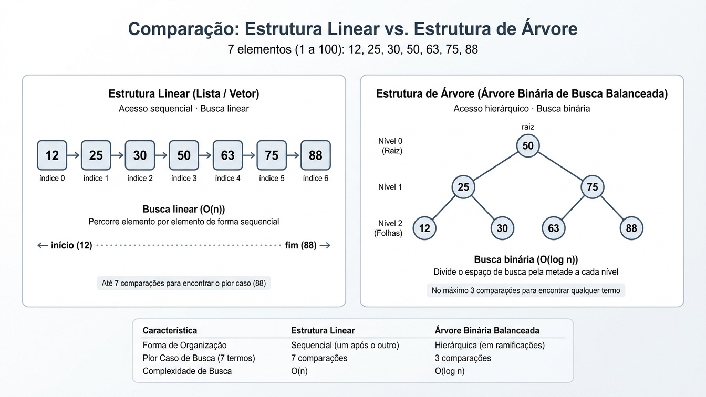
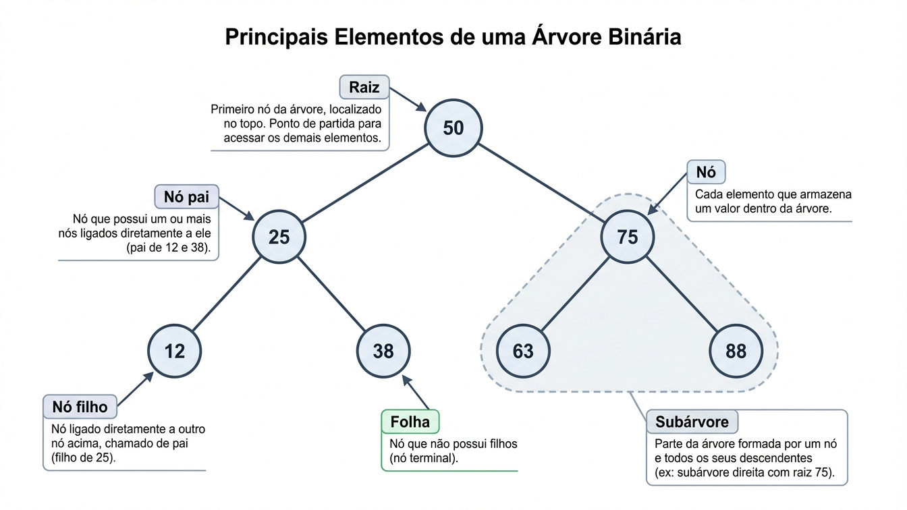
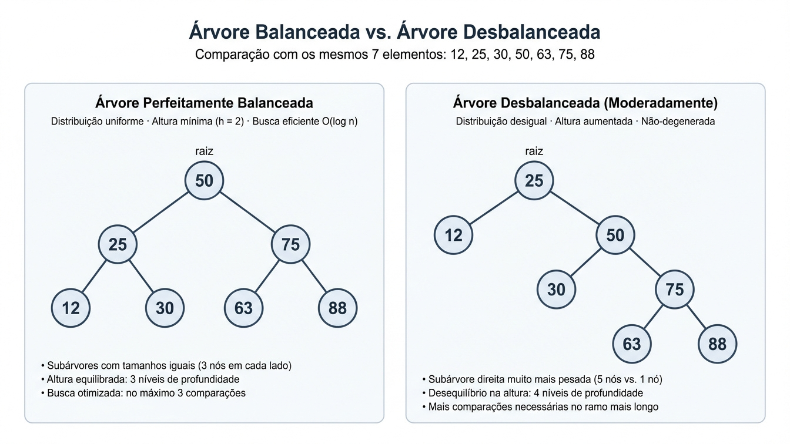

# Árvores Binárias

## Objetivos de aprendizagem

Ao final deste conteúdo, você deverá ser capaz de:

-   Entender o conceito de árvore binária e sua finalidade nas
    estruturas de dados.
-   Identificar os elementos de uma árvore: raiz, nós, arestas, folhas e
    subárvores.
-   Compreender as propriedades e regras de uma árvore binária.
-   Compreender os conceitos de altura, profundidade e nível.
-   Entender os diferentes tipos de percursos em árvores: pré-ordem, em
    ordem (in-order), pós-ordem e em largura.
-   Compreender o funcionamento e as propriedades de uma árvore binária
    de busca (BST).
-   Entender como funcionam as operações de busca, inserção e remoção de
    elementos.

------------------------------------------------------------------------

## 1. Introdução às árvores binárias

### O que são estruturas de dados não lineares?

Estruturas de dados não lineares são aquelas em que os elementos não
precisam seguir uma sequência única. Em vez disso, podem se relacionar e
se ramificar, formando estruturas hierárquicas.

Diferentemente de listas, filas e pilhas, nas quais os elementos são
organizados linearmente, estruturas não lineares permitem diferentes
caminhos de conexão entre os elementos.

### O que é uma árvore binária?

Uma árvore binária é uma estrutura de dados não linear utilizada para
organizar informações de maneira hierárquica.

Sua principal característica é que cada elemento, chamado de nó, pode
possuir no máximo dois filhos: um à esquerda e outro à direita.

Essa organização permite criar ramificações e estabelecer relações entre
os elementos.{align=center width=100%}

### Para que servem e onde são utilizadas?

As árvores binárias são utilizadas principalmente para organizar,
armazenar e pesquisar informações de maneira eficiente.

Algumas de suas aplicações incluem:

-   **Sistemas de busca:** organização de informações para facilitar
    pesquisas.
-   **Bancos de dados:** estruturas auxiliares para organização e
    localização de registros.
-   **Expressões matemáticas:** representação de operações e expressões.
-   **Inteligência artificial:** representação de decisões e
    possibilidades.

### Vantagens em relação às estruturas lineares

Uma das principais vantagens das árvores binárias é a possibilidade de
organizar informações de maneira hierárquica, permitindo pesquisas mais
eficientes em determinadas situações.

Enquanto uma lista não ordenada pode exigir a verificação de vários
elementos até encontrar um valor, uma árvore binária de busca balanceada
consegue reduzir significativamente essa quantidade de verificações.

**Importante:** árvores binárias não são necessariamente mais rápidas em
todas as operações. Sua eficiência depende da organização e do
balanceamento da estrutura.
{align=center width=100%}

------------------------------------------------------------------------

## 2. Conceitos e elementos de uma árvore

Uma árvore binária é formada por elementos chamados **nós**, que se
conectam entre si por meio de ligações. Cada elemento possui uma função
dentro da estrutura.

### Principais elementos

-   **Raiz:** é o primeiro nó da árvore, localizado no topo. É o ponto
    de partida para acessar os demais elementos.
-   **Nó:** cada elemento que armazena um valor dentro da árvore.
-   **Nó pai:** nó que possui um ou mais nós ligados diretamente a ele.
-   **Nó filho:** nó que está ligado diretamente a outro nó, chamado de
    pai.
-   **Folha:** nó que não possui filhos.
-   **Subárvore:** parte da árvore formada por um nó e seus
    descendentes.

### Relação entre os nós

Em uma árvore binária, cada nó pode possuir até dois filhos:

-   **Filho esquerdo:** nó conectado pelo lado esquerdo.
-   **Filho direito:** nó conectado pelo lado direito.

Essas relações permitem organizar os elementos em diferentes caminhos,
formando a estrutura hierárquica da árvore.
{align=center width=100%}

### Estrutura e funcionamento

A estrutura de uma árvore binária começa pela raiz e se ramifica por
meio de nós filhos, formando diferentes caminhos.

É importante entender que nem toda árvore binária segue uma regra
específica para organizar seus valores.

Na **árvore binária comum**, os valores podem ser distribuídos sem uma
ordem obrigatória.

Já na **árvore binária de busca (BST)**, existe uma regra:

-   Valores menores ficam à esquerda.
-   Valores maiores ficam à direita.

Essa organização permite realizar buscas seguindo um caminho pela
árvore, sem precisar verificar todos os nós.

------------------------------------------------------------------------

## 3. Balanceamento de árvore

Uma árvore binária pode ou não estar balanceada. Uma árvore
desbalanceada ocorre quando seus nós ficam distribuídos de maneira
irregular, fazendo com que um dos lados tenha muito mais níveis que o
outro.

Isso pode fazer com que a árvore fique parecida com uma lista,
prejudicando o desempenho das operações de busca. Por isso, é preciso
balancear a árvore para evitar esse prejuízo.

Uma árvore binária é considerada **balanceada em altura** quando, para
todo nó da árvore, a diferença entre a altura da sua subárvore esquerda
e a altura da sua subárvore direita é, no máximo, 1.

### Como identificar se uma árvore é balanceada?

Para identificar se uma árvore está balanceada, é necessário comparar a
altura das subárvores esquerda e direita de cada nó:

1.  Identifique um nó da árvore.
2.  Conte a altura da subárvore esquerda e da direita.
3.  Calcule a diferença entre essas alturas.
4.  Repita a verificação para os demais nós.

No critério de balanceamento de uma árvore AVL, a diferença pode ser de,
no máximo, 1 nível. Essa verificação deve ser feita em todos os nós, não
apenas na raiz.

### Impacto no desempenho

-   **Árvore balanceada:** permite buscas mais rápidas, em
    (O(`\log `{=tex}n)).
-   **Árvore desbalanceada:** pode exigir que vários nós sejam
    percorridos, chegando até (O(n)).

Portanto, quanto mais desbalanceada estiver uma árvore, maior poderá ser
o tempo necessário para encontrar um elemento.
{align=center width=100%}

------------------------------------------------------------------------

## 4. Níveis, profundidade e altura

Esses conceitos são utilizados para identificar a posição dos nós e o
tamanho de uma árvore binária.

### Níveis

O nível indica a posição de um nó na árvore, começando pela raiz:

-   **Nível 0:** raiz da árvore.
-   **Nível 1:** nós ligados diretamente à raiz.
-   **Nível 2:** nós que estão no nível seguinte.
-   Os níveis continuam aumentando conforme a distância da raiz.

### Profundidade

A profundidade representa a distância entre a raiz e um determinado nó,
medida pelo número de arestas percorridas.

Por exemplo, a raiz possui profundidade 0, e seus filhos possuem
profundidade 1.

### Altura

A altura representa a maior distância entre um nó e uma folha abaixo
dele, também medida pelo número de arestas.

-   A altura de uma folha é 0.
-   A altura de um nó aumenta conforme seus descendentes estão mais
    distantes.
-   A altura da árvore é a altura da raiz.

**Diferença principal:** o nível e a profundidade indicam a posição de
um nó a partir da raiz, enquanto a altura indica a distância até a folha
mais distante.

------------------------------------------------------------------------

## 5. Percursos em árvores binárias

Os percursos são formas de visitar todos os nós de uma árvore, seguindo
uma ordem específica. Existem quatro tipos principais:

### 1. Pré-ordem (Pre-order)

Segue a ordem:

1.  Visita a raiz.
2.  Percorre a subárvore esquerda.
3.  Percorre a subárvore direita.

### 2. Em ordem (In-order)

Segue a ordem:

1.  Percorre a subárvore esquerda.
2.  Visita a raiz.
3.  Percorre a subárvore direita.

Em uma árvore binária de busca (BST), esse percurso apresenta os valores
em ordem crescente.

### 3. Pós-ordem (Post-order)

Segue a ordem:

1.  Percorre a subárvore esquerda.
2.  Percorre a subárvore direita.
3.  Visita a raiz.

### 4. Em largura (Breadth-first)

Visita os nós nível por nível, começando pela raiz e seguindo da
esquerda para a direita.

### Resumo dos percursos

  Percurso     Ordem de visita
  ------------ ---------------------------
  Pré-ordem    Raiz → Esquerda → Direita
  Em ordem     Esquerda → Raiz → Direita
  Pós-ordem    Esquerda → Direita → Raiz
  Em largura   Nível por nível

**Importante:** os três primeiros percorrem a árvore em profundidade,
enquanto o percurso em largura visita os nós por nível.

------------------------------------------------------------------------

## 6. Busca de elementos

A busca consiste em localizar um determinado valor dentro de uma árvore
binária. O funcionamento depende do tipo de árvore utilizada.

### Busca em uma árvore binária de busca (BST)

Na BST, a busca utiliza a organização dos valores para encontrar o
elemento:

1.  Começa pela raiz.
2.  Compara o valor procurado com o valor do nó atual.
3.  Se for igual, o elemento foi encontrado.
4.  Se for menor, segue para a esquerda.
5.  Se for maior, segue para a direita.
6.  Repete o processo até encontrar o valor ou chegar a uma posição
    vazia.

### Desempenho da busca

O tempo necessário depende do balanceamento da árvore:

-   **Balanceada:** busca em (O(`\log `{=tex}n)), geralmente mais
    rápida.
-   **Desbalanceada:** pode chegar a (O(n)), exigindo a verificação de
    muitos nós.

Essa eficiência depende da regra de ordenação da BST. Uma árvore binária
comum, sem ordenação, pode exigir uma busca por vários nós até encontrar
o elemento.

------------------------------------------------------------------------

## 7. Inserção de elementos

A inserção consiste em adicionar um novo valor à árvore binária,
respeitando as regras de organização utilizadas. Em uma árvore binária
de busca (BST), cada novo elemento é posicionado de acordo com seu valor
em relação aos nós existentes.

### Como funciona a inserção?

1.  **Verificar a árvore:** se estiver vazia, o novo elemento será a
    raiz.
2.  **Começar pela raiz:** caso já existam elementos, a comparação
    começa pelo nó raiz.
3.  **Comparar os valores:** se o novo valor for menor, segue para a
    esquerda; se for maior, segue para a direita.
4.  **Encontrar uma posição:** o processo continua até encontrar uma
    posição vazia.
5.  **Inserir o elemento:** o novo valor é colocado nessa posição.

### Exemplo

Considere uma árvore inicialmente vazia e a inserção dos valores 50, 25,
75 e 30:

-   50 se torna a raiz.
-   25 é inserido à esquerda de 50.
-   75 é inserido à direita de 50.
-   30 é inserido à direita de 25.

A posição de cada elemento depende dos valores que já estão presentes na
árvore e da ordem em que são inseridos.

### Impacto na estrutura

A ordem em que os elementos são inseridos pode alterar o formato da
árvore. Inserções em uma sequência desfavorável podem gerar uma árvore
desbalanceada, prejudicando o desempenho das buscas.

------------------------------------------------------------------------

## 8. Remoção de elementos

A remoção consiste em retirar um valor de uma árvore binária de busca
(BST), mantendo a organização dos elementos restantes.

Existem três situações principais:

### 1. Remover um nó folha

Quando o nó não possui filhos, basta removê-lo da árvore.

### 2. Remover um nó com um filho

O filho ocupa o lugar do nó removido, mantendo a ligação com o restante
da árvore.

### 3. Remover um nó com dois filhos

O nó removido é substituído por outro valor para preservar a ordenação
da árvore. Normalmente, utiliza-se:

-   **Sucessor:** menor valor da subárvore direita.
-   **Antecessor:** maior valor da subárvore esquerda.

Após a substituição, o nó utilizado também é removido de sua posição
original.

------------------------------------------------------------------------

## 9. Aplicações das árvores binárias

As árvores binárias são utilizadas em bancos de dados, sistemas de
busca, compiladores e inteligência artificial, permitindo organizar
informações, localizar dados e representar estruturas hierárquicas de
maneira eficiente.

------------------------------------------------------------------------

## Conclusão

As árvores binárias são estruturas fundamentais na organização e no
processamento de dados, permitindo realizar operações como busca,
inserção e remoção de elementos. Entretanto, seu desempenho depende
diretamente de sua organização e balanceamento.

Para solucionar esse problema, existem ferramentas de balanceamento,
como as **rotações**, que reorganizam a estrutura para melhorar sua
eficiência. Nesse contexto, destaca-se a **árvore AVL**, uma estrutura
de busca balanceada que utiliza essas rotações e serve como base para o
estudo e desenvolvimento de outras árvores balanceadas.
