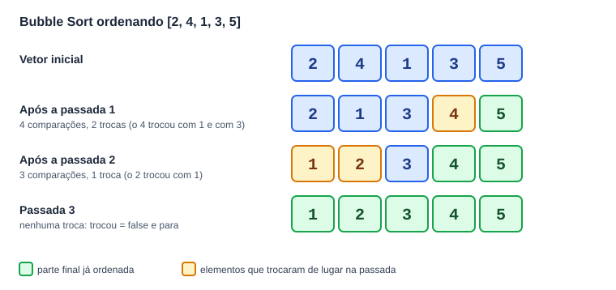

## Objetivos de aprendizagem

Ao final deste tópico, você deverá ser capaz de:

- Explicar a ideia do Bubble Sort: comparar elementos vizinhos e trocá-los quando estão fora de ordem.
- Executar o algoritmo passada a passada e identificar a parte final do vetor, que já está ordenada.
- Explicar o papel da variável `trocou` e quando ela permite encerrar o algoritmo mais cedo.
- Analisar o custo nos casos melhor, médio e pior, a estabilidade e o uso de memória.
- Comparar o Bubble Sort com o Insertion Sort e o Selection Sort.

## 1. Conexão com a Trilha: Onde Estamos?

Nos módulos anteriores desta trilha, construímos as duas bases conceituais que justificam e guiam o estudo dos algoritmos de ordenação:

- Em **Busca Sequencial e Busca Binária**, vimos que recuperar dados em vetores desordenados exige percorrer elemento a elemento em custo linear $O(n)$, mas que **manter a coleção ordenada** desbloqueia a **Busca Binária**, reduzindo consultas de milhões de comparações para no máximo $\lfloor \log_2 n \rfloor + 1$ passos ($O(\log n)$).
- Em **Eficiência e Estabilidade na Ordenação**, estabelecemos as lentes técnicas usadas para julgar qualquer algoritmo de ordenação: o equilíbrio entre **comparações de chaves**, **movimentações de registros**, consumo de memória auxiliar (**ordenação *in-place*** em $O(1)$) e **estabilidade** (preservar a ordem relativa original de elementos empatados).

Agora surge a pergunta central deste módulo:

> **Como transformar uma coleção desordenada em uma sequência ordenada usando a estratégia mais simples possível — comparando apenas elementos vizinhos — e qual é o preço em comparações e trocas dessa simplicidade?**

A resposta começa aqui, no primeiro degrau dos **métodos elementares de ordenação ($O(n^2)$)**: o **Bubble Sort**, que resolve o problema por meio de trocas adjacentes, serve como linha de base (*baseline*) para medir eficiência e já prepara o terreno para estratégias mais inteligentes que reduzem movimentações (como o **Selection Sort** e o **Insertion Sort**).

## 2. Introdução

**Ordenar** um vetor é reorganizar seus elementos segundo uma relação de ordem, por exemplo do menor para o maior. A ordenação é uma tarefa tão comum que serve de base para outras: com o vetor ordenado, a busca binária encontra um elemento com O(log *n*) comparações, em vez das O(*n*) da busca sequencial.

Os algoritmos de ordenação mais simples usam dois laços aninhados e têm custo quadrático. O **Bubble Sort** (ordenação por bolhas) é o mais intuitivo deles: percorre o vetor várias vezes, compara elementos vizinhos e troca os que estão fora de ordem. A cada passada, o maior elemento que ainda não está no lugar "sobe", como uma bolha, até o fim do vetor.

## 3. Conceito principal

Neste tópico, ordenamos vetores de números inteiros em ordem crescente. O Bubble Sort funciona assim:

- uma **passada** percorre o vetor comparando cada elemento `V[j]` com o seguinte, `V[j + 1]`. Se `V[j] > V[j + 1]`, os dois trocam de lugar;
- ao fim da primeira passada, o maior elemento do vetor está na última posição. Ao fim da passada *i* + 1 (contando *i* de 0), os *i* + 1 maiores elementos já estão no fim, em suas **posições definitivas**;
- por isso cada passada pode parar uma posição antes da anterior: ela compara só até `V[n - 1 - i]`;
- o vetor fica ordenado em, no máximo, *n* − 1 passadas;
- se uma passada **não faz nenhuma troca**, todos os pares vizinhos já estão em ordem e o vetor está ordenado: o algoritmo pode parar.

> O nome vem da imagem das bolhas: elementos grandes sobem rápido, pois uma única passada pode levar o maior elemento do começo ao fim. Já um elemento pequeno que está no fim do vetor anda **só uma posição por passada** em direção ao começo. Esses elementos pequenos são chamados de "tartarugas" e são o principal motivo da lentidão do algoritmo.

### 3.1 Exemplo de execução

Considere o vetor `[2, 4, 1, 3, 5]`.

{align=center width=100%}

Observe:

- Na **passada 1**, o 4 troca com o 1 e depois com o 3, "borbulhando" até a posição 3. O 5 já estava no fim, então a passada termina sem mexer nele.
- O 1 é uma "tartaruga": na passada 1 ele sobe só de `V[2]` para `V[1]`, e na passada 2 de `V[1]` para `V[0]`.
- Na **passada 3** nenhuma troca acontece. Como `trocou` continua `false`, o algoritmo para sem executar a passada 4, que seria desnecessária.

### 3.2 Por que parar quando não há trocas?

Se uma passada compara todos os pares vizinhos e não troca nenhum, então `V[0] <= V[1] <= ...`, ou seja, o vetor já está ordenado. Sem essa verificação, o algoritmo sempre faz *n*(*n* − 1)/2 comparações, mesmo para um vetor que já chegou ordenado. Com ela, um vetor ordenado custa uma única passada, com *n* − 1 comparações.

## 4. Representação em C

A função `trocar` inverte dois elementos usando ponteiros, e `bubble_sort` ordena o vetor `V` de tamanho `n`.

```c
#include <stdio.h>
#include <stdbool.h>

void trocar(int *a, int *b) {
    int temp = *a;
    *a = *b;
    *b = temp;
}

void bubble_sort(int V[], int n) {
    for (int i = 0; i < n - 1; i++) {
        bool trocou = false;
        for (int j = 0; j < n - 1 - i; j++) {
            if (V[j] > V[j + 1]) {
                trocar(&V[j], &V[j + 1]);
                trocou = true;
            }
        }
        if (!trocou) break;
    }
}
```

- O laço externo controla as passadas. Com `i` passadas já feitas, os `i` últimos elementos estão no lugar.
- O laço interno vai de `j = 0` até `j < n - 1 - i`, comparando `V[j]` com `V[j + 1]`. O limite diminui a cada passada porque a parte final já está ordenada.
- `trocou` começa `false` em cada passada e vira `true` na primeira troca. Se continuar `false` até o fim da passada, o `break` encerra o algoritmo.
- O teste usa `>` (e não `>=`), então elementos iguais nunca são trocados: isso torna o algoritmo **estável**.

> Exemplo de limite do laço interno: com `n = 5` e `i = 2`, o laço vai de `j = 0` até `j < 5 - 1 - 2 = 2`. Ele compara só `V[0]` com `V[1]` e `V[1]` com `V[2]`; as posições 3 e 4 já estão ordenadas.

Nos programas abaixo, clique em **Executar** e acompanhe a linha destacada no código. A tela mostra o vetor como uma linha de caixas: os elementos em destaque são os que estão sendo comparados ou trocados naquele passo, e os valores das variáveis são exibidos a cada passo.

## 5. Operações

### 5.1 Ordenação passo a passo

O programa abaixo ordena `[2, 4, 1, 3, 5]`. Repare em três momentos: o 4 "borbulhando" na passada 1, o 1 subindo uma posição por passada e o `break` na passada 3, quando nenhuma troca acontece.

```codigo
{"title":"Ordenando [2, 4, 1, 3, 5] com Bubble Sort","cols":5,"code":"#include <stdio.h>\n#include <stdbool.h>\n\nvoid trocar(int *a, int *b) {\n    int temp = *a;\n    *a = *b;\n    *b = temp;\n}\n\nvoid bubble_sort(int V[], int n) {\n    for (int i = 0; i < n - 1; i++) {\n        bool trocou = false;\n        for (int j = 0; j < n - 1 - i; j++) {\n            if (V[j] > V[j + 1]) {\n                trocar(&V[j], &V[j + 1]);\n                trocou = true;\n            }\n        }\n        if (!trocou) break;\n    }\n}\n\nint main(void) {\n    int V[] = {2, 4, 1, 3, 5};\n    int n = 5;\n    bubble_sort(V, n);\n    return 0;\n}","steps":[{"line":25,"caption":"Vetor inicial com 5 elementos. Vamos ordená-lo em ordem crescente com o Bubble Sort otimizado.","vars":{"n":5},"rows":[[{"s":0,"n":5,"i":[["2","",0],["4","",1],["1","",2],["3","",3],["5","",4]],"l":"vetor V"}]],"stack":"main"},{"line":12,"caption":"Passada 1: comparamos pares vizinhos de V[0] até V[4].","vars":{"i":0,"trocou":"false"},"rows":[[{"s":0,"n":5,"i":[["2","",0],["4","",1],["1","",2],["3","",3],["5","",4]],"l":"vetor V"}]],"stack":"bubble_sort ← main"},{"line":14,"caption":"Comparamos V[0] = 2 com V[1] = 4: 2 não é maior que 4, então já estão em ordem e nada muda.","vars":{"i":0,"j":0,"trocou":"false"},"rows":[[{"s":0,"n":5,"i":[["2","c",0],["4","c",1],["1","",2],["3","",3],["5","",4]],"l":"vetor V"}]],"stack":"bubble_sort ← main"},{"line":14,"caption":"Comparamos V[1] = 4 com V[2] = 1: 4 é maior que 1, então os dois estão fora de ordem e serão trocados.","vars":{"i":0,"j":1,"trocou":"false"},"rows":[[{"s":0,"n":5,"i":[["2","",0],["4","c",1],["1","c",2],["3","",3],["5","",4]],"l":"vetor V"}]],"stack":"bubble_sort ← main"},{"line":15,"caption":"trocar() inverteu os dois elementos: agora V[1] = 1 e V[2] = 4. Logo em seguida, trocou passa a valer true.","vars":{"i":0,"j":1,"trocou":"false"},"rows":[[{"s":0,"n":5,"i":[["2","",0],["1","p",2],["4","p",1],["3","",3],["5","",4]],"l":"vetor V"}]],"stack":"bubble_sort ← main"},{"line":14,"caption":"Comparamos V[2] = 4 com V[3] = 3: 4 é maior que 3, então os dois estão fora de ordem e serão trocados.","vars":{"i":0,"j":2,"trocou":"true"},"rows":[[{"s":0,"n":5,"i":[["2","",0],["1","",2],["4","c",1],["3","c",3],["5","",4]],"l":"vetor V"}]],"stack":"bubble_sort ← main"},{"line":15,"caption":"trocar() inverteu os dois elementos: agora V[2] = 3 e V[3] = 4. Logo em seguida, trocou passa a valer true.","vars":{"i":0,"j":2,"trocou":"true"},"rows":[[{"s":0,"n":5,"i":[["2","",0],["1","",2],["3","p",3],["4","p",1],["5","",4]],"l":"vetor V"}]],"stack":"bubble_sort ← main"},{"line":14,"caption":"Comparamos V[3] = 4 com V[4] = 5: 4 não é maior que 5, então já estão em ordem e nada muda.","vars":{"i":0,"j":3,"trocou":"true"},"rows":[[{"s":0,"n":5,"i":[["2","",0],["1","",2],["3","",3],["4","c",1],["5","c",4]],"l":"vetor V"}]],"stack":"bubble_sort ← main"},{"line":19,"caption":"Fim da passada 1: o maior elemento restante, 5, chegou à posição 4. Como houve trocas (trocou = true), seguimos para a próxima passada.","vars":{"i":0,"trocou":"true"},"rows":[[{"s":0,"n":5,"i":[["2","",0],["1","",2],["3","",3],["4","",1],["5","",4]],"l":"vetor V"}],[{"s":4,"n":1,"i":[["5","",4]],"l":"parte final já ordenada"}]],"stack":"bubble_sort ← main"},{"line":12,"caption":"Passada 2: comparamos pares vizinhos de V[0] até V[3]. Os 1 maiores elementos já estão no fim, em suas posições definitivas.","vars":{"i":1,"trocou":"false"},"rows":[[{"s":0,"n":5,"i":[["2","",0],["1","",2],["3","",3],["4","",1],["5","",4]],"l":"vetor V"}],[{"s":4,"n":1,"i":[["5","",4]],"l":"parte final já ordenada"}]],"stack":"bubble_sort ← main"},{"line":14,"caption":"Comparamos V[0] = 2 com V[1] = 1: 2 é maior que 1, então os dois estão fora de ordem e serão trocados.","vars":{"i":1,"j":0,"trocou":"false"},"rows":[[{"s":0,"n":5,"i":[["2","c",0],["1","c",2],["3","",3],["4","",1],["5","",4]],"l":"vetor V"}],[{"s":4,"n":1,"i":[["5","",4]],"l":"parte final já ordenada"}]],"stack":"bubble_sort ← main"},{"line":15,"caption":"trocar() inverteu os dois elementos: agora V[0] = 1 e V[1] = 2. Logo em seguida, trocou passa a valer true.","vars":{"i":1,"j":0,"trocou":"false"},"rows":[[{"s":0,"n":5,"i":[["1","p",2],["2","p",0],["3","",3],["4","",1],["5","",4]],"l":"vetor V"}],[{"s":4,"n":1,"i":[["5","",4]],"l":"parte final já ordenada"}]],"stack":"bubble_sort ← main"},{"line":14,"caption":"Comparamos V[1] = 2 com V[2] = 3: 2 não é maior que 3, então já estão em ordem e nada muda.","vars":{"i":1,"j":1,"trocou":"true"},"rows":[[{"s":0,"n":5,"i":[["1","",2],["2","c",0],["3","c",3],["4","",1],["5","",4]],"l":"vetor V"}],[{"s":4,"n":1,"i":[["5","",4]],"l":"parte final já ordenada"}]],"stack":"bubble_sort ← main"},{"line":14,"caption":"Comparamos V[2] = 3 com V[3] = 4: 3 não é maior que 4, então já estão em ordem e nada muda.","vars":{"i":1,"j":2,"trocou":"true"},"rows":[[{"s":0,"n":5,"i":[["1","",2],["2","",0],["3","c",3],["4","c",1],["5","",4]],"l":"vetor V"}],[{"s":4,"n":1,"i":[["5","",4]],"l":"parte final já ordenada"}]],"stack":"bubble_sort ← main"},{"line":19,"caption":"Fim da passada 2: o maior elemento restante, 4, chegou à posição 3. Como houve trocas (trocou = true), seguimos para a próxima passada.","vars":{"i":1,"trocou":"true"},"rows":[[{"s":0,"n":5,"i":[["1","",2],["2","",0],["3","",3],["4","",1],["5","",4]],"l":"vetor V"}],[{"s":3,"n":2,"i":[["4","",1],["5","",4]],"l":"parte final já ordenada"}]],"stack":"bubble_sort ← main"},{"line":12,"caption":"Passada 3: comparamos pares vizinhos de V[0] até V[2]. Os 2 maiores elementos já estão no fim, em suas posições definitivas.","vars":{"i":2,"trocou":"false"},"rows":[[{"s":0,"n":5,"i":[["1","",2],["2","",0],["3","",3],["4","",1],["5","",4]],"l":"vetor V"}],[{"s":3,"n":2,"i":[["4","",1],["5","",4]],"l":"parte final já ordenada"}]],"stack":"bubble_sort ← main"},{"line":14,"caption":"Comparamos V[0] = 1 com V[1] = 2: 1 não é maior que 2, então já estão em ordem e nada muda.","vars":{"i":2,"j":0,"trocou":"false"},"rows":[[{"s":0,"n":5,"i":[["1","c",2],["2","c",0],["3","",3],["4","",1],["5","",4]],"l":"vetor V"}],[{"s":3,"n":2,"i":[["4","",1],["5","",4]],"l":"parte final já ordenada"}]],"stack":"bubble_sort ← main"},{"line":14,"caption":"Comparamos V[1] = 2 com V[2] = 3: 2 não é maior que 3, então já estão em ordem e nada muda.","vars":{"i":2,"j":1,"trocou":"false"},"rows":[[{"s":0,"n":5,"i":[["1","",2],["2","c",0],["3","c",3],["4","",1],["5","",4]],"l":"vetor V"}],[{"s":3,"n":2,"i":[["4","",1],["5","",4]],"l":"parte final já ordenada"}]],"stack":"bubble_sort ← main"},{"line":19,"caption":"Fim da passada 3: nenhuma troca aconteceu (trocou = false). Todos os pares vizinhos estão em ordem, então o vetor já está ordenado e o break encerra o algoritmo.","vars":{"i":2,"trocou":"false"},"rows":[[{"s":0,"n":5,"i":[["1","",2],["2","",0],["3","",3],["4","",1],["5","",4]],"l":"vetor V"}],[{"s":0,"n":5,"i":[["1","",2],["2","",0],["3","",3],["4","",1],["5","",4]],"l":"vetor já ordenado"}]],"stack":"bubble_sort ← main"},{"line":27,"caption":"Vetor ordenado: [1, 2, 3, 4, 5]. Foram 9 comparações e 3 trocas.","vars":{},"rows":[[{"s":0,"n":5,"i":[["1","",2],["2","",0],["3","",3],["4","",1],["5","",4]],"l":"vetor V (ordenado)"}]],"stack":"main"}]}
```

### 5.2 Melhor caso: vetor já ordenado

Quando o vetor já está ordenado, a primeira passada compara os *n* − 1 pares, não troca nenhum e `trocou` continua `false`: o algoritmo termina logo depois, com custo O(*n*).

```codigo
{"title":"Bubble Sort em um vetor já ordenado","cols":5,"code":"#include <stdio.h>\n#include <stdbool.h>\n\nvoid trocar(int *a, int *b) {\n    int temp = *a;\n    *a = *b;\n    *b = temp;\n}\n\nvoid bubble_sort(int V[], int n) {\n    for (int i = 0; i < n - 1; i++) {\n        bool trocou = false;\n        for (int j = 0; j < n - 1 - i; j++) {\n            if (V[j] > V[j + 1]) {\n                trocar(&V[j], &V[j + 1]);\n                trocou = true;\n            }\n        }\n        if (!trocou) break;\n    }\n}\n\nint main(void) {\n    int V[] = {1, 2, 3, 4, 5};\n    int n = 5;\n    bubble_sort(V, n);\n    return 0;\n}","steps":[{"line":25,"caption":"Vetor inicial com 5 elementos. Vamos ordená-lo em ordem crescente com o Bubble Sort otimizado.","vars":{"n":5},"rows":[[{"s":0,"n":5,"i":[["1","",0],["2","",1],["3","",2],["4","",3],["5","",4]],"l":"vetor V"}]],"stack":"main"},{"line":12,"caption":"Passada 1: comparamos pares vizinhos de V[0] até V[4].","vars":{"i":0,"trocou":"false"},"rows":[[{"s":0,"n":5,"i":[["1","",0],["2","",1],["3","",2],["4","",3],["5","",4]],"l":"vetor V"}]],"stack":"bubble_sort ← main"},{"line":14,"caption":"Comparamos V[0] = 1 com V[1] = 2: 1 não é maior que 2, então já estão em ordem e nada muda.","vars":{"i":0,"j":0,"trocou":"false"},"rows":[[{"s":0,"n":5,"i":[["1","c",0],["2","c",1],["3","",2],["4","",3],["5","",4]],"l":"vetor V"}]],"stack":"bubble_sort ← main"},{"line":14,"caption":"Comparamos V[1] = 2 com V[2] = 3: 2 não é maior que 3, então já estão em ordem e nada muda.","vars":{"i":0,"j":1,"trocou":"false"},"rows":[[{"s":0,"n":5,"i":[["1","",0],["2","c",1],["3","c",2],["4","",3],["5","",4]],"l":"vetor V"}]],"stack":"bubble_sort ← main"},{"line":14,"caption":"Comparamos V[2] = 3 com V[3] = 4: 3 não é maior que 4, então já estão em ordem e nada muda.","vars":{"i":0,"j":2,"trocou":"false"},"rows":[[{"s":0,"n":5,"i":[["1","",0],["2","",1],["3","c",2],["4","c",3],["5","",4]],"l":"vetor V"}]],"stack":"bubble_sort ← main"},{"line":14,"caption":"Comparamos V[3] = 4 com V[4] = 5: 4 não é maior que 5, então já estão em ordem e nada muda.","vars":{"i":0,"j":3,"trocou":"false"},"rows":[[{"s":0,"n":5,"i":[["1","",0],["2","",1],["3","",2],["4","c",3],["5","c",4]],"l":"vetor V"}]],"stack":"bubble_sort ← main"},{"line":19,"caption":"Fim da passada 1: nenhuma troca aconteceu (trocou = false). Todos os pares vizinhos estão em ordem, então o vetor já está ordenado e o break encerra o algoritmo.","vars":{"i":0,"trocou":"false"},"rows":[[{"s":0,"n":5,"i":[["1","",0],["2","",1],["3","",2],["4","",3],["5","",4]],"l":"vetor V"}],[{"s":0,"n":5,"i":[["1","",0],["2","",1],["3","",2],["4","",3],["5","",4]],"l":"vetor já ordenado"}]],"stack":"bubble_sort ← main"},{"line":27,"caption":"Vetor ordenado: [1, 2, 3, 4, 5]. Foram 4 comparações e 0 trocas.","vars":{},"rows":[[{"s":0,"n":5,"i":[["1","",0],["2","",1],["3","",2],["4","",3],["5","",4]],"l":"vetor V (ordenado)"}]],"stack":"main"}]}
```

## 6. Análise de complexidade

Sejam *n* o número de elementos do vetor.

| Caso | Comparações | Trocas | Tempo |
|:--|:--|:--|:--|
| Melhor (vetor ordenado, com `trocou`) | *n* − 1 | 0 | O(*n*) |
| Médio (ordem aleatória) | O(*n*²) | cerca de *n*(*n* − 1)/4 | O(*n*²) |
| Pior (ordem decrescente) | *n*(*n* − 1)/2 | *n*(*n* − 1)/2 | O(*n*²) |

- O número de trocas é exatamente o número de **inversões** do vetor, isto é, de pares fora de ordem: cada troca de vizinhos desfaz uma inversão.
- Sem a variável `trocou`, o algoritmo sempre faz *n*(*n* − 1)/2 comparações, mesmo no melhor caso.

| Propriedade | Bubble Sort |
|:--|:--|
| Espaço extra | O(1): ordena no próprio vetor (*in place*) |
| Estável | Sim |
| Adaptativo | Sim, com `trocou` (vetores quase ordenados custam menos) |

## 7. Comparação com outros algoritmos

| Algoritmo | Melhor caso | Pior caso | Trocas ou movimentos no pior caso | Estável | Espaço extra |
|:--|:--|:--|:--|:--|:--|
| Bubble Sort | O(*n*) | O(*n*²) | O(*n*²) trocas | Sim | O(1) |
| Insertion Sort | O(*n*) | O(*n*²) | O(*n*²) deslocamentos | Sim | O(1) |
| Selection Sort | O(*n*²) | O(*n*²) | no máximo *n* − 1 trocas | Não | O(1) |
| Heap Sort | O(*n* log *n*) | O(*n* log *n*) | O(*n* log *n*) | Não | O(1) |
| Merge Sort | O(*n* log *n*) | O(*n* log *n*) | O(*n* log *n*) | Sim | O(*n*) |

Entre os três algoritmos simples, o Bubble Sort costuma ser o mais lento na prática, porque faz muitas trocas (cada uma custa três atribuições) e move os elementos pequenos uma posição por passada.

## 8. Aplicações

Em programas reais, o Bubble Sort quase não é usado: algoritmos O(*n* log *n*) são preferidos. Ele ainda aparece em alguns contextos:

- **Ensino**: é o algoritmo de ordenação mais fácil de visualizar e de provar correto.
- **Vetores muito pequenos**, em que a simplicidade pesa mais que o custo.
- **Verificar se um vetor está ordenado**: uma passada sem trocas responde isso em O(*n*).
- **Vetores quase ordenados**, na versão com `trocou`, principalmente se os elementos fora do lugar forem grandes (as "lebres").
- **Variantes** que tentam corrigir o problema das tartarugas, como o *Cocktail Shaker Sort*, que alterna passadas nos dois sentidos, e o *Comb Sort*, que compara elementos distantes.

## 9. Teste de conhecimento

```quiz
{
  "question": "Ao final da primeira passada completa do Bubble Sort (ordem crescente), o que se pode garantir?",
  "options": [
    { "text": "O menor elemento do vetor está na primeira posição.", "correct": false },
    { "text": "O maior elemento do vetor está na última posição.", "correct": true },
    { "text": "O vetor inteiro está ordenado.", "correct": false },
    { "text": "Todos os elementos trocaram de posição pelo menos uma vez.", "correct": false }
  ],
  "correctFeedback": "Correto! O maior elemento \"borbulha\" até o fim: assim que ele é comparado, vai sendo trocado com cada vizinho menor até chegar à última posição.",
  "incorrectFeedback": "Pense no que acontece com o maior elemento quando ele é comparado com o vizinho da direita."
}
```

```quiz
{
  "question": "Qual é o vetor depois da primeira passada do Bubble Sort sobre [4, 1, 3, 2]?",
  "options": [
    { "text": "[1, 4, 3, 2]", "correct": false },
    { "text": "[1, 2, 3, 4]", "correct": false },
    { "text": "[1, 3, 2, 4]", "correct": true },
    { "text": "[4, 1, 3, 2]", "correct": false }
  ],
  "correctFeedback": "Correto! 4 > 1: troca, e fica [1, 4, 3, 2]. 4 > 3: troca, e fica [1, 3, 4, 2]. 4 > 2: troca, e fica [1, 3, 2, 4].",
  "incorrectFeedback": "Acompanhe os três pares vizinhos, da esquerda para a direita, trocando sempre que o da esquerda for maior."
}
```

```quiz
{
  "question": "Qual é o papel da variável trocou no Bubble Sort otimizado?",
  "options": [
    { "text": "Contar quantas trocas o algoritmo fez no total.", "correct": false },
    { "text": "Guardar a posição do maior elemento da passada.", "correct": false },
    { "text": "Indicar que uma passada não fez nenhuma troca, o que significa que o vetor já está ordenado e o algoritmo pode parar.", "correct": true },
    { "text": "Impedir que elementos iguais sejam trocados.", "correct": false }
  ],
  "correctFeedback": "Correto! Se nenhum par vizinho precisou ser trocado, todos estão em ordem e o vetor está ordenado: o break evita passadas inúteis.",
  "incorrectFeedback": "Releia a seção \"Por que parar quando não há trocas?\"."
}
```
---
## 10. Ponte para o Próximo Módulo da Trilha

Neste módulo, demos o primeiro passo nos algoritmos de ordenação com o **Bubble Sort** e identificamos seu principal gargalo: mesmo sendo *in-place* e estável, ele realiza muitas trocas sucessivas (três atribuições por par invertido) e sofre com as "tartarugas" — elementos pequenos que avançam apenas uma posição por passada.

Com isso, surgem perguntas naturais que guiam a próxima etapa:

- **O que acontece se, em vez de fazer trocas vizinhas repetidas até o dado chegar ao fim, escolhermos diretamente o menor elemento restante e o colocarmos na sua posição definitiva a cada passo?**
- **Como fica o número de trocas e a estabilidade quando priorizamos posicionar cada elemento uma única vez no prefixo ordenado?**

É exatamente essa abordagem — baseada na seleção do menor elemento — que vamos explorar no próximo passo da trilha:

> **Próximo Módulo 🔜:** **Selection Sort** — ordenação por seleção direta, redução de trocas ao limite linear e o impacto de trocas distantes na estabilidade!