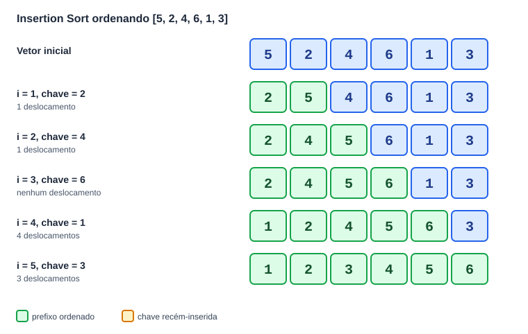

## Objetivos de aprendizagem

Ao final deste tópico, você deverá ser capaz de:

- Explicar a ideia do Insertion Sort: manter um prefixo ordenado e inserir um novo elemento nele a cada iteração.
- Executar o algoritmo passo a passo, identificando a chave, os deslocamentos e a posição de inserção.
- Explicar por que o algoritmo desloca elementos em vez de trocá-los.
- Analisar o custo nos casos melhor, médio e pior, e explicar por que ele é adaptativo e estável.
- Comparar o Insertion Sort com o Bubble Sort e o Selection Sort.

## 1. Conexão com a Trilha: Onde Estamos?

Nos módulos anteriores desta trilha, estabelecemos os critérios de análise e exploramos dois algoritmos elementares de ordenação com trade-offs opostos:

- Em **Busca Sequencial e Busca Binária** e **Eficiência e Estabilidade**, vimos o papel da ordenação nas buscas e definimos as métricas de **comparações**, **movimentações**, **memória auxiliar (*in-place*)** e **estabilidade**.
- Em **Bubble Sort** e **Selection Sort**, vimos como métodos $O(n^2)$ e *in-place* se comportam: o Bubble Sort é estável e adaptativo, mas faz muitas trocas; o Selection Sort faz no máximo $n - 1$ trocas, mas não é adaptativo nem estável.

Agora surge a pergunta central deste módulo:

> **Como combinar estabilidade, espaço extra $O(1)$ e adaptatividade em entradas quase ordenadas, substituindo trocas repetidas por deslocamentos mais enxutos?**

A resposta está em manter um **prefixo ordenado** e inserir cada nova chave na posição correta por meio de deslocamentos: o **Insertion Sort**.

## 2. Introdução

Ao ordenar cartas de baralho na mão, quase todo mundo faz o mesmo: pega uma carta de cada vez e a encaixa na posição certa entre as que já estão em ordem, empurrando as maiores um pouco para o lado. O **Insertion Sort** (ordenação por inserção) faz exatamente isso com os elementos de um vetor.

Ele é simples, não usa memória extra e é muito rápido em vetores pequenos ou quase ordenados. Por isso aparece como etapa de algoritmos de ordenação mais sofisticados.

## 3. Conceito principal

Neste tópico, ordenamos vetores de números inteiros em ordem crescente. O Insertion Sort divide o vetor em duas partes: um **prefixo ordenado** `V[0..i - 1]` e o restante, ainda desordenado. Em cada iteração *i* (de 1 até *n* − 1):

- a **chave** `V[i]` é guardada em uma variável, porque a sua posição será sobrescrita;
- os elementos do prefixo que são **maiores que a chave** são deslocados uma posição para a direita, percorrendo o prefixo da direita para a esquerda;
- quando aparece um elemento menor ou igual à chave (ou o início do vetor é alcançado), a chave é inserida na posição que ficou livre;
- depois da iteração *i*, o prefixo `V[0..i]` está ordenado.

O primeiro elemento, sozinho, já é um prefixo ordenado, por isso a primeira iteração é a de *i* = 1.

> Atenção: o prefixo está ordenado **entre si**, mas os seus elementos ainda não estão em posições definitivas. Se uma chave menor aparecer depois, os elementos maiores do prefixo serão empurrados para a direita. No Selection Sort, ao contrário, cada posição do prefixo é definitiva.

### 3.1 Exemplo de execução

Considere o vetor `[5, 2, 4, 6, 1, 3]`.

{align=center width=100%}

Observe:

- Em **i = 1**, a chave 2 desloca o 5 e entra na posição 0.
- Em **i = 3**, a chave 6 já é maior que o último elemento do prefixo (5): ela é comparada uma vez, não desloca ninguém e fica onde está.
- Em **i = 4**, a chave 1 é menor que todo o prefixo: desloca 4 elementos e entra na posição 0, quando `j` chega a −1.
- No total são 9 deslocamentos, que é o número de **inversões** do vetor (pares fora de ordem).

### 3.2 Por que deslocar em vez de trocar?

Inserir a chave por trocas sucessivas, como no Bubble Sort, custaria três atribuições por troca. O Insertion Sort guarda a chave uma vez, **desloca** cada elemento maior com uma única atribuição e escreve a chave no final. Para *k* elementos deslocados, são *k* + 2 atribuições, contra 3*k* de *k* trocas.

## 4. Representação em C

```c
#include <stdio.h>

void insertion_sort(int V[], int n) {
    for (int i = 1; i < n; i++) {
        int chave = V[i];
        int j = i - 1;
        while (j >= 0 && V[j] > chave) {
            V[j + 1] = V[j];
            j--;
        }
        V[j + 1] = chave;
    }
}
```

- `chave` guarda `V[i]` antes de o laço começar a sobrescrever as posições à sua esquerda.
- `j` começa em `i - 1`, o último elemento do prefixo ordenado, e anda para a esquerda.
- O teste `j >= 0 && V[j] > chave` verifica `j >= 0` primeiro: assim `V[j]` nunca é lido fora do vetor.
- `V[j + 1] = V[j]` desloca um elemento para a direita, e `j--` passa ao elemento seguinte.
- Ao sair do laço, `j + 1` é a posição livre: é nela que `V[j + 1] = chave` insere a chave.
- O teste usa `>` (e não `>=`): a chave para logo depois dos elementos iguais, então o algoritmo é **estável**.

Nos programas abaixo, clique em **Executar** e acompanhe a linha destacada no código. A tela mostra o vetor como uma linha de caixas, e a variável `chave` aparece acima da posição em que ela será inserida. Quando um elemento é deslocado, o valor antigo ainda aparece na posição que ficou livre, até ser sobrescrito pela chave.

## 5. Operações

### 5.1 Ordenação passo a passo

O programa abaixo ordena `[5, 2, 4, 6, 1, 3]`. Repare nos deslocamentos de cada iteração: 1, 1, 0, 4 e 3.

```codigo
{"title":"Ordenando [5, 2, 4, 6, 1, 3] com Insertion Sort","cols":6,"code":"#include <stdio.h>\n\nvoid insertion_sort(int V[], int n) {\n    for (int i = 1; i < n; i++) {\n        int chave = V[i];\n        int j = i - 1;\n        while (j >= 0 && V[j] > chave) {\n            V[j + 1] = V[j];\n            j--;\n        }\n        V[j + 1] = chave;\n    }\n}\n\nint main(void) {\n    int V[] = {5, 2, 4, 6, 1, 3};\n    int n = 6;\n    insertion_sort(V, n);\n    return 0;\n}","steps":[{"line":17,"caption":"Vetor inicial com 6 elementos. Vamos ordená-lo em ordem crescente com o Insertion Sort. O primeiro elemento, sozinho, já forma um prefixo ordenado.","vars":{"n":6},"rows":[[{"s":0,"n":6,"i":[["5","",0],["2","",1],["4","",2],["6","",3],["1","",4],["3","",5]],"l":"vetor V"}]],"stack":"main"},{"line":6,"caption":"Iteração i = 1: guardamos chave = V[1] = 2 e começamos a comparar com o elemento à esquerda (j = 0). O prefixo V[0..0] já está ordenado.","vars":{"i":1,"chave":2,"j":0},"rows":[[{"s":0,"n":6,"i":[["5","",0],["2","c",1],["4","",2],["6","",3],["1","",4],["3","",5]],"l":"vetor V"}],[{"s":1,"n":1,"i":[["2","c",1]],"l":"chave (variável)"}]],"stack":"insertion_sort ← main"},{"line":9,"caption":"V[0] = 5 é maior que a chave (2): deslocamos esse valor para V[1] e decrementamos j (agora j = -1). A posição 0 fica livre para a chave; o valor antigo ainda aparece ali, mas será sobrescrito.","vars":{"i":1,"chave":2,"j":-1},"rows":[[{"s":0,"n":6,"i":[["5","c",0],["5","p",0],["4","",2],["6","",3],["1","",4],["3","",5]],"l":"vetor V"}],[{"s":0,"n":1,"i":[["2","c",1]],"l":"chave (variável)"}]],"stack":"insertion_sort ← main"},{"line":11,"caption":"j chegou a -1: não há mais elementos à esquerda. Colocamos a chave 2 em V[0]. Agora V[0..1] está ordenado.","vars":{"i":1,"chave":2,"j":-1},"rows":[[{"s":0,"n":6,"i":[["2","p",1],["5","",0],["4","",2],["6","",3],["1","",4],["3","",5]],"l":"vetor V"}]],"stack":"insertion_sort ← main"},{"line":6,"caption":"Iteração i = 2: guardamos chave = V[2] = 4 e começamos a comparar com o elemento à esquerda (j = 1). O prefixo V[0..1] já está ordenado.","vars":{"i":2,"chave":4,"j":1},"rows":[[{"s":0,"n":6,"i":[["2","",1],["5","",0],["4","c",2],["6","",3],["1","",4],["3","",5]],"l":"vetor V"}],[{"s":2,"n":1,"i":[["4","c",2]],"l":"chave (variável)"}]],"stack":"insertion_sort ← main"},{"line":9,"caption":"V[1] = 5 é maior que a chave (4): deslocamos esse valor para V[2] e decrementamos j (agora j = 0). A posição 1 fica livre para a chave; o valor antigo ainda aparece ali, mas será sobrescrito.","vars":{"i":2,"chave":4,"j":0},"rows":[[{"s":0,"n":6,"i":[["2","",1],["5","c",0],["5","p",0],["6","",3],["1","",4],["3","",5]],"l":"vetor V"}],[{"s":1,"n":1,"i":[["4","c",2]],"l":"chave (variável)"}]],"stack":"insertion_sort ← main"},{"line":11,"caption":"V[0] = 2 não é maior que a chave (4), então o laço para. Colocamos a chave 4 em V[1]. Agora V[0..2] está ordenado.","vars":{"i":2,"chave":4,"j":0},"rows":[[{"s":0,"n":6,"i":[["2","",1],["4","p",2],["5","",0],["6","",3],["1","",4],["3","",5]],"l":"vetor V"}]],"stack":"insertion_sort ← main"},{"line":6,"caption":"Iteração i = 3: guardamos chave = V[3] = 6 e começamos a comparar com o elemento à esquerda (j = 2). O prefixo V[0..2] já está ordenado.","vars":{"i":3,"chave":6,"j":2},"rows":[[{"s":0,"n":6,"i":[["2","",1],["4","",2],["5","",0],["6","c",3],["1","",4],["3","",5]],"l":"vetor V"}],[{"s":3,"n":1,"i":[["6","c",3]],"l":"chave (variável)"}]],"stack":"insertion_sort ← main"},{"line":11,"caption":"V[2] = 5 não é maior que a chave (6), então o laço para. Colocamos a chave 6 em V[3]. Agora V[0..3] está ordenado.","vars":{"i":3,"chave":6,"j":2},"rows":[[{"s":0,"n":6,"i":[["2","",1],["4","",2],["5","",0],["6","p",3],["1","",4],["3","",5]],"l":"vetor V"}]],"stack":"insertion_sort ← main"},{"line":6,"caption":"Iteração i = 4: guardamos chave = V[4] = 1 e começamos a comparar com o elemento à esquerda (j = 3). O prefixo V[0..3] já está ordenado.","vars":{"i":4,"chave":1,"j":3},"rows":[[{"s":0,"n":6,"i":[["2","",1],["4","",2],["5","",0],["6","",3],["1","c",4],["3","",5]],"l":"vetor V"}],[{"s":4,"n":1,"i":[["1","c",4]],"l":"chave (variável)"}]],"stack":"insertion_sort ← main"},{"line":9,"caption":"V[3] = 6 é maior que a chave (1): deslocamos esse valor para V[4] e decrementamos j (agora j = 2). A posição 3 fica livre para a chave; o valor antigo ainda aparece ali, mas será sobrescrito.","vars":{"i":4,"chave":1,"j":2},"rows":[[{"s":0,"n":6,"i":[["2","",1],["4","",2],["5","",0],["6","c",3],["6","p",3],["3","",5]],"l":"vetor V"}],[{"s":3,"n":1,"i":[["1","c",4]],"l":"chave (variável)"}]],"stack":"insertion_sort ← main"},{"line":9,"caption":"V[2] = 5 é maior que a chave (1): deslocamos esse valor para V[3] e decrementamos j (agora j = 1). A posição 2 fica livre para a chave; o valor antigo ainda aparece ali, mas será sobrescrito.","vars":{"i":4,"chave":1,"j":1},"rows":[[{"s":0,"n":6,"i":[["2","",1],["4","",2],["5","c",0],["5","p",0],["6","",3],["3","",5]],"l":"vetor V"}],[{"s":2,"n":1,"i":[["1","c",4]],"l":"chave (variável)"}]],"stack":"insertion_sort ← main"},{"line":9,"caption":"V[1] = 4 é maior que a chave (1): deslocamos esse valor para V[2] e decrementamos j (agora j = 0). A posição 1 fica livre para a chave; o valor antigo ainda aparece ali, mas será sobrescrito.","vars":{"i":4,"chave":1,"j":0},"rows":[[{"s":0,"n":6,"i":[["2","",1],["4","c",2],["4","p",2],["5","",0],["6","",3],["3","",5]],"l":"vetor V"}],[{"s":1,"n":1,"i":[["1","c",4]],"l":"chave (variável)"}]],"stack":"insertion_sort ← main"},{"line":9,"caption":"V[0] = 2 é maior que a chave (1): deslocamos esse valor para V[1] e decrementamos j (agora j = -1). A posição 0 fica livre para a chave; o valor antigo ainda aparece ali, mas será sobrescrito.","vars":{"i":4,"chave":1,"j":-1},"rows":[[{"s":0,"n":6,"i":[["2","c",1],["2","p",1],["4","",2],["5","",0],["6","",3],["3","",5]],"l":"vetor V"}],[{"s":0,"n":1,"i":[["1","c",4]],"l":"chave (variável)"}]],"stack":"insertion_sort ← main"},{"line":11,"caption":"j chegou a -1: não há mais elementos à esquerda. Colocamos a chave 1 em V[0]. Agora V[0..4] está ordenado.","vars":{"i":4,"chave":1,"j":-1},"rows":[[{"s":0,"n":6,"i":[["1","p",4],["2","",1],["4","",2],["5","",0],["6","",3],["3","",5]],"l":"vetor V"}]],"stack":"insertion_sort ← main"},{"line":6,"caption":"Iteração i = 5: guardamos chave = V[5] = 3 e começamos a comparar com o elemento à esquerda (j = 4). O prefixo V[0..4] já está ordenado.","vars":{"i":5,"chave":3,"j":4},"rows":[[{"s":0,"n":6,"i":[["1","",4],["2","",1],["4","",2],["5","",0],["6","",3],["3","c",5]],"l":"vetor V"}],[{"s":5,"n":1,"i":[["3","c",5]],"l":"chave (variável)"}]],"stack":"insertion_sort ← main"},{"line":9,"caption":"V[4] = 6 é maior que a chave (3): deslocamos esse valor para V[5] e decrementamos j (agora j = 3). A posição 4 fica livre para a chave; o valor antigo ainda aparece ali, mas será sobrescrito.","vars":{"i":5,"chave":3,"j":3},"rows":[[{"s":0,"n":6,"i":[["1","",4],["2","",1],["4","",2],["5","",0],["6","c",3],["6","p",3]],"l":"vetor V"}],[{"s":4,"n":1,"i":[["3","c",5]],"l":"chave (variável)"}]],"stack":"insertion_sort ← main"},{"line":9,"caption":"V[3] = 5 é maior que a chave (3): deslocamos esse valor para V[4] e decrementamos j (agora j = 2). A posição 3 fica livre para a chave; o valor antigo ainda aparece ali, mas será sobrescrito.","vars":{"i":5,"chave":3,"j":2},"rows":[[{"s":0,"n":6,"i":[["1","",4],["2","",1],["4","",2],["5","c",0],["5","p",0],["6","",3]],"l":"vetor V"}],[{"s":3,"n":1,"i":[["3","c",5]],"l":"chave (variável)"}]],"stack":"insertion_sort ← main"},{"line":9,"caption":"V[2] = 4 é maior que a chave (3): deslocamos esse valor para V[3] e decrementamos j (agora j = 1). A posição 2 fica livre para a chave; o valor antigo ainda aparece ali, mas será sobrescrito.","vars":{"i":5,"chave":3,"j":1},"rows":[[{"s":0,"n":6,"i":[["1","",4],["2","",1],["4","c",2],["4","p",2],["5","",0],["6","",3]],"l":"vetor V"}],[{"s":2,"n":1,"i":[["3","c",5]],"l":"chave (variável)"}]],"stack":"insertion_sort ← main"},{"line":11,"caption":"V[1] = 2 não é maior que a chave (3), então o laço para. Colocamos a chave 3 em V[2]. Agora V[0..5] está ordenado.","vars":{"i":5,"chave":3,"j":1},"rows":[[{"s":0,"n":6,"i":[["1","",4],["2","",1],["3","p",5],["4","",2],["5","",0],["6","",3]],"l":"vetor V"}]],"stack":"insertion_sort ← main"},{"line":19,"caption":"Vetor ordenado: [1, 2, 3, 4, 5, 6]. Foram 9 deslocamentos e 12 comparações.","vars":{},"rows":[[{"s":0,"n":6,"i":[["1","",4],["2","",1],["3","",5],["4","",2],["5","",0],["6","",3]],"l":"vetor V (ordenado)"}]],"stack":"main"}]}
```

### 5.2 Melhor caso: vetor já ordenado

Quando o vetor já está ordenado, o primeiro elemento comparado de cada iteração já não é maior que a chave: nenhum deslocamento acontece e cada iteração faz uma única comparação, com custo O(*n*).

```codigo
{"title":"Insertion Sort em um vetor já ordenado","cols":5,"code":"#include <stdio.h>\n\nvoid insertion_sort(int V[], int n) {\n    for (int i = 1; i < n; i++) {\n        int chave = V[i];\n        int j = i - 1;\n        while (j >= 0 && V[j] > chave) {\n            V[j + 1] = V[j];\n            j--;\n        }\n        V[j + 1] = chave;\n    }\n}\n\nint main(void) {\n    int V[] = {1, 2, 3, 4, 5};\n    int n = 5;\n    insertion_sort(V, n);\n    return 0;\n}","steps":[{"line":17,"caption":"Vetor inicial com 5 elementos. Vamos ordená-lo em ordem crescente com o Insertion Sort. O primeiro elemento, sozinho, já forma um prefixo ordenado.","vars":{"n":5},"rows":[[{"s":0,"n":5,"i":[["1","",0],["2","",1],["3","",2],["4","",3],["5","",4]],"l":"vetor V"}]],"stack":"main"},{"line":6,"caption":"Iteração i = 1: guardamos chave = V[1] = 2 e começamos a comparar com o elemento à esquerda (j = 0). O prefixo V[0..0] já está ordenado.","vars":{"i":1,"chave":2,"j":0},"rows":[[{"s":0,"n":5,"i":[["1","",0],["2","c",1],["3","",2],["4","",3],["5","",4]],"l":"vetor V"}],[{"s":1,"n":1,"i":[["2","c",1]],"l":"chave (variável)"}]],"stack":"insertion_sort ← main"},{"line":11,"caption":"V[0] = 1 não é maior que a chave (2), então o laço para. Colocamos a chave 2 em V[1]. Agora V[0..1] está ordenado.","vars":{"i":1,"chave":2,"j":0},"rows":[[{"s":0,"n":5,"i":[["1","",0],["2","p",1],["3","",2],["4","",3],["5","",4]],"l":"vetor V"}]],"stack":"insertion_sort ← main"},{"line":6,"caption":"Iteração i = 2: guardamos chave = V[2] = 3 e começamos a comparar com o elemento à esquerda (j = 1). O prefixo V[0..1] já está ordenado.","vars":{"i":2,"chave":3,"j":1},"rows":[[{"s":0,"n":5,"i":[["1","",0],["2","",1],["3","c",2],["4","",3],["5","",4]],"l":"vetor V"}],[{"s":2,"n":1,"i":[["3","c",2]],"l":"chave (variável)"}]],"stack":"insertion_sort ← main"},{"line":11,"caption":"V[1] = 2 não é maior que a chave (3), então o laço para. Colocamos a chave 3 em V[2]. Agora V[0..2] está ordenado.","vars":{"i":2,"chave":3,"j":1},"rows":[[{"s":0,"n":5,"i":[["1","",0],["2","",1],["3","p",2],["4","",3],["5","",4]],"l":"vetor V"}]],"stack":"insertion_sort ← main"},{"line":6,"caption":"Iteração i = 3: guardamos chave = V[3] = 4 e começamos a comparar com o elemento à esquerda (j = 2). O prefixo V[0..2] já está ordenado.","vars":{"i":3,"chave":4,"j":2},"rows":[[{"s":0,"n":5,"i":[["1","",0],["2","",1],["3","",2],["4","c",3],["5","",4]],"l":"vetor V"}],[{"s":3,"n":1,"i":[["4","c",3]],"l":"chave (variável)"}]],"stack":"insertion_sort ← main"},{"line":11,"caption":"V[2] = 3 não é maior que a chave (4), então o laço para. Colocamos a chave 4 em V[3]. Agora V[0..3] está ordenado.","vars":{"i":3,"chave":4,"j":2},"rows":[[{"s":0,"n":5,"i":[["1","",0],["2","",1],["3","",2],["4","p",3],["5","",4]],"l":"vetor V"}]],"stack":"insertion_sort ← main"},{"line":6,"caption":"Iteração i = 4: guardamos chave = V[4] = 5 e começamos a comparar com o elemento à esquerda (j = 3). O prefixo V[0..3] já está ordenado.","vars":{"i":4,"chave":5,"j":3},"rows":[[{"s":0,"n":5,"i":[["1","",0],["2","",1],["3","",2],["4","",3],["5","c",4]],"l":"vetor V"}],[{"s":4,"n":1,"i":[["5","c",4]],"l":"chave (variável)"}]],"stack":"insertion_sort ← main"},{"line":11,"caption":"V[3] = 4 não é maior que a chave (5), então o laço para. Colocamos a chave 5 em V[4]. Agora V[0..4] está ordenado.","vars":{"i":4,"chave":5,"j":3},"rows":[[{"s":0,"n":5,"i":[["1","",0],["2","",1],["3","",2],["4","",3],["5","p",4]],"l":"vetor V"}]],"stack":"insertion_sort ← main"},{"line":19,"caption":"Vetor ordenado: [1, 2, 3, 4, 5]. Foram 0 deslocamentos e 4 comparações.","vars":{},"rows":[[{"s":0,"n":5,"i":[["1","",0],["2","",1],["3","",2],["4","",3],["5","",4]],"l":"vetor V (ordenado)"}]],"stack":"main"}]}
```

## 6. Análise de complexidade

Sejam *n* o número de elementos e *d* o número de **inversões** do vetor, isto é, de pares fora de ordem.

| Caso | Comparações | Deslocamentos | Tempo |
|:--|:--|:--|:--|
| Melhor (vetor ordenado) | *n* − 1 | 0 | O(*n*) |
| Médio (ordem aleatória) | O(*n*²) | cerca de *n*(*n* − 1)/4 | O(*n*²) |
| Pior (ordem decrescente) | *n*(*n* − 1)/2 | *n*(*n* − 1)/2 | O(*n*²) |

- O número de deslocamentos é exatamente *d*, e o de comparações é no máximo *d* + *n* − 1.
- Por isso o custo é O(*n* + *d*): quanto mais próximo de ordenado, mais rápido.

| Propriedade | Insertion Sort |
|:--|:--|
| Espaço extra | O(1): ordena no próprio vetor (*in place*) |
| Estável | Sim |
| Adaptativo | Sim: o custo cresce com o número de inversões |
| Online | Sim: pode inserir elementos à medida que eles chegam |

## 7. Comparação com outros algoritmos

| Algoritmo | Melhor caso | Pior caso | Trocas ou movimentos no pior caso | Estável | Espaço extra |
|:--|:--|:--|:--|:--|:--|
| Bubble Sort | O(*n*) | O(*n*²) | O(*n*²) trocas | Sim | O(1) |
| Insertion Sort | O(*n*) | O(*n*²) | O(*n*²) deslocamentos | Sim | O(1) |
| Selection Sort | O(*n*²) | O(*n*²) | no máximo *n* − 1 trocas | Não | O(1) |
| Heap Sort | O(*n* log *n*) | O(*n* log *n*) | O(*n* log *n*) | Não | O(1) |
| Merge Sort | O(*n* log *n*) | O(*n* log *n*) | O(*n* log *n*) | Sim | O(*n*) |

Entre os três algoritmos simples, o Insertion Sort costuma ser o mais rápido na prática: faz menos atribuições que o Bubble Sort e se aproveita de vetores parcialmente ordenados, o que o Selection Sort não faz.

## 8. Aplicações

- **Vetores pequenos**: para poucos elementos, a baixa sobrecarga do Insertion Sort vence algoritmos O(*n* log *n*). Por isso muitas bibliotecas o usam nas partições pequenas de algoritmos híbridos, como o Timsort (usado, por exemplo, em listas do Python).
- **Vetores quase ordenados**: poucos deslocamentos, custo próximo de O(*n*).
- **Ordenação online**: os dados chegam aos poucos (por exemplo, leituras de um sensor) e a lista é mantida ordenada a cada novo elemento.
- **Base de outros algoritmos**: o *Shell Sort* é uma generalização do Insertion Sort que compara elementos distantes para reduzir os deslocamentos.

## 9. Teste de conhecimento

```quiz
{
  "question": "No início da iteração i do Insertion Sort, o que se sabe sobre V[0..i − 1]?",
  "options": [
    { "text": "Está ordenado, mas os elementos ainda podem mudar de posição depois.", "correct": true },
    { "text": "Contém os i menores elementos do vetor, em suas posições definitivas.", "correct": false },
    { "text": "Está em ordem decrescente.", "correct": false },
    { "text": "Contém os i maiores elementos do vetor.", "correct": false }
  ],
  "correctFeedback": "Correto! O prefixo está ordenado entre si, mas um elemento menor que aparecer depois empurrará os maiores para a direita. Quem tem posições definitivas é o Selection Sort.",
  "incorrectFeedback": "Pense no que acontece quando a chave 1 chega ao vetor [2, 4, 5, 6]."
}
```

```quiz
{
  "question": "O vetor [2, 5, 4, 1] passa pelas iterações i = 1 e i = 2 do Insertion Sort. Qual é o vetor depois da iteração i = 2?",
  "options": [
    { "text": "[2, 5, 4, 1]", "correct": false },
    { "text": "[2, 4, 5, 1]", "correct": true },
    { "text": "[1, 2, 4, 5]", "correct": false },
    { "text": "[4, 2, 5, 1]", "correct": false }
  ],
  "correctFeedback": "Correto! Em i = 1 a chave 5 já está no lugar. Em i = 2 a chave 4 desloca o 5 uma posição à direita e é inserida em V[1]. O 1 ainda não foi tratado.",
  "incorrectFeedback": "A iteração i = 2 só mexe em V[0..2]: a chave é 4 e o prefixo é [2, 5]."
}
```
---
## 10. Ponte para o Próximo Módulo da Trilha

Neste módulo, encerramos o ciclo dos três algoritmos elementares vendo que o **Insertion Sort** é estável, *in-place* e adaptativo ($O(n)$ quando há poucas inversões), mas ainda realiza até $\Theta(n^2)$ deslocamentos no pior caso quando elementos pequenos estão distantes ou o vetor está em ordem inversa.

Com isso, surge uma pergunta natural para o próximo passo da trilha:

- **E se, em vez de deslocar elementos sempre de uma posição em uma posição, começarmos comparando e movimentando elementos separados por saltos (*gaps*) maiores, reduzindo o número de inversões antes da passada final de inserção?**
- **Como a escolha desses saltos influencia a redução do custo quadrático e quais propriedades (como estabilidade e espaço extra) entram em jogo nessa transição?**

É exatamente essa generalização do Insertion Sort que vamos explorar no próximo módulo da trilha:

> **Próximo Módulo 🔜:** **Shellsort** — ordenação por saltos (*gaps*), redução de deslocamentos distantes e transição além dos métodos elementares!