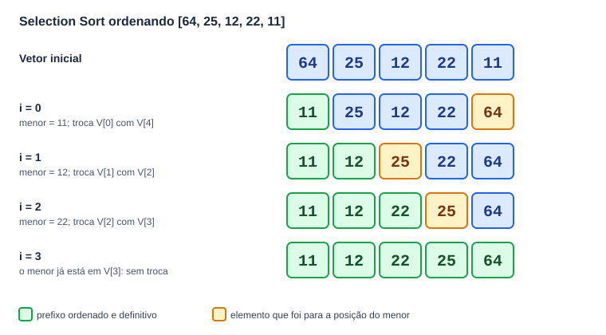

## Objetivos de aprendizagem

Ao final deste tópico, você deverá ser capaz de:

- Explicar a ideia do Selection Sort: escolher o menor elemento restante e colocá-lo na sua posição definitiva.
- Executar o algoritmo passo a passo, identificando o índice do menor elemento e a troca de cada iteração.
- Explicar por que o número de comparações não depende do conteúdo do vetor, mas o número de trocas é pequeno.
- Explicar por que o Selection Sort não é estável.
- Comparar o Selection Sort com o Bubble Sort e o Insertion Sort.

## 1. Conexão com a Trilha: Onde Estamos?

Nos módulos anteriores desta trilha, construímos a base de análise e demos nosso primeiro passo prático na ordenação em memória principal:

- Em **Busca Sequencial e Busca Binária** e **Eficiência e Estabilidade**, vimos que a ordenação acelera buscas para $O(\log n)$ e que avaliamos métodos por **comparações**, **movimentações**, **memória extra (*in-place*)** e **estabilidade** (preservando a ordem relativa de empates, especialmente quando não há trocas distantes).
- Em **Bubble Sort**, conhecemos nosso primeiro método elementar $O(n^2)$: ele é *in-place*, estável e adaptativo (com `trocou`), mas pode fazer até $\Theta(n^2)$ trocas de elementos adjacentes.

Agora surge a pergunta central deste módulo:

> **Como reorganizar um vetor *in-place* fazendo no máximo $n - 1$ trocas ao longo de toda a execução, e qual é o preço que pagamos por isso?**

A resposta está em selecionar diretamente o menor elemento restante e levá-lo à sua posição definitiva: o **Selection Sort**.

## 2. Introdução

Uma forma natural de ordenar é procurar o menor elemento de todos e colocá-lo na primeira posição; depois, procurar o menor dos restantes e colocá-lo na segunda; e assim por diante. É isso que o **Selection Sort** (ordenação por seleção) faz.

Sua característica marcante é que cada elemento é movido **no máximo uma vez** para o seu lugar definitivo: o algoritmo faz poucas trocas, mesmo que o número de comparações seja alto.

## 3. Conceito principal

Neste tópico, ordenamos vetores de números inteiros em ordem crescente. O Selection Sort divide o vetor em duas partes: um **prefixo ordenado e definitivo** `V[0..i - 1]`, com os *i* menores elementos do vetor, e o restante, ainda desordenado. Em cada iteração *i* (de 0 até *n* − 2):

- procuramos, em `V[i..n - 1]`, o **índice** `min` do menor elemento;
- trocamos `V[i]` com `V[min]` (se `min` for diferente de *i*);
- depois da iteração, a posição *i* está em seu lugar definitivo, e o prefixo cresce uma posição.

Depois de *n* − 1 iterações o vetor está ordenado: o último elemento sobra e já está no lugar certo.

> Cada iteração faz **uma única troca** no máximo, então o algoritmo faz no máximo *n* − 1 trocas. Em compensação, a busca pelo menor elemento percorre todo o restante do vetor em toda iteração, não importa se o vetor já estava ordenado.

### 3.1 Exemplo de execução

Considere o vetor `[64, 25, 12, 22, 11]`.

{align=center width=100%}

Observe:

- Em **i = 0**, o menor elemento é 11, na posição 4. Ele troca com o 64, que vai para a posição 4.
- Em **i = 3**, o menor de `V[3..4]` é o 25, que já está em `V[3]`: não há troca, mas a comparação com o 64 foi feita do mesmo jeito.
- No total são 10 comparações (4 + 3 + 2 + 1) e 3 trocas.

### 3.2 Por que o Selection Sort não é estável?

A troca entre `V[i]` e `V[min]` leva um elemento para longe e pode **ultrapassar elementos iguais**. Considere o vetor `[3a, 3b, 2]`, em que 3a e 3b valem 3: na primeira iteração, o menor é o 2, que troca com `V[0] = 3a`. O resultado é `[2, 3b, 3a]`, e a ordem original de 3a e 3b foi invertida.

## 4. Representação em C

A função `trocar` inverte dois elementos usando ponteiros, e `selection_sort` ordena o vetor `V` de tamanho `n`.

```c
#include <stdio.h>

void trocar(int *a, int *b) {
    int temp = *a;
    *a = *b;
    *b = temp;
}

void selection_sort(int V[], int n) {
    for (int i = 0; i < n - 1; i++) {
        int min = i;
        for (int j = i + 1; j < n; j++) {
            if (V[j] < V[min]) min = j;
        }
        if (min != i) trocar(&V[i], &V[min]);
    }
}
```

- O laço externo escolhe a posição `i` que será preenchida.
- `min` guarda o **índice** (e não o valor) do menor elemento encontrado até o momento; começa em `i`.
- O laço interno vai de `j = i + 1` até o fim, e atualiza `min` sempre que encontra um elemento estritamente menor.
- `if (min != i)` evita uma troca inútil quando o menor elemento já está na posição `i`.

> Como o laço interno é executado por inteiro em toda iteração, o número de comparações é sempre (*n* − 1) + (*n* − 2) + ... + 1 = *n*(*n* − 1)/2, mesmo para um vetor já ordenado.

Nos programas abaixo, clique em **Executar** e acompanhe a linha destacada no código. A tela mostra o vetor como uma linha de caixas: os elementos em destaque são o candidato a menor (`min`) e o elemento comparado, e uma segunda linha mostra o prefixo já ordenado e definitivo.

## 5. Operações

### 5.1 Ordenação passo a passo

O programa abaixo ordena `[64, 25, 12, 22, 11]`. Repare em como `min` muda durante a busca e na última iteração, em que não há troca.

```codigo
{"title":"Ordenando [64, 25, 12, 22, 11] com Selection Sort","cols":5,"code":"#include <stdio.h>\n\nvoid trocar(int *a, int *b) {\n    int temp = *a;\n    *a = *b;\n    *b = temp;\n}\n\nvoid selection_sort(int V[], int n) {\n    for (int i = 0; i < n - 1; i++) {\n        int min = i;\n        for (int j = i + 1; j < n; j++) {\n            if (V[j] < V[min]) min = j;\n        }\n        if (min != i) trocar(&V[i], &V[min]);\n    }\n}\n\nint main(void) {\n    int V[] = {64, 25, 12, 22, 11};\n    int n = 5;\n    selection_sort(V, n);\n    return 0;\n}","steps":[{"line":21,"caption":"Vetor inicial com 5 elementos. Vamos ordená-lo em ordem crescente com o Selection Sort: a cada iteração, o menor elemento restante vai para a sua posição definitiva.","vars":{"n":5},"rows":[[{"s":0,"n":5,"i":[["64","",0],["25","",1],["12","",2],["22","",3],["11","",4]],"l":"vetor V"}]],"stack":"main"},{"line":11,"caption":"Iteração i = 0: procuramos o menor elemento de V[0..4]. Por enquanto, assumimos que é V[0] = 64 (min = 0).","vars":{"i":0,"min":0},"rows":[[{"s":0,"n":5,"i":[["64","p",0],["25","",1],["12","",2],["22","",3],["11","",4]],"l":"vetor V"}]],"stack":"selection_sort ← main"},{"line":13,"caption":"V[1] = 25 é menor que o menor atual, V[0] = 64: temos um novo menor, min = 1.","vars":{"i":0,"j":1,"min":1},"rows":[[{"s":0,"n":5,"i":[["64","",0],["25","p",1],["12","",2],["22","",3],["11","",4]],"l":"vetor V"}]],"stack":"selection_sort ← main"},{"line":13,"caption":"V[2] = 12 é menor que o menor atual, V[1] = 25: temos um novo menor, min = 2.","vars":{"i":0,"j":2,"min":2},"rows":[[{"s":0,"n":5,"i":[["64","",0],["25","",1],["12","p",2],["22","",3],["11","",4]],"l":"vetor V"}]],"stack":"selection_sort ← main"},{"line":13,"caption":"V[3] = 22 não é menor que o menor atual, V[2] = 12: min continua em 2.","vars":{"i":0,"j":3,"min":2},"rows":[[{"s":0,"n":5,"i":[["64","",0],["25","",1],["12","p",2],["22","c",3],["11","",4]],"l":"vetor V"}]],"stack":"selection_sort ← main"},{"line":13,"caption":"V[4] = 11 é menor que o menor atual, V[2] = 12: temos um novo menor, min = 4.","vars":{"i":0,"j":4,"min":4},"rows":[[{"s":0,"n":5,"i":[["64","",0],["25","",1],["12","",2],["22","",3],["11","p",4]],"l":"vetor V"}]],"stack":"selection_sort ← main"},{"line":15,"caption":"O menor de V[0..4] é 11, que estava na posição 4. Trocamos V[0] com V[4]: o 11 vai para a posição 0, que agora está em seu lugar definitivo.","vars":{"i":0,"min":4},"rows":[[{"s":0,"n":5,"i":[["11","p",4],["25","",1],["12","",2],["22","",3],["64","p",0]],"l":"vetor V"}],[{"s":0,"n":1,"i":[["11","",4]],"l":"parte inicial já ordenada e definitiva"}]],"stack":"selection_sort ← main"},{"line":11,"caption":"Iteração i = 1: procuramos o menor elemento de V[1..4]. Por enquanto, assumimos que é V[1] = 25 (min = 1).","vars":{"i":1,"min":1},"rows":[[{"s":0,"n":5,"i":[["11","",4],["25","p",1],["12","",2],["22","",3],["64","",0]],"l":"vetor V"}],[{"s":0,"n":1,"i":[["11","",4]],"l":"parte inicial já ordenada e definitiva"}]],"stack":"selection_sort ← main"},{"line":13,"caption":"V[2] = 12 é menor que o menor atual, V[1] = 25: temos um novo menor, min = 2.","vars":{"i":1,"j":2,"min":2},"rows":[[{"s":0,"n":5,"i":[["11","",4],["25","",1],["12","p",2],["22","",3],["64","",0]],"l":"vetor V"}],[{"s":0,"n":1,"i":[["11","",4]],"l":"parte inicial já ordenada e definitiva"}]],"stack":"selection_sort ← main"},{"line":13,"caption":"V[3] = 22 não é menor que o menor atual, V[2] = 12: min continua em 2.","vars":{"i":1,"j":3,"min":2},"rows":[[{"s":0,"n":5,"i":[["11","",4],["25","",1],["12","p",2],["22","c",3],["64","",0]],"l":"vetor V"}],[{"s":0,"n":1,"i":[["11","",4]],"l":"parte inicial já ordenada e definitiva"}]],"stack":"selection_sort ← main"},{"line":13,"caption":"V[4] = 64 não é menor que o menor atual, V[2] = 12: min continua em 2.","vars":{"i":1,"j":4,"min":2},"rows":[[{"s":0,"n":5,"i":[["11","",4],["25","",1],["12","p",2],["22","",3],["64","c",0]],"l":"vetor V"}],[{"s":0,"n":1,"i":[["11","",4]],"l":"parte inicial já ordenada e definitiva"}]],"stack":"selection_sort ← main"},{"line":15,"caption":"O menor de V[1..4] é 12, que estava na posição 2. Trocamos V[1] com V[2]: o 12 vai para a posição 1, que agora está em seu lugar definitivo.","vars":{"i":1,"min":2},"rows":[[{"s":0,"n":5,"i":[["11","",4],["12","p",2],["25","p",1],["22","",3],["64","",0]],"l":"vetor V"}],[{"s":0,"n":2,"i":[["11","",4],["12","",2]],"l":"parte inicial já ordenada e definitiva"}]],"stack":"selection_sort ← main"},{"line":11,"caption":"Iteração i = 2: procuramos o menor elemento de V[2..4]. Por enquanto, assumimos que é V[2] = 25 (min = 2).","vars":{"i":2,"min":2},"rows":[[{"s":0,"n":5,"i":[["11","",4],["12","",2],["25","p",1],["22","",3],["64","",0]],"l":"vetor V"}],[{"s":0,"n":2,"i":[["11","",4],["12","",2]],"l":"parte inicial já ordenada e definitiva"}]],"stack":"selection_sort ← main"},{"line":13,"caption":"V[3] = 22 é menor que o menor atual, V[2] = 25: temos um novo menor, min = 3.","vars":{"i":2,"j":3,"min":3},"rows":[[{"s":0,"n":5,"i":[["11","",4],["12","",2],["25","",1],["22","p",3],["64","",0]],"l":"vetor V"}],[{"s":0,"n":2,"i":[["11","",4],["12","",2]],"l":"parte inicial já ordenada e definitiva"}]],"stack":"selection_sort ← main"},{"line":13,"caption":"V[4] = 64 não é menor que o menor atual, V[3] = 22: min continua em 3.","vars":{"i":2,"j":4,"min":3},"rows":[[{"s":0,"n":5,"i":[["11","",4],["12","",2],["25","",1],["22","p",3],["64","c",0]],"l":"vetor V"}],[{"s":0,"n":2,"i":[["11","",4],["12","",2]],"l":"parte inicial já ordenada e definitiva"}]],"stack":"selection_sort ← main"},{"line":15,"caption":"O menor de V[2..4] é 22, que estava na posição 3. Trocamos V[2] com V[3]: o 22 vai para a posição 2, que agora está em seu lugar definitivo.","vars":{"i":2,"min":3},"rows":[[{"s":0,"n":5,"i":[["11","",4],["12","",2],["22","p",3],["25","p",1],["64","",0]],"l":"vetor V"}],[{"s":0,"n":3,"i":[["11","",4],["12","",2],["22","",3]],"l":"parte inicial já ordenada e definitiva"}]],"stack":"selection_sort ← main"},{"line":11,"caption":"Iteração i = 3: procuramos o menor elemento de V[3..4]. Por enquanto, assumimos que é V[3] = 25 (min = 3).","vars":{"i":3,"min":3},"rows":[[{"s":0,"n":5,"i":[["11","",4],["12","",2],["22","",3],["25","p",1],["64","",0]],"l":"vetor V"}],[{"s":0,"n":3,"i":[["11","",4],["12","",2],["22","",3]],"l":"parte inicial já ordenada e definitiva"}]],"stack":"selection_sort ← main"},{"line":13,"caption":"V[4] = 64 não é menor que o menor atual, V[3] = 25: min continua em 3.","vars":{"i":3,"j":4,"min":3},"rows":[[{"s":0,"n":5,"i":[["11","",4],["12","",2],["22","",3],["25","p",1],["64","c",0]],"l":"vetor V"}],[{"s":0,"n":3,"i":[["11","",4],["12","",2],["22","",3]],"l":"parte inicial já ordenada e definitiva"}]],"stack":"selection_sort ← main"},{"line":15,"caption":"O menor de V[3..4] já está em V[3] (min = i), então não há troca. A posição 3 também já está definitiva, mas todas as comparações foram feitas do mesmo jeito.","vars":{"i":3,"min":3},"rows":[[{"s":0,"n":5,"i":[["11","",4],["12","",2],["22","",3],["25","p",1],["64","",0]],"l":"vetor V"}],[{"s":0,"n":4,"i":[["11","",4],["12","",2],["22","",3],["25","",1]],"l":"parte inicial já ordenada e definitiva"}]],"stack":"selection_sort ← main"},{"line":23,"caption":"Vetor ordenado: [11, 12, 22, 25, 64]. Foram 10 comparações (sempre n(n − 1)/2) e 3 trocas.","vars":{},"rows":[[{"s":0,"n":5,"i":[["11","",4],["12","",2],["22","",3],["25","",1],["64","",0]],"l":"vetor V (ordenado)"}]],"stack":"main"}]}
```

### 5.2 Vetor já ordenado: o algoritmo não aproveita

Em um vetor que já está ordenado, nenhuma troca acontece, mas todas as comparações continuam sendo feitas: o custo segue sendo *n*(*n* − 1)/2 comparações. O Selection Sort **não é adaptativo**.

```codigo
{"title":"Selection Sort em um vetor já ordenado","cols":4,"code":"#include <stdio.h>\n\nvoid trocar(int *a, int *b) {\n    int temp = *a;\n    *a = *b;\n    *b = temp;\n}\n\nvoid selection_sort(int V[], int n) {\n    for (int i = 0; i < n - 1; i++) {\n        int min = i;\n        for (int j = i + 1; j < n; j++) {\n            if (V[j] < V[min]) min = j;\n        }\n        if (min != i) trocar(&V[i], &V[min]);\n    }\n}\n\nint main(void) {\n    int V[] = {1, 2, 3, 4};\n    int n = 4;\n    selection_sort(V, n);\n    return 0;\n}","steps":[{"line":21,"caption":"Vetor inicial com 4 elementos. Vamos ordená-lo em ordem crescente com o Selection Sort: a cada iteração, o menor elemento restante vai para a sua posição definitiva.","vars":{"n":4},"rows":[[{"s":0,"n":4,"i":[["1","",0],["2","",1],["3","",2],["4","",3]],"l":"vetor V"}]],"stack":"main"},{"line":11,"caption":"Iteração i = 0: procuramos o menor elemento de V[0..3]. Por enquanto, assumimos que é V[0] = 1 (min = 0).","vars":{"i":0,"min":0},"rows":[[{"s":0,"n":4,"i":[["1","p",0],["2","",1],["3","",2],["4","",3]],"l":"vetor V"}]],"stack":"selection_sort ← main"},{"line":13,"caption":"V[1] = 2 não é menor que o menor atual, V[0] = 1: min continua em 0.","vars":{"i":0,"j":1,"min":0},"rows":[[{"s":0,"n":4,"i":[["1","p",0],["2","c",1],["3","",2],["4","",3]],"l":"vetor V"}]],"stack":"selection_sort ← main"},{"line":13,"caption":"V[2] = 3 não é menor que o menor atual, V[0] = 1: min continua em 0.","vars":{"i":0,"j":2,"min":0},"rows":[[{"s":0,"n":4,"i":[["1","p",0],["2","",1],["3","c",2],["4","",3]],"l":"vetor V"}]],"stack":"selection_sort ← main"},{"line":13,"caption":"V[3] = 4 não é menor que o menor atual, V[0] = 1: min continua em 0.","vars":{"i":0,"j":3,"min":0},"rows":[[{"s":0,"n":4,"i":[["1","p",0],["2","",1],["3","",2],["4","c",3]],"l":"vetor V"}]],"stack":"selection_sort ← main"},{"line":15,"caption":"O menor de V[0..3] já está em V[0] (min = i), então não há troca. A posição 0 também já está definitiva, mas todas as comparações foram feitas do mesmo jeito.","vars":{"i":0,"min":0},"rows":[[{"s":0,"n":4,"i":[["1","p",0],["2","",1],["3","",2],["4","",3]],"l":"vetor V"}],[{"s":0,"n":1,"i":[["1","",0]],"l":"parte inicial já ordenada e definitiva"}]],"stack":"selection_sort ← main"},{"line":11,"caption":"Iteração i = 1: procuramos o menor elemento de V[1..3]. Por enquanto, assumimos que é V[1] = 2 (min = 1).","vars":{"i":1,"min":1},"rows":[[{"s":0,"n":4,"i":[["1","",0],["2","p",1],["3","",2],["4","",3]],"l":"vetor V"}],[{"s":0,"n":1,"i":[["1","",0]],"l":"parte inicial já ordenada e definitiva"}]],"stack":"selection_sort ← main"},{"line":13,"caption":"V[2] = 3 não é menor que o menor atual, V[1] = 2: min continua em 1.","vars":{"i":1,"j":2,"min":1},"rows":[[{"s":0,"n":4,"i":[["1","",0],["2","p",1],["3","c",2],["4","",3]],"l":"vetor V"}],[{"s":0,"n":1,"i":[["1","",0]],"l":"parte inicial já ordenada e definitiva"}]],"stack":"selection_sort ← main"},{"line":13,"caption":"V[3] = 4 não é menor que o menor atual, V[1] = 2: min continua em 1.","vars":{"i":1,"j":3,"min":1},"rows":[[{"s":0,"n":4,"i":[["1","",0],["2","p",1],["3","",2],["4","c",3]],"l":"vetor V"}],[{"s":0,"n":1,"i":[["1","",0]],"l":"parte inicial já ordenada e definitiva"}]],"stack":"selection_sort ← main"},{"line":15,"caption":"O menor de V[1..3] já está em V[1] (min = i), então não há troca. A posição 1 também já está definitiva, mas todas as comparações foram feitas do mesmo jeito.","vars":{"i":1,"min":1},"rows":[[{"s":0,"n":4,"i":[["1","",0],["2","p",1],["3","",2],["4","",3]],"l":"vetor V"}],[{"s":0,"n":2,"i":[["1","",0],["2","",1]],"l":"parte inicial já ordenada e definitiva"}]],"stack":"selection_sort ← main"},{"line":11,"caption":"Iteração i = 2: procuramos o menor elemento de V[2..3]. Por enquanto, assumimos que é V[2] = 3 (min = 2).","vars":{"i":2,"min":2},"rows":[[{"s":0,"n":4,"i":[["1","",0],["2","",1],["3","p",2],["4","",3]],"l":"vetor V"}],[{"s":0,"n":2,"i":[["1","",0],["2","",1]],"l":"parte inicial já ordenada e definitiva"}]],"stack":"selection_sort ← main"},{"line":13,"caption":"V[3] = 4 não é menor que o menor atual, V[2] = 3: min continua em 2.","vars":{"i":2,"j":3,"min":2},"rows":[[{"s":0,"n":4,"i":[["1","",0],["2","",1],["3","p",2],["4","c",3]],"l":"vetor V"}],[{"s":0,"n":2,"i":[["1","",0],["2","",1]],"l":"parte inicial já ordenada e definitiva"}]],"stack":"selection_sort ← main"},{"line":15,"caption":"O menor de V[2..3] já está em V[2] (min = i), então não há troca. A posição 2 também já está definitiva, mas todas as comparações foram feitas do mesmo jeito.","vars":{"i":2,"min":2},"rows":[[{"s":0,"n":4,"i":[["1","",0],["2","",1],["3","p",2],["4","",3]],"l":"vetor V"}],[{"s":0,"n":3,"i":[["1","",0],["2","",1],["3","",2]],"l":"parte inicial já ordenada e definitiva"}]],"stack":"selection_sort ← main"},{"line":23,"caption":"Vetor ordenado: [1, 2, 3, 4]. Foram 6 comparações (sempre n(n − 1)/2) e 0 trocas.","vars":{},"rows":[[{"s":0,"n":4,"i":[["1","",0],["2","",1],["3","",2],["4","",3]],"l":"vetor V (ordenado)"}]],"stack":"main"}]}
```

## 6. Análise de complexidade

Sejam *n* o número de elementos do vetor.

| Caso | Comparações | Trocas | Tempo |
|:--|:--|:--|:--|
| Melhor (vetor ordenado) | *n*(*n* − 1)/2 | 0 | O(*n*²) |
| Médio (ordem aleatória) | *n*(*n* − 1)/2 | no máximo *n* − 1 | O(*n*²) |
| Pior | *n*(*n* − 1)/2 | no máximo *n* − 1 | O(*n*²) |

- O número de comparações **não depende** do conteúdo do vetor.
- O número de trocas é no máximo *n* − 1 (uma por iteração), o menor entre os algoritmos simples.

| Propriedade | Selection Sort |
|:--|:--|
| Espaço extra | O(1): ordena no próprio vetor (*in place*) |
| Estável | Não (a troca pode ultrapassar elementos iguais) |
| Adaptativo | Não: vetores ordenados custam o mesmo que os demais |

## 7. Comparação com outros algoritmos

| Algoritmo | Melhor caso | Pior caso | Trocas ou movimentos no pior caso | Estável | Espaço extra |
|:--|:--|:--|:--|:--|:--|
| Bubble Sort | O(*n*) | O(*n*²) | O(*n*²) trocas | Sim | O(1) |
| Insertion Sort | O(*n*) | O(*n*²) | O(*n*²) deslocamentos | Sim | O(1) |
| Selection Sort | O(*n*²) | O(*n*²) | no máximo *n* − 1 trocas | Não | O(1) |
| Heap Sort | O(*n* log *n*) | O(*n* log *n*) | O(*n* log *n*) | Não | O(1) |
| Merge Sort | O(*n* log *n*) | O(*n* log *n*) | O(*n* log *n*) | Sim | O(*n*) |

O Heap Sort é uma versão do Selection Sort em que a busca pelo menor (ou maior) elemento é feita com um heap: a extração custa O(log *n*) em vez de O(*n*), o que leva o custo total a O(*n* log *n*).

## 8. Aplicações

- **Escrita cara**: quando gravar em um elemento é caro ou limitado, como em memórias flash e EEPROM, as no máximo *n* − 1 trocas do Selection Sort são uma vantagem.
- **Seleção parcial**: para obter só os *k* menores elementos, basta parar depois de *k* iterações, com custo O(*k* · *n*).
- **Vetores pequenos e código simples**: é fácil de escrever e de verificar, e não usa memória extra.
- **Ensino**: ajuda a entender a ideia de invariante (o prefixo ordenado e definitivo) e abre caminho para o Heap Sort.

## 9. Teste de conhecimento

```quiz
{
  "question": "Após a iteração i do Selection Sort, o que está garantido?",
  "options": [
    { "text": "O maior elemento do vetor está na última posição.", "correct": false },
    { "text": "V[0..i] está ordenado, mas os elementos ainda podem mudar de posição.", "correct": false },
    { "text": "V[0..i] contém os i + 1 menores elementos do vetor, já em suas posições definitivas.", "correct": true },
    { "text": "O vetor inteiro está ordenado.", "correct": false }
  ],
  "correctFeedback": "Correto! A cada iteração o menor elemento restante vai para a posição i, e nenhuma iteração posterior mexe nesse prefixo.",
  "incorrectFeedback": "Compare com o Insertion Sort: aqui, o que fica garantido sobre as posições do prefixo?"
}
```

```quiz
{
  "question": "Qual é o vetor depois da primeira iteração (i = 0) do Selection Sort sobre [29, 10, 14, 37, 13]?",
  "options": [
    { "text": "[10, 14, 29, 37, 13]", "correct": false },
    { "text": "[10, 29, 14, 37, 13]", "correct": true },
    { "text": "[13, 10, 14, 37, 29]", "correct": false },
    { "text": "[10, 14, 37, 13, 29]", "correct": false }
  ],
  "correctFeedback": "Correto! O menor elemento é 10, na posição 1. Ele troca com V[0] = 29, resultando em [10, 29, 14, 37, 13]. Não há deslocamento dos demais.",
  "incorrectFeedback": "O Selection Sort faz uma única troca por iteração, entre V[i] e o menor elemento encontrado."
}
```

```quiz
{
  "question": "Quantas comparações o Selection Sort faz para ordenar um vetor com 6 elementos?",
  "options": [
    { "text": "5, se o vetor já estiver ordenado.", "correct": false },
    { "text": "6", "correct": false },
    { "text": "15, independentemente do conteúdo do vetor.", "correct": true },
    { "text": "36", "correct": false }
  ],
  "correctFeedback": "Correto! São 5 + 4 + 3 + 2 + 1 = 15 = n(n − 1)/2 comparações, mesmo se o vetor já estiver ordenado. O Selection Sort não é adaptativo.",
  "incorrectFeedback": "Quantos elementos o laço interno percorre em cada iteração, e isso depende dos valores do vetor?"
}
```
---

## 10. Ponte para o Próximo Módulo da Trilha

Neste módulo, vimos que o **Selection Sort** limita o número de trocas a no máximo $n - 1$, mas não é adaptativo (faz sempre $\frac{n(n-1)}{2}$ comparações) e perde a **estabilidade** por realizar trocas que podem ultrapassar elementos iguais.

Com isso, surgem perguntas importantes para a próxima etapa da trilha:

- **E se quisermos recuperar a estabilidade e o comportamento adaptativo (custo próximo de $O(n)$ em vetores quase ordenados), mas evitando o excesso de trocas de três atribuições do Bubble Sort?**
- **Como funciona a estratégia de construir um prefixo ordenado deslocando elementos maiores apenas o necessário para encaixar cada nova chave?**

É exatamente essa estratégia — inspirada na ordenação de cartas na mão — que vamos explorar no próximo passo da trilha:

> **Próximo Módulo 🔜:** **Insertion Sort** — ordenação por inserção, deslocamentos simples, estabilidade e desempenho superior em vetores pequenos ou quase ordenados!