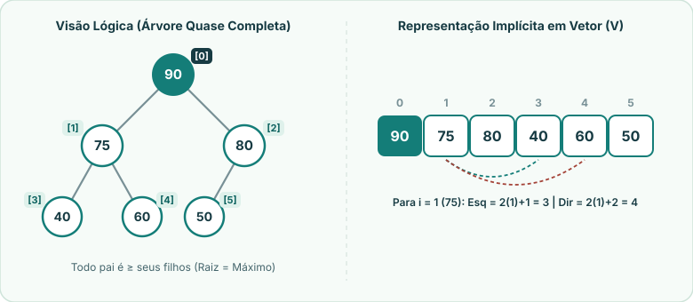
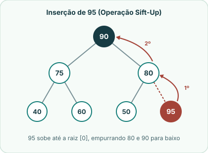

## Objetivos de aprendizagem

Ao final deste tópico, você deverá ser capaz de:

- Compreender as propriedades estruturais e de ordenação de um Heap Binário (**Max-Heap** e **Min-Heap**).
- Diferenciar a ordenação vertical de um Heap da ordenação horizontal de uma Árvore Binária de Busca (ABB).
- Mapear um Heap diretamente em um vetor contíguo utilizando aritmética de índices.
- Executar as operações `sift-up` (inserção), `sift-down` (extração da raiz) e `build-heap` em C.

## Introdução

Um **Heap Binário** (*Binary Heap*) é uma estrutura de dados baseada em árvore binária projetada para resolver problemas em que precisamos acessar e remover repetidamente o elemento de **maior** ou **menor** prioridade — como filas de prioridade, escalonamento de tarefas em sistemas operacionais, algoritmo de caminhos mínimos de Dijkstra e o método de ordenação **HeapSort**.

## Conceito principal

Um Heap Binário é uma **árvore binária quase completa** (todos os níveis estão totalmente preenchidos, exceto possivelmente o último, que é preenchido estritamente da esquerda para a direita) que satisfaz a **Propriedade de Heap**:

- **Max-Heap:** A chave de cada nó pai é **maior ou igual** às chaves de seus filhos ($V[\text{pai}] \ge V[\text{filho}]$). O **maior** elemento está sempre na raiz.
- **Min-Heap:** A chave de cada nó pai é **menor ou igual** às chaves de seus filhos ($V[\text{pai}] \le V[\text{filho}]$). O **menor** elemento está sempre na raiz.

{align=center width=88%}

### Como funciona

Por ser uma árvore quase completa sem lacunas internas, o Heap dispensa ponteiros e alocação dinâmica de nós. Todo o armazenamento é feito em um vetor contíguo `V` (indexado a partir de `0`), navegando pelas relações matemáticas para um nó no índice $i$:

$$\text{Pai}(i) = \left\lfloor \frac{i - 1}{2} \right\rfloor \qquad \text{Esquerdo}(i) = 2i + 1 \qquad \text{Direito}(i) = 2i + 2$$

> **Regra fundamental:** um Heap **não** é uma Árvore Binária de Busca. Não existe ordenação entre filho esquerdo e filho direito; a única garantia é a relação vertical entre pai e filho.

---

## Exemplo

Considere as operações fundamentais sobre um **Max-Heap** armazenado em vetor.

### 1. Inserção e `Sift-Up` (Subir)

{align=right width=46%}

Para inserir um novo valor mantendo a estrutura intacta:

1. Colocamos o elemento na primeira posição livre ao final do vetor (`V[n]`), preservando o formato de árvore quase completa.
2. Aplicamos o **Sift-Up** (*Heapify-Up*): comparamos o elemento com seu pai e trocamos ambos enquanto o filho for maior que o pai.

<details>
<summary><strong>Ver rastreamento passo a passo da inserção do 95</strong></summary>

1. O valor `95` entra no índice `6` (filho direito de `80`).
2. Como $95 > 80$, trocamos `V[6]` com `V[2]`.
3. Agora no índice `2`, comparamos com a raiz `90`: como $95 > 90$, trocamos `V[2]` com `V[0]`.
4. O elemento alcançou o índice `0` (raiz) e o processo encerra em $O(\log n)$.

</details>

### 2. Extração da Raiz e `Sift-Down` (Descer)

Para remover o maior elemento (`V[0]`):

1. Guardamos `V[0]` para retorno.
2. Movemos o **último elemento do vetor** (`V[n - 1]`) para a raiz `V[0]` e decrementamos o tamanho `n`.
3. Aplicamos o **Sift-Down** (*Heapify-Down*): comparamos `V[0]` com seus dois filhos e trocamos com o **maior** filho até restabelecer a propriedade de Max-Heap.

<details>
<summary><strong>Ver rastreamento da extração da raiz (95)</strong></summary>

1. Salvamos `95` para retorno.
2. Movemos o último elemento (`80`, que estava no índice `6`) para `V[0]` e reduzimos $n$ para `6`.
3. Comparamos `80` com seus filhos `75` (esq) e `90` (dir): como $90 > 80$, trocamos `V[0]` com `V[2]`.
4. No índice `2`, `80` é maior que seu único filho `50` (índice `5`), encerrando a descida.

</details>

### 3. Construção Linear (`Build-Heap`) e `HeapSort`

Dado um vetor desordenado qualquer de tamanho $n$, transformamos o vetor em um Max-Heap aplicando `sift-down` de trás para frente a partir do último nó interno até a raiz:

$$i = \left\lfloor \frac{n}{2} \right\rfloor - 1 \;\longrightarrow\; 0$$

Graças à distribuição das alturas dos nós na árvore, essa construção ocorre em tempo linear $O(n)$. Em seguida, extraindo a raiz $n - 1$ vezes para o final do vetor, obtemos o algoritmo **HeapSort** em tempo $O(n \log n)$ e memória auxiliar $O(1)$.

### 4. Implementação em C (Max-Heap)

```c
#include <stdio.h>

void trocar(int *a, int *b) {
    int temp = *a;
    *a = *b;
    *b = temp;
}

void sift_up(int V[], int i) {
    while (i > 0) {
        int pai = (i - 1) / 2;
        if (V[i] > V[pai]) {
            trocar(&V[i], &V[pai]);
            i = pai;
        } else {
            break;
        }
    }
}

void sift_down(int V[], int n, int i) {
    while (1) {
        int maior = i;
        int esq = 2 * i + 1;
        int dir = 2 * i + 2;

        if (esq < n && V[esq] > V[maior]) maior = esq;
        if (dir < n && V[dir] > V[maior]) maior = dir;

        if (maior != i) {
            trocar(&V[i], &V[maior]);
            i = maior;
        } else {
            break;
        }
    }
}

void inserir_heap(int V[], int *n, int valor) {
    V[*n] = valor;
    (*n)++;
    sift_up(V, *n - 1);
}

int extrair_maximo(int V[], int *n) {
    int max = V[0];
    V[0] = V[*n - 1];
    (*n)--;
    sift_down(V, *n, 0);
    return max;
}

void construir_heap(int V[], int n) {
    for (int i = (n / 2) - 1; i >= 0; i--) {
        sift_down(V, n, i);
    }
}
```

## Comparação e complexidade

A tabela abaixo resume o custo computacional das operações em um Heap Binário de $n$ elementos:

| Operação | Descrição | Custo |
|:--|:--|--:|
| Consultar topo (`Peek`) | Lê diretamente `V[0]` (máximo ou mínimo) | $O(1)$ |
| Inserir (`Insert`) | Adiciona ao fim do vetor e executa `sift-up` | $O(\log n)$ |
| Extrair raiz (`Extract`) | Move o último elemento para `V[0]` e executa `sift-down` | $O(\log n)$ |
| Construir Heap (`Build-Heap`) | Aplica `sift-down` de $\lfloor n/2 \rfloor - 1$ até `0` | $O(n)$ |
| Buscar valor arbitrário | Exige varredura linear pois não há ordenação horizontal | $O(n)$ |

## Teste de conhecimento

```quiz
{
  "question": "Qual é a diferença fundamental entre a ordenação de um Max-Heap e de uma Árvore Binária de Busca (ABB)?",
  "options": [
    { "text": "No Max-Heap a ordenação é estritamente vertical (pai >= filhos) sem relação entre irmãos; na ABB os menores ficam à esquerda e os maiores à direita.", "correct": true },
    { "text": "No Max-Heap cada nó pode ter até 4 filhos, enquanto a ABB aceita apenas 2.", "correct": false },
    { "text": "Não há diferença estrutural; todo Max-Heap válido também é uma ABB válida.", "correct": false }
  ],
  "correctFeedback": "Correto! Em um Max-Heap, o filho esquerdo pode ser maior ou menor que o filho direito sem problema algum, desde que ambos sejam menores ou iguais ao pai.",
  "incorrectFeedback": "Compare a relação entre irmãos esquerdo e direito nas duas estruturas."
}
```

```quiz
{
  "question": "Em um Heap armazenado em um vetor indexado a partir de 0, um nó está na posição i = 4. Quais são os índices do seu nó PAI e dos seus filhos ESQUERDO e DIREITO, respectivamente?",
  "options": [
    { "text": "Pai = 1, Esquerdo = 9, Direito = 10.", "correct": true },
    { "text": "Pai = 2, Esquerdo = 8, Direito = 9.", "correct": false },
    { "text": "Pai = 1, Esquerdo = 8, Direito = 10.", "correct": false }
  ],
  "correctFeedback": "Exato! Para índice base 0: Pai = (4 - 1) / 2 = 1; Esquerdo = 2*(4) + 1 = 9; Direito = 2*(4) + 2 = 10.",
  "incorrectFeedback": "Aplique as fórmulas de índice base 0: Pai = (i - 1) / 2 (divisão inteira), Esquerdo = 2*i + 1 e Direito = 2*i + 2."
}
```

```quiz
{
  "question": "Ao extrair a raiz de um Max-Heap, por que movemos o ÚLTIMO elemento do vetor para V[0] antes de executar o sift-down, em vez de apenas promover o maior filho da raiz?",
  "options": [
    { "text": "Para manter a propriedade de árvore binária quase completa sem criar lacunas (buracos) no meio do vetor.", "correct": true },
    { "text": "Porque o último elemento do vetor é sempre o segundo maior valor do Heap.", "correct": false },
    { "text": "Porque a linguagem C não permite alterar o índice 0 sem realocar o vetor inteiro.", "correct": false }
  ],
  "correctFeedback": "Correto! Remover o último elemento preserva a contiguidade dos índices de 0 até n - 1, enquanto o sift-down restaura a prioridade vertical.",
  "incorrectFeedback": "Pense no que aconteceria com os índices do vetor se subíssemos nós internos deixando posições vazias nos níveis intermediários."
}
```
