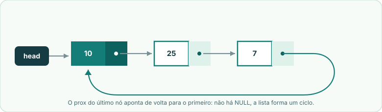

## Objetivos de aprendizagem

Ao final deste tópico, você deverá ser capaz de:

- Explicar como o encadeamento circular elimina o `NULL` do fim da lista.
- Percorrer uma lista circular com um critério de parada correto.
- Descrever situações em que a estrutura circular é a escolha natural.
- Comparar as implementações de lista vistas neste tópico.

## Introdução

Pense em uma roda de conversa: depois que a última pessoa fala, a vez volta para a primeira, e a rodada recomeça. Não existe "fim da fila". Uma **lista circular** segue essa ideia: a referência do último nó aponta de volta para o primeiro, fechando um ciclo.

## Conceito principal

Em uma lista encadeada comum, o último nó tem `prox` igual a `NULL`. Na versão circular, esse `prox` aponta para o primeiro nó:

{align=center width=85%}

Uma lista circular pode ser **simplesmente encadeada** (só `prox` fecha o ciclo) ou **duplamente encadeada** (os dois sentidos formam ciclos). A escolha entre elas segue os mesmos critérios da versão não circular.

### O percurso e o critério de parada

Como não existe `NULL` marcando o fim, percorrer com `while (atual != NULL)` nunca termina. O critério de parada passa a ser **voltar ao ponto de partida**:

```explicado c
void percorrer(No *head) {
    if (head == NULL) return; @@ Lista vazia: nada a percorrer.
    No *atual = head; @@ Começa pela cabeça.
    do {
        printf("%d ", atual->info); @@ Visita o nó atual.
        atual = atual->prox; @@ Avança para o próximo.
    } while (atual != head); @@ Para quando der a volta completa.
}
```

> **Cuidado:** o `do...while` executa o corpo antes de testar a condição, garantindo que o primeiro nó seja visitado. Com `while` comum, o laço pararia antes mesmo de começar.

### Inserção no fim em O(1)

Na lista simples comum, inserir no fim custa O(n) porque só guardamos `head`. Na circular, basta manter um ponteiro para o **último** nó: como `ultimo->prox` é sempre o primeiro, as duas pontas ficam acessíveis em O(1) — e a cabeça pode ser dispensada.

```text
Inserir [ 9 ] no fim, com ponteiro 'ultimo':

Passo 1: novo->prox   = ultimo->prox    o novo nó aponta para o primeiro
Passo 2: ultimo->prox = novo            o antigo último aponta para o novo
Passo 3: ultimo       = novo            o novo nó passa a ser o último
```

## Quando usar

A forma circular aparece quando o percurso deve se repetir indefinidamente:

- **Escalonamento de processos (round-robin):** o sistema operacional dá a vez a cada processo em rodadas contínuas.
- **Playlists em repetição:** ao fim da última música, volta para a primeira.
- **Jogos por turnos:** a vez circula entre os participantes.

## Comparação das implementações

| Critério | Vetor | Simples | Dupla | Circular |
|:--|:--:|:--:|:--:|--:|
| Acesso por índice | O(1) | O(n) | O(n) | O(n) |
| Inserir ou remover no início | O(n) | O(1) | O(1) | O(1)* |
| Remover nó conhecido | O(n) | O(n) | O(1) | O(1)* |
| Percurso inverso | O(n) | Não | Sim | Sim (versão dupla) |
| Memória extra por elemento | Nenhuma | 1 referência | 2 referências | 1 ou 2 referências |

*Na versão circular com ponteiro para o último nó. A melhor escolha depende das operações mais frequentes da aplicação — não existe implementação vencedora em todos os cenários.

## Teste de conhecimento

```quiz
{
  "question": "Qual é o critério de parada correto para percorrer uma lista circular simplesmente encadeada?",
  "options": [
    { "text": "Parar quando atual->prox for NULL, como na lista comum.", "correct": false },
    { "text": "Parar quando o ponteiro atual voltar a apontar para o nó de partida (head).", "correct": true },
    { "text": "Parar após exatamente n iterações, sendo n o tamanho máximo do vetor.", "correct": false }
  ],
  "correctFeedback": "Correto! Como não há NULL, o fim do percurso é detectado quando completamos a volta e chegamos de novo ao primeiro nó.",
  "incorrectFeedback": "Na lista circular o campo prox do último nó não é NULL — ele aponta para o primeiro. O que sinaliza a volta completa? Tente novamente."
}
```

```quiz
{
  "question": "Por que uma lista circular com ponteiro para o último nó permite inserir no fim em O(1)?",
  "options": [
    { "text": "Porque ultimo->prox sempre aponta para o primeiro nó, dando acesso imediato às duas pontas do ciclo.", "correct": true },
    { "text": "Porque a lista circular mantém os elementos em posições contíguas de memória.", "correct": false },
    { "text": "Porque o percurso até o fim é substituído por uma busca binária.", "correct": false }
  ],
  "correctFeedback": "Exato! O último nó dá acesso direto ao primeiro (ultimo->prox), então inserir depois do último e atualizar o ponteiro resolve tudo sem percurso.",
  "incorrectFeedback": "Reveja o passo a passo da inserção no fim: quais referências mudam e quem você já conhece de antemão? Tente novamente."
}
```
