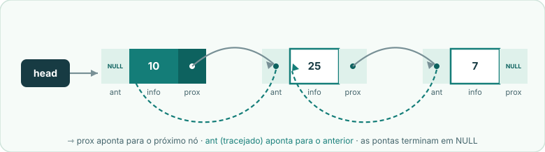

## Objetivos de aprendizagem

Ao final deste tópico, você deverá ser capaz de:

- Descrever a anatomia de um nó duplo (`ant`, `info` e `prox`).
- Executar inserção e remoção atualizando os dois encadeamentos, inclusive nas extremidades.
- Implementar as operações básicas em C.
- Avaliar o custo extra de memória em troca da navegação nos dois sentidos.

## Introdução

Na lista simplesmente encadeada, cada nó só conhece o próximo: o percurso é uma via de mão única. Uma **lista duplamente encadeada** funciona como os vagões de um trem: de qualquer vagão, você pode seguir para a frente ou voltar para o vagão anterior.

Essa segunda referência tem um preço — cada nó ocupa mais memória e toda alteração precisa manter dois encadeamentos consistentes —, mas simplifica operações como remover um nó conhecido e percorrer a lista de trás para frente.

## Conceito principal

Cada nó guarda três campos: a referência para o nó **anterior** (`ant`), o **dado** (`info`) e a referência para o **próximo** (`prox`).

{align=center width=90%}

No primeiro nó, `ant` vale `NULL`; no último, `prox` vale `NULL`. Essas pontas vazias marcam os limites da lista nos dois sentidos.

## Exemplo

### 1. Inserção após um nó conhecido

Para inserir `novo` logo após um nó `ant`, quatro referências precisam mudar — e a ordem evita perder o restante da lista:

```text
Situação inicial:  ... [ A ] <==> [ B ] ...

Passo 1: novo->ant  = ant          o novo nó aponta para A
Passo 2: novo->prox = ant->prox    o novo nó aponta para B
Passo 3: ant->prox->ant = novo     B passa a apontar de volta para o novo nó
Passo 4: ant->prox = novo          A passa a apontar para o novo nó

Resultado:         ... [ A ] <==> [ novo ] <==> [ B ] ...
```

> **Atenção:** se `ant` for o último nó, `ant->prox` é `NULL` e o passo 3 deve ser pulado — não existe nó seguinte para atualizar. Tratar as extremidades separadamente evita desreferenciar `NULL`.

### 2. Remoção de um nó conhecido

Com as duas referências, remover um nó `atual` já localizado não exige percorrer a lista: basta "costurar" os vizinhos entre si.

```text
Passo 1: atual->ant->prox = atual->prox    o anterior aponta para o próximo
Passo 2: atual->prox->ant = atual->ant     o próximo aponta para o anterior
Passo 3: free(atual)                        o nó é liberado

... [ A ] <==> [ X ] <==> [ B ] ...   se torna   ... [ A ] <==> [ B ] ...
```

## Implementação em C

```explicado c
#include <stdio.h>
#include <stdlib.h>

typedef struct NoDuplo {
    int info;
    struct NoDuplo *ant;
    struct NoDuplo *prox;
} NoDuplo;

NoDuplo* inserir_inicio(NoDuplo *head, int valor) {
    NoDuplo *novo = (NoDuplo*) malloc(sizeof(NoDuplo));
    if (novo == NULL) return head; @@ Falta de memória: a lista não muda.
    novo->info = valor; @@ Guarda o dado no novo nó.
    novo->ant = NULL; @@ O novo nó será o primeiro: não tem anterior.
    novo->prox = head; @@ O próximo do novo nó é o antigo primeiro.
    if (head != NULL) head->ant = novo; @@ O antigo primeiro aponta de volta para o novo.
    return novo; @@ O novo nó passa a ser a cabeça da lista.
}

void remover_no(NoDuplo **head, NoDuplo *atual) {
    if (atual == NULL) return; @@ Nada a remover.
    if (atual->ant != NULL) @@ Se existe um nó anterior...
        atual->ant->prox = atual->prox; @@ ...ele passa a apontar para o próximo do removido.
    else
        *head = atual->prox; @@ Removendo o primeiro: a cabeça avança.
    if (atual->prox != NULL) @@ Se existe um próximo nó...
        atual->prox->ant = atual->ant; @@ ...ele passa a apontar para o anterior do removido.
    free(atual); @@ Libera a memória do nó removido.
}
```

## Comparação e complexidade

| Operação | Lista simples | Lista dupla |
|:--|:--:|--:|
| Inserir no início | O(1) | O(1) |
| Remover um nó **conhecido** | O(n), pois é preciso achar o anterior | O(1), o anterior vem de `ant` |
| Percorrer de trás para frente | Não é possível | O(n), seguindo `ant` |
| Memória por nó | 1 referência | 2 referências |

A lista dupla troca memória por conveniência: paga-se uma referência a mais por nó e operações com mais atribuições, em troca de remoção direta e percurso nos dois sentidos.

## Teste de conhecimento

```quiz
{
  "question": "Na inserção de 'novo' após o nó 'ant', qual é o efeito de executar 'ant->prox = novo' antes de 'novo->prox = ant->prox'?",
  "options": [
    { "text": "Nenhum, pois na lista dupla a ordem das atribuições não importa.", "correct": false },
    { "text": "O endereço do antigo sucessor de 'ant' se perde, e 'novo->prox' fica apontando para o próprio 'novo'.", "correct": true },
    { "text": "O campo 'ant' do novo nó fica com valor incorreto, mas o encadeamento para frente continua certo.", "correct": false }
  ],
  "correctFeedback": "Correto! Assim como na lista simples, é preciso salvar o sucessor antigo antes de sobrescrever ant->prox.",
  "incorrectFeedback": "Rastreie o valor de ant->prox após a primeira atribuição: o que a segunda linha lê? Tente novamente."
}
```

```quiz
{
  "question": "Por que remover um nó já localizado custa O(1) na lista duplamente encadeada e O(n) na simplesmente encadeada?",
  "options": [
    { "text": "Porque na lista dupla o campo 'ant' fornece o nó anterior sem percurso, permitindo costurar os vizinhos diretamente.", "correct": true },
    { "text": "Porque na lista dupla o sistema operacional libera a memória em tempo constante.", "correct": false },
    { "text": "Porque na lista simples a função free() precisa percorrer todos os nós antes de liberar.", "correct": false }
  ],
  "correctFeedback": "Isso! Na lista simples é preciso percorrer desde head até achar quem aponta para o nó removido; na dupla, atual->ant resolve na hora.",
  "incorrectFeedback": "Pense no que é necessário para remover: atualizar o anterior e o próximo. Qual informação falta na lista simples? Tente novamente."
}
```
