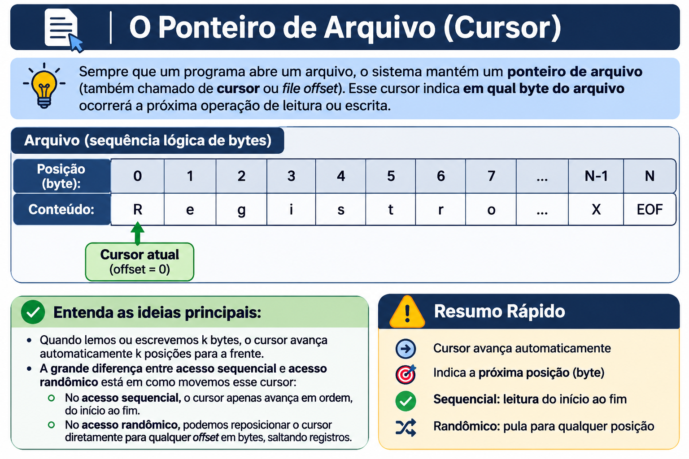
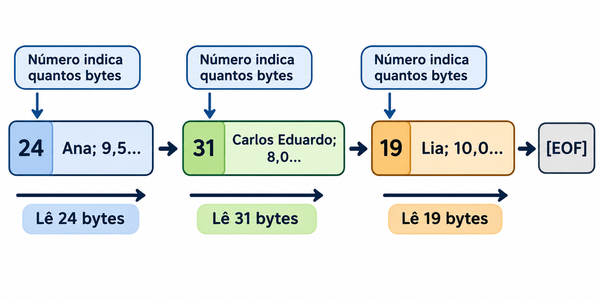
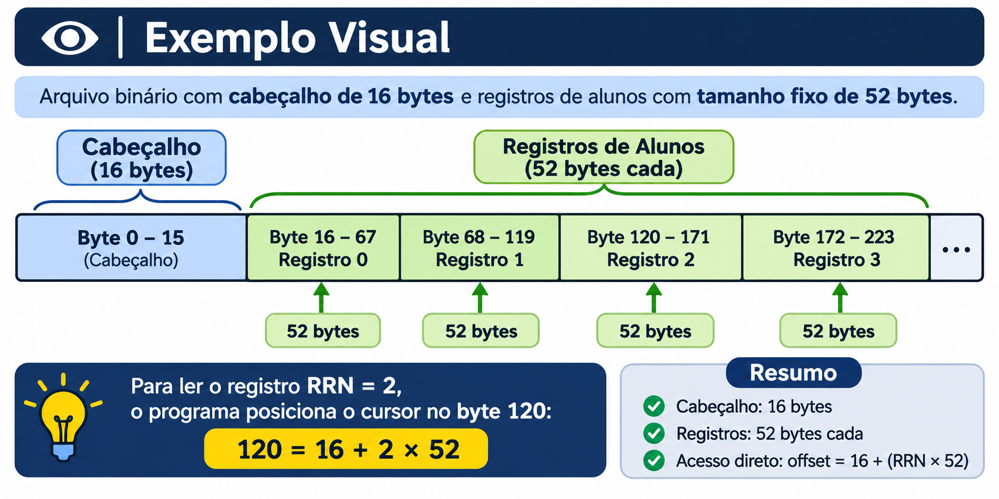

# Acesso Sequencial e Acesso Randômico em Arquivos

---

## Objetivos de Aprendizagem

Ao concluir este módulo da trilha, você será capaz de:

1. Compreender como o **ponteiro de arquivo** controla a posição de leitura e escrita em bytes.
2. Explicar o funcionamento, as operações e os custos em **acessos a disco (E/S)** do **acesso sequencial** e do **acesso randômico (direto)**.
3. Relacionar o **tipo de registro** (tamanho fixo vs. tamanho variável) à viabilidade do acesso randômico por **RRN** (*Relative Record Number*).
4. Implementar operações de leitura sequencial, salto direto (`fseek`), atualização *in-place*.
5. Escolher conscientemente entre acesso sequencial e acesso randômico em diferentes cenários práticos, evitando armadilhas de desempenho em memória secundária.

---

## 1. Conexão com a Trilha: Onde Estamos?

Nos módulos anteriores desta trilha, construímos duas bases essenciais:

- Em **Organização em Memória Secundária**, vimos que o disco é muito mais lento que a memória RAM e que os dados são transferidos em **blocos (páginas)**, envolvendo custos físicos como tempo de busca (*seek*), latência e transferência.
- Em **Arquivos**, vimos como estruturar dados persistentes em **campos** e **registros** (de tamanho fixo ou variável), organizados em arquivos texto ou binários.

Agora surge a pergunta central deste módulo:

> **Uma vez que os registros estão gravados em um arquivo, como o programa navega até o registro desejado para ler, buscar, alterar ou remover dados com eficiência?**

A resposta passa por dois modelos fundamentais de navegação: **Acesso Sequencial** e **Acesso Randômico (Direto)**.

### O Ponteiro de Arquivo (Cursor)

Sempre que um programa abre um arquivo, o Sistema Operacional mantém um **ponteiro de arquivo** (também chamado de **cursor** ou *file offset*). Esse cursor é simplesmente um número inteiro que indica **em qual byte do arquivo** ocorrerá a próxima operação de leitura ou escrita.



- Quando lemos ou escrevemos `k` bytes, o cursor avança automaticamente `k` posições para a frente.
- A grande diferença entre **acesso sequencial** e **acesso randômico** está em **como movemos esse cursor**:
  - No **acesso sequencial**, o cursor apenas avança em ordem, do início ao fim.
  - No **acesso randômico**, podemos reposicionar o cursor diretamente para qualquer *offset* em bytes, saltando registros intermediários.

---

## 2. Acesso Sequencial

No **acesso sequencial**, os registros são lidos ou gravados **em ordem, um após o outro**, a partir do início do arquivo até encontrar o dado desejado ou atingir o fim do arquivo (`EOF` — *End of File*).

> **Analogia:** Pense em uma fita cassete ou em ler um caderno sem índice. Para chegar à 50ª anotação, você precisa passar pelas 49 anteriores.

### Compatibilidade com Tipos de Registro

Uma grande vantagem do acesso sequencial é sua flexibilidade estrutural. Ele funciona naturalmente com:

- **Registros de tamanho fixo:** lê-se sempre a mesma quantidade de bytes por iteração.
- **Registros de tamanho variável:** seja com **delimitadores** (ex.: `;` e `\n` em arquivos CSV) ou com **indicador de tamanho** (um inteiro antes do registro informando quantos bytes ler em seguida). Como a leitura é feita em ordem, o programa sempre sabe onde termina um registro e onde começa o próximo.



### Operações Principais e Custo em E/S

Em AEDS 2, ao analisar algoritmos em **memória secundária**, a métrica dominante não é apenas o número de comparações na CPU, mas sim o **número de acessos a blocos de disco (operações de E/S)**.

Considere um arquivo com $n$ registros distribuídos em $B$ blocos no disco:

| Operação | Como funciona no acesso sequencial | Custo em E/S (blocos) |
| :--- | :--- | :--- |
| **Percurso completo** | Lê o arquivo do primeiro ao último registro (ex.: relatórios, folhas de pagamento). | `O(B)` — lê todos os $B$ blocos uma única vez |
| **Busca (arquivo desordenado)** | Lê registro a registro até achar a chave ou chegar ao `EOF`. | Melhor: `O(1)` \| Médio: $\approx \frac{B}{2}$ \| Pior: `O(B)` |
| **Busca (arquivo ordenado)** | Igual à anterior, mas permite **parada antecipada** assim que encontrar uma chave maior que a procurada. | Melhor: `O(1)` \| Médio: $\approx \frac{B}{2}$ \| Pior: `O(B)` |
| **Inserção no final (*append*)** | Posiciona no fim do arquivo e grava o novo registro. | `O(1)` |
| **Inserção ordenada** | Precisa abrir espaço no meio do arquivo — na prática, exige **reescrever** o arquivo (ou copiar para um arquivo temporário). | `O(B)` |
| **Atualização / Remoção física** | Especialmente com tamanho variável, alterar ou remover um registro no meio muda os deslocamentos seguintes, exigindo **reescrita** do arquivo. | `O(B)` |

### Pontos Fortes e Limitações

- **Pontos fortes:**
  - Simplicidade de implementação.
  - Aceita registros de tamanho variável sem desperdício de espaço (*padding*).
  - **Excelente desempenho em processamento em lote (*batch*):** como os blocos costumam estar próximos no disco, o Sistema Operacional aproveita **bufferização** e **leitura antecipada (*prefetching*)**, reduzindo drasticamente o custo médio por registro.
- **Limitações:**
  - Ineficiente para consultas pontuais frequentes (ex.: buscar 1 cliente específico entre 5 milhões de registros).
  - Manutenção de dados (atualizações e remoções frequentes no meio do arquivo) exige reescritas custosas.

```quiz
{
  "question": "Por que a remoção física de um registro no meio de um arquivo sequencial com registros de tamanho variável é uma operação custosa?",
  "options": [
    { "text": "Porque o sistema operacional proíbe apagar registros em arquivos sequenciais.", "correct": false },
    { "text": "Porque exige deslocar todos os registros posteriores, o que na prática implica reescrever grande parte ou todo o arquivo (O(B) acessos a disco).", "correct": true },
    { "text": "Porque arquivos sequenciais só aceitam registros de tamanho fixo.", "correct": false }
  ],
  "correctFeedback": "Correto! Como não é possível 'encolher' bytes no meio de um arquivo diretamente, remover fisicamente exige reescrever os dados subsequentes, custando O(B) em operações de E/S.",
  "incorrectFeedback": "Releia a tabela de operações do acesso sequencial e pense no que acontece com os bytes seguintes quando um registro do meio deixa de existir."
}
```

---

## 3. Acesso Randômico (Acesso Direto)

No **acesso randômico** (também chamado de **acesso direto** ou **acesso aleatório**), o programa pode mover o cursor diretamente para **qualquer byte do arquivo** sem precisar ler os registros anteriores.

> **Analogia:** Pense em abrir um livro diretamente na página 184 ou acessar um elemento `v[42]` de um vetor na memória RAM — você vai direto ao ponto, sem folhear as páginas anteriores.

### O Pré-requisito Fundamental: Registros de Tamanho Fixo e RRN

Para saltar diretamente até o *k*-ésimo registro de um arquivo sem ler os anteriores, precisamos conseguir **calcular exatamente em qual byte ele começa**.

Isso é trivial quando todos os registros têm o **mesmo tamanho fixo** ($T$ bytes). Nesse caso, identificamos cada registro pelo seu **RRN** (*Relative Record Number* — Número Relativo de Registro, começando em `0`):

$$\text{offset} = \text{tamanho\_cabecalho} + \text{RRN} \times \text{tamanho\_registro}$$

Se o arquivo não tiver cabeçalho ($\text{tamanho\_cabecalho} = 0$), a fórmula simplifica para:

$$\text{offset} = \text{RRN} \times \text{tamanho\_registro}$$

#### Exemplo visual

Suponha um arquivo binário com **cabeçalho de 16 bytes** e registros de alunos com **tamanho fixo de 52 bytes**:



Para ler o registro `RRN = 2`, o programa simplesmente posiciona o cursor no byte `120` e lê `52` bytes — **sem tocar nos registros `0` e `1`**!

> **E se os registros tiverem tamanho variável?**  
> Sem um tamanho fixo, não existe uma fórmula matemática que converta `RRN` em `offset`, pois o início do registro 2 depende do tamanho real dos registros 0 e 1. Nesses casos, o acesso direto só é possível com ajuda de uma estrutura auxiliar que guarde os *offsets* (os **índices**, tema do próximo módulo da trilha!).

### Primitivas de Controle do Cursor

As linguagens oferecem funções/métodos diretos para mover e consultar o cursor do arquivo usando três pontos de referência: **início**, **posição atual** e **fim do arquivo**.

| Ação | C (`stdio.h`) | Java (`RandomAccessFile`) | Python |
| :--- | :--- | :--- | :--- |
| Mover a partir do início | `fseek(fp, offset, SEEK_SET)` | `raf.seek(offset)` | `f.seek(offset, 0)` |
| Mover a partir da posição atual | `fseek(fp, delta, SEEK_CUR)` | `raf.seek(raf.getFilePointer() + delta)` | `f.seek(delta, 1)` |
| Mover a partir do fim | `fseek(fp, delta, SEEK_END)` | `raf.seek(raf.length() + delta)` | `f.seek(delta, 2)` |
| Consultar posição atual (bytes) | `ftell(fp)` | `raf.getFilePointer()` | `f.tell()` |
| Voltar ao início | `rewind(fp)` | `raf.seek(0)` | `f.seek(0)` |

> **Dica de AEDS 2:** Com `fseek(fp, 0, SEEK_END)` seguido de `ftell(fp)`, você descobre o **tamanho total do arquivo em bytes**. Dividindo `(tamanho_total - tamanho_cabecalho)` por `sizeof(Registro)`, você obtém imediatamente a quantidade total de registros (`n`) em `O(1)`!

### Operações Permitidas pelo Acesso Randômico

#### 1. Leitura direta por RRN — `O(1)`
Calcula-se o *offset*, chama-se `seek` e lê-se o registro. Exige **1 acesso a bloco** no disco (independentemente de o arquivo ter 100 ou 10 milhões de registros).

#### 2. Pesquisa Binária diretamente em Arquivo — `O(log n)`
Se o arquivo possuir **registros de tamanho fixo** e estiver **ordenado pela chave de busca**, o acesso randômico permite aplicar **Pesquisa Binária** diretamente sobre o disco:

1. Calcula `meio = (esq + dir) / 2`.
2. Posiciona o cursor em `meio * sizeof(Registro)` com `fseek`.
3. Lê apenas 1 registro e compara a chave.
4. Descarta metade do arquivo a cada iteração.

Para **1.000.000 de registros**, enquanto a busca sequencial pode precisar ler todo o arquivo, a pesquisa binária em arquivo encontra (ou descarta) a chave em **no máximo $\lceil \log_2(1.000.000) \rceil = 20$ leituras**!

#### 3. Atualização *in-place* (no próprio local)
Como o registro tem tamanho fixo, alterar um campo (por exemplo, atualizar a nota de um aluno ou o saldo de uma conta) **não altera o tamanho do registro**. Basta:

1. Posicionar o cursor no *offset* do registro;
2. Sobrescrever o registro modificado no mesmo lugar (`fwrite`).

Não é necessário criar arquivo temporário nem reescrever o restante do arquivo!


```quiz
{
  "question": "Um arquivo binário de acesso randômico possui um cabeçalho de 12 bytes seguido por registros de tamanho fixo de 80 bytes (RRN iniciando em 0). Em qual deslocamento (offset em bytes) começa o registro de RRN = 10?",
  "options": [
    { "text": "800 bytes", "correct": false },
    { "text": "812 bytes", "correct": true },
    { "text": "732 bytes", "correct": false },
    { "text": "892 bytes", "correct": false }
  ],
  "correctFeedback": "Correto! Pela fórmula offset = tamanho_cabecalho + RRN × tamanho_registro, temos 12 + 10 × 80 = 812 bytes.",
  "incorrectFeedback": "Lembre-se de somar o tamanho do cabeçalho ao produto RRN × tamanho_registro (com RRN começando em 0)."
}
```

---

## 4. Comparativo: Acesso Sequencial vs. Acesso Randômico

| Critério | Acesso Sequencial | Acesso Randômico (Direto) |
| :--- | :--- | :--- |
| **Tipo de registro** | Fixo ou variável | Tipicamente **tamanho fixo** (para cálculo direto de RRN) |
| **Uso de espaço em disco** | Compacto (com registros variáveis) | Pode haver desperdício interno (*padding* nos campos fixos) |
| **Leitura do registro `k`** | `O(k)` — precisa percorrer `0..k-1` | `O(1)` — salto direto pelo *offset* |
| **Busca por chave (desordenado)** | `O(B)` blocos | `O(B)` blocos (sem índice ou ordenação, ainda precisa varrer) |
| **Busca por chave (ordenado)** | `O(B)` (com parada antecipada) | **`O(log n)`** (via Pesquisa Binária em arquivo) |
| **Inserção no final** | `O(1)` | `O(1)` (ou em espaço livre via *avail list*) |
| **Atualização de registro** | `O(B)` (reescrita do arquivo) | **`O(1)`** (atualização *in-place*) |
| **Remoção de registro** | `O(B)` (remoção física) | **`O(1)`** (remoção lógica com lápide) |
| **Varredura total (100% dos dados)** | **Muito eficiente** (blocos contíguos + *prefetch*) | Mais lenta se feita em ordem aleatória |
| **Exemplos clássicos de uso** | Logs, backups, CSVs, processamento *batch*, streaming | Bancos de dados, sistemas de cadastro/consulta online (OLTP) |

### Mito Comum: "Acesso randômico é sempre mais rápido?"

**Não!** Essa é uma das lições mais importantes que conecta este módulo ao módulo anterior de **Organização em Memória Secundária**.

Imagine que um arquivo possui **1.000.000 de registros** armazenados em **10.000 blocos** (100 registros por bloco):

- **Cenário A — Consultar 1 único registro (pelo RRN ou por chave em arquivo ordenado):**
  - Acesso randômico vence com folga: **1 acesso** (por RRN) ou até **20 acessos** (pesquisa binária), contra até **10.000 blocos** na varredura sequencial.
- **Cenário B — Ler todos os registros (ou uma grande fração deles) para gerar um relatório:**
  - **Acesso sequencial é muito mais rápido!** Ele lê cada um dos 10.000 blocos uma única vez, em sequência contígua, aproveitando *buffers* e leitura antecipada do SO.
  - Fazer 1.000.000 de acessos randômicos em posições espalhadas desperdiçaria o restante dos 99 registros trazidos em cada bloco e multiplicaria o número de operações de *seek* e leitura de disco.

> **Regra de ouro em AEDS 2:**  
> Use **acesso sequencial** quando precisar processar **grande parte ou todos os registros** do arquivo.  
> Use **acesso randômico** quando precisar localizar, atualizar ou remover **registros específicos** rapidamente.

---

## 5. Exemplos Práticos em C

Os exemplos a seguir usam um arquivo binário com registros de tamanho fixo (`Aluno`) para demonstrar, lado a lado, o acesso sequencial e o acesso randômico.

> **Observação sobre `sizeof`:** Em C, sempre use `sizeof(Aluno)` ao calcular *offsets* em vez de somar manualmente o tamanho dos campos, pois o compilador pode inserir bytes de alinhamento (*padding*) na `struct`.

### Estrutura do Registro

```c
#include <stdio.h>
#include <string.h>

typedef struct {
    int matricula;   // Chave de identificação
    char nome[40];   // Campo de tamanho fixo
    float nota;
    int ativo;       // 1 = ativo, 0 = removido logicamente (lápide)
} Aluno;
```

### Exemplo 1: Gravação e Leitura Sequencial

Percorremos todos os registros do início ao fim do arquivo, ignorando registros removidos logicamente.

```c
void listarSequencial(FILE *arq) {
    Aluno a;

    // Garante que o cursor comece no byte 0
    rewind(arq);

    printf("--- Listagem Sequencial ---\n");
    int rrn = 0;

    // fread avança o cursor automaticamente em sizeof(Aluno) bytes a cada leitura
    while (fread(&a, sizeof(Aluno), 1, arq) == 1) {
        if (a.ativo) {
            printf("[RRN %d] Matricula: %d | Nome: %s | Nota: %.2f\n",
                   rrn, a.matricula, a.nome, a.nota);
        }
        rrn++;
    }
}
```

```codigo
{"title": "Acesso sequencial: leitura registro a registro", "code": "#include <stdio.h>\n\ntypedef struct {\n    int matricula;\n    char nome[40];\n    float nota;\n    int ativo;\n} Aluno; /* 52 bytes por registro */\n\nvoid listarSequencial(FILE *arq) {\n    Aluno a;\n    rewind(arq);\n    int rrn = 0;\n    while (fread(&a, sizeof(Aluno), 1, arq) == 1) {\n        if (a.ativo) {\n            printf(\"[RRN %d] %s: %.1f\\n\", rrn, a.nome, a.nota);\n        }\n        rrn++;\n    }\n}\n\nint main(void) {\n    FILE *arq = fopen(\"alunos.dat\", \"rb\");\n    listarSequencial(arq);\n    fclose(arq);\n    return 0;\n}", "steps": [{"line": 24, "caption": "Abrimos o arquivo binário alunos.dat com 3 registros de 52 bytes (156 bytes no total) e chamamos listarSequencial.", "vars": {}, "rows": [[{"s": 0, "n": 4, "i": [["R0", "", 5], ["R1", "g", 6], ["R2", "", 7], ["·", "g", 0]], "l": "arquivo (R0 = Ana, R1 = Bruno [removido], R2 = Carla)"}], [{"s": 0, "n": 4, "i": [["0", "", 5], ["52", "", 6], ["104", "", 7], ["156", "", 0]], "l": "offset em bytes (cada registro ocupa 52 bytes; 156 = EOF)"}]], "stack": "main"}, {"line": 12, "caption": "rewind(arq) posiciona o ponteiro de arquivo (cursor) no byte 0, início do arquivo.", "vars": {"cursor (byte)": 0}, "rows": [[{"s": 0, "n": 4, "i": [["R0", "c", 5], ["R1", "g", 6], ["R2", "", 7], ["·", "g", 0]], "l": "arquivo (R0 = Ana, R1 = Bruno [removido], R2 = Carla)"}], [{"s": 0, "n": 4, "i": [["0", "c", 5], ["52", "", 6], ["104", "", 7], ["156", "", 0]], "l": "offset em bytes (cada registro ocupa 52 bytes; 156 = EOF)"}]], "stack": "listarSequencial ← main"}, {"line": 14, "caption": "O primeiro fread lê 52 bytes (RRN 0: Ana) e avança o cursor automaticamente para o byte 52.", "vars": {"rrn": 0, "cursor (byte)": 52}, "rows": [[{"s": 0, "n": 4, "i": [["R0", "p", 5], ["R1", "g", 6], ["R2", "", 7], ["·", "g", 0]], "l": "arquivo (R0 = Ana, R1 = Bruno [removido], R2 = Carla)"}], [{"s": 0, "n": 4, "i": [["0", "", 5], ["52", "c", 6], ["104", "", 7], ["156", "", 0]], "l": "offset em bytes (cada registro ocupa 52 bytes; 156 = EOF)"}], [{"i": [["Ana", "p", 5], ["8.5", "p", 10], ["ativo=1", "p", 12]], "l": "registro carregado na struct a (nome, nota, ativo)"}]], "stack": "listarSequencial ← main"}, {"line": 16, "caption": "Como a.ativo == 1, o registro de Ana é exibido. Em seguida, rrn passa para 1.", "vars": {"rrn": 0, "ativo": 1}, "rows": [[{"s": 0, "n": 4, "i": [["R0", "p", 5], ["R1", "g", 6], ["R2", "", 7], ["·", "g", 0]], "l": "arquivo (R0 = Ana, R1 = Bruno [removido], R2 = Carla)"}], [{"s": 0, "n": 4, "i": [["0", "", 5], ["52", "c", 6], ["104", "", 7], ["156", "", 0]], "l": "offset em bytes (cada registro ocupa 52 bytes; 156 = EOF)"}], [{"i": [["Ana", "p", 5], ["8.5", "p", 10], ["ativo=1", "p", 12]], "l": "registro carregado na struct a (nome, nota, ativo)"}]], "stack": "listarSequencial ← main"}, {"line": 14, "caption": "Sem precisar de fseek, o segundo fread lê os próximos 52 bytes (RRN 1: Bruno) e move o cursor para o byte 104.", "vars": {"rrn": 1, "cursor (byte)": 104}, "rows": [[{"s": 0, "n": 4, "i": [["R0", "", 5], ["R1", "c", 6], ["R2", "", 7], ["·", "g", 0]], "l": "arquivo (R0 = Ana, R1 = Bruno [removido], R2 = Carla)"}], [{"s": 0, "n": 4, "i": [["0", "", 5], ["52", "", 6], ["104", "c", 7], ["156", "", 0]], "l": "offset em bytes (cada registro ocupa 52 bytes; 156 = EOF)"}], [{"i": [["Bruno", "g", 6], ["6.0", "g", 10], ["ativo=0", "g", 0]], "l": "registro carregado na struct a (nome, nota, ativo)"}]], "stack": "listarSequencial ← main"}, {"line": 15, "caption": "Bruno possui lápide (ativo == 0), então o if falha e o registro é ignorado na listagem.", "vars": {"rrn": 1, "ativo": 0}, "rows": [[{"s": 0, "n": 4, "i": [["R0", "", 5], ["R1", "g", 6], ["R2", "", 7], ["·", "g", 0]], "l": "arquivo (R0 = Ana, R1 = Bruno [removido], R2 = Carla)"}], [{"s": 0, "n": 4, "i": [["0", "", 5], ["52", "", 6], ["104", "c", 7], ["156", "", 0]], "l": "offset em bytes (cada registro ocupa 52 bytes; 156 = EOF)"}], [{"i": [["Bruno", "g", 6], ["6.0", "g", 10], ["ativo=0", "g", 0]], "l": "registro carregado na struct a (nome, nota, ativo)"}]], "stack": "listarSequencial ← main"}, {"line": 14, "caption": "O terceiro fread lê o RRN 2 (Carla) do byte 104 ao 156. O cursor agora aponta para o fim do arquivo (EOF).", "vars": {"rrn": 2, "cursor (byte)": 156}, "rows": [[{"s": 0, "n": 4, "i": [["R0", "", 5], ["R1", "g", 6], ["R2", "p", 7], ["·", "g", 0]], "l": "arquivo (R0 = Ana, R1 = Bruno [removido], R2 = Carla)"}], [{"s": 0, "n": 4, "i": [["0", "", 5], ["52", "", 6], ["104", "", 7], ["156", "c", 0]], "l": "offset em bytes (cada registro ocupa 52 bytes; 156 = EOF)"}], [{"i": [["Carla", "p", 7], ["9.2", "p", 10], ["ativo=1", "p", 12]], "l": "registro carregado na struct a (nome, nota, ativo)"}]], "stack": "listarSequencial ← main"}, {"line": 14, "caption": "Na quarta tentativa, fread retorna 0 (atingiu EOF no byte 156) e encerra o laço sequencial.", "vars": {"rrn": 3, "retorno fread": 0}, "rows": [[{"s": 0, "n": 4, "i": [["R0", "", 5], ["R1", "g", 6], ["R2", "", 7], ["·", "c", 0]], "l": "arquivo (R0 = Ana, R1 = Bruno [removido], R2 = Carla)"}], [{"s": 0, "n": 4, "i": [["0", "", 5], ["52", "", 6], ["104", "", 7], ["156", "c", 0]], "l": "offset em bytes (cada registro ocupa 52 bytes; 156 = EOF)"}]], "stack": "listarSequencial ← main"}]}
```


### Exemplo 2: Acesso Randômico por RRN, Atualização *In-Place* e Remoção Lógica

Note o modo de abertura `"r+b"` (leitura e escrita em modo binário sem apagar o arquivo existente).

```c
// Leitura direta em O(1) pelo RRN
int lerPorRRN(FILE *arq, int rrn, Aluno *saida) {
    long offset = (long)rrn * sizeof(Aluno);

    if (fseek(arq, offset, SEEK_SET) != 0) {
        return 0; // Erro no posicionamento
    }
    return fread(saida, sizeof(Aluno), 1, arq) == 1 && saida->ativo;
}

// Atualização in-place da nota de um aluno em O(1)
int atualizarNota(FILE *arq, int rrn, float novaNota) {
    Aluno a;
    long offset = (long)rrn * sizeof(Aluno);

    // 1. Vai até o registro e lê seus dados atuais
    if (fseek(arq, offset, SEEK_SET) != 0 || fread(&a, sizeof(Aluno), 1, arq) != 1) {
        return 0;
    }
    if (!a.ativo) return 0; // Registro já foi removido

    // 2. Modifica o campo em memória
    a.nota = novaNota;

    // 3. Reposiciona o cursor no MESMO offset (pois o fread anterior avançou o cursor!)
    fseek(arq, offset, SEEK_SET);

    // 4. Sobrescreve o registro no mesmo local
    return fwrite(&a, sizeof(Aluno), 1, arq) == 1;
}

// Remoção lógica (lápide) em O(1)
int removerLogicamente(FILE *arq, int rrn) {
    Aluno a;
    long offset = (long)rrn * sizeof(Aluno);

    if (fseek(arq, offset, SEEK_SET) != 0 || fread(&a, sizeof(Aluno), 1, arq) != 1) {
        return 0;
    }

    a.ativo = 0; // Marca como removido (lápide)
    fseek(arq, offset, SEEK_SET);
    return fwrite(&a, sizeof(Aluno), 1, arq) == 1;
}
```

> **Atenção ao detalhe clássico de prova e laboratório!**  
> Na função `atualizarNota`, após executar `fread`, o cursor **já avançou para o registro seguinte** (`rrn + 1`). Se você esquecer de chamar `fseek(arq, offset, SEEK_SET)` (ou `fseek(arq, -(long)sizeof(Aluno), SEEK_CUR)`) antes do `fwrite`, vai acabar sobrescrevendo o **próximo registro** por engano!

```codigo
{"title": "Acesso randômico: atualização in-place com fseek", "code": "#include <stdio.h>\n\ntypedef struct {\n    int matricula;\n    char nome[40];\n    float nota;\n    int ativo;\n} Aluno; /* 52 bytes */\n\nint atualizarNota(FILE *arq, int rrn, float novaNota) {\n    Aluno a;\n    long offset = (long)rrn * sizeof(Aluno);\n    fseek(arq, offset, SEEK_SET);\n    if (fread(&a, sizeof(Aluno), 1, arq) != 1 || !a.ativo) return 0;\n    a.nota = novaNota;\n    fseek(arq, offset, SEEK_SET); /* reposiciona antes de gravar! */\n    return fwrite(&a, sizeof(Aluno), 1, arq) == 1;\n}\n\nint main(void) {\n    FILE *arq = fopen(\"alunos.dat\", \"r+b\");\n    atualizarNota(arq, 1, 9.5f);\n    fclose(arq);\n    return 0;\n}", "steps": [{"line": 22, "caption": "Queremos alterar a nota do registro RRN 1 (Bruno) para 9.5 diretamente no disco, sem reescrever o arquivo.", "vars": {"rrn": 1, "novaNota": 9.5}, "rows": [[{"s": 0, "n": 4, "i": [["R0", "", 5], ["R1", "", 6], ["R2", "", 7], ["·", "g", 0]], "l": "arquivo (R0 = Ana, R1 = Bruno, R2 = Carla)"}], [{"s": 0, "n": 4, "i": [["0", "", 5], ["52", "", 6], ["104", "", 7], ["156", "", 0]], "l": "offset em bytes (RRN × 52)"}]], "stack": "main"}, {"line": 12, "caption": "Calculamos o deslocamento exato: offset = 1 × 52 = 52 bytes.", "vars": {"rrn": 1, "offset": 52}, "rows": [[{"s": 0, "n": 4, "i": [["R0", "", 5], ["R1", "c", 6], ["R2", "", 7], ["·", "g", 0]], "l": "arquivo (R0 = Ana, R1 = Bruno, R2 = Carla)"}], [{"s": 0, "n": 4, "i": [["0", "", 5], ["52", "c", 6], ["104", "", 7], ["156", "", 0]], "l": "offset em bytes (RRN × 52)"}]], "stack": "atualizarNota ← main"}, {"line": 13, "caption": "fseek salta diretamente para o byte 52, ignorando completamente o RRN 0.", "vars": {"offset": 52, "cursor (byte)": 52}, "rows": [[{"s": 0, "n": 4, "i": [["R0", "", 5], ["R1", "c", 6], ["R2", "", 7], ["·", "g", 0]], "l": "arquivo (R0 = Ana, R1 = Bruno, R2 = Carla)"}], [{"s": 0, "n": 4, "i": [["0", "", 5], ["52", "c", 6], ["104", "", 7], ["156", "", 0]], "l": "offset em bytes (RRN × 52)"}]], "stack": "atualizarNota ← main"}, {"line": 14, "caption": "fread lê os 52 bytes de Bruno para a memória. Atenção: o cursor avançou sozinho para o byte 104 (início de R2)!", "vars": {"offset": 52, "cursor (byte)": 104}, "rows": [[{"s": 0, "n": 4, "i": [["R0", "", 5], ["R1", "p", 6], ["R2", "", 7], ["·", "g", 0]], "l": "arquivo (R0 = Ana, R1 = Bruno, R2 = Carla)"}], [{"s": 0, "n": 4, "i": [["0", "", 5], ["52", "", 6], ["104", "c", 7], ["156", "", 0]], "l": "offset em bytes (RRN × 52)"}], [{"i": [["Bruno", "p", 6], ["6.0", "p", 10], ["ativo=1", "p", 12]], "l": "variável a na memória RAM"}]], "stack": "atualizarNota ← main"}, {"line": 15, "caption": "Atualizamos a.nota = 9.5 apenas na memória RAM. No disco, o byte 52 ainda guarda a nota antiga (6.0).", "vars": {"a.nota": 9.5, "cursor (byte)": 104}, "rows": [[{"s": 0, "n": 4, "i": [["R0", "", 5], ["R1", "p", 6], ["R2", "", 7], ["·", "g", 0]], "l": "arquivo (R0 = Ana, R1 = Bruno, R2 = Carla)"}], [{"s": 0, "n": 4, "i": [["0", "", 5], ["52", "", 6], ["104", "c", 7], ["156", "", 0]], "l": "offset em bytes (RRN × 52)"}], [{"i": [["Bruno", "p", 6], ["9.5", "c", 12], ["ativo=1", "p", 12]], "l": "variável a na memória RAM"}]], "stack": "atualizarNota ← main"}, {"line": 16, "caption": "Passo crucial: chamamos fseek novamente para voltar o cursor do byte 104 para o byte 52 (offset original).", "vars": {"offset": 52, "cursor (byte)": 52}, "rows": [[{"s": 0, "n": 4, "i": [["R0", "", 5], ["R1", "c", 6], ["R2", "", 7], ["·", "g", 0]], "l": "arquivo (R0 = Ana, R1 = Bruno, R2 = Carla)"}], [{"s": 0, "n": 4, "i": [["0", "", 5], ["52", "c", 6], ["104", "", 7], ["156", "", 0]], "l": "offset em bytes (RRN × 52)"}], [{"i": [["Bruno", "p", 6], ["9.5", "p", 12], ["ativo=1", "p", 12]], "l": "variável a na memória RAM"}]], "stack": "atualizarNota ← main"}, {"line": 17, "caption": "fwrite sobrescreve os 52 bytes a partir do byte 52 (atualização in-place). O cursor vai para 104 e R0 e R2 permanecem intactos.", "vars": {"offset": 52, "cursor (byte)": 104}, "rows": [[{"s": 0, "n": 4, "i": [["R0", "", 5], ["R1", "p", 6], ["R2", "", 7], ["·", "g", 0]], "l": "arquivo (R0 = Ana, R1 = Bruno, R2 = Carla)"}], [{"s": 0, "n": 4, "i": [["0", "", 5], ["52", "", 6], ["104", "c", 7], ["156", "", 0]], "l": "offset em bytes (RRN × 52)"}], [{"i": [["Bruno", "p", 6], ["9.5", "p", 12], ["ativo=1", "p", 12]], "l": "variável a na memória RAM"}]], "stack": "atualizarNota ← main"}]}
```

### Exemplo 3: Pesquisa Binária Diretamente em Arquivo (`O(log n)`)

Pressupõe que os registros estão **ordenados por `matricula`** e têm **tamanho fixo**.

```c
// Retorna o RRN encontrado ou -1 se não existir
int buscaBinariaArquivo(FILE *arq, int matriculaAlvo) {
    // Descobre quantos registros existem no arquivo em O(1)
    fseek(arq, 0, SEEK_END);
    long totalBytes = ftell(arq);
    int n = (int)(totalBytes / sizeof(Aluno));

    int esq = 0, dir = n - 1;
    Aluno a;

    while (esq <= dir) {
        int meio = esq + (dir - esq) / 2;

        // Salto randômico direto para o registro do meio
        fseek(arq, (long)meio * sizeof(Aluno), SEEK_SET);
        fread(&a, sizeof(Aluno), 1, arq);

        if (a.matricula == matriculaAlvo) {
            return a.ativo ? meio : -1;
        } else if (a.matricula < matriculaAlvo) {
            esq = meio + 1;
        } else {
            dir = meio - 1;
        }
    }
    return -1; // Não encontrado
}
```

```codigo
{"title": "Pesquisa binária em arquivo: O(log n) acessos a disco", "code": "#include <stdio.h>\n\ntypedef struct {\n    int matricula;\n    char nome[40];\n    float nota;\n    int ativo;\n} Aluno; /* 52 bytes, ordenado por matricula */\n\nint buscaBinariaArquivo(FILE *arq, int alvo) {\n    fseek(arq, 0, SEEK_END);\n    int n = (int)(ftell(arq) / sizeof(Aluno));\n    int esq = 0, dir = n - 1;\n    Aluno a;\n    while (esq <= dir) {\n        int meio = esq + (dir - esq) / 2;\n        fseek(arq, (long)meio * sizeof(Aluno), SEEK_SET);\n        fread(&a, sizeof(Aluno), 1, arq);\n        if (a.matricula == alvo) return a.ativo ? meio : -1;\n        else if (a.matricula < alvo) esq = meio + 1;\n        else dir = meio - 1;\n    }\n    return -1;\n}\n\nint main(void) {\n    FILE *arq = fopen(\"ordenado.dat\", \"rb\");\n    int rrn = buscaBinariaArquivo(arq, 405);\n    fclose(arq);\n    return 0;\n}", "steps": [{"line": 28, "caption": "Queremos localizar a matrícula 405 em um arquivo ordenado com 5 registros de tamanho fixo.", "vars": {"alvo": 405}, "rows": [[{"s": 0, "n": 5, "i": [["102", "", 5], ["210", "", 6], ["315", "", 7], ["405", "", 8], ["590", "", 5]], "l": "chaves (matricula) no arquivo ordenado (52 bytes cada)"}], [{"s": 0, "n": 5, "i": [["RRN 0", "", 5], ["RRN 1", "", 6], ["RRN 2", "", 7], ["RRN 3", "", 8], ["RRN 4", "", 5]], "l": "índice relativo (offset = RRN × 52)"}]], "stack": "main"}, {"line": 12, "caption": "fseek até SEEK_END + ftell retorna 260 bytes. Dividindo por 52 bytes, descobrimos n = 5 registros em O(1).", "vars": {"totalBytes": 260, "n": 5}, "rows": [[{"s": 0, "n": 5, "i": [["102", "", 5], ["210", "", 6], ["315", "", 7], ["405", "", 8], ["590", "", 5]], "l": "chaves (matricula) no arquivo ordenado (52 bytes cada)"}], [{"s": 0, "n": 5, "i": [["RRN 0", "", 5], ["RRN 1", "", 6], ["RRN 2", "", 7], ["RRN 3", "", 8], ["RRN 4", "", 5]], "l": "índice relativo (offset = RRN × 52)"}]], "stack": "buscaBinariaArquivo ← main"}, {"line": 16, "caption": "Iteração 1: esq = 0, dir = 4. Calculamos o registro central meio = 2.", "vars": {"esq": 0, "dir": 4, "meio": 2}, "rows": [[{"s": 0, "n": 5, "i": [["102", "", 5], ["210", "", 6], ["315", "c", 7], ["405", "", 8], ["590", "", 5]], "l": "chaves (matricula) no arquivo ordenado (52 bytes cada)"}], [{"s": 0, "n": 5, "i": [["RRN 0", "", 5], ["RRN 1", "", 6], ["RRN 2", "c", 7], ["RRN 3", "", 8], ["RRN 4", "", 5]], "l": "índice relativo (offset = RRN × 52)"}]], "stack": "buscaBinariaArquivo ← main"}, {"line": 18, "caption": "Saltamos direto ao byte 104 (2 × 52) e lemos o RRN 2: matrícula 315.", "vars": {"meio": 2, "offset": 104, "a.matricula": 315}, "rows": [[{"s": 0, "n": 5, "i": [["102", "", 5], ["210", "", 6], ["315", "c", 7], ["405", "", 8], ["590", "", 5]], "l": "chaves (matricula) no arquivo ordenado (52 bytes cada)"}], [{"s": 0, "n": 5, "i": [["RRN 0", "", 5], ["RRN 1", "", 6], ["RRN 2", "c", 7], ["RRN 3", "", 8], ["RRN 4", "", 5]], "l": "índice relativo (offset = RRN × 52)"}], [{"i": [["315", "c", 7], ["Carla", "p", 10]], "l": "registro lido do disco para comparação"}]], "stack": "buscaBinariaArquivo ← main"}, {"line": 20, "caption": "Como 315 < 405, descartamos toda a metade esquerda (RRNs 0, 1 e 2) ajustando esq = 3.", "vars": {"esq": 3, "dir": 4, "alvo": 405}, "rows": [[{"s": 0, "n": 5, "i": [["102", "g", 5], ["210", "g", 6], ["315", "g", 7], ["405", "", 8], ["590", "", 5]], "l": "chaves (matricula) no arquivo ordenado (52 bytes cada)"}], [{"s": 0, "n": 5, "i": [["RRN 0", "g", 5], ["RRN 1", "g", 6], ["RRN 2", "g", 7], ["RRN 3", "", 8], ["RRN 4", "", 5]], "l": "índice relativo (offset = RRN × 52)"}]], "stack": "buscaBinariaArquivo ← main"}, {"line": 16, "caption": "Iteração 2: no intervalo restante [3..4], calculamos meio = 3 + (4 - 3) / 2 = 3.", "vars": {"esq": 3, "dir": 4, "meio": 3}, "rows": [[{"s": 0, "n": 5, "i": [["102", "g", 5], ["210", "g", 6], ["315", "g", 7], ["405", "c", 8], ["590", "", 5]], "l": "chaves (matricula) no arquivo ordenado (52 bytes cada)"}], [{"s": 0, "n": 5, "i": [["RRN 0", "g", 5], ["RRN 1", "g", 6], ["RRN 2", "g", 7], ["RRN 3", "c", 8], ["RRN 4", "", 5]], "l": "índice relativo (offset = RRN × 52)"}]], "stack": "buscaBinariaArquivo ← main"}, {"line": 19, "caption": "Saltamos ao byte 156 (3 × 52), lemos a matrícula 405 == alvo e retornamos RRN = 3 com apenas 2 leituras de disco!", "vars": {"meio": 3, "offset": 156, "retorno": 3}, "rows": [[{"s": 0, "n": 5, "i": [["102", "g", 5], ["210", "g", 6], ["315", "g", 7], ["405", "p", 8], ["590", "", 5]], "l": "chaves (matricula) no arquivo ordenado (52 bytes cada)"}], [{"s": 0, "n": 5, "i": [["RRN 0", "g", 5], ["RRN 1", "g", 6], ["RRN 2", "g", 7], ["RRN 3", "p", 8], ["RRN 4", "", 5]], "l": "índice relativo (offset = RRN × 52)"}], [{"i": [["405", "p", 8], ["Davi", "p", 12]], "l": "registro lido do disco para comparação"}]], "stack": "buscaBinariaArquivo ← main"}]}
```

---

## 6. Quiz de Fixação

Teste seu entendimento sobre os conceitos deste módulo:

```quiz
{
  "question": "Qual é o principal motivo de a Pesquisa Binária em arquivo exigir acesso randômico em vez de acesso sequencial?",
  "options": [
    { "text": "Porque a Pesquisa Binária precisa saltar diretamente para o registro central (meio) em O(1) sem ler os registros anteriores.", "correct": true },
    { "text": "Porque arquivos sequenciais não podem ser mantidos ordenados.", "correct": false },
    { "text": "Porque o acesso randômico elimina a necessidade de os dados estarem ordenados.", "correct": false }
  ],
  "correctFeedback": "Correto! Para atingir O(log n) acessos a disco, o algoritmo precisa posicionar o cursor diretamente no registro 'meio' em cada iteração, o que só é possível com acesso randômico.",
  "incorrectFeedback": "Pense no passo fundamental da Pesquisa Binária: como ela descarta metade do arquivo a cada iteração? O que aconteceria se precisasse ler todos os registros até o meio?"
}
```

```quiz
{
  "question": "Ao implementar uma atualização in-place em C (lendo o registro com fread e gravando a versão alterada com fwrite), o que acontece se você NÃO reposicionar o cursor com fseek entre o fread e o fwrite?",
  "options": [
    { "text": "O registro atual é atualizado corretamente, pois o cursor só avança em operações de escrita.", "correct": false },
    { "text": "O programa sobrescreve o registro seguinte ao desejado, pois o fread já avançou o cursor em sizeof(Registro) bytes.", "correct": true },
    { "text": "O arquivo é automaticamente truncado na posição atual.", "correct": false }
  ],
  "correctFeedback": "Correto! Toda leitura com fread avança o cursor; por isso é indispensável voltar ao offset original (com SEEK_SET ou SEEK_CUR negativo) antes de chamar fwrite.",
  "incorrectFeedback": "Revise como o ponteiro de arquivo se comporta após cada operação de leitura na Seção 1 e no Exemplo 2."
}
```

```quiz
{
  "question": "Em um sistema que precisa gerar mensalmente um relatório lendo 100% dos 2 milhões de registros de um arquivo em disco, qual padrão de acesso tende a ser mais eficiente?",
  "options": [
    { "text": "Acesso randômico em ordem aleatória, pois cada leitura custa O(1).", "correct": false },
    { "text": "Acesso sequencial do início ao fim, aproveitando a leitura contígua de blocos, bufferização e prefetching do sistema operacional.", "correct": true },
    { "text": "Ambos têm exatamente o mesmo tempo de execução, pois leem o mesmo volume de dados.", "correct": false }
  ],
  "correctFeedback": "Correto! Quando todos os registros precisam ser visitados, a varredura sequencial minimiza seeks e aproveita todos os registros carregados em cada bloco de disco.",
  "incorrectFeedback": "Releia o tópico 'Mito Comum: Acesso randômico é sempre mais rápido?' e considere o custo de seek e a transferência por blocos em memória secundária."
}
```

```quiz
{
  "question": "Qual é a principal função da 'lápide' (remoção lógica) combinada com uma lista de espaços livres (avail list) em arquivos de acesso randômico?",
  "options": [
    { "text": "Permitir que registros de tamanho variável sejam acessados por RRN.", "correct": false },
    { "text": "Remover registros em O(1) sem reescrever o arquivo nem invalidar os RRNs existentes, permitindo reaproveitar os espaços liberados em futuras inserções.", "correct": true },
    { "text": "Ordenar automaticamente o arquivo toda vez que um registro é apagado.", "correct": false }
  ],
  "correctFeedback": "Correto! A remoção lógica evita reescritas custosas e mantém os RRNs estáveis, enquanto a avail list reaproveita os 'buracos' deixados no arquivo.",
  "incorrectFeedback": "Revise o item 4 da Seção 3 sobre remoção lógica e reaproveitamento de espaço."
}
```

---


## 7. Ponte para o Próximo Módulo da Trilha

Neste módulo, vimos **como o programa navega pelos bytes de um arquivo** (de forma sequencial ou randômica) e percebemos uma lição central: o desempenho das operações de busca, inserção, atualização e remoção depende diretamente de **como os dados estão estruturados e distribuídos dentro do arquivo**.
Com isso, surgem perguntas fundamentais que vão guiar a próxima etapa:
**Como organizar campos e registros dentro de um arquivo** (tamanho fixo vs. variável, delimitadores, indicadores de tamanho, cabeçalhos e metadados) para equilibrar economia de espaço e facilidade de acesso?
**Como dispor e gerenciar os registros ao longo do tempo** (arquivos desordenados/*heap*, ordenados, controle de fragmentação, espaços livres e compactação) para atender bem aos padrões de acesso da aplicação?
É exatamente isso que vamos explorar no próximo passo da trilha:
> **Próximo Módulo 🔜:** **Organização de Dados em Arquivos** — técnicas para estruturar registros, gerenciar espaço em disco e escolher o layout ideal para cada tipo de operação!