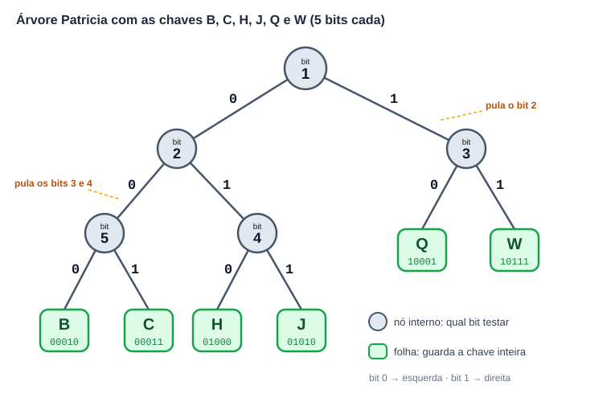

## Objetivos de aprendizagem

Ao final deste tópico, você deverá ser capaz de:

- Explicar o problema da Trie que a árvore Patricia resolve.
- Interpretar uma árvore Patricia: o que guardam os nós internos e as folhas.
- Executar a pesquisa e a inserção de chaves, bit a bit.
- Explicar por que a pesquisa precisa comparar a chave inteira no final.
- Comparar o custo e o espaço da Patricia com a Trie e outras estruturas.

## Introdução

Na Trie, cada nível consome um símbolo da chave. Quando as chaves são longas e há poucas delas, a árvore fica cheia de **caminhos sem bifurcação**: nós com um único filho, que não ajudam a separar uma chave da outra, mas ocupam memória e aumentam a altura.

A árvore **Patricia** (*Practical Algorithm To Retrieve Information Coded In Alphanumeric*, proposta por Morrison em 1968) elimina esses caminhos. Em vez de testar todos os bits da chave, um depois do outro, ela testa **só os bits que realmente distinguem** as chaves armazenadas e pula os demais.

## Conceito principal

Neste tópico, as chaves são sequências de bits do mesmo tamanho. Uma árvore Patricia é uma árvore binária em que:

- cada **nó interno** guarda o **índice de um bit**, ou seja, qual posição da chave deve ser testada nele;
- se esse bit da chave vale 0, a pesquisa segue para a **esquerda**; se vale 1, segue para a **direita**;
- as **folhas** (nós externos) guardam as **chaves inteiras**;
- ao descer da raiz até uma folha, os índices testados são sempre **crescentes**;
- todo nó interno tem exatamente dois filhos. Com *n* chaves, a árvore tem *n* folhas e *n* − 1 nós internos.

> A Patricia é uma Trie binária compactada: os nós que só teriam um filho são removidos, e o nó que sobra anota qual bit testar. A mesma ideia de juntar caminhos sem bifurcação aparece nas *radix trees*, que trabalham com caracteres em vez de bits.

### Exemplo de estrutura

Considere as chaves `B`, `C`, `H`, `J`, `Q` e `W`, representadas com 5 bits pela posição da letra no alfabeto: B = 2 = `00010`, C = 3 = `00011`, H = 8 = `01000`, J = 10 = `01010`, Q = 17 = `10001` e W = 23 = `10111`. Os bits são numerados de 1 a 5, da esquerda para a direita.

{align=center width=100%}

Observe os saltos:

- B e C só diferem no bit 5. Depois de testar o bit 2, a árvore vai direto para o bit 5, **pulando os bits 3 e 4**, que são iguais nas duas chaves.
- Q e W começam com 1 e diferem no bit 3. O bit 2 é igual nas duas, então a árvore **pula o bit 2** nesse ramo.

Uma Trie binária comum precisaria de um nível para cada um dos 5 bits. A Patricia usa no máximo 3 testes até qualquer folha.

### Por que comparar a chave no final?

Como alguns bits são pulados, chegar a uma folha **não garante** que a chave procurada esteja nela. Procurando D = `00100`: o bit 1 vale 0, o bit 2 vale 0 e o bit 5 vale 0, então a pesquisa chega à folha **B** = `00010`. Os bits testados coincidem, mas D e B diferem justamente nos bits 3 e 4, que foram pulados. Por isso, ao chegar à folha, a Patricia faz **uma única comparação da chave inteira**.

## Representação em C

Os nós internos e as folhas guardam informações diferentes, então usamos um `union` com um campo `tipo` que diz qual dos dois é o nó.

```c
#define NBITS 5                     /* cada chave tem 5 bits */
typedef unsigned char Chave;

typedef enum { Interno, Externo } TipoNo;

typedef struct NoPat {
    TipoNo tipo;
    union {
        struct {
            int indice;             /* qual bit testar (1 = o mais à esquerda) */
            struct NoPat *esq, *dir;
        } interno;
        Chave chave;                /* só as folhas guardam chave */
    } u;
} NoPat;

/* devolve o i-ésimo bit de k, contando da esquerda (i = 1..NBITS) */
int bit(int i, Chave k) {
    return (k >> (NBITS - i)) & 1;
}
```

- `tipo` indica se o nó é `Interno` ou `Externo` (folha).
- Em um nó interno, `indice` diz qual bit testar, e `esq`/`dir` são os filhos para os bits 0 e 1.
- Em uma folha, `chave` guarda a chave completa.
- `bit(i, k)` desloca `k` para a direita até o bit `i` ficar na última posição e isola esse bit com `& 1`.

> Exemplo de `bit`: para k = J = `01010` e i = 4, `k >> (5 − 4)` desloca uma posição e dá `0101`; `& 1` pega o último bit, que vale 1. De fato, o 4º bit de `01010` é 1.

Nos programas abaixo, clique em **Executar** e acompanhe a linha amarela. Na tela escura, cada nível da árvore é uma linha: os bonequinhos marrons com rótulo **testa bit** são nós internos (o número em cima é o índice do bit), e os coloridos são folhas, com os bits da chave embaixo. A linha de cima mostra a chave em uso, com o bit testado em destaque, e o colchete amarelo mostra o nó atual.

## Operações

### Inserção

A inserção de uma chave *k* tem três etapas:

1. **Descer até uma folha**, como numa pesquisa, testando os bits indicados nos nós internos.
2. **Comparar *k* com a chave dessa folha** e achar o primeiro bit *i* em que elas diferem. Se não houver diferença, a chave já está na árvore.
3. **Criar um nó interno que testa o bit *i***. Ele é colocado descendo de novo a partir da raiz, até encontrar uma folha ou um nó que testa um bit maior que *i*. Assim, os índices continuam crescentes ao descer. A folha de *k* fica à esquerda ou à direita do nó novo, conforme o bit *i* de *k*.

O programa abaixo insere B, C, H, J, Q e W, nessa ordem. Repare na inserção de H: o nó que testa o bit 2 entra **acima** do nó que testa o bit 5. Na inserção de Q, aparece uma nova raiz.

```codigo
{"title":"Inserindo B, C, H, J, Q e W na árvore Patricia","cols":7,"code":"#include <stdio.h>\n#include <stdlib.h>\n\n#define NBITS 5                     /* cada chave tem 5 bits */\ntypedef unsigned char Chave;\n\ntypedef enum { Interno, Externo } TipoNo;\n\ntypedef struct NoPat {\n    TipoNo tipo;\n    union {\n        struct {\n            int indice;             /* qual bit testar (1 = o mais à esquerda) */\n            struct NoPat *esq, *dir;\n        } interno;\n        Chave chave;                /* só as folhas guardam chave */\n    } u;\n} NoPat;\n\n/* devolve o i-ésimo bit de k, contando da esquerda (i = 1..NBITS) */\nint bit(int i, Chave k) {\n    return (k >> (NBITS - i)) & 1;\n}\n\nNoPat *criaExterno(Chave k) {\n    NoPat *p = malloc(sizeof(NoPat));\n    p->tipo = Externo;\n    p->u.chave = k;\n    return p;\n}\n\nNoPat *criaInterno(int i, NoPat *esq, NoPat *dir) {\n    NoPat *p = malloc(sizeof(NoPat));\n    p->tipo = Interno;\n    p->u.interno.indice = i;\n    p->u.interno.esq = esq;\n    p->u.interno.dir = dir;\n    return p;\n}\n\n/* desce enquanto o nó testa um bit menor que i; ali cria o nó novo */\nNoPat *insereEntre(Chave k, NoPat *t, int i) {\n    if (t->tipo == Externo || i < t->u.interno.indice) {\n        NoPat *folha = criaExterno(k);\n        if (bit(i, k) == 1) return criaInterno(i, t, folha);\n        else return criaInterno(i, folha, t);\n    }\n    if (bit(t->u.interno.indice, k) == 1)\n        t->u.interno.dir = insereEntre(k, t->u.interno.dir, i);\n    else\n        t->u.interno.esq = insereEntre(k, t->u.interno.esq, i);\n    return t;\n}\n\nNoPat *insere(Chave k, NoPat *t) {\n    if (t == NULL) return criaExterno(k);\n    NoPat *p = t;\n    while (p->tipo == Interno) {               /* 1) desce até uma folha */\n        if (bit(p->u.interno.indice, k) == 1) p = p->u.interno.dir;\n        else p = p->u.interno.esq;\n    }\n    int i = 1;                                 /* 2) primeiro bit diferente */\n    while (i <= NBITS && bit(i, k) == bit(i, p->u.chave)) i++;\n    if (i > NBITS) return t;                   /* a chave já está na árvore */\n    return insereEntre(k, t, i);               /* 3) cria o nó que testa o bit i */\n}\n\nenum { B = 2, C = 3, H = 8, J = 10, Q = 17, W = 23 };   /* posição da letra no alfabeto */\n\nint main(void) {\n    NoPat *t = NULL;\n    t = insere(B, t);\n    t = insere(C, t);\n    t = insere(H, t);\n    t = insere(J, t);\n    t = insere(Q, t);\n    t = insere(W, t);\n    return 0;\n}","steps":[{"line":72,"caption":"Vamos inserir **B** (00010).","vars":{},"rows":[[{"i":[["0","",6],["0","",6],["0","",6],["1","",2],["0","",6]],"l":"chave B = 00010 (bits 1 a 5)"}],[],[],[],[]],"stack":"main"},{"line":56,"caption":"A árvore está vazia: a chave B vira uma **folha**, que é a raiz.","vars":{"k":"B = 00010"},"rows":[[{"i":[["0","",6],["0","",6],["0","",6],["1","",2],["0","",6]],"l":"chave B = 00010 (bits 1 a 5)"}],[{"s":0.5,"n":1,"i":[["B","p",6]],"l":"00010"}],[],[],[]],"stack":"insere ← main"},{"line":73,"caption":"Vamos inserir **C** (00011).","vars":{},"rows":[[{"i":[["0","",6],["0","",6],["0","",6],["1","",2],["1","",2]],"l":"chave C = 00011 (bits 1 a 5)"}],[{"s":0.5,"n":1,"i":[["B","",6]],"l":"00010"}],[],[],[]],"stack":"main"},{"line":63,"caption":"Chegamos à folha **B** (00010). Comparando com C (00011) bit a bit, o primeiro bit diferente é o **bit 5**.","vars":{"k":"C = 00011","folha":"B = 00010","i":5},"rows":[[{"i":[["0","",6],["0","",6],["0","",6],["1","",2],["1","p",2]],"l":"chave C = 00011 (bits 1 a 5)"}],[{"s":0.5,"n":1,"i":[["B","c",6]],"l":"00010","a":1}],[],[],[]],"stack":"insere ← main"},{"line":43,"caption":"Paramos: chegamos a uma folha (B). O nó que testa o bit 5 entra **aqui**, no lugar da raiz, porque os testes precisam aparecer em ordem crescente de bit ao descer.","vars":{"i":5},"rows":[[{"i":[["0","",6],["0","",6],["0","",6],["1","",2],["1","p",2]],"l":"chave C = 00011 (bits 1 a 5)"}],[{"s":0.5,"n":1,"i":[["B","c",6]],"l":"00010","a":1}],[],[],[]],"stack":"insereEntre ← insere ← main"},{"line":45,"caption":"Criamos a folha C e um nó interno que testa o **bit 5**. O bit 5 de C vale 1, então C fica à direita e o que estava ali fica do outro lado.","vars":{"i":5,"bit(5, k)":1},"rows":[[{"i":[["0","",6],["0","",6],["0","",6],["1","",2],["1","p",2]],"l":"chave C = 00011 (bits 1 a 5)"}],[{"s":1,"n":1,"i":[["5","p",0]],"l":"testa bit"}],[{"s":0.5,"n":1,"i":[["B","",6]],"l":"00010"},{"s":1.5,"n":1,"i":[["C","p",4]],"l":"00011"}],[],[]],"stack":"insereEntre ← insere ← main"},{"line":74,"caption":"Vamos inserir **H** (01000).","vars":{},"rows":[[{"i":[["0","",6],["1","",2],["0","",6],["0","",6],["0","",6]],"l":"chave H = 01000 (bits 1 a 5)"}],[{"s":1,"n":1,"i":[["5","",0]],"l":"testa bit"}],[{"s":0.5,"n":1,"i":[["B","",6]],"l":"00010"},{"s":1.5,"n":1,"i":[["C","",4]],"l":"00011"}],[],[]],"stack":"main"},{"line":59,"caption":"O nó testa o **bit 5** de H, que vale 0: vamos para a esquerda.","vars":{"k":"H = 01000","indice":5,"bit(5, k)":0},"rows":[[{"i":[["0","",6],["1","",2],["0","",6],["0","",6],["0","c",6]],"l":"chave H = 01000 (bits 1 a 5)"}],[{"s":1,"n":1,"i":[["5","c",0]],"l":"testa bit","a":1}],[{"s":0.5,"n":1,"i":[["B","",6]],"l":"00010"},{"s":1.5,"n":1,"i":[["C","",4]],"l":"00011"}],[],[]],"stack":"insere ← main"},{"line":63,"caption":"Chegamos à folha **B** (00010). Comparando com H (01000) bit a bit, o primeiro bit diferente é o **bit 2**.","vars":{"k":"H = 01000","folha":"B = 00010","i":2},"rows":[[{"i":[["0","",6],["1","p",2],["0","",6],["0","",6],["0","",6]],"l":"chave H = 01000 (bits 1 a 5)"}],[{"s":1,"n":1,"i":[["5","",0]],"l":"testa bit"}],[{"s":0.5,"n":1,"i":[["B","c",6]],"l":"00010","a":1},{"s":1.5,"n":1,"i":[["C","",4]],"l":"00011"}],[],[]],"stack":"insere ← main"},{"line":43,"caption":"Paramos: este nó testa o bit 5, maior que 2. O nó que testa o bit 2 entra **aqui**, no lugar da raiz, porque os testes precisam aparecer em ordem crescente de bit ao descer.","vars":{"i":2},"rows":[[{"i":[["0","",6],["1","p",2],["0","",6],["0","",6],["0","",6]],"l":"chave H = 01000 (bits 1 a 5)"}],[{"s":1,"n":1,"i":[["5","c",0]],"l":"testa bit","a":1}],[{"s":0.5,"n":1,"i":[["B","",6]],"l":"00010"},{"s":1.5,"n":1,"i":[["C","",4]],"l":"00011"}],[],[]],"stack":"insereEntre ← insere ← main"},{"line":45,"caption":"Criamos a folha H e um nó interno que testa o **bit 2**. O bit 2 de H vale 1, então H fica à direita e o que estava ali fica do outro lado.","vars":{"i":2,"bit(2, k)":1},"rows":[[{"i":[["0","",6],["1","p",2],["0","",6],["0","",6],["0","",6]],"l":"chave H = 01000 (bits 1 a 5)"}],[{"s":1.5,"n":1,"i":[["2","p",0]],"l":"testa bit"}],[{"s":1,"n":1,"i":[["5","",0]],"l":"testa bit"},{"s":2.5,"n":1,"i":[["H","p",2]],"l":"01000"}],[{"s":0.5,"n":1,"i":[["B","",6]],"l":"00010"},{"s":1.5,"n":1,"i":[["C","",4]],"l":"00011"}],[]],"stack":"insereEntre ← insere ← main"},{"line":75,"caption":"Vamos inserir **J** (01010).","vars":{},"rows":[[{"i":[["0","",6],["1","",2],["0","",6],["1","",2],["0","",6]],"l":"chave J = 01010 (bits 1 a 5)"}],[{"s":1.5,"n":1,"i":[["2","",0]],"l":"testa bit"}],[{"s":1,"n":1,"i":[["5","",0]],"l":"testa bit"},{"s":2.5,"n":1,"i":[["H","",2]],"l":"01000"}],[{"s":0.5,"n":1,"i":[["B","",6]],"l":"00010"},{"s":1.5,"n":1,"i":[["C","",4]],"l":"00011"}],[]],"stack":"main"},{"line":59,"caption":"O nó testa o **bit 2** de J, que vale 1: vamos para a direita.","vars":{"k":"J = 01010","indice":2,"bit(2, k)":1},"rows":[[{"i":[["0","",6],["1","c",2],["0","",6],["1","",2],["0","",6]],"l":"chave J = 01010 (bits 1 a 5)"}],[{"s":1.5,"n":1,"i":[["2","c",0]],"l":"testa bit","a":1}],[{"s":1,"n":1,"i":[["5","",0]],"l":"testa bit"},{"s":2.5,"n":1,"i":[["H","",2]],"l":"01000"}],[{"s":0.5,"n":1,"i":[["B","",6]],"l":"00010"},{"s":1.5,"n":1,"i":[["C","",4]],"l":"00011"}],[]],"stack":"insere ← main"},{"line":63,"caption":"Chegamos à folha **H** (01000). Comparando com J (01010) bit a bit, o primeiro bit diferente é o **bit 4**.","vars":{"k":"J = 01010","folha":"H = 01000","i":4},"rows":[[{"i":[["0","",6],["1","",2],["0","",6],["1","p",2],["0","",6]],"l":"chave J = 01010 (bits 1 a 5)"}],[{"s":1.5,"n":1,"i":[["2","",0]],"l":"testa bit"}],[{"s":1,"n":1,"i":[["5","",0]],"l":"testa bit"},{"s":2.5,"n":1,"i":[["H","c",2]],"l":"01000","a":1}],[{"s":0.5,"n":1,"i":[["B","",6]],"l":"00010"},{"s":1.5,"n":1,"i":[["C","",4]],"l":"00011"}],[]],"stack":"insere ← main"},{"line":48,"caption":"O nó testa o bit 2, menor que 4: o nó novo fica **abaixo** dele. Como o bit 2 de J vale 1, seguimos para a direita.","vars":{"i":4,"indice":2},"rows":[[{"i":[["0","",6],["1","c",2],["0","",6],["1","p",2],["0","",6]],"l":"chave J = 01010 (bits 1 a 5)"}],[{"s":1.5,"n":1,"i":[["2","c",0]],"l":"testa bit","a":1}],[{"s":1,"n":1,"i":[["5","",0]],"l":"testa bit"},{"s":2.5,"n":1,"i":[["H","",2]],"l":"01000"}],[{"s":0.5,"n":1,"i":[["B","",6]],"l":"00010"},{"s":1.5,"n":1,"i":[["C","",4]],"l":"00011"}],[]],"stack":"insereEntre ← insere ← main"},{"line":43,"caption":"Paramos: chegamos a uma folha (H). O nó que testa o bit 4 entra **aqui**, entre o pai e este nó, porque os testes precisam aparecer em ordem crescente de bit ao descer.","vars":{"i":4},"rows":[[{"i":[["0","",6],["1","",2],["0","",6],["1","p",2],["0","",6]],"l":"chave J = 01010 (bits 1 a 5)"}],[{"s":1.5,"n":1,"i":[["2","",0]],"l":"testa bit"}],[{"s":1,"n":1,"i":[["5","",0]],"l":"testa bit"},{"s":2.5,"n":1,"i":[["H","c",2]],"l":"01000","a":1}],[{"s":0.5,"n":1,"i":[["B","",6]],"l":"00010"},{"s":1.5,"n":1,"i":[["C","",4]],"l":"00011"}],[]],"stack":"insereEntre ← insereEntre ← insere ← main"},{"line":45,"caption":"Criamos a folha J e um nó interno que testa o **bit 4**. O bit 4 de J vale 1, então J fica à direita e o que estava ali fica do outro lado.","vars":{"i":4,"bit(4, k)":1},"rows":[[{"i":[["0","",6],["1","",2],["0","",6],["1","p",2],["0","",6]],"l":"chave J = 01010 (bits 1 a 5)"}],[{"s":2,"n":1,"i":[["2","",0]],"l":"testa bit"}],[{"s":1,"n":1,"i":[["5","",0]],"l":"testa bit"},{"s":3,"n":1,"i":[["4","p",0]],"l":"testa bit"}],[{"s":0.5,"n":1,"i":[["B","",6]],"l":"00010"},{"s":1.5,"n":1,"i":[["C","",4]],"l":"00011"},{"s":2.5,"n":1,"i":[["H","",2]],"l":"01000"},{"s":3.5,"n":1,"i":[["J","p",8]],"l":"01010"}],[]],"stack":"insereEntre ← insereEntre ← insere ← main"},{"line":76,"caption":"Vamos inserir **Q** (10001).","vars":{},"rows":[[{"i":[["1","",2],["0","",6],["0","",6],["0","",6],["1","",2]],"l":"chave Q = 10001 (bits 1 a 5)"}],[{"s":2,"n":1,"i":[["2","",0]],"l":"testa bit"}],[{"s":1,"n":1,"i":[["5","",0]],"l":"testa bit"},{"s":3,"n":1,"i":[["4","",0]],"l":"testa bit"}],[{"s":0.5,"n":1,"i":[["B","",6]],"l":"00010"},{"s":1.5,"n":1,"i":[["C","",4]],"l":"00011"},{"s":2.5,"n":1,"i":[["H","",2]],"l":"01000"},{"s":3.5,"n":1,"i":[["J","",8]],"l":"01010"}],[]],"stack":"main"},{"line":59,"caption":"O nó testa o **bit 2** de Q, que vale 0: vamos para a esquerda.","vars":{"k":"Q = 10001","indice":2,"bit(2, k)":0},"rows":[[{"i":[["1","",2],["0","c",6],["0","",6],["0","",6],["1","",2]],"l":"chave Q = 10001 (bits 1 a 5)"}],[{"s":2,"n":1,"i":[["2","c",0]],"l":"testa bit","a":1}],[{"s":1,"n":1,"i":[["5","",0]],"l":"testa bit"},{"s":3,"n":1,"i":[["4","",0]],"l":"testa bit"}],[{"s":0.5,"n":1,"i":[["B","",6]],"l":"00010"},{"s":1.5,"n":1,"i":[["C","",4]],"l":"00011"},{"s":2.5,"n":1,"i":[["H","",2]],"l":"01000"},{"s":3.5,"n":1,"i":[["J","",8]],"l":"01010"}],[]],"stack":"insere ← main"},{"line":59,"caption":"O nó testa o **bit 5** de Q, que vale 1: vamos para a direita.","vars":{"k":"Q = 10001","indice":5,"bit(5, k)":1},"rows":[[{"i":[["1","",2],["0","",6],["0","",6],["0","",6],["1","c",2]],"l":"chave Q = 10001 (bits 1 a 5)"}],[{"s":2,"n":1,"i":[["2","",0]],"l":"testa bit"}],[{"s":1,"n":1,"i":[["5","c",0]],"l":"testa bit","a":1},{"s":3,"n":1,"i":[["4","",0]],"l":"testa bit"}],[{"s":0.5,"n":1,"i":[["B","",6]],"l":"00010"},{"s":1.5,"n":1,"i":[["C","",4]],"l":"00011"},{"s":2.5,"n":1,"i":[["H","",2]],"l":"01000"},{"s":3.5,"n":1,"i":[["J","",8]],"l":"01010"}],[]],"stack":"insere ← main"},{"line":63,"caption":"Chegamos à folha **C** (00011). Comparando com Q (10001) bit a bit, o primeiro bit diferente é o **bit 1**.","vars":{"k":"Q = 10001","folha":"C = 00011","i":1},"rows":[[{"i":[["1","p",2],["0","",6],["0","",6],["0","",6],["1","",2]],"l":"chave Q = 10001 (bits 1 a 5)"}],[{"s":2,"n":1,"i":[["2","",0]],"l":"testa bit"}],[{"s":1,"n":1,"i":[["5","",0]],"l":"testa bit"},{"s":3,"n":1,"i":[["4","",0]],"l":"testa bit"}],[{"s":0.5,"n":1,"i":[["B","",6]],"l":"00010"},{"s":1.5,"n":1,"i":[["C","c",4]],"l":"00011","a":1},{"s":2.5,"n":1,"i":[["H","",2]],"l":"01000"},{"s":3.5,"n":1,"i":[["J","",8]],"l":"01010"}],[]],"stack":"insere ← main"},{"line":43,"caption":"Paramos: este nó testa o bit 2, maior que 1. O nó que testa o bit 1 entra **aqui**, no lugar da raiz, porque os testes precisam aparecer em ordem crescente de bit ao descer.","vars":{"i":1},"rows":[[{"i":[["1","p",2],["0","",6],["0","",6],["0","",6],["1","",2]],"l":"chave Q = 10001 (bits 1 a 5)"}],[{"s":2,"n":1,"i":[["2","c",0]],"l":"testa bit","a":1}],[{"s":1,"n":1,"i":[["5","",0]],"l":"testa bit"},{"s":3,"n":1,"i":[["4","",0]],"l":"testa bit"}],[{"s":0.5,"n":1,"i":[["B","",6]],"l":"00010"},{"s":1.5,"n":1,"i":[["C","",4]],"l":"00011"},{"s":2.5,"n":1,"i":[["H","",2]],"l":"01000"},{"s":3.5,"n":1,"i":[["J","",8]],"l":"01010"}],[]],"stack":"insereEntre ← insere ← main"},{"line":45,"caption":"Criamos a folha Q e um nó interno que testa o **bit 1**. O bit 1 de Q vale 1, então Q fica à direita e o que estava ali fica do outro lado.","vars":{"i":1,"bit(1, k)":1},"rows":[[{"i":[["1","p",2],["0","",6],["0","",6],["0","",6],["1","",2]],"l":"chave Q = 10001 (bits 1 a 5)"}],[{"s":2.5,"n":1,"i":[["1","p",0]],"l":"testa bit"}],[{"s":2,"n":1,"i":[["2","",0]],"l":"testa bit"},{"s":4.5,"n":1,"i":[["Q","p",7]],"l":"10001"}],[{"s":1,"n":1,"i":[["5","",0]],"l":"testa bit"},{"s":3,"n":1,"i":[["4","",0]],"l":"testa bit"}],[{"s":0.5,"n":1,"i":[["B","",6]],"l":"00010"},{"s":1.5,"n":1,"i":[["C","",4]],"l":"00011"},{"s":2.5,"n":1,"i":[["H","",2]],"l":"01000"},{"s":3.5,"n":1,"i":[["J","",8]],"l":"01010"}]],"stack":"insereEntre ← insere ← main"},{"line":77,"caption":"Vamos inserir **W** (10111).","vars":{},"rows":[[{"i":[["1","",2],["0","",6],["1","",2],["1","",2],["1","",2]],"l":"chave W = 10111 (bits 1 a 5)"}],[{"s":2.5,"n":1,"i":[["1","",0]],"l":"testa bit"}],[{"s":2,"n":1,"i":[["2","",0]],"l":"testa bit"},{"s":4.5,"n":1,"i":[["Q","",7]],"l":"10001"}],[{"s":1,"n":1,"i":[["5","",0]],"l":"testa bit"},{"s":3,"n":1,"i":[["4","",0]],"l":"testa bit"}],[{"s":0.5,"n":1,"i":[["B","",6]],"l":"00010"},{"s":1.5,"n":1,"i":[["C","",4]],"l":"00011"},{"s":2.5,"n":1,"i":[["H","",2]],"l":"01000"},{"s":3.5,"n":1,"i":[["J","",8]],"l":"01010"}]],"stack":"main"},{"line":59,"caption":"O nó testa o **bit 1** de W, que vale 1: vamos para a direita.","vars":{"k":"W = 10111","indice":1,"bit(1, k)":1},"rows":[[{"i":[["1","c",2],["0","",6],["1","",2],["1","",2],["1","",2]],"l":"chave W = 10111 (bits 1 a 5)"}],[{"s":2.5,"n":1,"i":[["1","c",0]],"l":"testa bit","a":1}],[{"s":2,"n":1,"i":[["2","",0]],"l":"testa bit"},{"s":4.5,"n":1,"i":[["Q","",7]],"l":"10001"}],[{"s":1,"n":1,"i":[["5","",0]],"l":"testa bit"},{"s":3,"n":1,"i":[["4","",0]],"l":"testa bit"}],[{"s":0.5,"n":1,"i":[["B","",6]],"l":"00010"},{"s":1.5,"n":1,"i":[["C","",4]],"l":"00011"},{"s":2.5,"n":1,"i":[["H","",2]],"l":"01000"},{"s":3.5,"n":1,"i":[["J","",8]],"l":"01010"}]],"stack":"insere ← main"},{"line":63,"caption":"Chegamos à folha **Q** (10001). Comparando com W (10111) bit a bit, o primeiro bit diferente é o **bit 3**.","vars":{"k":"W = 10111","folha":"Q = 10001","i":3},"rows":[[{"i":[["1","",2],["0","",6],["1","p",2],["1","",2],["1","",2]],"l":"chave W = 10111 (bits 1 a 5)"}],[{"s":2.5,"n":1,"i":[["1","",0]],"l":"testa bit"}],[{"s":2,"n":1,"i":[["2","",0]],"l":"testa bit"},{"s":4.5,"n":1,"i":[["Q","c",7]],"l":"10001","a":1}],[{"s":1,"n":1,"i":[["5","",0]],"l":"testa bit"},{"s":3,"n":1,"i":[["4","",0]],"l":"testa bit"}],[{"s":0.5,"n":1,"i":[["B","",6]],"l":"00010"},{"s":1.5,"n":1,"i":[["C","",4]],"l":"00011"},{"s":2.5,"n":1,"i":[["H","",2]],"l":"01000"},{"s":3.5,"n":1,"i":[["J","",8]],"l":"01010"}]],"stack":"insere ← main"},{"line":48,"caption":"O nó testa o bit 1, menor que 3: o nó novo fica **abaixo** dele. Como o bit 1 de W vale 1, seguimos para a direita.","vars":{"i":3,"indice":1},"rows":[[{"i":[["1","c",2],["0","",6],["1","p",2],["1","",2],["1","",2]],"l":"chave W = 10111 (bits 1 a 5)"}],[{"s":2.5,"n":1,"i":[["1","c",0]],"l":"testa bit","a":1}],[{"s":2,"n":1,"i":[["2","",0]],"l":"testa bit"},{"s":4.5,"n":1,"i":[["Q","",7]],"l":"10001"}],[{"s":1,"n":1,"i":[["5","",0]],"l":"testa bit"},{"s":3,"n":1,"i":[["4","",0]],"l":"testa bit"}],[{"s":0.5,"n":1,"i":[["B","",6]],"l":"00010"},{"s":1.5,"n":1,"i":[["C","",4]],"l":"00011"},{"s":2.5,"n":1,"i":[["H","",2]],"l":"01000"},{"s":3.5,"n":1,"i":[["J","",8]],"l":"01010"}]],"stack":"insereEntre ← insere ← main"},{"line":43,"caption":"Paramos: chegamos a uma folha (Q). O nó que testa o bit 3 entra **aqui**, entre o pai e este nó, porque os testes precisam aparecer em ordem crescente de bit ao descer.","vars":{"i":3},"rows":[[{"i":[["1","",2],["0","",6],["1","p",2],["1","",2],["1","",2]],"l":"chave W = 10111 (bits 1 a 5)"}],[{"s":2.5,"n":1,"i":[["1","",0]],"l":"testa bit"}],[{"s":2,"n":1,"i":[["2","",0]],"l":"testa bit"},{"s":4.5,"n":1,"i":[["Q","c",7]],"l":"10001","a":1}],[{"s":1,"n":1,"i":[["5","",0]],"l":"testa bit"},{"s":3,"n":1,"i":[["4","",0]],"l":"testa bit"}],[{"s":0.5,"n":1,"i":[["B","",6]],"l":"00010"},{"s":1.5,"n":1,"i":[["C","",4]],"l":"00011"},{"s":2.5,"n":1,"i":[["H","",2]],"l":"01000"},{"s":3.5,"n":1,"i":[["J","",8]],"l":"01010"}]],"stack":"insereEntre ← insereEntre ← insere ← main"},{"line":45,"caption":"Criamos a folha W e um nó interno que testa o **bit 3**. O bit 3 de W vale 1, então W fica à direita e o que estava ali fica do outro lado.","vars":{"i":3,"bit(3, k)":1},"rows":[[{"i":[["1","",2],["0","",6],["1","p",2],["1","",2],["1","",2]],"l":"chave W = 10111 (bits 1 a 5)"}],[{"s":3,"n":1,"i":[["1","",0]],"l":"testa bit"}],[{"s":2,"n":1,"i":[["2","",0]],"l":"testa bit"},{"s":5,"n":1,"i":[["3","p",0]],"l":"testa bit"}],[{"s":1,"n":1,"i":[["5","",0]],"l":"testa bit"},{"s":3,"n":1,"i":[["4","",0]],"l":"testa bit"},{"s":4.5,"n":1,"i":[["Q","",7]],"l":"10001"},{"s":5.5,"n":1,"i":[["W","p",9]],"l":"10111"}],[{"s":0.5,"n":1,"i":[["B","",6]],"l":"00010"},{"s":1.5,"n":1,"i":[["C","",4]],"l":"00011"},{"s":2.5,"n":1,"i":[["H","",2]],"l":"01000"},{"s":3.5,"n":1,"i":[["J","",8]],"l":"01010"}]],"stack":"insereEntre ← insereEntre ← insere ← main"},{"line":78,"caption":"Pronto: 6 chaves, 6 folhas e **5 nós internos**. Uma Patricia com n chaves sempre tem n − 1 nós internos, porque cada nó interno separa dois grupos de chaves.","vars":{},"rows":[[{"i":[],"l":""}],[{"s":3,"n":1,"i":[["1","",0]],"l":"testa bit"}],[{"s":2,"n":1,"i":[["2","",0]],"l":"testa bit"},{"s":5,"n":1,"i":[["3","",0]],"l":"testa bit"}],[{"s":1,"n":1,"i":[["5","",0]],"l":"testa bit"},{"s":3,"n":1,"i":[["4","",0]],"l":"testa bit"},{"s":4.5,"n":1,"i":[["Q","",7]],"l":"10001"},{"s":5.5,"n":1,"i":[["W","",9]],"l":"10111"}],[{"s":0.5,"n":1,"i":[["B","",6]],"l":"00010"},{"s":1.5,"n":1,"i":[["C","",4]],"l":"00011"},{"s":2.5,"n":1,"i":[["H","",2]],"l":"01000"},{"s":3.5,"n":1,"i":[["J","",8]],"l":"01010"}]],"stack":"main"}]}
```

### Pesquisa

A pesquisa desce testando, em cada nó interno, o bit indicado: 0 vai para a esquerda e 1 para a direita. Ao chegar a uma folha, compara a chave inteira uma única vez.

```codigo
{"title":"Pesquisando J e D na árvore Patricia","cols":7,"code":"#include <stdbool.h>\n/* NoPat, bit, criaExterno, criaInterno e insere: veja o programa anterior */\n\nbool pesquisa(NoPat *t, Chave k) {\n    if (t == NULL) return false;               /* árvore vazia */\n    while (t->tipo == Interno) {\n        if (bit(t->u.interno.indice, k) == 0) t = t->u.interno.esq;\n        else t = t->u.interno.dir;\n    }\n    return t->u.chave == k;                    /* uma única comparação da chave inteira */\n}\n\nenum { B = 2, C = 3, D = 4, H = 8, J = 10, Q = 17, W = 23 };\n\nint main(void) {\n    NoPat *t = NULL;\n    t = insere(B, t);  t = insere(C, t);  t = insere(H, t);\n    t = insere(J, t);  t = insere(Q, t);  t = insere(W, t);\n    printf(\"%d\\n\", pesquisa(t, J));       /* 1 */\n    printf(\"%d\\n\", pesquisa(t, D));       /* 0 */\n    return 0;\n}","steps":[{"line":18,"caption":"Partimos da árvore montada no programa anterior, com B, C, H, J, Q e W.","vars":{},"rows":[[{"i":[],"l":""}],[{"s":3,"n":1,"i":[["1","",0]],"l":"testa bit"}],[{"s":2,"n":1,"i":[["2","",0]],"l":"testa bit"},{"s":5,"n":1,"i":[["3","",0]],"l":"testa bit"}],[{"s":1,"n":1,"i":[["5","",0]],"l":"testa bit"},{"s":3,"n":1,"i":[["4","",0]],"l":"testa bit"},{"s":4.5,"n":1,"i":[["Q","",7]],"l":"10001"},{"s":5.5,"n":1,"i":[["W","",9]],"l":"10111"}],[{"s":0.5,"n":1,"i":[["B","",6]],"l":"00010"},{"s":1.5,"n":1,"i":[["C","",4]],"l":"00011"},{"s":2.5,"n":1,"i":[["H","",2]],"l":"01000"},{"s":3.5,"n":1,"i":[["J","",8]],"l":"01010"}]],"stack":"main"},{"line":19,"caption":"Procuramos **J** (01010).","vars":{},"rows":[[{"i":[["0","",6],["1","",2],["0","",6],["1","",2],["0","",6]],"l":"chave J = 01010 (bits 1 a 5)"}],[{"s":3,"n":1,"i":[["1","",0]],"l":"testa bit"}],[{"s":2,"n":1,"i":[["2","",0]],"l":"testa bit"},{"s":5,"n":1,"i":[["3","",0]],"l":"testa bit"}],[{"s":1,"n":1,"i":[["5","",0]],"l":"testa bit"},{"s":3,"n":1,"i":[["4","",0]],"l":"testa bit"},{"s":4.5,"n":1,"i":[["Q","",7]],"l":"10001"},{"s":5.5,"n":1,"i":[["W","",9]],"l":"10111"}],[{"s":0.5,"n":1,"i":[["B","",6]],"l":"00010"},{"s":1.5,"n":1,"i":[["C","",4]],"l":"00011"},{"s":2.5,"n":1,"i":[["H","",2]],"l":"01000"},{"s":3.5,"n":1,"i":[["J","",8]],"l":"01010"}]],"stack":"main"},{"line":7,"caption":"O nó testa o **bit 1** de J: vale 0, então vamos para a esquerda.","vars":{"k":"J = 01010","indice":1,"bit(1, k)":0},"rows":[[{"i":[["0","c",6],["1","",2],["0","",6],["1","",2],["0","",6]],"l":"chave J = 01010 (bits 1 a 5)"}],[{"s":3,"n":1,"i":[["1","c",0]],"l":"testa bit","a":1}],[{"s":2,"n":1,"i":[["2","",0]],"l":"testa bit"},{"s":5,"n":1,"i":[["3","",0]],"l":"testa bit"}],[{"s":1,"n":1,"i":[["5","",0]],"l":"testa bit"},{"s":3,"n":1,"i":[["4","",0]],"l":"testa bit"},{"s":4.5,"n":1,"i":[["Q","",7]],"l":"10001"},{"s":5.5,"n":1,"i":[["W","",9]],"l":"10111"}],[{"s":0.5,"n":1,"i":[["B","",6]],"l":"00010"},{"s":1.5,"n":1,"i":[["C","",4]],"l":"00011"},{"s":2.5,"n":1,"i":[["H","",2]],"l":"01000"},{"s":3.5,"n":1,"i":[["J","",8]],"l":"01010"}]],"stack":"pesquisa ← main"},{"line":7,"caption":"O nó testa o **bit 2** de J: vale 1, então vamos para a direita.","vars":{"k":"J = 01010","indice":2,"bit(2, k)":1},"rows":[[{"i":[["0","",6],["1","c",2],["0","",6],["1","",2],["0","",6]],"l":"chave J = 01010 (bits 1 a 5)"}],[{"s":3,"n":1,"i":[["1","",0]],"l":"testa bit"}],[{"s":2,"n":1,"i":[["2","c",0]],"l":"testa bit","a":1},{"s":5,"n":1,"i":[["3","",0]],"l":"testa bit"}],[{"s":1,"n":1,"i":[["5","",0]],"l":"testa bit"},{"s":3,"n":1,"i":[["4","",0]],"l":"testa bit"},{"s":4.5,"n":1,"i":[["Q","",7]],"l":"10001"},{"s":5.5,"n":1,"i":[["W","",9]],"l":"10111"}],[{"s":0.5,"n":1,"i":[["B","",6]],"l":"00010"},{"s":1.5,"n":1,"i":[["C","",4]],"l":"00011"},{"s":2.5,"n":1,"i":[["H","",2]],"l":"01000"},{"s":3.5,"n":1,"i":[["J","",8]],"l":"01010"}]],"stack":"pesquisa ← main"},{"line":7,"caption":"O nó testa o **bit 4** de J: vale 1, então vamos para a direita.","vars":{"k":"J = 01010","indice":4,"bit(4, k)":1},"rows":[[{"i":[["0","",6],["1","",2],["0","",6],["1","c",2],["0","",6]],"l":"chave J = 01010 (bits 1 a 5)"}],[{"s":3,"n":1,"i":[["1","",0]],"l":"testa bit"}],[{"s":2,"n":1,"i":[["2","",0]],"l":"testa bit"},{"s":5,"n":1,"i":[["3","",0]],"l":"testa bit"}],[{"s":1,"n":1,"i":[["5","",0]],"l":"testa bit"},{"s":3,"n":1,"i":[["4","c",0]],"l":"testa bit","a":1},{"s":4.5,"n":1,"i":[["Q","",7]],"l":"10001"},{"s":5.5,"n":1,"i":[["W","",9]],"l":"10111"}],[{"s":0.5,"n":1,"i":[["B","",6]],"l":"00010"},{"s":1.5,"n":1,"i":[["C","",4]],"l":"00011"},{"s":2.5,"n":1,"i":[["H","",2]],"l":"01000"},{"s":3.5,"n":1,"i":[["J","",8]],"l":"01010"}]],"stack":"pesquisa ← main"},{"line":10,"caption":"Chegamos à folha **J**. Comparamos a chave inteira: 01010 = 01010. **Encontrada**, devolve `true`.","vars":{"folha":"J = 01010","retorno":"true"},"rows":[[{"i":[["0","",6],["1","",2],["0","",6],["1","",2],["0","",6]],"l":"chave J = 01010 (bits 1 a 5)"}],[{"s":3,"n":1,"i":[["1","",0]],"l":"testa bit"}],[{"s":2,"n":1,"i":[["2","",0]],"l":"testa bit"},{"s":5,"n":1,"i":[["3","",0]],"l":"testa bit"}],[{"s":1,"n":1,"i":[["5","",0]],"l":"testa bit"},{"s":3,"n":1,"i":[["4","",0]],"l":"testa bit"},{"s":4.5,"n":1,"i":[["Q","",7]],"l":"10001"},{"s":5.5,"n":1,"i":[["W","",9]],"l":"10111"}],[{"s":0.5,"n":1,"i":[["B","",6]],"l":"00010"},{"s":1.5,"n":1,"i":[["C","",4]],"l":"00011"},{"s":2.5,"n":1,"i":[["H","",2]],"l":"01000"},{"s":3.5,"n":1,"i":[["J","p",8]],"l":"01010","a":1}]],"stack":"pesquisa ← main"},{"line":20,"caption":"Procuramos **D** (00100).","vars":{},"rows":[[{"i":[["0","",6],["0","",6],["1","",2],["0","",6],["0","",6]],"l":"chave D = 00100 (bits 1 a 5)"}],[{"s":3,"n":1,"i":[["1","",0]],"l":"testa bit"}],[{"s":2,"n":1,"i":[["2","",0]],"l":"testa bit"},{"s":5,"n":1,"i":[["3","",0]],"l":"testa bit"}],[{"s":1,"n":1,"i":[["5","",0]],"l":"testa bit"},{"s":3,"n":1,"i":[["4","",0]],"l":"testa bit"},{"s":4.5,"n":1,"i":[["Q","",7]],"l":"10001"},{"s":5.5,"n":1,"i":[["W","",9]],"l":"10111"}],[{"s":0.5,"n":1,"i":[["B","",6]],"l":"00010"},{"s":1.5,"n":1,"i":[["C","",4]],"l":"00011"},{"s":2.5,"n":1,"i":[["H","",2]],"l":"01000"},{"s":3.5,"n":1,"i":[["J","",8]],"l":"01010"}]],"stack":"main"},{"line":7,"caption":"O nó testa o **bit 1** de D: vale 0, então vamos para a esquerda.","vars":{"k":"D = 00100","indice":1,"bit(1, k)":0},"rows":[[{"i":[["0","c",6],["0","",6],["1","",2],["0","",6],["0","",6]],"l":"chave D = 00100 (bits 1 a 5)"}],[{"s":3,"n":1,"i":[["1","c",0]],"l":"testa bit","a":1}],[{"s":2,"n":1,"i":[["2","",0]],"l":"testa bit"},{"s":5,"n":1,"i":[["3","",0]],"l":"testa bit"}],[{"s":1,"n":1,"i":[["5","",0]],"l":"testa bit"},{"s":3,"n":1,"i":[["4","",0]],"l":"testa bit"},{"s":4.5,"n":1,"i":[["Q","",7]],"l":"10001"},{"s":5.5,"n":1,"i":[["W","",9]],"l":"10111"}],[{"s":0.5,"n":1,"i":[["B","",6]],"l":"00010"},{"s":1.5,"n":1,"i":[["C","",4]],"l":"00011"},{"s":2.5,"n":1,"i":[["H","",2]],"l":"01000"},{"s":3.5,"n":1,"i":[["J","",8]],"l":"01010"}]],"stack":"pesquisa ← main"},{"line":7,"caption":"O nó testa o **bit 2** de D: vale 0, então vamos para a esquerda.","vars":{"k":"D = 00100","indice":2,"bit(2, k)":0},"rows":[[{"i":[["0","",6],["0","c",6],["1","",2],["0","",6],["0","",6]],"l":"chave D = 00100 (bits 1 a 5)"}],[{"s":3,"n":1,"i":[["1","",0]],"l":"testa bit"}],[{"s":2,"n":1,"i":[["2","c",0]],"l":"testa bit","a":1},{"s":5,"n":1,"i":[["3","",0]],"l":"testa bit"}],[{"s":1,"n":1,"i":[["5","",0]],"l":"testa bit"},{"s":3,"n":1,"i":[["4","",0]],"l":"testa bit"},{"s":4.5,"n":1,"i":[["Q","",7]],"l":"10001"},{"s":5.5,"n":1,"i":[["W","",9]],"l":"10111"}],[{"s":0.5,"n":1,"i":[["B","",6]],"l":"00010"},{"s":1.5,"n":1,"i":[["C","",4]],"l":"00011"},{"s":2.5,"n":1,"i":[["H","",2]],"l":"01000"},{"s":3.5,"n":1,"i":[["J","",8]],"l":"01010"}]],"stack":"pesquisa ← main"},{"line":7,"caption":"O nó testa o **bit 5** de D: vale 0, então vamos para a esquerda.","vars":{"k":"D = 00100","indice":5,"bit(5, k)":0},"rows":[[{"i":[["0","",6],["0","",6],["1","",2],["0","",6],["0","c",6]],"l":"chave D = 00100 (bits 1 a 5)"}],[{"s":3,"n":1,"i":[["1","",0]],"l":"testa bit"}],[{"s":2,"n":1,"i":[["2","",0]],"l":"testa bit"},{"s":5,"n":1,"i":[["3","",0]],"l":"testa bit"}],[{"s":1,"n":1,"i":[["5","c",0]],"l":"testa bit","a":1},{"s":3,"n":1,"i":[["4","",0]],"l":"testa bit"},{"s":4.5,"n":1,"i":[["Q","",7]],"l":"10001"},{"s":5.5,"n":1,"i":[["W","",9]],"l":"10111"}],[{"s":0.5,"n":1,"i":[["B","",6]],"l":"00010"},{"s":1.5,"n":1,"i":[["C","",4]],"l":"00011"},{"s":2.5,"n":1,"i":[["H","",2]],"l":"01000"},{"s":3.5,"n":1,"i":[["J","",8]],"l":"01010"}]],"stack":"pesquisa ← main"},{"line":10,"caption":"Chegamos à folha **B** (00010), mas D = 00100. Os bits 3 e 4 **não foram testados** na descida e é justamente aí que as chaves diferem. Por isso a comparação final é obrigatória: devolve `false`.","vars":{"folha":"B = 00010","retorno":"false"},"rows":[[{"i":[["0","",6],["0","",6],["1","",2],["0","",6],["0","",6]],"l":"chave D = 00100 (bits 1 a 5)"}],[{"s":3,"n":1,"i":[["1","",0]],"l":"testa bit"}],[{"s":2,"n":1,"i":[["2","",0]],"l":"testa bit"},{"s":5,"n":1,"i":[["3","",0]],"l":"testa bit"}],[{"s":1,"n":1,"i":[["5","",0]],"l":"testa bit"},{"s":3,"n":1,"i":[["4","",0]],"l":"testa bit"},{"s":4.5,"n":1,"i":[["Q","",7]],"l":"10001"},{"s":5.5,"n":1,"i":[["W","",9]],"l":"10111"}],[{"s":0.5,"n":1,"i":[["B","c",6]],"l":"00010","a":1},{"s":1.5,"n":1,"i":[["C","",4]],"l":"00011"},{"s":2.5,"n":1,"i":[["H","",2]],"l":"01000"},{"s":3.5,"n":1,"i":[["J","",8]],"l":"01010"}]],"stack":"pesquisa ← main"},{"line":21,"caption":"A pesquisa testa no máximo um bit por nível e compara a chave inteira **uma única vez**, na folha.","vars":{},"rows":[[{"i":[],"l":""}],[{"s":3,"n":1,"i":[["1","",0]],"l":"testa bit"}],[{"s":2,"n":1,"i":[["2","",0]],"l":"testa bit"},{"s":5,"n":1,"i":[["3","",0]],"l":"testa bit"}],[{"s":1,"n":1,"i":[["5","",0]],"l":"testa bit"},{"s":3,"n":1,"i":[["4","",0]],"l":"testa bit"},{"s":4.5,"n":1,"i":[["Q","",7]],"l":"10001"},{"s":5.5,"n":1,"i":[["W","",9]],"l":"10111"}],[{"s":0.5,"n":1,"i":[["B","",6]],"l":"00010"},{"s":1.5,"n":1,"i":[["C","",4]],"l":"00011"},{"s":2.5,"n":1,"i":[["H","",2]],"l":"01000"},{"s":3.5,"n":1,"i":[["J","",8]],"l":"01010"}]],"stack":"main"}]}
```

### Remoção

Para remover uma chave, descemos como numa pesquisa. Se a chave estiver na folha encontrada, a folha é liberada e o **nó interno pai também deixa de ser necessário**, porque passaria a ter um único filho. Então o pai é liberado e o **irmão** da folha ocupa o lugar dele. O irmão pode ser uma folha ou um nó interno com tudo o que está abaixo dele. Se a chave da folha for diferente, a chave não está na árvore e nada muda.

A função `retira` é recursiva: cada chamada olha o filho do lado da chave. Se ele for um nó interno, desce mais um nível; se for uma folha, decide ali. O valor devolvido é religado no lugar de onde a chamada partiu. O nome não é `remove` porque essa função já existe em `stdio.h`.

O programa abaixo remove `C` (o irmão que sobe é uma folha), depois `B` (o irmão que sobe é um nó interno) e tenta remover `D`, que não está na árvore.

```codigo
{"title":"Removendo C, B e D da árvore Patricia","cols":7,"code":"#include <stdlib.h>\n/* NoPat, bit, criaExterno, criaInterno e insere: veja o primeiro programa */\n\n/* remove k da árvore t e devolve a raiz (que pode mudar) */\nNoPat *retira(NoPat *t, Chave k) {\n    if (t == NULL) return NULL;                    /* árvore vazia */\n    if (t->tipo == Externo) {                      /* a árvore é uma folha só */\n        if (t->u.chave != k) return t;\n        free(t);\n        return NULL;\n    }\n    int b = bit(t->u.interno.indice, k);\n    NoPat *filho = b ? t->u.interno.dir : t->u.interno.esq;\n    NoPat *irmao = b ? t->u.interno.esq : t->u.interno.dir;\n    if (filho->tipo == Externo) {                  /* o filho do lado de k é uma folha */\n        if (filho->u.chave != k) return t;         /* k não está na árvore */\n        free(filho);                               /* libera a folha de k... */\n        free(t);                                   /* ...e o nó interno, que ficaria com um filho só */\n        return irmao;                              /* o irmão sobe para o lugar dele */\n    }\n    if (b) t->u.interno.dir = retira(t->u.interno.dir, k);\n    else   t->u.interno.esq = retira(t->u.interno.esq, k);\n    return t;\n}\n\nenum { B = 2, C = 3, D = 4, H = 8, J = 10, Q = 17, W = 23 };\n\nint main(void) {\n    NoPat *t = NULL;\n    t = insere(B, t);  t = insere(C, t);  t = insere(H, t);\n    t = insere(J, t);  t = insere(Q, t);  t = insere(W, t);\n    t = retira(t, C);\n    t = retira(t, B);\n    t = retira(t, D);\n    return 0;\n}","steps":[{"line":31,"caption":"Partimos da árvore do primeiro programa, com B, C, H, J, Q e W. Vamos remover C, depois B, e tentar remover D, que não está na árvore.","vars":{},"rows":[[{"i":[],"l":""}],[{"s":3,"n":1,"i":[["1","",0]],"l":"testa bit"}],[{"s":2,"n":1,"i":[["2","",0]],"l":"testa bit"},{"s":5,"n":1,"i":[["3","",0]],"l":"testa bit"}],[{"s":1,"n":1,"i":[["5","",0]],"l":"testa bit"},{"s":3,"n":1,"i":[["4","",0]],"l":"testa bit"},{"s":4.5,"n":1,"i":[["Q","",7]],"l":"10001"},{"s":5.5,"n":1,"i":[["W","",9]],"l":"10111"}],[{"s":0.5,"n":1,"i":[["B","",6]],"l":"00010"},{"s":1.5,"n":1,"i":[["C","",4]],"l":"00011"},{"s":2.5,"n":1,"i":[["H","",2]],"l":"01000"},{"s":3.5,"n":1,"i":[["J","",8]],"l":"01010"}]],"stack":"main"},{"line":32,"caption":"Chamamos `retira(t, C)`, com C = 00011.","vars":{},"rows":[[{"i":[["0","",6],["0","",6],["0","",6],["1","",2],["1","",2]],"l":"chave C = 00011 (bits 1 a 5)"}],[{"s":3,"n":1,"i":[["1","",0]],"l":"testa bit"}],[{"s":2,"n":1,"i":[["2","",0]],"l":"testa bit"},{"s":5,"n":1,"i":[["3","",0]],"l":"testa bit"}],[{"s":1,"n":1,"i":[["5","",0]],"l":"testa bit"},{"s":3,"n":1,"i":[["4","",0]],"l":"testa bit"},{"s":4.5,"n":1,"i":[["Q","",7]],"l":"10001"},{"s":5.5,"n":1,"i":[["W","",9]],"l":"10111"}],[{"s":0.5,"n":1,"i":[["B","",6]],"l":"00010"},{"s":1.5,"n":1,"i":[["C","",4]],"l":"00011"},{"s":2.5,"n":1,"i":[["H","",2]],"l":"01000"},{"s":3.5,"n":1,"i":[["J","",8]],"l":"01010"}]],"stack":"main"},{"line":12,"caption":"Este nó testa o **bit 1** de C, que vale 0. O filho do lado de C é o da esquerda: o nó que testa o bit 2.","vars":{"indice":1,"b":0,"filho":"nó do bit 2"},"rows":[[{"i":[["0","c",6],["0","",6],["0","",6],["1","",2],["1","",2]],"l":"chave C = 00011 (bits 1 a 5)"}],[{"s":3,"n":1,"i":[["1","",0]],"l":"testa bit","a":1}],[{"s":2,"n":1,"i":[["2","c",0]],"l":"testa bit"},{"s":5,"n":1,"i":[["3","",0]],"l":"testa bit"}],[{"s":1,"n":1,"i":[["5","",0]],"l":"testa bit"},{"s":3,"n":1,"i":[["4","",0]],"l":"testa bit"},{"s":4.5,"n":1,"i":[["Q","",7]],"l":"10001"},{"s":5.5,"n":1,"i":[["W","",9]],"l":"10111"}],[{"s":0.5,"n":1,"i":[["B","",6]],"l":"00010"},{"s":1.5,"n":1,"i":[["C","",4]],"l":"00011"},{"s":2.5,"n":1,"i":[["H","",2]],"l":"01000"},{"s":3.5,"n":1,"i":[["J","",8]],"l":"01010"}]],"stack":"retira ← main"},{"line":22,"caption":"O filho é um nó interno, então a folha onde C estaria fica mais abaixo. Chamamos `retira` para esse filho (recursão); o que ela devolver será o novo filho esquerdo deste nó.","vars":{"indice":1,"b":0,"filho":"nó do bit 2"},"rows":[[{"i":[["0","",6],["0","",6],["0","",6],["1","",2],["1","",2]],"l":"chave C = 00011 (bits 1 a 5)"}],[{"s":3,"n":1,"i":[["1","",0]],"l":"testa bit","a":1}],[{"s":2,"n":1,"i":[["2","c",0]],"l":"testa bit"},{"s":5,"n":1,"i":[["3","",0]],"l":"testa bit"}],[{"s":1,"n":1,"i":[["5","",0]],"l":"testa bit"},{"s":3,"n":1,"i":[["4","",0]],"l":"testa bit"},{"s":4.5,"n":1,"i":[["Q","",7]],"l":"10001"},{"s":5.5,"n":1,"i":[["W","",9]],"l":"10111"}],[{"s":0.5,"n":1,"i":[["B","",6]],"l":"00010"},{"s":1.5,"n":1,"i":[["C","",4]],"l":"00011"},{"s":2.5,"n":1,"i":[["H","",2]],"l":"01000"},{"s":3.5,"n":1,"i":[["J","",8]],"l":"01010"}]],"stack":"retira ← main"},{"line":12,"caption":"Este nó testa o **bit 2** de C, que vale 0. O filho do lado de C é o da esquerda: o nó que testa o bit 5.","vars":{"indice":2,"b":0,"filho":"nó do bit 5"},"rows":[[{"i":[["0","",6],["0","c",6],["0","",6],["1","",2],["1","",2]],"l":"chave C = 00011 (bits 1 a 5)"}],[{"s":3,"n":1,"i":[["1","",0]],"l":"testa bit"}],[{"s":2,"n":1,"i":[["2","",0]],"l":"testa bit","a":1},{"s":5,"n":1,"i":[["3","",0]],"l":"testa bit"}],[{"s":1,"n":1,"i":[["5","c",0]],"l":"testa bit"},{"s":3,"n":1,"i":[["4","",0]],"l":"testa bit"},{"s":4.5,"n":1,"i":[["Q","",7]],"l":"10001"},{"s":5.5,"n":1,"i":[["W","",9]],"l":"10111"}],[{"s":0.5,"n":1,"i":[["B","",6]],"l":"00010"},{"s":1.5,"n":1,"i":[["C","",4]],"l":"00011"},{"s":2.5,"n":1,"i":[["H","",2]],"l":"01000"},{"s":3.5,"n":1,"i":[["J","",8]],"l":"01010"}]],"stack":"retira ← retira ← main"},{"line":22,"caption":"O filho é um nó interno, então a folha onde C estaria fica mais abaixo. Chamamos `retira` para esse filho (recursão); o que ela devolver será o novo filho esquerdo deste nó.","vars":{"indice":2,"b":0,"filho":"nó do bit 5"},"rows":[[{"i":[["0","",6],["0","",6],["0","",6],["1","",2],["1","",2]],"l":"chave C = 00011 (bits 1 a 5)"}],[{"s":3,"n":1,"i":[["1","",0]],"l":"testa bit"}],[{"s":2,"n":1,"i":[["2","",0]],"l":"testa bit","a":1},{"s":5,"n":1,"i":[["3","",0]],"l":"testa bit"}],[{"s":1,"n":1,"i":[["5","c",0]],"l":"testa bit"},{"s":3,"n":1,"i":[["4","",0]],"l":"testa bit"},{"s":4.5,"n":1,"i":[["Q","",7]],"l":"10001"},{"s":5.5,"n":1,"i":[["W","",9]],"l":"10111"}],[{"s":0.5,"n":1,"i":[["B","",6]],"l":"00010"},{"s":1.5,"n":1,"i":[["C","",4]],"l":"00011"},{"s":2.5,"n":1,"i":[["H","",2]],"l":"01000"},{"s":3.5,"n":1,"i":[["J","",8]],"l":"01010"}]],"stack":"retira ← retira ← main"},{"line":12,"caption":"Este nó testa o **bit 5** de C, que vale 1. O filho do lado de C é o da direita: a folha **C**.","vars":{"indice":5,"b":1,"filho":"folha C"},"rows":[[{"i":[["0","",6],["0","",6],["0","",6],["1","",2],["1","c",2]],"l":"chave C = 00011 (bits 1 a 5)"}],[{"s":3,"n":1,"i":[["1","",0]],"l":"testa bit"}],[{"s":2,"n":1,"i":[["2","",0]],"l":"testa bit"},{"s":5,"n":1,"i":[["3","",0]],"l":"testa bit"}],[{"s":1,"n":1,"i":[["5","",0]],"l":"testa bit","a":1},{"s":3,"n":1,"i":[["4","",0]],"l":"testa bit"},{"s":4.5,"n":1,"i":[["Q","",7]],"l":"10001"},{"s":5.5,"n":1,"i":[["W","",9]],"l":"10111"}],[{"s":0.5,"n":1,"i":[["B","",6]],"l":"00010"},{"s":1.5,"n":1,"i":[["C","c",4]],"l":"00011"},{"s":2.5,"n":1,"i":[["H","",2]],"l":"01000"},{"s":3.5,"n":1,"i":[["J","",8]],"l":"01010"}]],"stack":"retira ← retira ← retira ← main"},{"line":17,"caption":"A folha é **C**: é ela que sai. Liberamos a folha e o nó interno que testa o bit 5, que ficaria com um filho só.","vars":{"indice":5,"b":1,"filho":"folha C"},"rows":[[{"i":[["0","",6],["0","",6],["0","",6],["1","",2],["1","",2]],"l":"chave C = 00011 (bits 1 a 5)"}],[{"s":3,"n":1,"i":[["1","",0]],"l":"testa bit"}],[{"s":2,"n":1,"i":[["2","",0]],"l":"testa bit"},{"s":5,"n":1,"i":[["3","",0]],"l":"testa bit"}],[{"s":1,"n":1,"i":[["5","c",0]],"l":"testa bit","a":1},{"s":3,"n":1,"i":[["4","",0]],"l":"testa bit"},{"s":4.5,"n":1,"i":[["Q","",7]],"l":"10001"},{"s":5.5,"n":1,"i":[["W","",9]],"l":"10111"}],[{"s":0.5,"n":1,"i":[["B","",6]],"l":"00010"},{"s":1.5,"n":1,"i":[["C","c",4]],"l":"00011"},{"s":2.5,"n":1,"i":[["H","",2]],"l":"01000"},{"s":3.5,"n":1,"i":[["J","",8]],"l":"01010"}]],"stack":"retira ← retira ← retira ← main"},{"line":19,"caption":"Devolvemos o irmão (a folha B), e quem chamou o liga no lugar do nó removido. A folha de C some, e o nó que testa o bit 5 também, porque ficaria com um filho só. A folha B, irmã de C, sobe para o lugar dele.","vars":{},"rows":[[{"i":[["0","",6],["0","",6],["0","",6],["1","",2],["1","",2]],"l":"chave C = 00011 (bits 1 a 5)"}],[{"s":3,"n":1,"i":[["1","",0]],"l":"testa bit"}],[{"s":2,"n":1,"i":[["2","",0]],"l":"testa bit"},{"s":5,"n":1,"i":[["3","",0]],"l":"testa bit"}],[{"s":0.5,"n":1,"i":[["B","p",6]],"l":"00010"},{"s":3,"n":1,"i":[["4","",0]],"l":"testa bit"},{"s":4.5,"n":1,"i":[["Q","",7]],"l":"10001"},{"s":5.5,"n":1,"i":[["W","",9]],"l":"10111"}],[{"s":2.5,"n":1,"i":[["H","",2]],"l":"01000"},{"s":3.5,"n":1,"i":[["J","",8]],"l":"01010"}]],"stack":"retira ← retira ← retira ← main"},{"line":33,"caption":"Chamamos `retira(t, B)`, com B = 00010.","vars":{},"rows":[[{"i":[["0","",6],["0","",6],["0","",6],["1","",2],["0","",6]],"l":"chave B = 00010 (bits 1 a 5)"}],[{"s":3,"n":1,"i":[["1","",0]],"l":"testa bit"}],[{"s":2,"n":1,"i":[["2","",0]],"l":"testa bit"},{"s":5,"n":1,"i":[["3","",0]],"l":"testa bit"}],[{"s":0.5,"n":1,"i":[["B","",6]],"l":"00010"},{"s":3,"n":1,"i":[["4","",0]],"l":"testa bit"},{"s":4.5,"n":1,"i":[["Q","",7]],"l":"10001"},{"s":5.5,"n":1,"i":[["W","",9]],"l":"10111"}],[{"s":2.5,"n":1,"i":[["H","",2]],"l":"01000"},{"s":3.5,"n":1,"i":[["J","",8]],"l":"01010"}]],"stack":"main"},{"line":12,"caption":"Este nó testa o **bit 1** de B, que vale 0. O filho do lado de B é o da esquerda: o nó que testa o bit 2.","vars":{"indice":1,"b":0,"filho":"nó do bit 2"},"rows":[[{"i":[["0","c",6],["0","",6],["0","",6],["1","",2],["0","",6]],"l":"chave B = 00010 (bits 1 a 5)"}],[{"s":3,"n":1,"i":[["1","",0]],"l":"testa bit","a":1}],[{"s":2,"n":1,"i":[["2","c",0]],"l":"testa bit"},{"s":5,"n":1,"i":[["3","",0]],"l":"testa bit"}],[{"s":0.5,"n":1,"i":[["B","",6]],"l":"00010"},{"s":3,"n":1,"i":[["4","",0]],"l":"testa bit"},{"s":4.5,"n":1,"i":[["Q","",7]],"l":"10001"},{"s":5.5,"n":1,"i":[["W","",9]],"l":"10111"}],[{"s":2.5,"n":1,"i":[["H","",2]],"l":"01000"},{"s":3.5,"n":1,"i":[["J","",8]],"l":"01010"}]],"stack":"retira ← main"},{"line":22,"caption":"O filho é um nó interno, então a folha onde B estaria fica mais abaixo. Chamamos `retira` para esse filho (recursão); o que ela devolver será o novo filho esquerdo deste nó.","vars":{"indice":1,"b":0,"filho":"nó do bit 2"},"rows":[[{"i":[["0","",6],["0","",6],["0","",6],["1","",2],["0","",6]],"l":"chave B = 00010 (bits 1 a 5)"}],[{"s":3,"n":1,"i":[["1","",0]],"l":"testa bit","a":1}],[{"s":2,"n":1,"i":[["2","c",0]],"l":"testa bit"},{"s":5,"n":1,"i":[["3","",0]],"l":"testa bit"}],[{"s":0.5,"n":1,"i":[["B","",6]],"l":"00010"},{"s":3,"n":1,"i":[["4","",0]],"l":"testa bit"},{"s":4.5,"n":1,"i":[["Q","",7]],"l":"10001"},{"s":5.5,"n":1,"i":[["W","",9]],"l":"10111"}],[{"s":2.5,"n":1,"i":[["H","",2]],"l":"01000"},{"s":3.5,"n":1,"i":[["J","",8]],"l":"01010"}]],"stack":"retira ← main"},{"line":12,"caption":"Este nó testa o **bit 2** de B, que vale 0. O filho do lado de B é o da esquerda: a folha **B**.","vars":{"indice":2,"b":0,"filho":"folha B"},"rows":[[{"i":[["0","",6],["0","c",6],["0","",6],["1","",2],["0","",6]],"l":"chave B = 00010 (bits 1 a 5)"}],[{"s":3,"n":1,"i":[["1","",0]],"l":"testa bit"}],[{"s":2,"n":1,"i":[["2","",0]],"l":"testa bit","a":1},{"s":5,"n":1,"i":[["3","",0]],"l":"testa bit"}],[{"s":0.5,"n":1,"i":[["B","c",6]],"l":"00010"},{"s":3,"n":1,"i":[["4","",0]],"l":"testa bit"},{"s":4.5,"n":1,"i":[["Q","",7]],"l":"10001"},{"s":5.5,"n":1,"i":[["W","",9]],"l":"10111"}],[{"s":2.5,"n":1,"i":[["H","",2]],"l":"01000"},{"s":3.5,"n":1,"i":[["J","",8]],"l":"01010"}]],"stack":"retira ← retira ← main"},{"line":17,"caption":"A folha é **B**: é ela que sai. Liberamos a folha e o nó interno que testa o bit 2, que ficaria com um filho só.","vars":{"indice":2,"b":0,"filho":"folha B"},"rows":[[{"i":[["0","",6],["0","",6],["0","",6],["1","",2],["0","",6]],"l":"chave B = 00010 (bits 1 a 5)"}],[{"s":3,"n":1,"i":[["1","",0]],"l":"testa bit"}],[{"s":2,"n":1,"i":[["2","c",0]],"l":"testa bit","a":1},{"s":5,"n":1,"i":[["3","",0]],"l":"testa bit"}],[{"s":0.5,"n":1,"i":[["B","c",6]],"l":"00010"},{"s":3,"n":1,"i":[["4","",0]],"l":"testa bit"},{"s":4.5,"n":1,"i":[["Q","",7]],"l":"10001"},{"s":5.5,"n":1,"i":[["W","",9]],"l":"10111"}],[{"s":2.5,"n":1,"i":[["H","",2]],"l":"01000"},{"s":3.5,"n":1,"i":[["J","",8]],"l":"01010"}]],"stack":"retira ← retira ← main"},{"line":19,"caption":"Devolvemos o irmão (o nó que testa o bit 4), e quem chamou o liga no lugar do nó removido. Agora o irmão de B é um **nó interno** (o que testa o bit 4). Ele sobe com tudo o que está abaixo dele, e as folhas H e J não precisam mudar.","vars":{},"rows":[[{"i":[["0","",6],["0","",6],["0","",6],["1","",2],["0","",6]],"l":"chave B = 00010 (bits 1 a 5)"}],[{"s":4,"n":1,"i":[["1","",0]],"l":"testa bit"}],[{"s":3,"n":1,"i":[["4","p",0]],"l":"testa bit"},{"s":5,"n":1,"i":[["3","",0]],"l":"testa bit"}],[{"s":2.5,"n":1,"i":[["H","",2]],"l":"01000"},{"s":3.5,"n":1,"i":[["J","",8]],"l":"01010"},{"s":4.5,"n":1,"i":[["Q","",7]],"l":"10001"},{"s":5.5,"n":1,"i":[["W","",9]],"l":"10111"}],[]],"stack":"retira ← retira ← main"},{"line":34,"caption":"Chamamos `retira(t, D)`, com D = 00100.","vars":{},"rows":[[{"i":[["0","",6],["0","",6],["1","",2],["0","",6],["0","",6]],"l":"chave D = 00100 (bits 1 a 5)"}],[{"s":4,"n":1,"i":[["1","",0]],"l":"testa bit"}],[{"s":3,"n":1,"i":[["4","",0]],"l":"testa bit"},{"s":5,"n":1,"i":[["3","",0]],"l":"testa bit"}],[{"s":2.5,"n":1,"i":[["H","",2]],"l":"01000"},{"s":3.5,"n":1,"i":[["J","",8]],"l":"01010"},{"s":4.5,"n":1,"i":[["Q","",7]],"l":"10001"},{"s":5.5,"n":1,"i":[["W","",9]],"l":"10111"}],[]],"stack":"main"},{"line":12,"caption":"Este nó testa o **bit 1** de D, que vale 0. O filho do lado de D é o da esquerda: o nó que testa o bit 4.","vars":{"indice":1,"b":0,"filho":"nó do bit 4"},"rows":[[{"i":[["0","c",6],["0","",6],["1","",2],["0","",6],["0","",6]],"l":"chave D = 00100 (bits 1 a 5)"}],[{"s":4,"n":1,"i":[["1","",0]],"l":"testa bit","a":1}],[{"s":3,"n":1,"i":[["4","c",0]],"l":"testa bit"},{"s":5,"n":1,"i":[["3","",0]],"l":"testa bit"}],[{"s":2.5,"n":1,"i":[["H","",2]],"l":"01000"},{"s":3.5,"n":1,"i":[["J","",8]],"l":"01010"},{"s":4.5,"n":1,"i":[["Q","",7]],"l":"10001"},{"s":5.5,"n":1,"i":[["W","",9]],"l":"10111"}],[]],"stack":"retira ← main"},{"line":22,"caption":"O filho é um nó interno, então a folha onde D estaria fica mais abaixo. Chamamos `retira` para esse filho (recursão); o que ela devolver será o novo filho esquerdo deste nó.","vars":{"indice":1,"b":0,"filho":"nó do bit 4"},"rows":[[{"i":[["0","",6],["0","",6],["1","",2],["0","",6],["0","",6]],"l":"chave D = 00100 (bits 1 a 5)"}],[{"s":4,"n":1,"i":[["1","",0]],"l":"testa bit","a":1}],[{"s":3,"n":1,"i":[["4","c",0]],"l":"testa bit"},{"s":5,"n":1,"i":[["3","",0]],"l":"testa bit"}],[{"s":2.5,"n":1,"i":[["H","",2]],"l":"01000"},{"s":3.5,"n":1,"i":[["J","",8]],"l":"01010"},{"s":4.5,"n":1,"i":[["Q","",7]],"l":"10001"},{"s":5.5,"n":1,"i":[["W","",9]],"l":"10111"}],[]],"stack":"retira ← main"},{"line":12,"caption":"Este nó testa o **bit 4** de D, que vale 0. O filho do lado de D é o da esquerda: a folha **H**.","vars":{"indice":4,"b":0,"filho":"folha H"},"rows":[[{"i":[["0","",6],["0","",6],["1","",2],["0","c",6],["0","",6]],"l":"chave D = 00100 (bits 1 a 5)"}],[{"s":4,"n":1,"i":[["1","",0]],"l":"testa bit"}],[{"s":3,"n":1,"i":[["4","",0]],"l":"testa bit","a":1},{"s":5,"n":1,"i":[["3","",0]],"l":"testa bit"}],[{"s":2.5,"n":1,"i":[["H","c",2]],"l":"01000"},{"s":3.5,"n":1,"i":[["J","",8]],"l":"01010"},{"s":4.5,"n":1,"i":[["Q","",7]],"l":"10001"},{"s":5.5,"n":1,"i":[["W","",9]],"l":"10111"}],[]],"stack":"retira ← retira ← main"},{"line":16,"caption":"Chegamos à folha **H** (01000), mas D = 00100. Os bits que separam as duas não foram testados na descida; só a comparação da chave inteira revela que **D não está na árvore**. Nada é removido.","vars":{"indice":4,"b":0,"filho":"folha H","chave da folha":"01000"},"rows":[[{"i":[["0","",6],["0","",6],["1","",2],["0","",6],["0","",6]],"l":"chave D = 00100 (bits 1 a 5)"}],[{"s":4,"n":1,"i":[["1","",0]],"l":"testa bit"}],[{"s":3,"n":1,"i":[["4","",0]],"l":"testa bit","a":1},{"s":5,"n":1,"i":[["3","",0]],"l":"testa bit"}],[{"s":2.5,"n":1,"i":[["H","c",2]],"l":"01000"},{"s":3.5,"n":1,"i":[["J","",8]],"l":"01010"},{"s":4.5,"n":1,"i":[["Q","",7]],"l":"10001"},{"s":5.5,"n":1,"i":[["W","",9]],"l":"10111"}],[]],"stack":"retira ← retira ← main"},{"line":35,"caption":"Sobraram H, J, Q e W, com 3 nós internos: a regra de *n* folhas e *n* − 1 nós internos continua valendo depois de cada remoção.","vars":{},"rows":[[{"i":[],"l":""}],[{"s":4,"n":1,"i":[["1","",0]],"l":"testa bit"}],[{"s":3,"n":1,"i":[["4","",0]],"l":"testa bit"},{"s":5,"n":1,"i":[["3","",0]],"l":"testa bit"}],[{"s":2.5,"n":1,"i":[["H","",2]],"l":"01000"},{"s":3.5,"n":1,"i":[["J","",8]],"l":"01010"},{"s":4.5,"n":1,"i":[["Q","",7]],"l":"10001"},{"s":5.5,"n":1,"i":[["W","",9]],"l":"10111"}],[]],"stack":"main"}]}
```

## Análise de complexidade

Sejam *n* o número de chaves armazenadas e *b* o número de bits de cada chave.

| Operação | Custo | Observação |
|:--|:--|:--|
| Pesquisa | O(*b*) | Desce no máximo *b* níveis, pois os índices testados são crescentes, e compara a chave inteira uma vez |
| Inserção | O(*b*) | Uma descida, uma comparação bit a bit e uma segunda descida |
| Remoção | O(*b*) | Uma descida e um ajuste de ponteiros |
| Espaço | O(*n*) | *n* folhas e *n* − 1 nós internos, não importa o tamanho das chaves |

Na prática, a altura costuma ser bem menor que *b*: com chaves bem distribuídas, ela fica próxima de log₂ *n*, porque cada nó interno separa as chaves em dois grupos.

## Comparação com outras estruturas

| Estrutura | Pesquisa | Comparações da chave inteira | Espaço | Nós com um filho só |
|:--|:--|:--|:--|:--|
| Árvore binária de busca balanceada | O(log *n*) comparações | O(log *n*) | O(*n*) | podem existir |
| Trie binária | O(*b*) | nenhuma | até O(*n* · *b*) nós | muitos |
| Árvore Patricia | O(*b*), em geral perto de log₂ *n* | **1**, na folha | 2*n* − 1 nós | nenhum |

## Aplicações

- **Roteamento IP**: implementações clássicas de tabelas de rotas, como a do BSD Unix, usam árvores Patricia para encontrar o maior prefixo comum.
- **Bancos de dados e sistemas de arquivos**, como índice para chaves longas, em que testar só alguns bits economiza tempo.
- **Bioinformática e processamento de texto**, em estruturas derivadas, como as árvores de sufixos compactas.
- **Blockchain**: a *Merkle Patricia Trie* do Ethereum guarda o estado das contas em uma Trie compactada.

### Exemplo: índice de arquivos

Bancos de dados e sistemas de arquivos identificam cada registro ou arquivo por uma **chave numérica**: a chave primária de uma tabela ou o número do *inode* de um arquivo. Para abrir um arquivo ou ler um registro, o sistema precisa achar essa chave rapidamente em um **índice**.

Uma árvore Patricia é uma boa escolha para esse índice. A pesquisa testa só os bits que realmente separam as chaves cadastradas e faz uma única comparação no final. O espaço é sempre de 2*n* − 1 nós, mesmo quando as chaves são longas, como os números de 32 ou 64 bits usados na prática. Aqui usamos 5 bits para a árvore caber na tela.

Veja o índice sendo montado. Clique em **Construir** (automático) ou em **Próximo passo**. Em cada inserção, a chave desce até uma folha, é comparada com ela para achar o **primeiro bit diferente** (em vermelho) e ganha um nó interno que testa esse bit. Repare em três momentos:

- `aula.pdf` cria uma **nova raiz**, acima do nó que já existia.
- `backup.zip` entra **no meio da árvore**, entre a raiz e o nó que testa o bit 5.
- `aula.pdf` aparece de novo no fim: como todos os bits são iguais, a chave já está no índice e nada muda.

```patricia
{
  "title": "Montando um índice de arquivos com árvore Patricia",
  "bits": 5,
  "chaves": [
    { "nome": "notas.txt", "bits": "01101" },
    { "nome": "foto.png", "bits": "01100" },
    { "nome": "aula.pdf", "bits": "10010" },
    { "nome": "musica.mp3", "bits": "10111" },
    { "nome": "backup.zip", "bits": "00110" },
    { "nome": "video.mp4", "bits": "10011" },
    { "nome": "aula.pdf", "bits": "10010" }
  ]
}
```

## Teste de conhecimento

```quiz
{
  "question": "O que um nó interno de uma árvore Patricia armazena?",
  "options": [
    { "text": "Uma chave completa", "correct": false },
    { "text": "O índice do bit que deve ser testado nele", "correct": true },
    { "text": "Um caractere da chave, como na Trie", "correct": false },
    { "text": "A quantidade de chaves abaixo dele", "correct": false }
  ],
  "correctFeedback": "Correto! O nó interno só diz qual bit testar; as chaves ficam nas folhas.",
  "incorrectFeedback": "Revise a seção Conceito principal: o que fica nos nós internos e o que fica nas folhas?"
}
```

```quiz
{
  "question": "Por que a pesquisa na Patricia precisa comparar a chave inteira ao chegar a uma folha?",
  "options": [
    { "text": "Porque as folhas não guardam a chave", "correct": false },
    { "text": "Porque alguns bits são pulados na descida, e a chave procurada pode diferir justamente neles", "correct": true },
    { "text": "Porque a árvore pode estar desbalanceada", "correct": false }
  ],
  "correctFeedback": "Correto! É o que acontece na pesquisa por D, que chega à folha B: os bits testados batem, mas os bits pulados são diferentes.",
  "incorrectFeedback": "Lembre do exemplo da pesquisa por D: que bits foram testados e quais foram pulados?"
}
```

```quiz
{
  "question": "Uma árvore Patricia armazena 10 chaves. Quantos nós internos ela tem?",
  "options": [
    { "text": "10", "correct": false },
    { "text": "9", "correct": true },
    { "text": "20", "correct": false },
    { "text": "Depende do tamanho das chaves", "correct": false }
  ],
  "correctFeedback": "Correto! Com n chaves há n folhas e n − 1 nós internos, porque cada nó interno tem exatamente dois filhos.",
  "incorrectFeedback": "Cada nó interno tem dois filhos e as chaves ficam nas folhas. Quantos nós internos são necessários para separar n folhas?"
}
```

```quiz
{
  "question": "Na árvore do exemplo, a chave K = 01011 é inserida. Qual bit o novo nó interno vai testar?",
  "options": [
    { "text": "Bit 2", "correct": false },
    { "text": "Bit 4", "correct": false },
    { "text": "Bit 5", "correct": true },
    { "text": "Bit 3", "correct": false }
  ],
  "correctFeedback": "Correto! K desce pelos bits 1 (0), 2 (1) e 4 (1) até a folha J = 01010. O primeiro bit em que K e J diferem é o 5.",
  "incorrectFeedback": "Desça a árvore com K = 01011 até uma folha e compare K com a chave dessa folha, bit a bit."
}
```
