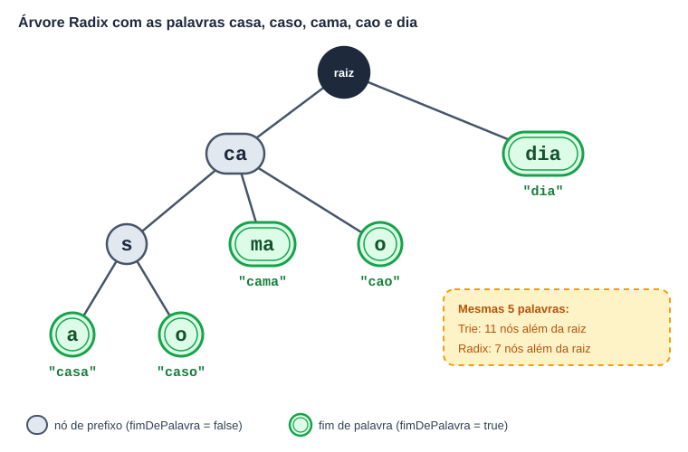

## Objetivos de aprendizagem

Ao final deste tópico, você deverá ser capaz de:

- Explicar o que é uma árvore Radix e por que ela é chamada de Trie compacta.
- Representar um conjunto de palavras em uma árvore Radix e compará-la com a Trie.
- Implementar as operações de inserção (com divisão de nós), busca e remoção (com fusão de nós).
- Analisar o custo dessas operações e o espaço ocupado pela árvore.

## Introdução

Na Trie, cada nó guarda **uma única letra**. Isso deixa as operações simples, mas gasta muitos nós quando as palavras têm trechos longos sem nenhuma bifurcação. Na Trie com `casa`, `caso`, `cama`, `cao` e `dia`, a palavra `dia` ocupa três nós, `d`, `i` e `a`, em fila, cada um com um único filho. Nenhum deles ajuda a distinguir palavras: só existem para soletrar o caminho.

A **árvore Radix** resolve esse desperdício juntando cada cadeia de nós com um único filho em **um só nó**, rotulado com o trecho inteiro. O caminho continua soletrando as palavras, mas agora em pedaços, e a árvore só cria um nó novo onde as palavras realmente se separam.

## Conceito principal

Uma **árvore Radix** (também chamada de *Trie compacta* ou *radix tree*) é uma Trie em que:

- cada nó, exceto a raiz, guarda um **rótulo**: uma cadeia com uma ou mais letras;
- concatenando os rótulos do caminho da raiz até um nó, obtemos o prefixo que esse nó representa;
- os filhos de um mesmo nó começam com **letras diferentes**, então a primeira letra basta para escolher o caminho;
- nenhum nó que não seja fim de palavra tem **um único filho**, exceto a raiz: se tivesse, ele seria fundido com esse filho.

> A última regra é o que torna a árvore compacta. Ela garante que todo nó que não é fim de palavra seja um ponto de bifurcação, onde pelo menos duas palavras se separam.

### Exemplo de estrutura

Com as mesmas palavras da aula de Trie (`casa`, `caso`, `cama`, `cao` e `dia`), a árvore Radix fica assim (os nós vermelhos, com contorno duplo, marcam fim de palavra, e os azuis são só prefixo):

{align=center width=100%}

Compare com a Trie: `dia` agora é **um único nó**, e `cama` termina no nó `ma`, em vez de passar por `m` e depois `a`. O prefixo `ca` continua sendo guardado uma vez só. A árvore caiu de 11 para 7 nós, sem perder nenhuma palavra.

### Radix e Patricia

Os dois nomes aparecem juntos com frequência. **Radix** é o nome geral da ideia de compactar a Trie. A **árvore Patricia**, que você vê no próximo tópico, é a versão binária dessa ideia: as chaves são sequências de bits, e cada nó interno guarda **qual bit testar**, em vez de guardar o trecho da chave. Nesta aula, trabalhamos com letras e rótulos de texto.

## Representação em C

O nó da Radix é o da Trie com um campo a mais: o `rotulo`, alocado com o tamanho exato do trecho. Os filhos continuam num vetor de 26 posições, mas agora a posição é a **primeira letra do rótulo do filho**.

```c
typedef struct NoRadix {
    char *rotulo;                          /* pedaço da chave guardado neste nó */
    struct NoRadix *filhos[TAM_ALFABETO];  /* posição = 1ª letra do rótulo do filho */
    bool fimDePalavra;                     /* o caminho até aqui é uma palavra? */
} NoRadix;
```

A raiz tem rótulo vazio (`""`) e, como na Trie, representa a cadeia vazia.

## Operações

### Inserção

A inserção desce pela árvore consumindo a chave em pedaços. Em cada nó, a primeira letra do que falta da chave escolhe o filho, e a função `prefixoComum` conta quantos caracteres do rótulo desse filho coincidem com a chave. Há quatro situações:

1. **Não há filho com essa letra.** Cria-se uma folha com **todo o resto da chave** de uma vez, marcada como fim de palavra.
2. **O rótulo inteiro coincide.** Desce-se para o filho e a chave avança o tamanho do rótulo.
3. **Só o começo do rótulo coincide.** O nó precisa ser **dividido**: cria-se um nó com a parte comum, o filho antigo fica só com o resto do rótulo e vira filho do nó novo. Depois, a inserção continua a partir do nó novo.
4. **A chave acaba exatamente num nó.** Basta marcá-lo como fim de palavra.

Nos programas abaixo, clique em **Executar** ou em **Próximo** e acompanhe a linha amarela. Na tela escura, a primeira linha mostra a chave (as letras apagadas já foram consumidas) e cada linha seguinte é um nível da árvore: cada bonequinho é um nó com o seu rótulo, e o asterisco marca fim de palavra. O nó em destaque é aquele em que o programa está, o contorno amarelo indica o filho sendo comparado e o contorno verde, um nó que acabou de ser criado.

O programa abaixo traz a estrutura do nó, as funções `criarNo`, `prefixoComum` e `inserir`, e insere `casa`, `caso`, `cama` e `ca` numa árvore vazia. Essas quatro palavras passam pelas quatro situações. Repare nas duas divisões: `casa` vira `cas` + `a` quando chega `caso`, e `cas` vira `ca` + `s` quando chega `cama`.

```codigo
{"title":"Inserindo casa, caso, cama e ca na árvore Radix","cols":6,"code":"#include <stdbool.h>\n#include <stdlib.h>\n#include <string.h>\n\n#define TAM_ALFABETO 26\n\ntypedef struct NoRadix {\n    char *rotulo;                          /* pedaço da chave guardado neste nó */\n    struct NoRadix *filhos[TAM_ALFABETO];  /* posição = 1ª letra do rótulo do filho */\n    bool fimDePalavra;                     /* o caminho até aqui é uma palavra? */\n} NoRadix;\n\n/* cria um nó cujo rótulo é uma cópia dos tam primeiros caracteres de texto */\nNoRadix *criarNo(const char *texto, int tam, bool fim) {\n    NoRadix *no = malloc(sizeof(NoRadix));\n    no->rotulo = malloc(tam + 1);\n    memcpy(no->rotulo, texto, tam);\n    no->rotulo[tam] = '\\0';\n    for (int i = 0; i < TAM_ALFABETO; i++) {\n        no->filhos[i] = NULL;\n    }\n    no->fimDePalavra = fim;\n    return no;\n}\n\n/* quantos caracteres do início de a e b são iguais */\nint prefixoComum(const char *a, const char *b) {\n    int k = 0;\n    while (a[k] != '\\0' && a[k] == b[k]) {\n        k++;\n    }\n    return k;\n}\n\nvoid inserir(NoRadix *raiz, const char *chave) {\n    NoRadix *atual = raiz;\n    while (*chave != '\\0') {\n        int indice = chave[0] - 'a';\n        NoRadix *filho = atual->filhos[indice];\n        if (filho == NULL) {\n            atual->filhos[indice] = criarNo(chave, strlen(chave), true);\n            return;\n        }\n        int k = prefixoComum(filho->rotulo, chave);\n        if (filho->rotulo[k] != '\\0') {\n            NoRadix *meio = criarNo(filho->rotulo, k, false);\n            memmove(filho->rotulo, filho->rotulo + k, strlen(filho->rotulo) - k + 1);\n            meio->filhos[filho->rotulo[0] - 'a'] = filho;\n            atual->filhos[indice] = meio;\n            filho = meio;\n        }\n        atual = filho;\n        chave += k;\n    }\n    atual->fimDePalavra = true;\n}\n\nint main(void) {\n    NoRadix *raiz = criarNo(\"\", 0, false);\n    inserir(raiz, \"casa\");\n    inserir(raiz, \"caso\");\n    inserir(raiz, \"cama\");\n    inserir(raiz, \"ca\");\n    return 0;\n}","steps":[{"line":60,"caption":"O programa cria a **raiz**: um nó de rótulo vazio que representa a cadeia vazia. Ela ainda não tem filhos.","vars":{},"rows":[[{"i":[],"l":""}],[{"s":2,"n":2,"i":[["raiz","",0]]}],[],[],[],[]],"stack":"main"},{"line":36,"caption":"Inserindo `casa`. `atual` começa na raiz.","vars":{"chave":"\"casa\"","atual":"raiz"},"rows":[[{"i":[["c","",2],["a","",0],["s","",6],["a","",0]],"l":"chave (apagadas: já consumidas)"}],[{"s":2,"n":2,"i":[["raiz","",0]],"a":1}],[],[],[],[]],"stack":"inserir ← main"},{"line":40,"caption":"A chave que falta é `casa` e começa com 'c' (`indice` = 2). `filhos[2]` está vazio: nenhuma palavra continua com 'c' a partir daqui.","vars":{"chave":"\"casa\"","atual":"raiz","indice":2},"rows":[[{"i":[["c","c",2],["a","",0],["s","",6],["a","",0]],"l":"chave (apagadas: já consumidas)"}],[{"s":2,"n":2,"i":[["raiz","",0]],"a":1}],[],[],[],[]],"stack":"inserir ← main"},{"line":42,"caption":"Criamos **uma única folha** com todo o resto da chave, `casa`, já marcada como fim de palavra. Na Trie seriam 4 nós, um por letra. A inserção termina.","vars":{"chave":"\"casa\"","atual":"raiz","indice":2},"rows":[[{"i":[["c","",2],["a","",0],["s","",6],["a","",0]],"l":"chave (apagadas: já consumidas)"}],[{"s":2,"n":2,"i":[["raiz","",0]],"a":1}],[{"s":2,"n":2,"i":[["casa*","p",2]],"l":"fim"}],[],[],[]],"stack":"inserir ← main"},{"line":36,"caption":"Inserindo `caso`. `atual` começa na raiz.","vars":{"chave":"\"caso\"","atual":"raiz"},"rows":[[{"i":[["c","",2],["a","",0],["s","",6],["o","",2]],"l":"chave (apagadas: já consumidas)"}],[{"s":2,"n":2,"i":[["raiz","",0]],"a":1}],[{"s":2,"n":2,"i":[["casa*","",2]],"l":"fim"}],[],[],[]],"stack":"inserir ← main"},{"line":40,"caption":"A chave que falta é `caso` e começa com 'c' (`indice` = 2). Em `filhos[2]` está o nó `casa`.","vars":{"chave":"\"caso\"","atual":"raiz","filho":"\"casa\"","indice":2},"rows":[[{"i":[["c","c",2],["a","",0],["s","",6],["o","",2]],"l":"chave (apagadas: já consumidas)"}],[{"s":2,"n":2,"i":[["raiz","",0]],"a":1}],[{"s":2,"n":2,"i":[["casa*","c",2]],"l":"fim"}],[],[],[]],"stack":"inserir ← main"},{"line":45,"caption":"`prefixoComum` compara o rótulo `casa` com `caso`: 3 caracteres são iguais (`cas`). Depois disso o rótulo tem 'a', mas a chave tem 'o': o rótulo precisa ser **dividido**.","vars":{"chave":"\"caso\"","atual":"raiz","filho":"\"casa\"","k":3},"rows":[[{"i":[["c","c",2],["a","",0],["s","",6],["o","",2]],"l":"chave (apagadas: já consumidas)"}],[{"s":2,"n":2,"i":[["raiz","",0]],"a":1}],[{"s":2,"n":2,"i":[["casa*","c",2]],"l":"fim"}],[],[],[]],"stack":"inserir ← main"},{"line":47,"caption":"Criamos o nó `cas` só com a parte comum. Ele ainda está fora da árvore e não é fim de palavra.","vars":{"chave":"\"caso\"","atual":"raiz","filho":"\"casa\"","k":3},"rows":[[{"i":[["c","",2],["a","",0],["s","",6],["o","",2]],"l":"chave (apagadas: já consumidas)"}],[{"s":2,"n":2,"i":[["raiz","",0]],"a":1}],[{"s":2,"n":2,"i":[["casa*","c",2]],"l":"fim"}],[],[],[{"i":[["cas","p",2]],"l":"nó novo, ainda fora da árvore"}]],"stack":"inserir ← main"},{"line":48,"caption":"`memmove` tira os 3 primeiros caracteres do rótulo do filho: ele passa a guardar só `a`, o pedaço que sobrou.","vars":{"chave":"\"caso\"","atual":"raiz","filho":"\"a\"","k":3},"rows":[[{"i":[["c","",2],["a","",0],["s","",6],["o","",2]],"l":"chave (apagadas: já consumidas)"}],[{"s":2,"n":2,"i":[["raiz","",0]],"a":1}],[{"s":2,"n":2,"i":[["a*","c",0]],"l":"fim"}],[],[],[{"i":[["cas","p",2]],"l":"nó novo, ainda fora da árvore"}]],"stack":"inserir ← main"},{"line":49,"caption":"O filho encurtado vira filho do nó `cas`, na posição da letra 'a'.","vars":{"chave":"\"caso\"","atual":"raiz","filho":"\"a\"","k":3},"rows":[[{"i":[["c","",2],["a","",0],["s","",6],["o","",2]],"l":"chave (apagadas: já consumidas)"}],[{"s":2,"n":2,"i":[["raiz","",0]],"a":1}],[{"s":2,"n":2,"i":[["a*","c",0]],"l":"fim"}],[],[],[{"i":[["cas","p",2],["→","g",0],["a*","",0]],"l":"nó novo, ainda fora da árvore"}]],"stack":"inserir ← main"},{"line":50,"caption":"`cas` toma o lugar do filho antigo na árvore. A divisão terminou: as palavras que já estavam lá continuam com o mesmo caminho.","vars":{"chave":"\"caso\"","atual":"raiz","filho":"\"cas\"","k":3},"rows":[[{"i":[["c","",2],["a","",0],["s","",6],["o","",2]],"l":"chave (apagadas: já consumidas)"}],[{"s":2,"n":2,"i":[["raiz","",0]],"a":1}],[{"s":2,"n":2,"i":[["cas","c",2]]}],[{"s":2,"n":2,"i":[["a*","",0]],"l":"fim"}],[],[]],"stack":"inserir ← main"},{"line":53,"caption":"`atual` desce para o nó `cas` e a chave avança 3: falta `o`.","vars":{"chave":"\"caso\"","atual":"\"cas\"","k":3},"rows":[[{"i":[["c","",2],["a","",0],["s","",6],["o","",2]],"l":"chave (apagadas: já consumidas)"}],[{"s":2,"n":2,"i":[["raiz","",0]]}],[{"s":2,"n":2,"i":[["cas","",2]],"a":1}],[{"s":2,"n":2,"i":[["a*","",0]],"l":"fim"}],[],[]],"stack":"inserir ← main"},{"line":40,"caption":"A chave que falta é `o` e começa com 'o' (`indice` = 14). `filhos[14]` está vazio: nenhuma palavra continua com 'o' a partir daqui.","vars":{"chave":"\"o\"","atual":"\"cas\"","indice":14},"rows":[[{"i":[["c","g",2],["a","g",0],["s","g",6],["o","c",2]],"l":"chave (apagadas: já consumidas)"}],[{"s":2,"n":2,"i":[["raiz","",0]]}],[{"s":2,"n":2,"i":[["cas","",2]],"a":1}],[{"s":2,"n":2,"i":[["a*","",0]],"l":"fim"}],[],[]],"stack":"inserir ← main"},{"line":42,"caption":"Criamos **uma única folha** com todo o resto da chave, `o`, já marcada como fim de palavra. A inserção termina.","vars":{"chave":"\"o\"","atual":"\"cas\"","indice":14},"rows":[[{"i":[["c","g",2],["a","g",0],["s","g",6],["o","",2]],"l":"chave (apagadas: já consumidas)"}],[{"s":1,"n":2,"i":[["raiz","",0]]}],[{"s":1,"n":2,"i":[["cas","",2]],"a":1}],[{"s":1,"n":2,"i":[["a*","",0]],"l":"fim"},{"s":3,"n":2,"i":[["o*","p",2]],"l":"fim"}],[],[]],"stack":"inserir ← main"},{"line":36,"caption":"Inserindo `cama`. `atual` começa na raiz.","vars":{"chave":"\"cama\"","atual":"raiz"},"rows":[[{"i":[["c","",2],["a","",0],["m","",0],["a","",0]],"l":"chave (apagadas: já consumidas)"}],[{"s":1,"n":2,"i":[["raiz","",0]],"a":1}],[{"s":1,"n":2,"i":[["cas","",2]]}],[{"s":1,"n":2,"i":[["a*","",0]],"l":"fim"},{"s":3,"n":2,"i":[["o*","",2]],"l":"fim"}],[],[]],"stack":"inserir ← main"},{"line":40,"caption":"A chave que falta é `cama` e começa com 'c' (`indice` = 2). Em `filhos[2]` está o nó `cas`.","vars":{"chave":"\"cama\"","atual":"raiz","filho":"\"cas\"","indice":2},"rows":[[{"i":[["c","c",2],["a","",0],["m","",0],["a","",0]],"l":"chave (apagadas: já consumidas)"}],[{"s":1,"n":2,"i":[["raiz","",0]],"a":1}],[{"s":1,"n":2,"i":[["cas","c",2]]}],[{"s":1,"n":2,"i":[["a*","",0]],"l":"fim"},{"s":3,"n":2,"i":[["o*","",2]],"l":"fim"}],[],[]],"stack":"inserir ← main"},{"line":45,"caption":"`prefixoComum` compara o rótulo `cas` com `cama`: 2 caracteres são iguais (`ca`). Depois disso o rótulo tem 's', mas a chave tem 'm': o rótulo precisa ser **dividido**.","vars":{"chave":"\"cama\"","atual":"raiz","filho":"\"cas\"","k":2},"rows":[[{"i":[["c","c",2],["a","",0],["m","",0],["a","",0]],"l":"chave (apagadas: já consumidas)"}],[{"s":1,"n":2,"i":[["raiz","",0]],"a":1}],[{"s":1,"n":2,"i":[["cas","c",2]]}],[{"s":1,"n":2,"i":[["a*","",0]],"l":"fim"},{"s":3,"n":2,"i":[["o*","",2]],"l":"fim"}],[],[]],"stack":"inserir ← main"},{"line":47,"caption":"Criamos o nó `ca` só com a parte comum. Ele ainda está fora da árvore e não é fim de palavra.","vars":{"chave":"\"cama\"","atual":"raiz","filho":"\"cas\"","k":2},"rows":[[{"i":[["c","",2],["a","",0],["m","",0],["a","",0]],"l":"chave (apagadas: já consumidas)"}],[{"s":1,"n":2,"i":[["raiz","",0]],"a":1}],[{"s":1,"n":2,"i":[["cas","c",2]]}],[{"s":1,"n":2,"i":[["a*","",0]],"l":"fim"},{"s":3,"n":2,"i":[["o*","",2]],"l":"fim"}],[],[{"i":[["ca","p",2]],"l":"nó novo, ainda fora da árvore"}]],"stack":"inserir ← main"},{"line":48,"caption":"`memmove` tira os 2 primeiros caracteres do rótulo do filho: ele passa a guardar só `s`, o pedaço que sobrou.","vars":{"chave":"\"cama\"","atual":"raiz","filho":"\"s\"","k":2},"rows":[[{"i":[["c","",2],["a","",0],["m","",0],["a","",0]],"l":"chave (apagadas: já consumidas)"}],[{"s":1,"n":2,"i":[["raiz","",0]],"a":1}],[{"s":1,"n":2,"i":[["s","c",6]]}],[{"s":1,"n":2,"i":[["a*","",0]],"l":"fim"},{"s":3,"n":2,"i":[["o*","",2]],"l":"fim"}],[],[{"i":[["ca","p",2]],"l":"nó novo, ainda fora da árvore"}]],"stack":"inserir ← main"},{"line":49,"caption":"O filho encurtado vira filho do nó `ca`, na posição da letra 's'.","vars":{"chave":"\"cama\"","atual":"raiz","filho":"\"s\"","k":2},"rows":[[{"i":[["c","",2],["a","",0],["m","",0],["a","",0]],"l":"chave (apagadas: já consumidas)"}],[{"s":1,"n":2,"i":[["raiz","",0]],"a":1}],[{"s":1,"n":2,"i":[["s","c",6]]}],[{"s":1,"n":2,"i":[["a*","",0]],"l":"fim"},{"s":3,"n":2,"i":[["o*","",2]],"l":"fim"}],[],[{"i":[["ca","p",2],["→","g",0],["s","",6]],"l":"nó novo, ainda fora da árvore"}]],"stack":"inserir ← main"},{"line":50,"caption":"`ca` toma o lugar do filho antigo na árvore. A divisão terminou: as palavras que já estavam lá continuam com o mesmo caminho.","vars":{"chave":"\"cama\"","atual":"raiz","filho":"\"ca\"","k":2},"rows":[[{"i":[["c","",2],["a","",0],["m","",0],["a","",0]],"l":"chave (apagadas: já consumidas)"}],[{"s":1,"n":2,"i":[["raiz","",0]],"a":1}],[{"s":1,"n":2,"i":[["ca","c",2]]}],[{"s":1,"n":2,"i":[["s","",6]]}],[{"s":1,"n":2,"i":[["a*","",0]],"l":"fim"},{"s":3,"n":2,"i":[["o*","",2]],"l":"fim"}],[]],"stack":"inserir ← main"},{"line":53,"caption":"`atual` desce para o nó `ca` e a chave avança 2: falta `ma`.","vars":{"chave":"\"cama\"","atual":"\"ca\"","k":2},"rows":[[{"i":[["c","",2],["a","",0],["m","",0],["a","",0]],"l":"chave (apagadas: já consumidas)"}],[{"s":1,"n":2,"i":[["raiz","",0]]}],[{"s":1,"n":2,"i":[["ca","",2]],"a":1}],[{"s":1,"n":2,"i":[["s","",6]]}],[{"s":1,"n":2,"i":[["a*","",0]],"l":"fim"},{"s":3,"n":2,"i":[["o*","",2]],"l":"fim"}],[]],"stack":"inserir ← main"},{"line":40,"caption":"A chave que falta é `ma` e começa com 'm' (`indice` = 12). `filhos[12]` está vazio: nenhuma palavra continua com 'm' a partir daqui.","vars":{"chave":"\"ma\"","atual":"\"ca\"","indice":12},"rows":[[{"i":[["c","g",2],["a","g",0],["m","c",0],["a","",0]],"l":"chave (apagadas: já consumidas)"}],[{"s":1,"n":2,"i":[["raiz","",0]]}],[{"s":1,"n":2,"i":[["ca","",2]],"a":1}],[{"s":1,"n":2,"i":[["s","",6]]}],[{"s":1,"n":2,"i":[["a*","",0]],"l":"fim"},{"s":3,"n":2,"i":[["o*","",2]],"l":"fim"}],[]],"stack":"inserir ← main"},{"line":42,"caption":"Criamos **uma única folha** com todo o resto da chave, `ma`, já marcada como fim de palavra. Na Trie seriam 2 nós, um por letra. A inserção termina.","vars":{"chave":"\"ma\"","atual":"\"ca\"","indice":12},"rows":[[{"i":[["c","g",2],["a","g",0],["m","",0],["a","",0]],"l":"chave (apagadas: já consumidas)"}],[{"s":0,"n":2,"i":[["raiz","",0]]}],[{"s":0,"n":2,"i":[["ca","",2]],"a":1}],[{"s":0,"n":2,"i":[["ma*","p",0]],"l":"fim"},{"s":2,"n":2,"i":[["s","",6]]}],[{"s":2,"n":2,"i":[["a*","",0]],"l":"fim"},{"s":4,"n":2,"i":[["o*","",2]],"l":"fim"}],[]],"stack":"inserir ← main"},{"line":36,"caption":"Inserindo `ca`. `atual` começa na raiz.","vars":{"chave":"\"ca\"","atual":"raiz"},"rows":[[{"i":[["c","",2],["a","",0]],"l":"chave (apagadas: já consumidas)"}],[{"s":0,"n":2,"i":[["raiz","",0]],"a":1}],[{"s":0,"n":2,"i":[["ca","",2]]}],[{"s":0,"n":2,"i":[["ma*","",0]],"l":"fim"},{"s":2,"n":2,"i":[["s","",6]]}],[{"s":2,"n":2,"i":[["a*","",0]],"l":"fim"},{"s":4,"n":2,"i":[["o*","",2]],"l":"fim"}],[]],"stack":"inserir ← main"},{"line":40,"caption":"A chave que falta é `ca` e começa com 'c' (`indice` = 2). Em `filhos[2]` está o nó `ca`.","vars":{"chave":"\"ca\"","atual":"raiz","filho":"\"ca\"","indice":2},"rows":[[{"i":[["c","c",2],["a","",0]],"l":"chave (apagadas: já consumidas)"}],[{"s":0,"n":2,"i":[["raiz","",0]],"a":1}],[{"s":0,"n":2,"i":[["ca","c",2]]}],[{"s":0,"n":2,"i":[["ma*","",0]],"l":"fim"},{"s":2,"n":2,"i":[["s","",6]]}],[{"s":2,"n":2,"i":[["a*","",0]],"l":"fim"},{"s":4,"n":2,"i":[["o*","",2]],"l":"fim"}],[]],"stack":"inserir ← main"},{"line":45,"caption":"`prefixoComum` compara o rótulo `ca` com `ca`: 2 caracteres são iguais (`ca`). O rótulo casou inteiro, então não é preciso dividir nada.","vars":{"chave":"\"ca\"","atual":"raiz","filho":"\"ca\"","k":2},"rows":[[{"i":[["c","c",2],["a","",0]],"l":"chave (apagadas: já consumidas)"}],[{"s":0,"n":2,"i":[["raiz","",0]],"a":1}],[{"s":0,"n":2,"i":[["ca","c",2]]}],[{"s":0,"n":2,"i":[["ma*","",0]],"l":"fim"},{"s":2,"n":2,"i":[["s","",6]]}],[{"s":2,"n":2,"i":[["a*","",0]],"l":"fim"},{"s":4,"n":2,"i":[["o*","",2]],"l":"fim"}],[]],"stack":"inserir ← main"},{"line":53,"caption":"`atual` desce para o nó `ca` e a chave avança 2: a chave acabou.","vars":{"chave":"\"ca\"","atual":"\"ca\"","k":2},"rows":[[{"i":[["c","",2],["a","",0]],"l":"chave (apagadas: já consumidas)"}],[{"s":0,"n":2,"i":[["raiz","",0]]}],[{"s":0,"n":2,"i":[["ca","",2]],"a":1}],[{"s":0,"n":2,"i":[["ma*","",0]],"l":"fim"},{"s":2,"n":2,"i":[["s","",6]]}],[{"s":2,"n":2,"i":[["a*","",0]],"l":"fim"},{"s":4,"n":2,"i":[["o*","",2]],"l":"fim"}],[]],"stack":"inserir ← main"},{"line":55,"caption":"A chave acabou exatamente no nó `ca`. Não é preciso criar nada: basta marcar esse nó como fim de palavra.","vars":{"chave":"\"\"","atual":"\"ca\""},"rows":[[{"i":[["c","g",2],["a","g",0]],"l":"chave (apagadas: já consumidas)"}],[{"s":0,"n":2,"i":[["raiz","",0]]}],[{"s":0,"n":2,"i":[["ca","",2]],"a":1}],[{"s":0,"n":2,"i":[["ma*","",0]],"l":"fim"},{"s":2,"n":2,"i":[["s","",6]]}],[{"s":2,"n":2,"i":[["a*","",0]],"l":"fim"},{"s":4,"n":2,"i":[["o*","",2]],"l":"fim"}],[]],"stack":"inserir ← main"},{"line":56,"caption":"`ca` agora é fim de palavra (*): `ca` está na árvore.","vars":{"chave":"\"\"","atual":"\"ca\""},"rows":[[{"i":[["c","g",2],["a","g",0]],"l":"chave (apagadas: já consumidas)"}],[{"s":0,"n":2,"i":[["raiz","",0]]}],[{"s":0,"n":2,"i":[["ca*","",2]],"a":1,"l":"fim"}],[{"s":0,"n":2,"i":[["ma*","",0]],"l":"fim"},{"s":2,"n":2,"i":[["s","",6]]}],[{"s":2,"n":2,"i":[["a*","",0]],"l":"fim"},{"s":4,"n":2,"i":[["o*","",2]],"l":"fim"}],[]],"stack":"inserir ← main"},{"line":64,"caption":"Pronto: `casa`, `caso`, `cama` e `ca` ocupam só 5 nós além da raiz. Uma Trie com as mesmas palavras usaria 7, um por letra.","vars":{},"rows":[[{"i":[],"l":""}],[{"s":0,"n":2,"i":[["raiz","",0]]}],[{"s":0,"n":2,"i":[["ca*","",2]],"l":"fim"}],[{"s":0,"n":2,"i":[["ma*","",0]],"l":"fim"},{"s":2,"n":2,"i":[["s","",6]]}],[{"s":2,"n":2,"i":[["a*","",0]],"l":"fim"},{"s":4,"n":2,"i":[["o*","",2]],"l":"fim"}],[]],"stack":"main"}]}
```

> A divisão não muda o caminho das palavras que já estavam na árvore: `casa` continua sendo soletrada por `ca`, `s` e `a`. Ela só cria um ponto de bifurcação onde antes havia um rótulo inteiro.

### Busca

A busca segue o mesmo caminho, comparando um rótulo inteiro de cada vez com `strncmp`. Ela falha em três situações: não há filho com a letra procurada, o rótulo não coincide com o começo do que falta da chave (inclusive quando a chave **acaba no meio de um rótulo**) ou a chave acaba num nó que não é fim de palavra.

```codigo
{"title":"Buscando caso, cam, cas e dia na árvore Radix","cols":6,"code":"#include <stdio.h>\n/* NoRadix, criarNo, prefixoComum e inserir: veja o primeiro programa */\n\nbool buscar(NoRadix *raiz, const char *chave) {\n    NoRadix *atual = raiz;\n    while (*chave != '\\0') {\n        NoRadix *filho = atual->filhos[chave[0] - 'a'];\n        if (filho == NULL) {\n            return false;\n        }\n        int tam = strlen(filho->rotulo);\n        if (strncmp(filho->rotulo, chave, tam) != 0) {\n            return false;\n        }\n        atual = filho;\n        chave += tam;\n    }\n    return atual->fimDePalavra;\n}\n\nint main(void) {\n    NoRadix *raiz = criarNo(\"\", 0, false);\n    inserir(raiz, \"casa\");\n    inserir(raiz, \"caso\");\n    inserir(raiz, \"cama\");\n    inserir(raiz, \"ca\");\n    printf(\"%d\\n\", buscar(raiz, \"caso\"));   /* 1 */\n    printf(\"%d\\n\", buscar(raiz, \"cam\"));    /* 0 */\n    printf(\"%d\\n\", buscar(raiz, \"cas\"));    /* 0 */\n    printf(\"%d\\n\", buscar(raiz, \"dia\"));    /* 0 */\n    return 0;\n}","steps":[{"line":27,"caption":"A árvore já tem `casa`, `caso`, `cama` e `ca` (o asterisco marca fim de palavra). Vamos fazer quatro buscas.","vars":{},"rows":[[{"i":[],"l":""}],[{"s":0,"n":2,"i":[["raiz","",0]]}],[{"s":0,"n":2,"i":[["ca*","",2]],"l":"fim"}],[{"s":0,"n":2,"i":[["ma*","",0]],"l":"fim"},{"s":2,"n":2,"i":[["s","",6]]}],[{"s":2,"n":2,"i":[["a*","",0]],"l":"fim"},{"s":4,"n":2,"i":[["o*","",2]],"l":"fim"}],[]],"stack":"main"},{"line":5,"caption":"Buscando `caso`. `atual` começa na raiz.","vars":{"chave":"\"caso\"","atual":"raiz"},"rows":[[{"i":[["c","",2],["a","",0],["s","",6],["o","",2]],"l":"chave (apagadas: já consumidas)"}],[{"s":0,"n":2,"i":[["raiz","",0]],"a":1}],[{"s":0,"n":2,"i":[["ca*","",2]],"l":"fim"}],[{"s":0,"n":2,"i":[["ma*","",0]],"l":"fim"},{"s":2,"n":2,"i":[["s","",6]]}],[{"s":2,"n":2,"i":[["a*","",0]],"l":"fim"},{"s":4,"n":2,"i":[["o*","",2]],"l":"fim"}],[]],"stack":"buscar ← main"},{"line":8,"caption":"A chave que falta é `caso`. O filho da letra 'c' é o nó `ca`.","vars":{"chave":"\"caso\"","atual":"raiz","filho":"\"ca\""},"rows":[[{"i":[["c","c",2],["a","",0],["s","",6],["o","",2]],"l":"chave (apagadas: já consumidas)"}],[{"s":0,"n":2,"i":[["raiz","",0]],"a":1}],[{"s":0,"n":2,"i":[["ca*","c",2]],"l":"fim"}],[{"s":0,"n":2,"i":[["ma*","",0]],"l":"fim"},{"s":2,"n":2,"i":[["s","",6]]}],[{"s":2,"n":2,"i":[["a*","",0]],"l":"fim"},{"s":4,"n":2,"i":[["o*","",2]],"l":"fim"}],[]],"stack":"buscar ← main"},{"line":12,"caption":"O rótulo `ca` tem 2 caracteres. `strncmp` compara o rótulo inteiro com o começo de `caso`.","vars":{"chave":"\"caso\"","atual":"raiz","filho":"\"ca\"","tam":2},"rows":[[{"i":[["c","c",2],["a","",0],["s","",6],["o","",2]],"l":"chave (apagadas: já consumidas)"}],[{"s":0,"n":2,"i":[["raiz","",0]],"a":1}],[{"s":0,"n":2,"i":[["ca*","c",2]],"l":"fim"}],[{"s":0,"n":2,"i":[["ma*","",0]],"l":"fim"},{"s":2,"n":2,"i":[["s","",6]]}],[{"s":2,"n":2,"i":[["a*","",0]],"l":"fim"},{"s":4,"n":2,"i":[["o*","",2]],"l":"fim"}],[]],"stack":"buscar ← main"},{"line":16,"caption":"O rótulo casou inteiro. `atual` desce para `ca` e a chave avança 2: falta `so`.","vars":{"chave":"\"caso\"","atual":"\"ca\"","tam":2},"rows":[[{"i":[["c","",2],["a","",0],["s","",6],["o","",2]],"l":"chave (apagadas: já consumidas)"}],[{"s":0,"n":2,"i":[["raiz","",0]]}],[{"s":0,"n":2,"i":[["ca*","",2]],"a":1,"l":"fim"}],[{"s":0,"n":2,"i":[["ma*","",0]],"l":"fim"},{"s":2,"n":2,"i":[["s","",6]]}],[{"s":2,"n":2,"i":[["a*","",0]],"l":"fim"},{"s":4,"n":2,"i":[["o*","",2]],"l":"fim"}],[]],"stack":"buscar ← main"},{"line":8,"caption":"A chave que falta é `so`. O filho da letra 's' é o nó `s`.","vars":{"chave":"\"so\"","atual":"\"ca\"","filho":"\"s\""},"rows":[[{"i":[["c","g",2],["a","g",0],["s","c",6],["o","",2]],"l":"chave (apagadas: já consumidas)"}],[{"s":0,"n":2,"i":[["raiz","",0]]}],[{"s":0,"n":2,"i":[["ca*","",2]],"a":1,"l":"fim"}],[{"s":0,"n":2,"i":[["ma*","",0]],"l":"fim"},{"s":2,"n":2,"i":[["s","c",6]]}],[{"s":2,"n":2,"i":[["a*","",0]],"l":"fim"},{"s":4,"n":2,"i":[["o*","",2]],"l":"fim"}],[]],"stack":"buscar ← main"},{"line":12,"caption":"O rótulo `s` tem 1 caractere. `strncmp` compara o rótulo inteiro com o começo de `so`.","vars":{"chave":"\"so\"","atual":"\"ca\"","filho":"\"s\"","tam":1},"rows":[[{"i":[["c","g",2],["a","g",0],["s","c",6],["o","",2]],"l":"chave (apagadas: já consumidas)"}],[{"s":0,"n":2,"i":[["raiz","",0]]}],[{"s":0,"n":2,"i":[["ca*","",2]],"a":1,"l":"fim"}],[{"s":0,"n":2,"i":[["ma*","",0]],"l":"fim"},{"s":2,"n":2,"i":[["s","c",6]]}],[{"s":2,"n":2,"i":[["a*","",0]],"l":"fim"},{"s":4,"n":2,"i":[["o*","",2]],"l":"fim"}],[]],"stack":"buscar ← main"},{"line":16,"caption":"O rótulo casou inteiro. `atual` desce para `s` e a chave avança 1: falta `o`.","vars":{"chave":"\"so\"","atual":"\"s\"","tam":1},"rows":[[{"i":[["c","g",2],["a","g",0],["s","",6],["o","",2]],"l":"chave (apagadas: já consumidas)"}],[{"s":0,"n":2,"i":[["raiz","",0]]}],[{"s":0,"n":2,"i":[["ca*","",2]],"l":"fim"}],[{"s":0,"n":2,"i":[["ma*","",0]],"l":"fim"},{"s":2,"n":2,"i":[["s","",6]],"a":1}],[{"s":2,"n":2,"i":[["a*","",0]],"l":"fim"},{"s":4,"n":2,"i":[["o*","",2]],"l":"fim"}],[]],"stack":"buscar ← main"},{"line":8,"caption":"A chave que falta é `o`. O filho da letra 'o' é o nó `o`.","vars":{"chave":"\"o\"","atual":"\"s\"","filho":"\"o\""},"rows":[[{"i":[["c","g",2],["a","g",0],["s","g",6],["o","c",2]],"l":"chave (apagadas: já consumidas)"}],[{"s":0,"n":2,"i":[["raiz","",0]]}],[{"s":0,"n":2,"i":[["ca*","",2]],"l":"fim"}],[{"s":0,"n":2,"i":[["ma*","",0]],"l":"fim"},{"s":2,"n":2,"i":[["s","",6]],"a":1}],[{"s":2,"n":2,"i":[["a*","",0]],"l":"fim"},{"s":4,"n":2,"i":[["o*","c",2]],"l":"fim"}],[]],"stack":"buscar ← main"},{"line":12,"caption":"O rótulo `o` tem 1 caractere. `strncmp` compara o rótulo inteiro com o começo de `o`.","vars":{"chave":"\"o\"","atual":"\"s\"","filho":"\"o\"","tam":1},"rows":[[{"i":[["c","g",2],["a","g",0],["s","g",6],["o","c",2]],"l":"chave (apagadas: já consumidas)"}],[{"s":0,"n":2,"i":[["raiz","",0]]}],[{"s":0,"n":2,"i":[["ca*","",2]],"l":"fim"}],[{"s":0,"n":2,"i":[["ma*","",0]],"l":"fim"},{"s":2,"n":2,"i":[["s","",6]],"a":1}],[{"s":2,"n":2,"i":[["a*","",0]],"l":"fim"},{"s":4,"n":2,"i":[["o*","c",2]],"l":"fim"}],[]],"stack":"buscar ← main"},{"line":16,"caption":"O rótulo casou inteiro. `atual` desce para `o` e a chave avança 1: a chave acabou.","vars":{"chave":"\"o\"","atual":"\"o\"","tam":1},"rows":[[{"i":[["c","g",2],["a","g",0],["s","g",6],["o","",2]],"l":"chave (apagadas: já consumidas)"}],[{"s":0,"n":2,"i":[["raiz","",0]]}],[{"s":0,"n":2,"i":[["ca*","",2]],"l":"fim"}],[{"s":0,"n":2,"i":[["ma*","",0]],"l":"fim"},{"s":2,"n":2,"i":[["s","",6]]}],[{"s":2,"n":2,"i":[["a*","",0]],"l":"fim"},{"s":4,"n":2,"i":[["o*","",2]],"a":1,"l":"fim"}],[]],"stack":"buscar ← main"},{"line":18,"caption":"A chave acabou no nó `o`, que **é** fim de palavra: `buscar` devolve **true** (1).","vars":{"chave":"\"\"","atual":"\"o\""},"rows":[[{"i":[["c","g",2],["a","g",0],["s","g",6],["o","g",2]],"l":"chave (apagadas: já consumidas)"}],[{"s":0,"n":2,"i":[["raiz","",0]]}],[{"s":0,"n":2,"i":[["ca*","",2]],"l":"fim"}],[{"s":0,"n":2,"i":[["ma*","",0]],"l":"fim"},{"s":2,"n":2,"i":[["s","",6]]}],[{"s":2,"n":2,"i":[["a*","",0]],"l":"fim"},{"s":4,"n":2,"i":[["o*","",2]],"a":1,"l":"fim"}],[]],"stack":"buscar ← main"},{"line":5,"caption":"Buscando `cam`. `atual` começa na raiz.","vars":{"chave":"\"cam\"","atual":"raiz"},"rows":[[{"i":[["c","",2],["a","",0],["m","",0]],"l":"chave (apagadas: já consumidas)"}],[{"s":0,"n":2,"i":[["raiz","",0]],"a":1}],[{"s":0,"n":2,"i":[["ca*","",2]],"l":"fim"}],[{"s":0,"n":2,"i":[["ma*","",0]],"l":"fim"},{"s":2,"n":2,"i":[["s","",6]]}],[{"s":2,"n":2,"i":[["a*","",0]],"l":"fim"},{"s":4,"n":2,"i":[["o*","",2]],"l":"fim"}],[]],"stack":"buscar ← main"},{"line":8,"caption":"A chave que falta é `cam`. O filho da letra 'c' é o nó `ca`.","vars":{"chave":"\"cam\"","atual":"raiz","filho":"\"ca\""},"rows":[[{"i":[["c","c",2],["a","",0],["m","",0]],"l":"chave (apagadas: já consumidas)"}],[{"s":0,"n":2,"i":[["raiz","",0]],"a":1}],[{"s":0,"n":2,"i":[["ca*","c",2]],"l":"fim"}],[{"s":0,"n":2,"i":[["ma*","",0]],"l":"fim"},{"s":2,"n":2,"i":[["s","",6]]}],[{"s":2,"n":2,"i":[["a*","",0]],"l":"fim"},{"s":4,"n":2,"i":[["o*","",2]],"l":"fim"}],[]],"stack":"buscar ← main"},{"line":12,"caption":"O rótulo `ca` tem 2 caracteres. `strncmp` compara o rótulo inteiro com o começo de `cam`.","vars":{"chave":"\"cam\"","atual":"raiz","filho":"\"ca\"","tam":2},"rows":[[{"i":[["c","c",2],["a","",0],["m","",0]],"l":"chave (apagadas: já consumidas)"}],[{"s":0,"n":2,"i":[["raiz","",0]],"a":1}],[{"s":0,"n":2,"i":[["ca*","c",2]],"l":"fim"}],[{"s":0,"n":2,"i":[["ma*","",0]],"l":"fim"},{"s":2,"n":2,"i":[["s","",6]]}],[{"s":2,"n":2,"i":[["a*","",0]],"l":"fim"},{"s":4,"n":2,"i":[["o*","",2]],"l":"fim"}],[]],"stack":"buscar ← main"},{"line":16,"caption":"O rótulo casou inteiro. `atual` desce para `ca` e a chave avança 2: falta `m`.","vars":{"chave":"\"cam\"","atual":"\"ca\"","tam":2},"rows":[[{"i":[["c","",2],["a","",0],["m","",0]],"l":"chave (apagadas: já consumidas)"}],[{"s":0,"n":2,"i":[["raiz","",0]]}],[{"s":0,"n":2,"i":[["ca*","",2]],"a":1,"l":"fim"}],[{"s":0,"n":2,"i":[["ma*","",0]],"l":"fim"},{"s":2,"n":2,"i":[["s","",6]]}],[{"s":2,"n":2,"i":[["a*","",0]],"l":"fim"},{"s":4,"n":2,"i":[["o*","",2]],"l":"fim"}],[]],"stack":"buscar ← main"},{"line":8,"caption":"A chave que falta é `m`. O filho da letra 'm' é o nó `ma`.","vars":{"chave":"\"m\"","atual":"\"ca\"","filho":"\"ma\""},"rows":[[{"i":[["c","g",2],["a","g",0],["m","c",0]],"l":"chave (apagadas: já consumidas)"}],[{"s":0,"n":2,"i":[["raiz","",0]]}],[{"s":0,"n":2,"i":[["ca*","",2]],"a":1,"l":"fim"}],[{"s":0,"n":2,"i":[["ma*","c",0]],"l":"fim"},{"s":2,"n":2,"i":[["s","",6]]}],[{"s":2,"n":2,"i":[["a*","",0]],"l":"fim"},{"s":4,"n":2,"i":[["o*","",2]],"l":"fim"}],[]],"stack":"buscar ← main"},{"line":12,"caption":"O rótulo `ma` tem 2 caracteres. `strncmp` compara o rótulo inteiro com o começo de `m`.","vars":{"chave":"\"m\"","atual":"\"ca\"","filho":"\"ma\"","tam":2},"rows":[[{"i":[["c","g",2],["a","g",0],["m","c",0]],"l":"chave (apagadas: já consumidas)"}],[{"s":0,"n":2,"i":[["raiz","",0]]}],[{"s":0,"n":2,"i":[["ca*","",2]],"a":1,"l":"fim"}],[{"s":0,"n":2,"i":[["ma*","c",0]],"l":"fim"},{"s":2,"n":2,"i":[["s","",6]]}],[{"s":2,"n":2,"i":[["a*","",0]],"l":"fim"},{"s":4,"n":2,"i":[["o*","",2]],"l":"fim"}],[]],"stack":"buscar ← main"},{"line":13,"caption":"`ma` não é o começo de `m`: a chave acaba **no meio do rótulo**. `buscar` devolve **false** (0).","vars":{"chave":"\"m\"","atual":"\"ca\"","filho":"\"ma\"","tam":2},"rows":[[{"i":[["c","g",2],["a","g",0],["m","",0]],"l":"chave (apagadas: já consumidas)"}],[{"s":0,"n":2,"i":[["raiz","",0]]}],[{"s":0,"n":2,"i":[["ca*","",2]],"a":1,"l":"fim"}],[{"s":0,"n":2,"i":[["ma*","c",0]],"l":"fim"},{"s":2,"n":2,"i":[["s","",6]]}],[{"s":2,"n":2,"i":[["a*","",0]],"l":"fim"},{"s":4,"n":2,"i":[["o*","",2]],"l":"fim"}],[]],"stack":"buscar ← main"},{"line":5,"caption":"Buscando `cas`. `atual` começa na raiz.","vars":{"chave":"\"cas\"","atual":"raiz"},"rows":[[{"i":[["c","",2],["a","",0],["s","",6]],"l":"chave (apagadas: já consumidas)"}],[{"s":0,"n":2,"i":[["raiz","",0]],"a":1}],[{"s":0,"n":2,"i":[["ca*","",2]],"l":"fim"}],[{"s":0,"n":2,"i":[["ma*","",0]],"l":"fim"},{"s":2,"n":2,"i":[["s","",6]]}],[{"s":2,"n":2,"i":[["a*","",0]],"l":"fim"},{"s":4,"n":2,"i":[["o*","",2]],"l":"fim"}],[]],"stack":"buscar ← main"},{"line":8,"caption":"A chave que falta é `cas`. O filho da letra 'c' é o nó `ca`.","vars":{"chave":"\"cas\"","atual":"raiz","filho":"\"ca\""},"rows":[[{"i":[["c","c",2],["a","",0],["s","",6]],"l":"chave (apagadas: já consumidas)"}],[{"s":0,"n":2,"i":[["raiz","",0]],"a":1}],[{"s":0,"n":2,"i":[["ca*","c",2]],"l":"fim"}],[{"s":0,"n":2,"i":[["ma*","",0]],"l":"fim"},{"s":2,"n":2,"i":[["s","",6]]}],[{"s":2,"n":2,"i":[["a*","",0]],"l":"fim"},{"s":4,"n":2,"i":[["o*","",2]],"l":"fim"}],[]],"stack":"buscar ← main"},{"line":12,"caption":"O rótulo `ca` tem 2 caracteres. `strncmp` compara o rótulo inteiro com o começo de `cas`.","vars":{"chave":"\"cas\"","atual":"raiz","filho":"\"ca\"","tam":2},"rows":[[{"i":[["c","c",2],["a","",0],["s","",6]],"l":"chave (apagadas: já consumidas)"}],[{"s":0,"n":2,"i":[["raiz","",0]],"a":1}],[{"s":0,"n":2,"i":[["ca*","c",2]],"l":"fim"}],[{"s":0,"n":2,"i":[["ma*","",0]],"l":"fim"},{"s":2,"n":2,"i":[["s","",6]]}],[{"s":2,"n":2,"i":[["a*","",0]],"l":"fim"},{"s":4,"n":2,"i":[["o*","",2]],"l":"fim"}],[]],"stack":"buscar ← main"},{"line":16,"caption":"O rótulo casou inteiro. `atual` desce para `ca` e a chave avança 2: falta `s`.","vars":{"chave":"\"cas\"","atual":"\"ca\"","tam":2},"rows":[[{"i":[["c","",2],["a","",0],["s","",6]],"l":"chave (apagadas: já consumidas)"}],[{"s":0,"n":2,"i":[["raiz","",0]]}],[{"s":0,"n":2,"i":[["ca*","",2]],"a":1,"l":"fim"}],[{"s":0,"n":2,"i":[["ma*","",0]],"l":"fim"},{"s":2,"n":2,"i":[["s","",6]]}],[{"s":2,"n":2,"i":[["a*","",0]],"l":"fim"},{"s":4,"n":2,"i":[["o*","",2]],"l":"fim"}],[]],"stack":"buscar ← main"},{"line":8,"caption":"A chave que falta é `s`. O filho da letra 's' é o nó `s`.","vars":{"chave":"\"s\"","atual":"\"ca\"","filho":"\"s\""},"rows":[[{"i":[["c","g",2],["a","g",0],["s","c",6]],"l":"chave (apagadas: já consumidas)"}],[{"s":0,"n":2,"i":[["raiz","",0]]}],[{"s":0,"n":2,"i":[["ca*","",2]],"a":1,"l":"fim"}],[{"s":0,"n":2,"i":[["ma*","",0]],"l":"fim"},{"s":2,"n":2,"i":[["s","c",6]]}],[{"s":2,"n":2,"i":[["a*","",0]],"l":"fim"},{"s":4,"n":2,"i":[["o*","",2]],"l":"fim"}],[]],"stack":"buscar ← main"},{"line":12,"caption":"O rótulo `s` tem 1 caractere. `strncmp` compara o rótulo inteiro com o começo de `s`.","vars":{"chave":"\"s\"","atual":"\"ca\"","filho":"\"s\"","tam":1},"rows":[[{"i":[["c","g",2],["a","g",0],["s","c",6]],"l":"chave (apagadas: já consumidas)"}],[{"s":0,"n":2,"i":[["raiz","",0]]}],[{"s":0,"n":2,"i":[["ca*","",2]],"a":1,"l":"fim"}],[{"s":0,"n":2,"i":[["ma*","",0]],"l":"fim"},{"s":2,"n":2,"i":[["s","c",6]]}],[{"s":2,"n":2,"i":[["a*","",0]],"l":"fim"},{"s":4,"n":2,"i":[["o*","",2]],"l":"fim"}],[]],"stack":"buscar ← main"},{"line":16,"caption":"O rótulo casou inteiro. `atual` desce para `s` e a chave avança 1: a chave acabou.","vars":{"chave":"\"s\"","atual":"\"s\"","tam":1},"rows":[[{"i":[["c","g",2],["a","g",0],["s","",6]],"l":"chave (apagadas: já consumidas)"}],[{"s":0,"n":2,"i":[["raiz","",0]]}],[{"s":0,"n":2,"i":[["ca*","",2]],"l":"fim"}],[{"s":0,"n":2,"i":[["ma*","",0]],"l":"fim"},{"s":2,"n":2,"i":[["s","",6]],"a":1}],[{"s":2,"n":2,"i":[["a*","",0]],"l":"fim"},{"s":4,"n":2,"i":[["o*","",2]],"l":"fim"}],[]],"stack":"buscar ← main"},{"line":18,"caption":"A chave acabou no nó `s`, que **não** é fim de palavra: `buscar` devolve **false** (0). O caminho existe, mas `cas` é só o começo de outras palavras.","vars":{"chave":"\"\"","atual":"\"s\""},"rows":[[{"i":[["c","g",2],["a","g",0],["s","g",6]],"l":"chave (apagadas: já consumidas)"}],[{"s":0,"n":2,"i":[["raiz","",0]]}],[{"s":0,"n":2,"i":[["ca*","",2]],"l":"fim"}],[{"s":0,"n":2,"i":[["ma*","",0]],"l":"fim"},{"s":2,"n":2,"i":[["s","",6]],"a":1}],[{"s":2,"n":2,"i":[["a*","",0]],"l":"fim"},{"s":4,"n":2,"i":[["o*","",2]],"l":"fim"}],[]],"stack":"buscar ← main"},{"line":5,"caption":"Buscando `dia`. `atual` começa na raiz.","vars":{"chave":"\"dia\"","atual":"raiz"},"rows":[[{"i":[["d","",3],["i","",8],["a","",0]],"l":"chave (apagadas: já consumidas)"}],[{"s":0,"n":2,"i":[["raiz","",0]],"a":1}],[{"s":0,"n":2,"i":[["ca*","",2]],"l":"fim"}],[{"s":0,"n":2,"i":[["ma*","",0]],"l":"fim"},{"s":2,"n":2,"i":[["s","",6]]}],[{"s":2,"n":2,"i":[["a*","",0]],"l":"fim"},{"s":4,"n":2,"i":[["o*","",2]],"l":"fim"}],[]],"stack":"buscar ← main"},{"line":8,"caption":"A chave que falta é `dia`, mas não há filho para a letra 'd'.","vars":{"chave":"\"dia\"","atual":"raiz"},"rows":[[{"i":[["d","c",3],["i","",8],["a","",0]],"l":"chave (apagadas: já consumidas)"}],[{"s":0,"n":2,"i":[["raiz","",0]],"a":1}],[{"s":0,"n":2,"i":[["ca*","",2]],"l":"fim"}],[{"s":0,"n":2,"i":[["ma*","",0]],"l":"fim"},{"s":2,"n":2,"i":[["s","",6]]}],[{"s":2,"n":2,"i":[["a*","",0]],"l":"fim"},{"s":4,"n":2,"i":[["o*","",2]],"l":"fim"}],[]],"stack":"buscar ← main"},{"line":9,"caption":"Nenhuma palavra continua por aqui: `buscar` devolve **false** (0).","vars":{"chave":"\"dia\"","atual":"raiz"},"rows":[[{"i":[["d","",3],["i","",8],["a","",0]],"l":"chave (apagadas: já consumidas)"}],[{"s":0,"n":2,"i":[["raiz","",0]],"a":1}],[{"s":0,"n":2,"i":[["ca*","",2]],"l":"fim"}],[{"s":0,"n":2,"i":[["ma*","",0]],"l":"fim"},{"s":2,"n":2,"i":[["s","",6]]}],[{"s":2,"n":2,"i":[["a*","",0]],"l":"fim"},{"s":4,"n":2,"i":[["o*","",2]],"l":"fim"}],[]],"stack":"buscar ← main"}]}
```

Para a **busca por prefixo** (o autocompletar), a regra muda num ponto: se o prefixo acabar no meio de um rótulo, a resposta é sim, porque todas as palavras abaixo daquele nó começam com o prefixo procurado.

### Remoção

A remoção começa como na Trie: encontra o nó da palavra, desmarca o fim de palavra e, se ele ficou sem filhos, o pai o libera. A diferença é o passo seguinte: a árvore precisa continuar compacta. Se um nó que **não é fim de palavra** ficar com **um único filho**, ele é **fundido** com esse filho, e os dois rótulos viram um só. A função `fundir` faz isso, e `contarFilhos` diz quantos filhos um nó tem.

```codigo
{"title":"Removendo caso, ca e cama da árvore Radix","cols":6,"code":"#include <stdio.h>\n/* NoRadix, criarNo, prefixoComum e inserir: veja o primeiro programa */\n#include <stdlib.h>\n#include <string.h>\n\nint contarFilhos(NoRadix *no) {\n    int total = 0;\n    for (int i = 0; i < TAM_ALFABETO; i++) {\n        if (no->filhos[i] != NULL) total++;\n    }\n    return total;\n}\n\n/* junta o nó com seu único filho: \"s\" + \"a\" vira \"sa\" */\nvoid fundir(NoRadix *no) {\n    NoRadix *unico = NULL;\n    for (int i = 0; i < TAM_ALFABETO; i++) {\n        if (no->filhos[i] != NULL) unico = no->filhos[i];\n    }\n    char *junto = malloc(strlen(no->rotulo) + strlen(unico->rotulo) + 1);\n    strcpy(junto, no->rotulo);\n    strcat(junto, unico->rotulo);\n    free(no->rotulo);\n    no->rotulo = junto;\n    no->fimDePalavra = unico->fimDePalavra;\n    memcpy(no->filhos, unico->filhos, sizeof(no->filhos));\n    free(unico->rotulo);\n    free(unico);\n}\n\n/* devolve true quando o nó ficou inútil e o pai deve liberá-lo */\nbool removerRec(NoRadix *no, const char *chave) {\n    if (*chave == '\\0') {\n        if (!no->fimDePalavra) return false;\n        no->fimDePalavra = false;\n        return contarFilhos(no) == 0;\n    }\n    int indice = chave[0] - 'a';\n    NoRadix *filho = no->filhos[indice];\n    if (filho == NULL) return false;\n    int tam = strlen(filho->rotulo);\n    if (strncmp(filho->rotulo, chave, tam) != 0) return false;\n    if (removerRec(filho, chave + tam)) {\n        free(filho->rotulo);\n        free(filho);\n        no->filhos[indice] = NULL;\n    } else if (!filho->fimDePalavra && contarFilhos(filho) == 1) {\n        fundir(filho);\n    }\n    return !no->fimDePalavra && contarFilhos(no) == 0;\n}\n\nvoid remover(NoRadix *raiz, const char *chave) {\n    removerRec(raiz, chave);\n}\n\nint main(void) {\n    NoRadix *raiz = criarNo(\"\", 0, false);\n    inserir(raiz, \"casa\");\n    inserir(raiz, \"caso\");\n    inserir(raiz, \"cama\");\n    inserir(raiz, \"ca\");\n    remover(raiz, \"caso\");\n    remover(raiz, \"ca\");\n    remover(raiz, \"cama\");\n    printf(\"%s\\n\", raiz->filhos['c' - 'a']->rotulo);   /* casa */\n    return 0;\n}","steps":[{"line":63,"caption":"A árvore tem `casa`, `caso`, `cama` e `ca`. Vamos remover `caso`, `ca` e `cama`, nessa ordem.","vars":{},"rows":[[{"i":[],"l":""}],[{"s":0,"n":2,"i":[["raiz","",0]]}],[{"s":0,"n":2,"i":[["ca*","",2]],"l":"fim"}],[{"s":0,"n":2,"i":[["ma*","",0]],"l":"fim"},{"s":2,"n":2,"i":[["s","",6]]}],[{"s":2,"n":2,"i":[["a*","",0]],"l":"fim"},{"s":4,"n":2,"i":[["o*","",2]],"l":"fim"}],[]],"stack":"main"},{"line":33,"caption":"Começa a remoção de `caso`: `removerRec` é chamada para a raiz com a chave inteira.","vars":{"chave":"\"caso\"","no":"raiz"},"rows":[[{"i":[["c","",2],["a","",0],["s","",6],["o","",2]],"l":"chave (apagadas: já consumidas)"}],[{"s":0,"n":2,"i":[["raiz","",0]],"a":1}],[{"s":0,"n":2,"i":[["ca*","",2]],"l":"fim"}],[{"s":0,"n":2,"i":[["ma*","",0]],"l":"fim"},{"s":2,"n":2,"i":[["s","",6]]}],[{"s":2,"n":2,"i":[["a*","",0]],"l":"fim"},{"s":4,"n":2,"i":[["o*","",2]],"l":"fim"}],[]],"stack":"removerRec ← remover ← main"},{"line":43,"caption":"O rótulo `ca` casa com o começo da chave. Chamada recursiva para esse filho com o resto `so`.","vars":{"chave":"\"caso\"","no":"raiz","filho":"\"ca\"","tam":2},"rows":[[{"i":[["c","",2],["a","",0],["s","",6],["o","",2]],"l":"chave (apagadas: já consumidas)"}],[{"s":0,"n":2,"i":[["raiz","",0]],"a":1}],[{"s":0,"n":2,"i":[["ca*","c",2]],"l":"fim"}],[{"s":0,"n":2,"i":[["ma*","",0]],"l":"fim"},{"s":2,"n":2,"i":[["s","",6]]}],[{"s":2,"n":2,"i":[["a*","",0]],"l":"fim"},{"s":4,"n":2,"i":[["o*","",2]],"l":"fim"}],[]],"stack":"removerRec ← remover ← main"},{"line":33,"caption":"`removerRec` chega ao nó `ca` com a chave `so`.","vars":{"chave":"\"so\"","no":"\"ca\""},"rows":[[{"i":[["c","g",2],["a","g",0],["s","",6],["o","",2]],"l":"chave (apagadas: já consumidas)"}],[{"s":0,"n":2,"i":[["raiz","",0]]}],[{"s":0,"n":2,"i":[["ca*","",2]],"a":1,"l":"fim"}],[{"s":0,"n":2,"i":[["ma*","",0]],"l":"fim"},{"s":2,"n":2,"i":[["s","",6]]}],[{"s":2,"n":2,"i":[["a*","",0]],"l":"fim"},{"s":4,"n":2,"i":[["o*","",2]],"l":"fim"}],[]],"stack":"removerRec ← removerRec ← remover ← main"},{"line":43,"caption":"O rótulo `s` casa com o começo da chave. Chamada recursiva para esse filho com o resto `o`.","vars":{"chave":"\"so\"","no":"\"ca\"","filho":"\"s\"","tam":1},"rows":[[{"i":[["c","g",2],["a","g",0],["s","",6],["o","",2]],"l":"chave (apagadas: já consumidas)"}],[{"s":0,"n":2,"i":[["raiz","",0]]}],[{"s":0,"n":2,"i":[["ca*","",2]],"a":1,"l":"fim"}],[{"s":0,"n":2,"i":[["ma*","",0]],"l":"fim"},{"s":2,"n":2,"i":[["s","c",6]]}],[{"s":2,"n":2,"i":[["a*","",0]],"l":"fim"},{"s":4,"n":2,"i":[["o*","",2]],"l":"fim"}],[]],"stack":"removerRec ← removerRec ← remover ← main"},{"line":33,"caption":"`removerRec` chega ao nó `s` com a chave `o`.","vars":{"chave":"\"o\"","no":"\"s\""},"rows":[[{"i":[["c","g",2],["a","g",0],["s","g",6],["o","",2]],"l":"chave (apagadas: já consumidas)"}],[{"s":0,"n":2,"i":[["raiz","",0]]}],[{"s":0,"n":2,"i":[["ca*","",2]],"l":"fim"}],[{"s":0,"n":2,"i":[["ma*","",0]],"l":"fim"},{"s":2,"n":2,"i":[["s","",6]],"a":1}],[{"s":2,"n":2,"i":[["a*","",0]],"l":"fim"},{"s":4,"n":2,"i":[["o*","",2]],"l":"fim"}],[]],"stack":"removerRec ← removerRec ← removerRec ← remover ← main"},{"line":43,"caption":"O rótulo `o` casa com o começo da chave. Chamada recursiva para esse filho com a chave vazia.","vars":{"chave":"\"o\"","no":"\"s\"","filho":"\"o\"","tam":1},"rows":[[{"i":[["c","g",2],["a","g",0],["s","g",6],["o","",2]],"l":"chave (apagadas: já consumidas)"}],[{"s":0,"n":2,"i":[["raiz","",0]]}],[{"s":0,"n":2,"i":[["ca*","",2]],"l":"fim"}],[{"s":0,"n":2,"i":[["ma*","",0]],"l":"fim"},{"s":2,"n":2,"i":[["s","",6]],"a":1}],[{"s":2,"n":2,"i":[["a*","",0]],"l":"fim"},{"s":4,"n":2,"i":[["o*","c",2]],"l":"fim"}],[]],"stack":"removerRec ← removerRec ← removerRec ← remover ← main"},{"line":33,"caption":"`removerRec` chega ao nó `o` com a chave vazia.","vars":{"chave":"\"\"","no":"\"o\""},"rows":[[{"i":[["c","g",2],["a","g",0],["s","g",6],["o","g",2]],"l":"chave (apagadas: já consumidas)"}],[{"s":0,"n":2,"i":[["raiz","",0]]}],[{"s":0,"n":2,"i":[["ca*","",2]],"l":"fim"}],[{"s":0,"n":2,"i":[["ma*","",0]],"l":"fim"},{"s":2,"n":2,"i":[["s","",6]]}],[{"s":2,"n":2,"i":[["a*","",0]],"l":"fim"},{"s":4,"n":2,"i":[["o*","",2]],"a":1,"l":"fim"}],[]],"stack":"removerRec ← removerRec ← removerRec ← removerRec ← remover ← main"},{"line":34,"caption":"A chave acabou: `o` é o nó da palavra `caso`.","vars":{"chave":"\"\"","no":"\"o\""},"rows":[[{"i":[["c","g",2],["a","g",0],["s","g",6],["o","g",2]],"l":"chave (apagadas: já consumidas)"}],[{"s":0,"n":2,"i":[["raiz","",0]]}],[{"s":0,"n":2,"i":[["ca*","",2]],"l":"fim"}],[{"s":0,"n":2,"i":[["ma*","",0]],"l":"fim"},{"s":2,"n":2,"i":[["s","",6]]}],[{"s":2,"n":2,"i":[["a*","",0]],"l":"fim"},{"s":4,"n":2,"i":[["o*","",2]],"a":1,"l":"fim"}],[]],"stack":"removerRec ← removerRec ← removerRec ← removerRec ← remover ← main"},{"line":36,"caption":"Desmarcamos o fim de palavra. O nó não tem filhos, então ficou inútil: devolve **true** para o pai liberá-lo.","vars":{"chave":"\"\"","no":"\"o\"","filhos":0},"rows":[[{"i":[["c","g",2],["a","g",0],["s","g",6],["o","g",2]],"l":"chave (apagadas: já consumidas)"}],[{"s":0,"n":2,"i":[["raiz","",0]]}],[{"s":0,"n":2,"i":[["ca*","",2]],"l":"fim"}],[{"s":0,"n":2,"i":[["ma*","",0]],"l":"fim"},{"s":2,"n":2,"i":[["s","",6]]}],[{"s":2,"n":2,"i":[["a*","",0]],"l":"fim"},{"s":4,"n":2,"i":[["o","",2]],"a":1}],[]],"stack":"removerRec ← removerRec ← removerRec ← removerRec ← remover ← main"},{"line":44,"caption":"A chamada devolveu **true**: o filho `o` ficou inútil. Vamos liberar a memória dele.","vars":{"chave":"\"o\"","no":"\"s\"","filho":"\"o\""},"rows":[[{"i":[["c","g",2],["a","g",0],["s","g",6],["o","",2]],"l":"chave (apagadas: já consumidas)"}],[{"s":0,"n":2,"i":[["raiz","",0]]}],[{"s":0,"n":2,"i":[["ca*","",2]],"l":"fim"}],[{"s":0,"n":2,"i":[["ma*","",0]],"l":"fim"},{"s":2,"n":2,"i":[["s","",6]],"a":1}],[{"s":2,"n":2,"i":[["a*","",0]],"l":"fim"},{"s":4,"n":2,"i":[["o","c",2]]}],[]],"stack":"removerRec ← removerRec ← removerRec ← remover ← main"},{"line":47,"caption":"O filho foi liberado e o ponteiro dele voltou a `NULL`.","vars":{"chave":"\"o\"","no":"\"s\""},"rows":[[{"i":[["c","g",2],["a","g",0],["s","g",6],["o","",2]],"l":"chave (apagadas: já consumidas)"}],[{"s":1,"n":2,"i":[["raiz","",0]]}],[{"s":1,"n":2,"i":[["ca*","",2]],"l":"fim"}],[{"s":1,"n":2,"i":[["ma*","",0]],"l":"fim"},{"s":3,"n":2,"i":[["s","",6]],"a":1}],[{"s":3,"n":2,"i":[["a*","",0]],"l":"fim"}],[]],"stack":"removerRec ← removerRec ← removerRec ← remover ← main"},{"line":50,"caption":"De volta ao nó `s`, que ainda tem 1 filho: ele fica, e devolve **false**.","vars":{"chave":"\"o\"","no":"\"s\"","filhos":1},"rows":[[{"i":[["c","g",2],["a","g",0],["s","g",6],["o","",2]],"l":"chave (apagadas: já consumidas)"}],[{"s":1,"n":2,"i":[["raiz","",0]]}],[{"s":1,"n":2,"i":[["ca*","",2]],"l":"fim"}],[{"s":1,"n":2,"i":[["ma*","",0]],"l":"fim"},{"s":3,"n":2,"i":[["s","",6]],"a":1}],[{"s":3,"n":2,"i":[["a*","",0]],"l":"fim"}],[]],"stack":"removerRec ← removerRec ← removerRec ← remover ← main"},{"line":48,"caption":"O filho `s` não é fim de palavra e ficou com **um único filho**. Numa árvore Radix isso não pode acontecer: ele vai ser fundido com esse filho.","vars":{"chave":"\"so\"","no":"\"ca\"","filho":"\"s\""},"rows":[[{"i":[["c","g",2],["a","g",0],["s","",6],["o","",2]],"l":"chave (apagadas: já consumidas)"}],[{"s":1,"n":2,"i":[["raiz","",0]]}],[{"s":1,"n":2,"i":[["ca*","",2]],"a":1,"l":"fim"}],[{"s":1,"n":2,"i":[["ma*","",0]],"l":"fim"},{"s":3,"n":2,"i":[["s","c",6]]}],[{"s":3,"n":2,"i":[["a*","",0]],"l":"fim"}],[]],"stack":"removerRec ← removerRec ← remover ← main"},{"line":49,"caption":"`fundir` juntou os dois rótulos num nó só: `sa`, que herdou a marca de fim de palavra.","vars":{"chave":"\"so\"","no":"\"ca\"","filho":"\"sa\""},"rows":[[{"i":[["c","g",2],["a","g",0],["s","",6],["o","",2]],"l":"chave (apagadas: já consumidas)"}],[{"s":1,"n":2,"i":[["raiz","",0]]}],[{"s":1,"n":2,"i":[["ca*","",2]],"a":1,"l":"fim"}],[{"s":1,"n":2,"i":[["ma*","",0]],"l":"fim"},{"s":3,"n":2,"i":[["sa*","c",6]],"l":"fim"}],[],[]],"stack":"removerRec ← removerRec ← remover ← main"},{"line":50,"caption":"De volta ao nó `ca`, que é fim de palavra: ele fica, e devolve **false**.","vars":{"chave":"\"so\"","no":"\"ca\"","filho":"\"sa\"","filhos":2},"rows":[[{"i":[["c","g",2],["a","g",0],["s","",6],["o","",2]],"l":"chave (apagadas: já consumidas)"}],[{"s":1,"n":2,"i":[["raiz","",0]]}],[{"s":1,"n":2,"i":[["ca*","",2]],"a":1,"l":"fim"}],[{"s":1,"n":2,"i":[["ma*","",0]],"l":"fim"},{"s":3,"n":2,"i":[["sa*","c",6]],"l":"fim"}],[],[]],"stack":"removerRec ← removerRec ← remover ← main"},{"line":50,"caption":"De volta à raiz. A raiz nunca é liberada: a remoção terminou.","vars":{"chave":"\"caso\"","no":"raiz","filho":"\"sa\"","filhos":1},"rows":[[{"i":[["c","",2],["a","",0],["s","",6],["o","",2]],"l":"chave (apagadas: já consumidas)"}],[{"s":1,"n":2,"i":[["raiz","",0]],"a":1}],[{"s":1,"n":2,"i":[["ca*","",2]],"l":"fim"}],[{"s":1,"n":2,"i":[["ma*","",0]],"l":"fim"},{"s":3,"n":2,"i":[["sa*","c",6]],"l":"fim"}],[],[]],"stack":"removerRec ← remover ← main"},{"line":33,"caption":"Começa a remoção de `ca`: `removerRec` é chamada para a raiz com a chave inteira.","vars":{"chave":"\"ca\"","no":"raiz"},"rows":[[{"i":[["c","",2],["a","",0]],"l":"chave (apagadas: já consumidas)"}],[{"s":1,"n":2,"i":[["raiz","",0]],"a":1}],[{"s":1,"n":2,"i":[["ca*","",2]],"l":"fim"}],[{"s":1,"n":2,"i":[["ma*","",0]],"l":"fim"},{"s":3,"n":2,"i":[["sa*","",6]],"l":"fim"}],[],[]],"stack":"removerRec ← remover ← main"},{"line":43,"caption":"O rótulo `ca` casa com o começo da chave. Chamada recursiva para esse filho com a chave vazia.","vars":{"chave":"\"ca\"","no":"raiz","filho":"\"ca\"","tam":2},"rows":[[{"i":[["c","",2],["a","",0]],"l":"chave (apagadas: já consumidas)"}],[{"s":1,"n":2,"i":[["raiz","",0]],"a":1}],[{"s":1,"n":2,"i":[["ca*","c",2]],"l":"fim"}],[{"s":1,"n":2,"i":[["ma*","",0]],"l":"fim"},{"s":3,"n":2,"i":[["sa*","",6]],"l":"fim"}],[],[]],"stack":"removerRec ← remover ← main"},{"line":33,"caption":"`removerRec` chega ao nó `ca` com a chave vazia.","vars":{"chave":"\"\"","no":"\"ca\""},"rows":[[{"i":[["c","g",2],["a","g",0]],"l":"chave (apagadas: já consumidas)"}],[{"s":1,"n":2,"i":[["raiz","",0]]}],[{"s":1,"n":2,"i":[["ca*","",2]],"a":1,"l":"fim"}],[{"s":1,"n":2,"i":[["ma*","",0]],"l":"fim"},{"s":3,"n":2,"i":[["sa*","",6]],"l":"fim"}],[],[]],"stack":"removerRec ← removerRec ← remover ← main"},{"line":34,"caption":"A chave acabou: `ca` é o nó da palavra `ca`.","vars":{"chave":"\"\"","no":"\"ca\""},"rows":[[{"i":[["c","g",2],["a","g",0]],"l":"chave (apagadas: já consumidas)"}],[{"s":1,"n":2,"i":[["raiz","",0]]}],[{"s":1,"n":2,"i":[["ca*","",2]],"a":1,"l":"fim"}],[{"s":1,"n":2,"i":[["ma*","",0]],"l":"fim"},{"s":3,"n":2,"i":[["sa*","",6]],"l":"fim"}],[],[]],"stack":"removerRec ← removerRec ← remover ← main"},{"line":36,"caption":"Desmarcamos o fim de palavra. O nó ainda tem 2 filhos, que levam a outras palavras. Ele fica, e devolve **false**.","vars":{"chave":"\"\"","no":"\"ca\"","filhos":2},"rows":[[{"i":[["c","g",2],["a","g",0]],"l":"chave (apagadas: já consumidas)"}],[{"s":1,"n":2,"i":[["raiz","",0]]}],[{"s":1,"n":2,"i":[["ca","",2]],"a":1}],[{"s":1,"n":2,"i":[["ma*","",0]],"l":"fim"},{"s":3,"n":2,"i":[["sa*","",6]],"l":"fim"}],[],[]],"stack":"removerRec ← removerRec ← remover ← main"},{"line":50,"caption":"De volta à raiz. A raiz nunca é liberada: a remoção terminou.","vars":{"chave":"\"ca\"","no":"raiz","filhos":1},"rows":[[{"i":[["c","",2],["a","",0]],"l":"chave (apagadas: já consumidas)"}],[{"s":1,"n":2,"i":[["raiz","",0]],"a":1}],[{"s":1,"n":2,"i":[["ca","",2]]}],[{"s":1,"n":2,"i":[["ma*","",0]],"l":"fim"},{"s":3,"n":2,"i":[["sa*","",6]],"l":"fim"}],[],[]],"stack":"removerRec ← remover ← main"},{"line":33,"caption":"Começa a remoção de `cama`: `removerRec` é chamada para a raiz com a chave inteira.","vars":{"chave":"\"cama\"","no":"raiz"},"rows":[[{"i":[["c","",2],["a","",0],["m","",0],["a","",0]],"l":"chave (apagadas: já consumidas)"}],[{"s":1,"n":2,"i":[["raiz","",0]],"a":1}],[{"s":1,"n":2,"i":[["ca","",2]]}],[{"s":1,"n":2,"i":[["ma*","",0]],"l":"fim"},{"s":3,"n":2,"i":[["sa*","",6]],"l":"fim"}],[],[]],"stack":"removerRec ← remover ← main"},{"line":43,"caption":"O rótulo `ca` casa com o começo da chave. Chamada recursiva para esse filho com o resto `ma`.","vars":{"chave":"\"cama\"","no":"raiz","filho":"\"ca\"","tam":2},"rows":[[{"i":[["c","",2],["a","",0],["m","",0],["a","",0]],"l":"chave (apagadas: já consumidas)"}],[{"s":1,"n":2,"i":[["raiz","",0]],"a":1}],[{"s":1,"n":2,"i":[["ca","c",2]]}],[{"s":1,"n":2,"i":[["ma*","",0]],"l":"fim"},{"s":3,"n":2,"i":[["sa*","",6]],"l":"fim"}],[],[]],"stack":"removerRec ← remover ← main"},{"line":33,"caption":"`removerRec` chega ao nó `ca` com a chave `ma`.","vars":{"chave":"\"ma\"","no":"\"ca\""},"rows":[[{"i":[["c","g",2],["a","g",0],["m","",0],["a","",0]],"l":"chave (apagadas: já consumidas)"}],[{"s":1,"n":2,"i":[["raiz","",0]]}],[{"s":1,"n":2,"i":[["ca","",2]],"a":1}],[{"s":1,"n":2,"i":[["ma*","",0]],"l":"fim"},{"s":3,"n":2,"i":[["sa*","",6]],"l":"fim"}],[],[]],"stack":"removerRec ← removerRec ← remover ← main"},{"line":43,"caption":"O rótulo `ma` casa com o começo da chave. Chamada recursiva para esse filho com a chave vazia.","vars":{"chave":"\"ma\"","no":"\"ca\"","filho":"\"ma\"","tam":2},"rows":[[{"i":[["c","g",2],["a","g",0],["m","",0],["a","",0]],"l":"chave (apagadas: já consumidas)"}],[{"s":1,"n":2,"i":[["raiz","",0]]}],[{"s":1,"n":2,"i":[["ca","",2]],"a":1}],[{"s":1,"n":2,"i":[["ma*","c",0]],"l":"fim"},{"s":3,"n":2,"i":[["sa*","",6]],"l":"fim"}],[],[]],"stack":"removerRec ← removerRec ← remover ← main"},{"line":33,"caption":"`removerRec` chega ao nó `ma` com a chave vazia.","vars":{"chave":"\"\"","no":"\"ma\""},"rows":[[{"i":[["c","g",2],["a","g",0],["m","g",0],["a","g",0]],"l":"chave (apagadas: já consumidas)"}],[{"s":1,"n":2,"i":[["raiz","",0]]}],[{"s":1,"n":2,"i":[["ca","",2]]}],[{"s":1,"n":2,"i":[["ma*","",0]],"a":1,"l":"fim"},{"s":3,"n":2,"i":[["sa*","",6]],"l":"fim"}],[],[]],"stack":"removerRec ← removerRec ← removerRec ← remover ← main"},{"line":34,"caption":"A chave acabou: `ma` é o nó da palavra `cama`.","vars":{"chave":"\"\"","no":"\"ma\""},"rows":[[{"i":[["c","g",2],["a","g",0],["m","g",0],["a","g",0]],"l":"chave (apagadas: já consumidas)"}],[{"s":1,"n":2,"i":[["raiz","",0]]}],[{"s":1,"n":2,"i":[["ca","",2]]}],[{"s":1,"n":2,"i":[["ma*","",0]],"a":1,"l":"fim"},{"s":3,"n":2,"i":[["sa*","",6]],"l":"fim"}],[],[]],"stack":"removerRec ← removerRec ← removerRec ← remover ← main"},{"line":36,"caption":"Desmarcamos o fim de palavra. O nó não tem filhos, então ficou inútil: devolve **true** para o pai liberá-lo.","vars":{"chave":"\"\"","no":"\"ma\"","filhos":0},"rows":[[{"i":[["c","g",2],["a","g",0],["m","g",0],["a","g",0]],"l":"chave (apagadas: já consumidas)"}],[{"s":1,"n":2,"i":[["raiz","",0]]}],[{"s":1,"n":2,"i":[["ca","",2]]}],[{"s":1,"n":2,"i":[["ma","",0]],"a":1},{"s":3,"n":2,"i":[["sa*","",6]],"l":"fim"}],[],[]],"stack":"removerRec ← removerRec ← removerRec ← remover ← main"},{"line":44,"caption":"A chamada devolveu **true**: o filho `ma` ficou inútil. Vamos liberar a memória dele.","vars":{"chave":"\"ma\"","no":"\"ca\"","filho":"\"ma\""},"rows":[[{"i":[["c","g",2],["a","g",0],["m","",0],["a","",0]],"l":"chave (apagadas: já consumidas)"}],[{"s":1,"n":2,"i":[["raiz","",0]]}],[{"s":1,"n":2,"i":[["ca","",2]],"a":1}],[{"s":1,"n":2,"i":[["ma","c",0]]},{"s":3,"n":2,"i":[["sa*","",6]],"l":"fim"}],[],[]],"stack":"removerRec ← removerRec ← remover ← main"},{"line":47,"caption":"O filho foi liberado e o ponteiro dele voltou a `NULL`.","vars":{"chave":"\"ma\"","no":"\"ca\""},"rows":[[{"i":[["c","g",2],["a","g",0],["m","",0],["a","",0]],"l":"chave (apagadas: já consumidas)"}],[{"s":2,"n":2,"i":[["raiz","",0]]}],[{"s":2,"n":2,"i":[["ca","",2]],"a":1}],[{"s":2,"n":2,"i":[["sa*","",6]],"l":"fim"}],[],[]],"stack":"removerRec ← removerRec ← remover ← main"},{"line":50,"caption":"De volta ao nó `ca`, que ainda tem 1 filho: ele fica, e devolve **false**.","vars":{"chave":"\"ma\"","no":"\"ca\"","filhos":1},"rows":[[{"i":[["c","g",2],["a","g",0],["m","",0],["a","",0]],"l":"chave (apagadas: já consumidas)"}],[{"s":2,"n":2,"i":[["raiz","",0]]}],[{"s":2,"n":2,"i":[["ca","",2]],"a":1}],[{"s":2,"n":2,"i":[["sa*","",6]],"l":"fim"}],[],[]],"stack":"removerRec ← removerRec ← remover ← main"},{"line":48,"caption":"O filho `ca` não é fim de palavra e ficou com **um único filho**. Numa árvore Radix isso não pode acontecer: ele vai ser fundido com esse filho.","vars":{"chave":"\"cama\"","no":"raiz","filho":"\"ca\""},"rows":[[{"i":[["c","",2],["a","",0],["m","",0],["a","",0]],"l":"chave (apagadas: já consumidas)"}],[{"s":2,"n":2,"i":[["raiz","",0]],"a":1}],[{"s":2,"n":2,"i":[["ca","c",2]]}],[{"s":2,"n":2,"i":[["sa*","",6]],"l":"fim"}],[],[]],"stack":"removerRec ← remover ← main"},{"line":49,"caption":"`fundir` juntou os dois rótulos num nó só: `casa`, que herdou a marca de fim de palavra.","vars":{"chave":"\"cama\"","no":"raiz","filho":"\"casa\""},"rows":[[{"i":[["c","",2],["a","",0],["m","",0],["a","",0]],"l":"chave (apagadas: já consumidas)"}],[{"s":2,"n":2,"i":[["raiz","",0]],"a":1}],[{"s":2,"n":2,"i":[["casa*","c",2]],"l":"fim"}],[],[],[]],"stack":"removerRec ← remover ← main"},{"line":50,"caption":"De volta à raiz. A raiz nunca é liberada: a remoção terminou.","vars":{"chave":"\"cama\"","no":"raiz","filho":"\"casa\"","filhos":1},"rows":[[{"i":[["c","",2],["a","",0],["m","",0],["a","",0]],"l":"chave (apagadas: já consumidas)"}],[{"s":2,"n":2,"i":[["raiz","",0]],"a":1}],[{"s":2,"n":2,"i":[["casa*","c",2]],"l":"fim"}],[],[],[]],"stack":"removerRec ← remover ← main"},{"line":66,"caption":"Depois das três remoções sobrou só `casa`, guardada inteira em **um único nó**. A árvore continua compacta, sem nenhum nó desnecessário.","vars":{},"rows":[[{"i":[],"l":""}],[{"s":2,"n":2,"i":[["raiz","",0]]}],[{"s":2,"n":2,"i":[["casa*","",2]],"l":"fim"}],[],[],[]],"stack":"main"}]}
```

> A fusão é o inverso da divisão. Depois de remover `caso`, o nó `s` fica só com o filho `a` e os dois viram `sa`. A remoção de `ca` só desmarca o fim de palavra do nó `ca`: ele ainda tem dois filhos, `sa` e `ma`, então nada é fundido. É isso que permite a última fusão: depois de remover `cama`, o nó `ca`, que já não é fim de palavra, fica só com o filho `sa`, os dois viram um nó só e a árvore volta a ter um único nó, `casa`. Se `ca` continuasse cadastrada, o nó `ca` seria fim de palavra e não poderia ser fundido.

## Análise de complexidade

Sejam *m* o tamanho da chave, *n* o número de palavras armazenadas e *σ* o tamanho do alfabeto.

| Operação | Custo | Observação |
|:--|:--|:--|
| Busca | O(m) | Cada caractere da chave é comparado uma vez com algum rótulo |
| Inserção | O(m) | Inclui comparar, dividir no máximo um nó e copiar o rótulo novo |
| Remoção | O(m · σ) | `contarFilhos` percorre o vetor de cada nó do caminho |
| Número de nós | O(n) | No máximo 2*n* nós, porque todo nó que não é fim de palavra tem pelo menos dois filhos |

O tempo é o mesmo da Trie: depende do **tamanho da chave**, e não do número de palavras. O ganho está no **número de nós**. Na Trie ele cresce com o total de letras distintas nos prefixos, que pode ser muito maior que *n*. Na Radix ele fica limitado a cerca de 2*n*, por mais longas que sejam as palavras. Os rótulos ainda ocupam espaço proporcional aos caracteres guardados, mas cada nó custa os 26 ponteiros do vetor, então ter menos nós pesa muito.

## Comparação com outras estruturas

| Estrutura | O que cada nó guarda | Número de nós | Inserção |
|:--|:--|:--|:--|
| Trie | Uma letra | Um por letra distinta dos prefixos | Só cria nós |
| Radix | Um trecho da chave (rótulo) | No máximo cerca de 2*n* | Pode dividir um nó |
| Patricia | O número do bit a testar | Exatamente *n* − 1 internos e *n* folhas | Insere um nó interno por chave |

## Aplicações

- **Roteadores de URL** em servidores web: as rotas, como `/usuarios/perfil` e `/usuarios/posts`, compartilham longos prefixos, e a árvore Radix encontra a rota certa percorrendo a URL uma única vez.
- **Bancos de dados em memória**: o Redis usa uma árvore Radix para guardar as chaves de alguns tipos de dados, como os *streams*.
- **Autocompletar e dicionários**, com menos memória que a Trie quando as palavras são longas.
- **Roteamento IP**: tabelas de roteamento costumam ser guardadas em Tries binárias compactas, da mesma família da Radix e da Patricia.
