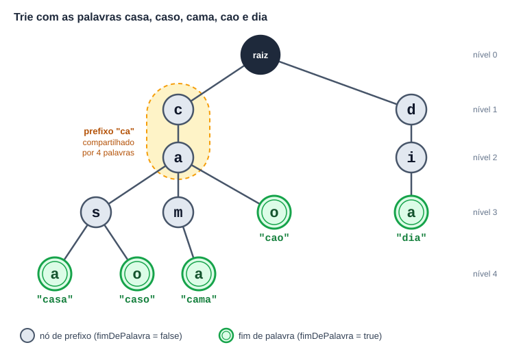

## Objetivos de aprendizagem

Ao final deste tópico, você deverá ser capaz de:

- Explicar o que é uma árvore Trie e por que ela é chamada de árvore de prefixos.
- Representar um conjunto de palavras em uma Trie.
- Implementar as operações de inserção, busca, busca por prefixo e remoção.
- Analisar o custo dessas operações e compará-lo com outras estruturas de busca.

## Introdução

Muitas aplicações precisam guardar e consultar grandes conjuntos de palavras: o autocompletar de um buscador, o corretor ortográfico de um editor de texto, a tabela de roteamento de um roteador ou um dicionário de termos. Nessas situações, não basta saber se uma palavra existe; também é útil descobrir rapidamente **todas as palavras que começam com um prefixo**.

Uma árvore binária de busca compara chaves inteiras em cada nó, e uma tabela hash não preserva nenhuma relação entre chaves parecidas. A **Trie** resolve esse problema de outra forma: em vez de comparar a chave inteira, ela percorre a chave **caractere por caractere**, e palavras com o mesmo início compartilham o mesmo caminho na árvore.

## Conceito principal

Uma **Trie** (do inglês *re**trie**val*, recuperação) é uma árvore de busca digital em que:

- a raiz representa a cadeia vazia;
- cada aresta corresponde a um caractere do alfabeto;
- o caminho da raiz até um nó forma um prefixo;
- um nó recebe uma marca de **fim de palavra** quando o caminho até ele forma uma chave armazenada.

> A posição de um nó na Trie define a chave que ele representa. As chaves não ficam guardadas inteiras dentro dos nós: elas são formadas pelo caminho percorrido.

### Exemplo de estrutura

Considere as palavras `casa`, `caso`, `cama`, `cão` (sem acento, `cao`) e `dia`. A Trie correspondente fica assim (os nós vermelhos, com contorno duplo, marcam fim de palavra, e os azuis são só prefixo):

{align=center width=100%}

Observe que o prefixo `ca` é armazenado uma única vez e compartilhado por quatro palavras.

### Por que marcar o fim da palavra?

Sem a marca, não seria possível distinguir uma palavra de um simples prefixo. Se inserirmos `car` e `carro`, o nó do `r` de `car` está no meio do caminho de `carro`. A marca `fimDePalavra` nesse nó indica que `car` também é uma chave válida, e não apenas o começo de outra.

## Representação em C

A forma mais direta usa um vetor de ponteiros em cada nó, com uma posição para cada letra do alfabeto. Neste exemplo, consideramos apenas as 26 letras minúsculas de `a` a `z`.

```c
#include <stdbool.h>
#include <stdlib.h>

#define TAM_ALFABETO 26

typedef struct NoTrie {
    struct NoTrie *filhos[TAM_ALFABETO];   /* um ponteiro por letra */
    bool fimDePalavra;                     /* o caminho até aqui é uma palavra? */
} NoTrie;

NoTrie *criarNo(void) {
    NoTrie *no = malloc(sizeof(NoTrie));
    if (no == NULL) return NULL;           /* sem memória */
    no->fimDePalavra = false;
    for (int i = 0; i < TAM_ALFABETO; i++) {
        no->filhos[i] = NULL;              /* nenhuma letra continua o caminho */
    }
    return no;
}
```

- `filhos[TAM_ALFABETO]`: 26 ponteiros. A posição 0 aponta para o filho da letra `a`, a 1 para o da letra `b`, e assim por diante. `NULL` significa que aquela letra não continua o caminho.
- `fimDePalavra`: indica se o caminho da raiz até o nó forma uma palavra completa (`true`) ou apenas um prefixo (`false`).
- `criarNo` reserva a memória de um nó com `malloc`, coloca `NULL` nos 26 filhos e começa com `fimDePalavra = false`.

> O índice do filho é calculado a partir do caractere: `c - 'a'`. Como os caracteres são números na tabela ASCII e as letras minúsculas são consecutivas, `'a' - 'a'` vale 0, `'b' - 'a'` vale 1 e `'z' - 'a'` vale 25.

Nos programas abaixo, clique em **Executar** e acompanhe a linha amarela. Na tela escura, cada bonequinho é um nó da Trie, organizado por nível (a raiz no topo). O colchete amarelo mostra onde está o ponteiro `atual`, o `*` e o rótulo **fim** marcam fim de palavra, e o bonequinho apagado com rótulo **NULL** mostra um filho que não existe.

## Operações

### Inserção

Para inserir uma palavra, percorremos seus caracteres a partir da raiz. Se o filho correspondente ao caractere atual não existir, criamos um novo nó. Ao terminar a palavra, marcamos o último nó como fim de palavra.

O programa abaixo junta a estrutura do nó, a função `criarNo` e a função `inserir`, e insere `sol`, `solo` e `sal` em uma Trie vazia.

```codigo
{"title":"Criando a Trie e inserindo sol, solo e sal","cols":7,"code":"#include <stdbool.h>\n#include <stdlib.h>\n\n#define TAM_ALFABETO 26\n\ntypedef struct NoTrie {\n    struct NoTrie *filhos[TAM_ALFABETO];   /* um ponteiro por letra */\n    bool fimDePalavra;                     /* o caminho até aqui é uma palavra? */\n} NoTrie;\n\nNoTrie *criarNo(void) {\n    NoTrie *no = malloc(sizeof(NoTrie));\n    if (no == NULL) return NULL;\n    no->fimDePalavra = false;\n    for (int i = 0; i < TAM_ALFABETO; i++) {\n        no->filhos[i] = NULL;\n    }\n    return no;\n}\n\nvoid inserir(NoTrie *raiz, const char *palavra) {\n    NoTrie *atual = raiz;\n    for (int i = 0; palavra[i] != '\\0'; i++) {\n        int indice = palavra[i] - 'a';\n        if (atual->filhos[indice] == NULL) {\n            atual->filhos[indice] = criarNo();\n        }\n        atual = atual->filhos[indice];\n    }\n    atual->fimDePalavra = true;\n}\n\nint main(void) {\n    NoTrie *raiz = criarNo();\n    inserir(raiz, \"sol\");\n    inserir(raiz, \"solo\");\n    inserir(raiz, \"sal\");\n    return 0;\n}","steps":[{"line":34,"caption":"O programa começa criando a **raiz**. Ela representa a cadeia vazia e ainda não tem filhos.","vars":{},"rows":[[{"i":[],"l":""}],[],[],[],[],[]],"stack":"main"},{"line":12,"caption":"`malloc` reserva a memória de um nó: 26 ponteiros (um para cada letra) e a marca `fimDePalavra`.","vars":{},"rows":[[{"i":[],"l":""}],[],[],[],[],[]],"stack":"criarNo ← main"},{"line":16,"caption":"O laço coloca `NULL` nas 26 posições: nenhuma letra continua o caminho ainda. `fimDePalavra` começa como `false`.","vars":{"i":"0..25"},"rows":[[{"i":[],"l":""}],[],[],[],[],[]],"stack":"criarNo ← main"},{"line":18,"caption":"A raiz está pronta e aparece no topo da árvore.","vars":{},"rows":[[{"i":[],"l":""}],[{"s":3,"n":1,"i":[["raiz","p",0]]}],[],[],[],[]],"stack":"criarNo ← main"},{"line":35,"caption":"Vamos inserir **sol**. A função percorre a palavra letra por letra, a partir da raiz.","vars":{},"rows":[[{"i":[["s","",6],["o","",4],["l","",2]],"l":"palavra"}],[{"s":3,"n":1,"i":[["raiz","",0]]}],[],[],[],[]],"stack":"main"},{"line":22,"caption":"`atual` começa na raiz (o colchete amarelo mostra onde `atual` está).","vars":{"atual":"raiz"},"rows":[[{"i":[["s","",6],["o","",4],["l","",2]],"l":"palavra"}],[{"s":3,"n":1,"i":[["raiz","",0]],"a":1}],[],[],[],[]],"stack":"inserir ← main"},{"line":25,"caption":"`'s' - 'a'` = 18. `filhos[18]` é **NULL**: ainda não há caminho para 's'.","vars":{"i":0,"palavra[i]":"'s'","indice":18,"atual":"raiz"},"rows":[[{"i":[["s","c",6],["o","",4],["l","",2]],"l":"palavra"}],[{"s":3,"n":1,"i":[["raiz","",0]],"a":1}],[{"s":3,"n":1,"i":[["s","g",6]],"l":"NULL"}],[],[],[]],"stack":"inserir ← main"},{"line":26,"caption":"Criamos um nó novo para 's' e o ligamos em `filhos[18]`.","vars":{"i":0,"palavra[i]":"'s'","indice":18,"atual":"raiz"},"rows":[[{"i":[["s","c",6],["o","",4],["l","",2]],"l":"palavra"}],[{"s":3,"n":1,"i":[["raiz","",0]],"a":1}],[{"s":3,"n":1,"i":[["s","p",6]]}],[],[],[]],"stack":"inserir ← main"},{"line":28,"caption":"`atual` desce para o nó de 's'.","vars":{"i":0,"palavra[i]":"'s'","indice":18,"atual":"raiz→s"},"rows":[[{"i":[["s","c",6],["o","",4],["l","",2]],"l":"palavra"}],[{"s":3,"n":1,"i":[["raiz","",0]]}],[{"s":3,"n":1,"i":[["s","",6]],"a":1}],[],[],[]],"stack":"inserir ← main"},{"line":25,"caption":"`'o' - 'a'` = 14. `filhos[14]` é **NULL**: ainda não há caminho para 'o'.","vars":{"i":1,"palavra[i]":"'o'","indice":14,"atual":"raiz→s"},"rows":[[{"i":[["s","",6],["o","c",4],["l","",2]],"l":"palavra"}],[{"s":3,"n":1,"i":[["raiz","",0]]}],[{"s":3,"n":1,"i":[["s","",6]],"a":1}],[{"s":2,"n":1,"i":[["o","g",4]],"l":"NULL"}],[],[]],"stack":"inserir ← main"},{"line":26,"caption":"Criamos um nó novo para 'o' e o ligamos em `filhos[14]`.","vars":{"i":1,"palavra[i]":"'o'","indice":14,"atual":"raiz→s"},"rows":[[{"i":[["s","",6],["o","c",4],["l","",2]],"l":"palavra"}],[{"s":3,"n":1,"i":[["raiz","",0]]}],[{"s":3,"n":1,"i":[["s","",6]],"a":1}],[{"s":2,"n":1,"i":[["o","p",4]]}],[],[]],"stack":"inserir ← main"},{"line":28,"caption":"`atual` desce para o nó de 'o'.","vars":{"i":1,"palavra[i]":"'o'","indice":14,"atual":"raiz→s→o"},"rows":[[{"i":[["s","",6],["o","c",4],["l","",2]],"l":"palavra"}],[{"s":3,"n":1,"i":[["raiz","",0]]}],[{"s":3,"n":1,"i":[["s","",6]]}],[{"s":2,"n":1,"i":[["o","",4]],"a":1}],[],[]],"stack":"inserir ← main"},{"line":25,"caption":"`'l' - 'a'` = 11. `filhos[11]` é **NULL**: ainda não há caminho para 'l'.","vars":{"i":2,"palavra[i]":"'l'","indice":11,"atual":"raiz→s→o"},"rows":[[{"i":[["s","",6],["o","",4],["l","c",2]],"l":"palavra"}],[{"s":3,"n":1,"i":[["raiz","",0]]}],[{"s":3,"n":1,"i":[["s","",6]]}],[{"s":2,"n":1,"i":[["o","",4]],"a":1}],[{"s":2,"n":1,"i":[["l","g",2]],"l":"NULL"}],[]],"stack":"inserir ← main"},{"line":26,"caption":"Criamos um nó novo para 'l' e o ligamos em `filhos[11]`.","vars":{"i":2,"palavra[i]":"'l'","indice":11,"atual":"raiz→s→o"},"rows":[[{"i":[["s","",6],["o","",4],["l","c",2]],"l":"palavra"}],[{"s":3,"n":1,"i":[["raiz","",0]]}],[{"s":3,"n":1,"i":[["s","",6]]}],[{"s":2,"n":1,"i":[["o","",4]],"a":1}],[{"s":2,"n":1,"i":[["l","p",2]]}],[]],"stack":"inserir ← main"},{"line":28,"caption":"`atual` desce para o nó de 'l'.","vars":{"i":2,"palavra[i]":"'l'","indice":11,"atual":"raiz→s→o→l"},"rows":[[{"i":[["s","",6],["o","",4],["l","c",2]],"l":"palavra"}],[{"s":3,"n":1,"i":[["raiz","",0]]}],[{"s":3,"n":1,"i":[["s","",6]]}],[{"s":2,"n":1,"i":[["o","",4]]}],[{"s":2,"n":1,"i":[["l","",2]],"a":1}],[]],"stack":"inserir ← main"},{"line":30,"caption":"Acabou a palavra (`palavra[3]` é `'\\0'`). Marcamos o último nó: **sol** agora está na Trie (`*` = fim de palavra).","vars":{"atual":"raiz→s→o→l","fimDePalavra":"true"},"rows":[[{"i":[["s","",6],["o","",4],["l","p",2]],"l":"palavra"}],[{"s":3,"n":1,"i":[["raiz","",0]]}],[{"s":3,"n":1,"i":[["s","",6]]}],[{"s":2,"n":1,"i":[["o","",4]]}],[{"s":2,"n":1,"i":[["l*","p",2]],"l":"fim","a":1}],[]],"stack":"inserir ← main"},{"line":36,"caption":"Vamos inserir **solo**. A função percorre a palavra letra por letra, a partir da raiz.","vars":{},"rows":[[{"i":[["s","",6],["o","",4],["l","",2],["o","",4]],"l":"palavra"}],[{"s":3,"n":1,"i":[["raiz","",0]]}],[{"s":3,"n":1,"i":[["s","",6]]}],[{"s":2,"n":1,"i":[["o","",4]]}],[{"s":2,"n":1,"i":[["l*","",2]],"l":"fim"}],[]],"stack":"main"},{"line":22,"caption":"`atual` começa na raiz (o colchete amarelo mostra onde `atual` está).","vars":{"atual":"raiz"},"rows":[[{"i":[["s","",6],["o","",4],["l","",2],["o","",4]],"l":"palavra"}],[{"s":3,"n":1,"i":[["raiz","",0]],"a":1}],[{"s":3,"n":1,"i":[["s","",6]]}],[{"s":2,"n":1,"i":[["o","",4]]}],[{"s":2,"n":1,"i":[["l*","",2]],"l":"fim"}],[]],"stack":"inserir ← main"},{"line":25,"caption":"`'s' - 'a'` = 18. `filhos[18]` **já existe**: o nó de 's' é reaproveitado, sem criar nada.","vars":{"i":0,"palavra[i]":"'s'","indice":18,"atual":"raiz"},"rows":[[{"i":[["s","c",6],["o","",4],["l","",2],["o","",4]],"l":"palavra"}],[{"s":3,"n":1,"i":[["raiz","",0]],"a":1}],[{"s":3,"n":1,"i":[["s","c",6]]}],[{"s":2,"n":1,"i":[["o","",4]]}],[{"s":2,"n":1,"i":[["l*","",2]],"l":"fim"}],[]],"stack":"inserir ← main"},{"line":28,"caption":"`atual` desce para o nó de 's'.","vars":{"i":0,"palavra[i]":"'s'","indice":18,"atual":"raiz→s"},"rows":[[{"i":[["s","c",6],["o","",4],["l","",2],["o","",4]],"l":"palavra"}],[{"s":3,"n":1,"i":[["raiz","",0]]}],[{"s":3,"n":1,"i":[["s","",6]],"a":1}],[{"s":2,"n":1,"i":[["o","",4]]}],[{"s":2,"n":1,"i":[["l*","",2]],"l":"fim"}],[]],"stack":"inserir ← main"},{"line":25,"caption":"`'o' - 'a'` = 14. `filhos[14]` **já existe**: o nó de 'o' é reaproveitado, sem criar nada.","vars":{"i":1,"palavra[i]":"'o'","indice":14,"atual":"raiz→s"},"rows":[[{"i":[["s","",6],["o","c",4],["l","",2],["o","",4]],"l":"palavra"}],[{"s":3,"n":1,"i":[["raiz","",0]]}],[{"s":3,"n":1,"i":[["s","",6]],"a":1}],[{"s":2,"n":1,"i":[["o","c",4]]}],[{"s":2,"n":1,"i":[["l*","",2]],"l":"fim"}],[]],"stack":"inserir ← main"},{"line":28,"caption":"`atual` desce para o nó de 'o'.","vars":{"i":1,"palavra[i]":"'o'","indice":14,"atual":"raiz→s→o"},"rows":[[{"i":[["s","",6],["o","c",4],["l","",2],["o","",4]],"l":"palavra"}],[{"s":3,"n":1,"i":[["raiz","",0]]}],[{"s":3,"n":1,"i":[["s","",6]]}],[{"s":2,"n":1,"i":[["o","",4]],"a":1}],[{"s":2,"n":1,"i":[["l*","",2]],"l":"fim"}],[]],"stack":"inserir ← main"},{"line":25,"caption":"`'l' - 'a'` = 11. `filhos[11]` **já existe**: o nó de 'l' é reaproveitado, sem criar nada.","vars":{"i":2,"palavra[i]":"'l'","indice":11,"atual":"raiz→s→o"},"rows":[[{"i":[["s","",6],["o","",4],["l","c",2],["o","",4]],"l":"palavra"}],[{"s":3,"n":1,"i":[["raiz","",0]]}],[{"s":3,"n":1,"i":[["s","",6]]}],[{"s":2,"n":1,"i":[["o","",4]],"a":1}],[{"s":2,"n":1,"i":[["l*","c",2]],"l":"fim"}],[]],"stack":"inserir ← main"},{"line":28,"caption":"`atual` desce para o nó de 'l'.","vars":{"i":2,"palavra[i]":"'l'","indice":11,"atual":"raiz→s→o→l"},"rows":[[{"i":[["s","",6],["o","",4],["l","c",2],["o","",4]],"l":"palavra"}],[{"s":3,"n":1,"i":[["raiz","",0]]}],[{"s":3,"n":1,"i":[["s","",6]]}],[{"s":2,"n":1,"i":[["o","",4]]}],[{"s":2,"n":1,"i":[["l*","",2]],"l":"fim","a":1}],[]],"stack":"inserir ← main"},{"line":25,"caption":"`'o' - 'a'` = 14. `filhos[14]` é **NULL**: ainda não há caminho para 'o'.","vars":{"i":3,"palavra[i]":"'o'","indice":14,"atual":"raiz→s→o→l"},"rows":[[{"i":[["s","",6],["o","",4],["l","",2],["o","c",4]],"l":"palavra"}],[{"s":3,"n":1,"i":[["raiz","",0]]}],[{"s":3,"n":1,"i":[["s","",6]]}],[{"s":2,"n":1,"i":[["o","",4]]}],[{"s":2,"n":1,"i":[["l*","",2]],"l":"fim","a":1}],[{"s":2,"n":1,"i":[["o","g",4]],"l":"NULL"}]],"stack":"inserir ← main"},{"line":26,"caption":"Criamos um nó novo para 'o' e o ligamos em `filhos[14]`.","vars":{"i":3,"palavra[i]":"'o'","indice":14,"atual":"raiz→s→o→l"},"rows":[[{"i":[["s","",6],["o","",4],["l","",2],["o","c",4]],"l":"palavra"}],[{"s":3,"n":1,"i":[["raiz","",0]]}],[{"s":3,"n":1,"i":[["s","",6]]}],[{"s":2,"n":1,"i":[["o","",4]]}],[{"s":2,"n":1,"i":[["l*","",2]],"l":"fim","a":1}],[{"s":2,"n":1,"i":[["o","p",4]]}]],"stack":"inserir ← main"},{"line":28,"caption":"`atual` desce para o nó de 'o'.","vars":{"i":3,"palavra[i]":"'o'","indice":14,"atual":"raiz→s→o→l→o"},"rows":[[{"i":[["s","",6],["o","",4],["l","",2],["o","c",4]],"l":"palavra"}],[{"s":3,"n":1,"i":[["raiz","",0]]}],[{"s":3,"n":1,"i":[["s","",6]]}],[{"s":2,"n":1,"i":[["o","",4]]}],[{"s":2,"n":1,"i":[["l*","",2]],"l":"fim"}],[{"s":2,"n":1,"i":[["o","",4]],"a":1}]],"stack":"inserir ← main"},{"line":30,"caption":"Acabou a palavra (`palavra[4]` é `'\\0'`). Marcamos o último nó: **solo** agora está na Trie (`*` = fim de palavra). Repare: só um nó novo foi criado, porque `sol` já estava lá.","vars":{"atual":"raiz→s→o→l→o","fimDePalavra":"true"},"rows":[[{"i":[["s","",6],["o","",4],["l","",2],["o","p",4]],"l":"palavra"}],[{"s":3,"n":1,"i":[["raiz","",0]]}],[{"s":3,"n":1,"i":[["s","",6]]}],[{"s":2,"n":1,"i":[["o","",4]]}],[{"s":2,"n":1,"i":[["l*","",2]],"l":"fim"}],[{"s":2,"n":1,"i":[["o*","p",4]],"l":"fim","a":1}]],"stack":"inserir ← main"},{"line":37,"caption":"Vamos inserir **sal**. A função percorre a palavra letra por letra, a partir da raiz.","vars":{},"rows":[[{"i":[["s","",6],["a","",8],["l","",2]],"l":"palavra"}],[{"s":3,"n":1,"i":[["raiz","",0]]}],[{"s":3,"n":1,"i":[["s","",6]]}],[{"s":2,"n":1,"i":[["o","",4]]}],[{"s":2,"n":1,"i":[["l*","",2]],"l":"fim"}],[{"s":2,"n":1,"i":[["o*","",4]],"l":"fim"}]],"stack":"main"},{"line":22,"caption":"`atual` começa na raiz (o colchete amarelo mostra onde `atual` está).","vars":{"atual":"raiz"},"rows":[[{"i":[["s","",6],["a","",8],["l","",2]],"l":"palavra"}],[{"s":3,"n":1,"i":[["raiz","",0]],"a":1}],[{"s":3,"n":1,"i":[["s","",6]]}],[{"s":2,"n":1,"i":[["o","",4]]}],[{"s":2,"n":1,"i":[["l*","",2]],"l":"fim"}],[{"s":2,"n":1,"i":[["o*","",4]],"l":"fim"}]],"stack":"inserir ← main"},{"line":25,"caption":"`'s' - 'a'` = 18. `filhos[18]` **já existe**: o nó de 's' é reaproveitado, sem criar nada.","vars":{"i":0,"palavra[i]":"'s'","indice":18,"atual":"raiz"},"rows":[[{"i":[["s","c",6],["a","",8],["l","",2]],"l":"palavra"}],[{"s":3,"n":1,"i":[["raiz","",0]],"a":1}],[{"s":3,"n":1,"i":[["s","c",6]]}],[{"s":2,"n":1,"i":[["o","",4]]}],[{"s":2,"n":1,"i":[["l*","",2]],"l":"fim"}],[{"s":2,"n":1,"i":[["o*","",4]],"l":"fim"}]],"stack":"inserir ← main"},{"line":28,"caption":"`atual` desce para o nó de 's'.","vars":{"i":0,"palavra[i]":"'s'","indice":18,"atual":"raiz→s"},"rows":[[{"i":[["s","c",6],["a","",8],["l","",2]],"l":"palavra"}],[{"s":3,"n":1,"i":[["raiz","",0]]}],[{"s":3,"n":1,"i":[["s","",6]],"a":1}],[{"s":2,"n":1,"i":[["o","",4]]}],[{"s":2,"n":1,"i":[["l*","",2]],"l":"fim"}],[{"s":2,"n":1,"i":[["o*","",4]],"l":"fim"}]],"stack":"inserir ← main"},{"line":25,"caption":"`'a' - 'a'` = 0. `filhos[0]` é **NULL**: ainda não há caminho para 'a'.","vars":{"i":1,"palavra[i]":"'a'","indice":0,"atual":"raiz→s"},"rows":[[{"i":[["s","",6],["a","c",8],["l","",2]],"l":"palavra"}],[{"s":3,"n":1,"i":[["raiz","",0]]}],[{"s":3,"n":1,"i":[["s","",6]],"a":1}],[{"s":2,"n":1,"i":[["o","",4]]},{"s":4,"n":1,"i":[["a","g",8]],"l":"NULL"}],[{"s":2,"n":1,"i":[["l*","",2]],"l":"fim"}],[{"s":2,"n":1,"i":[["o*","",4]],"l":"fim"}]],"stack":"inserir ← main"},{"line":26,"caption":"Criamos um nó novo para 'a' e o ligamos em `filhos[0]`.","vars":{"i":1,"palavra[i]":"'a'","indice":0,"atual":"raiz→s"},"rows":[[{"i":[["s","",6],["a","c",8],["l","",2]],"l":"palavra"}],[{"s":3,"n":1,"i":[["raiz","",0]]}],[{"s":3,"n":1,"i":[["s","",6]],"a":1}],[{"s":2,"n":1,"i":[["o","",4]]},{"s":4,"n":1,"i":[["a","p",8]]}],[{"s":2,"n":1,"i":[["l*","",2]],"l":"fim"}],[{"s":2,"n":1,"i":[["o*","",4]],"l":"fim"}]],"stack":"inserir ← main"},{"line":28,"caption":"`atual` desce para o nó de 'a'.","vars":{"i":1,"palavra[i]":"'a'","indice":0,"atual":"raiz→s→a"},"rows":[[{"i":[["s","",6],["a","c",8],["l","",2]],"l":"palavra"}],[{"s":3,"n":1,"i":[["raiz","",0]]}],[{"s":3,"n":1,"i":[["s","",6]]}],[{"s":2,"n":1,"i":[["o","",4]]},{"s":4,"n":1,"i":[["a","",8]],"a":1}],[{"s":2,"n":1,"i":[["l*","",2]],"l":"fim"}],[{"s":2,"n":1,"i":[["o*","",4]],"l":"fim"}]],"stack":"inserir ← main"},{"line":25,"caption":"`'l' - 'a'` = 11. `filhos[11]` é **NULL**: ainda não há caminho para 'l'.","vars":{"i":2,"palavra[i]":"'l'","indice":11,"atual":"raiz→s→a"},"rows":[[{"i":[["s","",6],["a","",8],["l","c",2]],"l":"palavra"}],[{"s":3,"n":1,"i":[["raiz","",0]]}],[{"s":3,"n":1,"i":[["s","",6]]}],[{"s":2,"n":1,"i":[["o","",4]]},{"s":4,"n":1,"i":[["a","",8]],"a":1}],[{"s":2,"n":1,"i":[["l*","",2]],"l":"fim"},{"s":4,"n":1,"i":[["l","g",2]],"l":"NULL"}],[{"s":2,"n":1,"i":[["o*","",4]],"l":"fim"}]],"stack":"inserir ← main"},{"line":26,"caption":"Criamos um nó novo para 'l' e o ligamos em `filhos[11]`.","vars":{"i":2,"palavra[i]":"'l'","indice":11,"atual":"raiz→s→a"},"rows":[[{"i":[["s","",6],["a","",8],["l","c",2]],"l":"palavra"}],[{"s":3,"n":1,"i":[["raiz","",0]]}],[{"s":3,"n":1,"i":[["s","",6]]}],[{"s":2,"n":1,"i":[["o","",4]]},{"s":4,"n":1,"i":[["a","",8]],"a":1}],[{"s":2,"n":1,"i":[["l*","",2]],"l":"fim"},{"s":4,"n":1,"i":[["l","p",2]]}],[{"s":2,"n":1,"i":[["o*","",4]],"l":"fim"}]],"stack":"inserir ← main"},{"line":28,"caption":"`atual` desce para o nó de 'l'.","vars":{"i":2,"palavra[i]":"'l'","indice":11,"atual":"raiz→s→a→l"},"rows":[[{"i":[["s","",6],["a","",8],["l","c",2]],"l":"palavra"}],[{"s":3,"n":1,"i":[["raiz","",0]]}],[{"s":3,"n":1,"i":[["s","",6]]}],[{"s":2,"n":1,"i":[["o","",4]]},{"s":4,"n":1,"i":[["a","",8]]}],[{"s":2,"n":1,"i":[["l*","",2]],"l":"fim"},{"s":4,"n":1,"i":[["l","",2]],"a":1}],[{"s":2,"n":1,"i":[["o*","",4]],"l":"fim"}]],"stack":"inserir ← main"},{"line":30,"caption":"Acabou a palavra (`palavra[3]` é `'\\0'`). Marcamos o último nó: **sal** agora está na Trie (`*` = fim de palavra). O `s` foi reaproveitado e um novo ramo nasceu a partir dele.","vars":{"atual":"raiz→s→a→l","fimDePalavra":"true"},"rows":[[{"i":[["s","",6],["a","",8],["l","p",2]],"l":"palavra"}],[{"s":3,"n":1,"i":[["raiz","",0]]}],[{"s":3,"n":1,"i":[["s","",6]]}],[{"s":2,"n":1,"i":[["o","",4]]},{"s":4,"n":1,"i":[["a","",8]]}],[{"s":2,"n":1,"i":[["l*","",2]],"l":"fim"},{"s":4,"n":1,"i":[["l*","p",2]],"l":"fim","a":1}],[{"s":2,"n":1,"i":[["o*","",4]],"l":"fim"}]],"stack":"inserir ← main"},{"line":38,"caption":"Pronto: `sol`, `solo` e `sal` estão na Trie. O prefixo `s` é guardado uma única vez, e `so` é compartilhado por `sol` e `solo`.","vars":{},"rows":[[{"i":[],"l":""}],[{"s":3,"n":1,"i":[["raiz","",0]]}],[{"s":3,"n":1,"i":[["s","",6]]}],[{"s":2,"n":1,"i":[["o","",4]]},{"s":4,"n":1,"i":[["a","",8]]}],[{"s":2,"n":1,"i":[["l*","",2]],"l":"fim"},{"s":4,"n":1,"i":[["l*","",2]],"l":"fim"}],[{"s":2,"n":1,"i":[["o*","",4]],"l":"fim"}]],"stack":"main"}]}
```

### Busca e busca por prefixo

A busca segue o mesmo caminho. Se em algum momento o filho necessário não existir, a palavra não está na Trie. Se o caminho inteiro existir, a palavra só está armazenada quando o último nó estiver marcado como fim de palavra.

Verificar se existe alguma palavra que começa com um prefixo (`comecaCom`) é quase igual à busca, mas não exige a marca de fim de palavra: basta que o caminho exista.

```codigo
{"title":"Buscando palavras e prefixos na Trie","cols":7,"code":"#include <stdio.h>\n/* NoTrie, criarNo e inserir: veja o programa anterior */\n\nbool buscar(NoTrie *raiz, const char *palavra) {\n    NoTrie *atual = raiz;\n    for (int i = 0; palavra[i] != '\\0'; i++) {\n        int indice = palavra[i] - 'a';\n        if (atual->filhos[indice] == NULL) {\n            return false;\n        }\n        atual = atual->filhos[indice];\n    }\n    return atual->fimDePalavra;\n}\n\nbool comecaCom(NoTrie *raiz, const char *prefixo) {\n    NoTrie *atual = raiz;\n    for (int i = 0; prefixo[i] != '\\0'; i++) {\n        int indice = prefixo[i] - 'a';\n        if (atual->filhos[indice] == NULL) {\n            return false;\n        }\n        atual = atual->filhos[indice];\n    }\n    return true;\n}\n\nint main(void) {\n    NoTrie *raiz = criarNo();\n    inserir(raiz, \"sol\");\n    inserir(raiz, \"solo\");\n    inserir(raiz, \"sal\");\n    printf(\"%d\\n\", buscar(raiz, \"sol\"));      /* 1 */\n    printf(\"%d\\n\", buscar(raiz, \"so\"));       /* 0 */\n    printf(\"%d\\n\", buscar(raiz, \"sul\"));      /* 0 */\n    printf(\"%d\\n\", comecaCom(raiz, \"so\"));    /* 1 */\n    return 0;\n}","steps":[{"line":32,"caption":"Partimos da Trie montada no programa anterior, com `sol`, `solo` e `sal`.","vars":{},"rows":[[{"i":[],"l":""}],[{"s":3,"n":1,"i":[["raiz","",0]]}],[{"s":3,"n":1,"i":[["s","",6]]}],[{"s":2,"n":1,"i":[["o","",4]]},{"s":4,"n":1,"i":[["a","",8]]}],[{"s":2,"n":1,"i":[["l*","",2]],"l":"fim"},{"s":4,"n":1,"i":[["l*","",2]],"l":"fim"}],[{"s":2,"n":1,"i":[["o*","",4]],"l":"fim"}]],"stack":"main"},{"line":33,"caption":"Chamamos `buscar(raiz, \"sol\")`.","vars":{},"rows":[[{"i":[["s","",6],["o","",4],["l","",2]],"l":"palavra"}],[{"s":3,"n":1,"i":[["raiz","",0]]}],[{"s":3,"n":1,"i":[["s","",6]]}],[{"s":2,"n":1,"i":[["o","",4]]},{"s":4,"n":1,"i":[["a","",8]]}],[{"s":2,"n":1,"i":[["l*","",2]],"l":"fim"},{"s":4,"n":1,"i":[["l*","",2]],"l":"fim"}],[{"s":2,"n":1,"i":[["o*","",4]],"l":"fim"}]],"stack":"main"},{"line":11,"caption":"`'s' - 'a'` = 18. `filhos[18]` existe: `atual` desce para 's'.","vars":{"i":0,"palavra[i]":"'s'","indice":18,"atual":"raiz→s"},"rows":[[{"i":[["s","c",6],["o","",4],["l","",2]],"l":"palavra"}],[{"s":3,"n":1,"i":[["raiz","",0]]}],[{"s":3,"n":1,"i":[["s","c",6]],"a":1}],[{"s":2,"n":1,"i":[["o","",4]]},{"s":4,"n":1,"i":[["a","",8]]}],[{"s":2,"n":1,"i":[["l*","",2]],"l":"fim"},{"s":4,"n":1,"i":[["l*","",2]],"l":"fim"}],[{"s":2,"n":1,"i":[["o*","",4]],"l":"fim"}]],"stack":"buscar ← main"},{"line":11,"caption":"`'o' - 'a'` = 14. `filhos[14]` existe: `atual` desce para 'o'.","vars":{"i":1,"palavra[i]":"'o'","indice":14,"atual":"raiz→s→o"},"rows":[[{"i":[["s","",6],["o","c",4],["l","",2]],"l":"palavra"}],[{"s":3,"n":1,"i":[["raiz","",0]]}],[{"s":3,"n":1,"i":[["s","",6]]}],[{"s":2,"n":1,"i":[["o","c",4]],"a":1},{"s":4,"n":1,"i":[["a","",8]]}],[{"s":2,"n":1,"i":[["l*","",2]],"l":"fim"},{"s":4,"n":1,"i":[["l*","",2]],"l":"fim"}],[{"s":2,"n":1,"i":[["o*","",4]],"l":"fim"}]],"stack":"buscar ← main"},{"line":11,"caption":"`'l' - 'a'` = 11. `filhos[11]` existe: `atual` desce para 'l'.","vars":{"i":2,"palavra[i]":"'l'","indice":11,"atual":"raiz→s→o→l"},"rows":[[{"i":[["s","",6],["o","",4],["l","c",2]],"l":"palavra"}],[{"s":3,"n":1,"i":[["raiz","",0]]}],[{"s":3,"n":1,"i":[["s","",6]]}],[{"s":2,"n":1,"i":[["o","",4]]},{"s":4,"n":1,"i":[["a","",8]]}],[{"s":2,"n":1,"i":[["l*","c",2]],"l":"fim","a":1},{"s":4,"n":1,"i":[["l*","",2]],"l":"fim"}],[{"s":2,"n":1,"i":[["o*","",4]],"l":"fim"}]],"stack":"buscar ← main"},{"line":13,"caption":"O caminho existe e o nó está marcado como fim de palavra: **sol** foi encontrada, devolve `true`.","vars":{"atual":"raiz→s→o→l","fimDePalavra":"true","retorno":"true"},"rows":[[{"i":[["s","",6],["o","",4],["l","p",2]],"l":"palavra"}],[{"s":3,"n":1,"i":[["raiz","",0]]}],[{"s":3,"n":1,"i":[["s","",6]]}],[{"s":2,"n":1,"i":[["o","",4]]},{"s":4,"n":1,"i":[["a","",8]]}],[{"s":2,"n":1,"i":[["l*","p",2]],"l":"fim","a":1},{"s":4,"n":1,"i":[["l*","",2]],"l":"fim"}],[{"s":2,"n":1,"i":[["o*","",4]],"l":"fim"}]],"stack":"buscar ← main"},{"line":34,"caption":"Chamamos `buscar(raiz, \"so\")`.","vars":{},"rows":[[{"i":[["s","",6],["o","",4]],"l":"palavra"}],[{"s":3,"n":1,"i":[["raiz","",0]]}],[{"s":3,"n":1,"i":[["s","",6]]}],[{"s":2,"n":1,"i":[["o","",4]]},{"s":4,"n":1,"i":[["a","",8]]}],[{"s":2,"n":1,"i":[["l*","",2]],"l":"fim"},{"s":4,"n":1,"i":[["l*","",2]],"l":"fim"}],[{"s":2,"n":1,"i":[["o*","",4]],"l":"fim"}]],"stack":"main"},{"line":11,"caption":"`'s' - 'a'` = 18. `filhos[18]` existe: `atual` desce para 's'.","vars":{"i":0,"palavra[i]":"'s'","indice":18,"atual":"raiz→s"},"rows":[[{"i":[["s","c",6],["o","",4]],"l":"palavra"}],[{"s":3,"n":1,"i":[["raiz","",0]]}],[{"s":3,"n":1,"i":[["s","c",6]],"a":1}],[{"s":2,"n":1,"i":[["o","",4]]},{"s":4,"n":1,"i":[["a","",8]]}],[{"s":2,"n":1,"i":[["l*","",2]],"l":"fim"},{"s":4,"n":1,"i":[["l*","",2]],"l":"fim"}],[{"s":2,"n":1,"i":[["o*","",4]],"l":"fim"}]],"stack":"buscar ← main"},{"line":11,"caption":"`'o' - 'a'` = 14. `filhos[14]` existe: `atual` desce para 'o'.","vars":{"i":1,"palavra[i]":"'o'","indice":14,"atual":"raiz→s→o"},"rows":[[{"i":[["s","",6],["o","c",4]],"l":"palavra"}],[{"s":3,"n":1,"i":[["raiz","",0]]}],[{"s":3,"n":1,"i":[["s","",6]]}],[{"s":2,"n":1,"i":[["o","c",4]],"a":1},{"s":4,"n":1,"i":[["a","",8]]}],[{"s":2,"n":1,"i":[["l*","",2]],"l":"fim"},{"s":4,"n":1,"i":[["l*","",2]],"l":"fim"}],[{"s":2,"n":1,"i":[["o*","",4]],"l":"fim"}]],"stack":"buscar ← main"},{"line":13,"caption":"O caminho existe, mas o nó **não** é fim de palavra: `so` é só um prefixo de outras palavras. Devolve `false`.","vars":{"atual":"raiz→s→o","fimDePalavra":"false","retorno":"false"},"rows":[[{"i":[["s","",6],["o","c",4]],"l":"palavra"}],[{"s":3,"n":1,"i":[["raiz","",0]]}],[{"s":3,"n":1,"i":[["s","",6]]}],[{"s":2,"n":1,"i":[["o","c",4]],"a":1},{"s":4,"n":1,"i":[["a","",8]]}],[{"s":2,"n":1,"i":[["l*","",2]],"l":"fim"},{"s":4,"n":1,"i":[["l*","",2]],"l":"fim"}],[{"s":2,"n":1,"i":[["o*","",4]],"l":"fim"}]],"stack":"buscar ← main"},{"line":35,"caption":"Chamamos `buscar(raiz, \"sul\")`.","vars":{},"rows":[[{"i":[["s","",6],["u","",1],["l","",2]],"l":"palavra"}],[{"s":3,"n":1,"i":[["raiz","",0]]}],[{"s":3,"n":1,"i":[["s","",6]]}],[{"s":2,"n":1,"i":[["o","",4]]},{"s":4,"n":1,"i":[["a","",8]]}],[{"s":2,"n":1,"i":[["l*","",2]],"l":"fim"},{"s":4,"n":1,"i":[["l*","",2]],"l":"fim"}],[{"s":2,"n":1,"i":[["o*","",4]],"l":"fim"}]],"stack":"main"},{"line":11,"caption":"`'s' - 'a'` = 18. `filhos[18]` existe: `atual` desce para 's'.","vars":{"i":0,"palavra[i]":"'s'","indice":18,"atual":"raiz→s"},"rows":[[{"i":[["s","c",6],["u","",1],["l","",2]],"l":"palavra"}],[{"s":3,"n":1,"i":[["raiz","",0]]}],[{"s":3,"n":1,"i":[["s","c",6]],"a":1}],[{"s":2,"n":1,"i":[["o","",4]]},{"s":4,"n":1,"i":[["a","",8]]}],[{"s":2,"n":1,"i":[["l*","",2]],"l":"fim"},{"s":4,"n":1,"i":[["l*","",2]],"l":"fim"}],[{"s":2,"n":1,"i":[["o*","",4]],"l":"fim"}]],"stack":"buscar ← main"},{"line":8,"caption":"`filhos[20]` de `raiz→s` é **NULL**: não existe caminho para 'u'.","vars":{"i":1,"palavra[i]":"'u'","indice":20,"atual":"raiz→s"},"rows":[[{"i":[["s","",6],["u","c",1],["l","",2]],"l":"palavra"}],[{"s":3,"n":1,"i":[["raiz","",0]]}],[{"s":3,"n":1,"i":[["s","",6]],"a":1}],[{"s":2,"n":1,"i":[["o","",4]]},{"s":4,"n":1,"i":[["a","",8]]},{"s":3,"n":1,"i":[["u","g",1]],"l":"NULL"}],[{"s":2,"n":1,"i":[["l*","",2]],"l":"fim"},{"s":4,"n":1,"i":[["l*","",2]],"l":"fim"}],[{"s":2,"n":1,"i":[["o*","",4]],"l":"fim"}]],"stack":"buscar ← main"},{"line":9,"caption":"Nenhuma palavra armazenada segue por esse caminho: devolve `false` sem olhar o resto da palavra.","vars":{"i":1,"palavra[i]":"'u'","indice":20,"atual":"raiz→s","retorno":"false"},"rows":[[{"i":[["s","",6],["u","c",1],["l","",2]],"l":"palavra"}],[{"s":3,"n":1,"i":[["raiz","",0]]}],[{"s":3,"n":1,"i":[["s","",6]],"a":1}],[{"s":2,"n":1,"i":[["o","",4]]},{"s":4,"n":1,"i":[["a","",8]]},{"s":3,"n":1,"i":[["u","g",1]],"l":"NULL"}],[{"s":2,"n":1,"i":[["l*","",2]],"l":"fim"},{"s":4,"n":1,"i":[["l*","",2]],"l":"fim"}],[{"s":2,"n":1,"i":[["o*","",4]],"l":"fim"}]],"stack":"buscar ← main"},{"line":36,"caption":"Chamamos `comecaCom(raiz, \"so\")`. Agora só queremos saber se **alguma** palavra começa com `so`.","vars":{},"rows":[[{"i":[["s","",6],["o","",4]],"l":"prefixo"}],[{"s":3,"n":1,"i":[["raiz","",0]]}],[{"s":3,"n":1,"i":[["s","",6]]}],[{"s":2,"n":1,"i":[["o","",4]]},{"s":4,"n":1,"i":[["a","",8]]}],[{"s":2,"n":1,"i":[["l*","",2]],"l":"fim"},{"s":4,"n":1,"i":[["l*","",2]],"l":"fim"}],[{"s":2,"n":1,"i":[["o*","",4]],"l":"fim"}]],"stack":"main"},{"line":23,"caption":"`'s' - 'a'` = 18. `filhos[18]` existe: `atual` desce para 's'.","vars":{"i":0,"prefixo[i]":"'s'","indice":18,"atual":"raiz→s"},"rows":[[{"i":[["s","c",6],["o","",4]],"l":"prefixo"}],[{"s":3,"n":1,"i":[["raiz","",0]]}],[{"s":3,"n":1,"i":[["s","c",6]],"a":1}],[{"s":2,"n":1,"i":[["o","",4]]},{"s":4,"n":1,"i":[["a","",8]]}],[{"s":2,"n":1,"i":[["l*","",2]],"l":"fim"},{"s":4,"n":1,"i":[["l*","",2]],"l":"fim"}],[{"s":2,"n":1,"i":[["o*","",4]],"l":"fim"}]],"stack":"comecaCom ← main"},{"line":23,"caption":"`'o' - 'a'` = 14. `filhos[14]` existe: `atual` desce para 'o'.","vars":{"i":1,"prefixo[i]":"'o'","indice":14,"atual":"raiz→s→o"},"rows":[[{"i":[["s","",6],["o","c",4]],"l":"prefixo"}],[{"s":3,"n":1,"i":[["raiz","",0]]}],[{"s":3,"n":1,"i":[["s","",6]]}],[{"s":2,"n":1,"i":[["o","c",4]],"a":1},{"s":4,"n":1,"i":[["a","",8]]}],[{"s":2,"n":1,"i":[["l*","",2]],"l":"fim"},{"s":4,"n":1,"i":[["l*","",2]],"l":"fim"}],[{"s":2,"n":1,"i":[["o*","",4]],"l":"fim"}]],"stack":"comecaCom ← main"},{"line":25,"caption":"O caminho `so` existe inteiro, então devolve `true`, **sem olhar `fimDePalavra`**. Abaixo desse nó estão `sol` e `solo`.","vars":{"atual":"raiz→s→o","retorno":"true"},"rows":[[{"i":[["s","",6],["o","p",4]],"l":"prefixo"}],[{"s":3,"n":1,"i":[["raiz","",0]]}],[{"s":3,"n":1,"i":[["s","",6]]}],[{"s":2,"n":1,"i":[["o","p",4]],"a":1},{"s":4,"n":1,"i":[["a","",8]]}],[{"s":2,"n":1,"i":[["l*","",2]],"l":"fim"},{"s":4,"n":1,"i":[["l*","",2]],"l":"fim"}],[{"s":2,"n":1,"i":[["o*","",4]],"l":"fim"}]],"stack":"comecaCom ← main"},{"line":37,"caption":"Resumo: `buscar` exige caminho **e** marca de fim; `comecaCom` exige só o caminho. As duas fazem no máximo um passo por letra.","vars":{},"rows":[[{"i":[],"l":""}],[{"s":3,"n":1,"i":[["raiz","",0]]}],[{"s":3,"n":1,"i":[["s","",6]]}],[{"s":2,"n":1,"i":[["o","",4]]},{"s":4,"n":1,"i":[["a","",8]]}],[{"s":2,"n":1,"i":[["l*","",2]],"l":"fim"},{"s":4,"n":1,"i":[["l*","",2]],"l":"fim"}],[{"s":2,"n":1,"i":[["o*","",4]],"l":"fim"}]],"stack":"main"}]}
```

Para implementar um **autocompletar**, desce-se até o nó do prefixo e, a partir dele, faz-se um percurso em profundidade listando todos os nós marcados como fim de palavra. O custo O(*m*) da busca por prefixo vale só para descobrir se o prefixo existe. Listar as sugestões custa, além disso, um passo por nó visitado abaixo do prefixo, então depende de quantas palavras começam com ele e do tamanho delas.

### Remoção

A remoção desmarca o fim de palavra e, em seguida, libera os nós que deixaram de ser úteis, isto é, nós que não marcam fim de palavra e não têm filhos. A solução usa três funções: `temFilhos` (verifica se algum dos 26 ponteiros é diferente de `NULL`), `removerRec` (desce recursivamente até o fim da palavra e, na volta, libera os nós inúteis) e `remover` (inicia a recursão pela raiz).

```codigo
{"title":"Removendo solo e sal da Trie","cols":7,"code":"#include <stdlib.h>\n/* NoTrie, criarNo e inserir: veja o primeiro programa */\n\nstatic bool temFilhos(NoTrie *no) {\n    for (int i = 0; i < TAM_ALFABETO; i++) {\n        if (no->filhos[i] != NULL) return true;\n    }\n    return false;\n}\n\nstatic bool removerRec(NoTrie *no, const char *palavra, int profundidade) {\n    if (no == NULL) return false;\n\n    if (palavra[profundidade] == '\\0') {\n        if (!no->fimDePalavra) return false;\n        no->fimDePalavra = false;\n        return !temFilhos(no);\n    }\n\n    int indice = palavra[profundidade] - 'a';\n    if (removerRec(no->filhos[indice], palavra, profundidade + 1)) {\n        free(no->filhos[indice]);\n        no->filhos[indice] = NULL;\n        return !no->fimDePalavra && !temFilhos(no);\n    }\n    return false;\n}\n\nvoid remover(NoTrie *raiz, const char *palavra) {\n    removerRec(raiz, palavra, 0);\n}\n\nint main(void) {\n    NoTrie *raiz = criarNo();\n    inserir(raiz, \"sol\");\n    inserir(raiz, \"solo\");\n    inserir(raiz, \"sal\");\n    remover(raiz, \"solo\");\n    remover(raiz, \"sal\");\n    return 0;\n}","steps":[{"line":37,"caption":"A Trie começa com `sol`, `solo` e `sal`. Vamos remover `solo` e depois `sal`.","vars":{},"rows":[[{"i":[],"l":""}],[{"s":3,"n":1,"i":[["raiz","",0]]}],[{"s":3,"n":1,"i":[["s","",6]]}],[{"s":2,"n":1,"i":[["o","",4]]},{"s":4,"n":1,"i":[["a","",8]]}],[{"s":2,"n":1,"i":[["l*","",2]],"l":"fim"},{"s":4,"n":1,"i":[["l*","",2]],"l":"fim"}],[{"s":2,"n":1,"i":[["o*","",4]],"l":"fim"}]],"stack":"main"},{"line":38,"caption":"Chamamos `remover(raiz, \"solo\")`, que começa a recursão pela raiz, na profundidade 0.","vars":{},"rows":[[{"i":[["s","",6],["o","",4],["l","",2],["o","",4]],"l":"palavra"}],[{"s":3,"n":1,"i":[["raiz","",0]]}],[{"s":3,"n":1,"i":[["s","",6]]}],[{"s":2,"n":1,"i":[["o","",4]]},{"s":4,"n":1,"i":[["a","",8]]}],[{"s":2,"n":1,"i":[["l*","",2]],"l":"fim"},{"s":4,"n":1,"i":[["l*","",2]],"l":"fim"}],[{"s":2,"n":1,"i":[["o*","",4]],"l":"fim"}]],"stack":"main"},{"line":21,"caption":"Na profundidade 0, o caractere é 's' (índice 18). A função chama a si mesma para o filho de 's', uma letra adiante.","vars":{"profundidade":0,"indice":18,"no":"raiz"},"rows":[[{"i":[["s","c",6],["o","",4],["l","",2],["o","",4]],"l":"palavra"}],[{"s":3,"n":1,"i":[["raiz","",0]],"a":1}],[{"s":3,"n":1,"i":[["s","c",6]]}],[{"s":2,"n":1,"i":[["o","",4]]},{"s":4,"n":1,"i":[["a","",8]]}],[{"s":2,"n":1,"i":[["l*","",2]],"l":"fim"},{"s":4,"n":1,"i":[["l*","",2]],"l":"fim"}],[{"s":2,"n":1,"i":[["o*","",4]],"l":"fim"}]],"stack":"removerRec(prof 0) ← remover ← main"},{"line":21,"caption":"Na profundidade 1, o caractere é 'o' (índice 14). A função chama a si mesma para o filho de 'o', uma letra adiante.","vars":{"profundidade":1,"indice":14,"no":"raiz→s"},"rows":[[{"i":[["s","",6],["o","c",4],["l","",2],["o","",4]],"l":"palavra"}],[{"s":3,"n":1,"i":[["raiz","",0]]}],[{"s":3,"n":1,"i":[["s","",6]],"a":1}],[{"s":2,"n":1,"i":[["o","c",4]]},{"s":4,"n":1,"i":[["a","",8]]}],[{"s":2,"n":1,"i":[["l*","",2]],"l":"fim"},{"s":4,"n":1,"i":[["l*","",2]],"l":"fim"}],[{"s":2,"n":1,"i":[["o*","",4]],"l":"fim"}]],"stack":"removerRec(prof 1) ← removerRec(prof 0) ← remover ← main"},{"line":21,"caption":"Na profundidade 2, o caractere é 'l' (índice 11). A função chama a si mesma para o filho de 'l', uma letra adiante.","vars":{"profundidade":2,"indice":11,"no":"raiz→s→o"},"rows":[[{"i":[["s","",6],["o","",4],["l","c",2],["o","",4]],"l":"palavra"}],[{"s":3,"n":1,"i":[["raiz","",0]]}],[{"s":3,"n":1,"i":[["s","",6]]}],[{"s":2,"n":1,"i":[["o","",4]],"a":1},{"s":4,"n":1,"i":[["a","",8]]}],[{"s":2,"n":1,"i":[["l*","c",2]],"l":"fim"},{"s":4,"n":1,"i":[["l*","",2]],"l":"fim"}],[{"s":2,"n":1,"i":[["o*","",4]],"l":"fim"}]],"stack":"removerRec(prof 2) ← removerRec(prof 1) ← removerRec(prof 0) ← remover ← main"},{"line":21,"caption":"Na profundidade 3, o caractere é 'o' (índice 14). A função chama a si mesma para o filho de 'o', uma letra adiante.","vars":{"profundidade":3,"indice":14,"no":"raiz→s→o→l"},"rows":[[{"i":[["s","",6],["o","",4],["l","",2],["o","c",4]],"l":"palavra"}],[{"s":3,"n":1,"i":[["raiz","",0]]}],[{"s":3,"n":1,"i":[["s","",6]]}],[{"s":2,"n":1,"i":[["o","",4]]},{"s":4,"n":1,"i":[["a","",8]]}],[{"s":2,"n":1,"i":[["l*","",2]],"l":"fim","a":1},{"s":4,"n":1,"i":[["l*","",2]],"l":"fim"}],[{"s":2,"n":1,"i":[["o*","c",4]],"l":"fim"}]],"stack":"removerRec(prof 3) ← removerRec(prof 2) ← removerRec(prof 1) ← removerRec(prof 0) ← remover ← main"},{"line":14,"caption":"Profundidade 4: chegamos ao fim da palavra. Este é o nó do último caractere, e ele está marcado como fim de palavra.","vars":{"profundidade":4,"no":"raiz→s→o→l→o"},"rows":[[{"i":[["s","",6],["o","",4],["l","",2],["o","c",4]],"l":"palavra"}],[{"s":3,"n":1,"i":[["raiz","",0]]}],[{"s":3,"n":1,"i":[["s","",6]]}],[{"s":2,"n":1,"i":[["o","",4]]},{"s":4,"n":1,"i":[["a","",8]]}],[{"s":2,"n":1,"i":[["l*","",2]],"l":"fim"},{"s":4,"n":1,"i":[["l*","",2]],"l":"fim"}],[{"s":2,"n":1,"i":[["o*","",4]],"l":"fim","a":1}]],"stack":"removerRec(prof 4) ← removerRec(prof 3) ← removerRec(prof 2) ← removerRec(prof 1) ← removerRec(prof 0) ← remover ← main"},{"line":16,"caption":"Desmarcamos `fimDePalavra`: a partir daqui, **solo** não está mais na Trie.","vars":{"profundidade":4,"no":"raiz→s→o→l→o","fimDePalavra":"false"},"rows":[[{"i":[["s","",6],["o","",4],["l","",2],["o","c",4]],"l":"palavra"}],[{"s":3,"n":1,"i":[["raiz","",0]]}],[{"s":3,"n":1,"i":[["s","",6]]}],[{"s":2,"n":1,"i":[["o","",4]]},{"s":4,"n":1,"i":[["a","",8]]}],[{"s":2,"n":1,"i":[["l*","",2]],"l":"fim"},{"s":4,"n":1,"i":[["l*","",2]],"l":"fim"}],[{"s":2,"n":1,"i":[["o","c",4]],"a":1}]],"stack":"removerRec(prof 4) ← removerRec(prof 3) ← removerRec(prof 2) ← removerRec(prof 1) ← removerRec(prof 0) ← remover ← main"},{"line":17,"caption":"O nó não tem filhos, então ficou inútil: devolve `true` para o pai, avisando que ele pode ser liberado.","vars":{"profundidade":4,"temFilhos":"false","retorno":"true"},"rows":[[{"i":[["s","",6],["o","",4],["l","",2],["o","c",4]],"l":"palavra"}],[{"s":3,"n":1,"i":[["raiz","",0]]}],[{"s":3,"n":1,"i":[["s","",6]]}],[{"s":2,"n":1,"i":[["o","",4]]},{"s":4,"n":1,"i":[["a","",8]]}],[{"s":2,"n":1,"i":[["l*","",2]],"l":"fim"},{"s":4,"n":1,"i":[["l*","",2]],"l":"fim"}],[{"s":2,"n":1,"i":[["o","c",4]],"a":1}]],"stack":"removerRec(prof 4) ← removerRec(prof 3) ← removerRec(prof 2) ← removerRec(prof 1) ← removerRec(prof 0) ← remover ← main"},{"line":22,"caption":"De volta à profundidade 3: o filho 'o' ficou inútil. `free` libera o nó e `filhos[14]` volta a ser `NULL`.","vars":{"profundidade":3,"no":"raiz→s→o→l"},"rows":[[{"i":[["s","",6],["o","",4],["l","",2],["o","c",4]],"l":"palavra"}],[{"s":3,"n":1,"i":[["raiz","",0]]}],[{"s":3,"n":1,"i":[["s","",6]]}],[{"s":2,"n":1,"i":[["o","",4]]},{"s":4,"n":1,"i":[["a","",8]]}],[{"s":2,"n":1,"i":[["l*","",2]],"l":"fim","a":1},{"s":4,"n":1,"i":[["l*","",2]],"l":"fim"}],[{"s":2,"n":1,"i":[["o","g",4]],"l":"NULL"}]],"stack":"removerRec(prof 3) ← removerRec(prof 2) ← removerRec(prof 1) ← removerRec(prof 0) ← remover ← main"},{"line":24,"caption":"O nó raiz→s→o→l **marca fim de palavra** (`sol`), então continua necessário: devolve `false` e a remoção para por aqui.","vars":{"profundidade":3,"fimDePalavra":"true","temFilhos":"false","retorno":"false"},"rows":[[{"i":[["s","",6],["o","",4],["l","",2],["o","c",4]],"l":"palavra"}],[{"s":3,"n":1,"i":[["raiz","",0]]}],[{"s":3,"n":1,"i":[["s","",6]]}],[{"s":2,"n":1,"i":[["o","",4]]},{"s":4,"n":1,"i":[["a","",8]]}],[{"s":2,"n":1,"i":[["l*","p",2]],"l":"fim","a":1},{"s":4,"n":1,"i":[["l*","",2]],"l":"fim"}],[]],"stack":"removerRec(prof 3) ← removerRec(prof 2) ← removerRec(prof 1) ← removerRec(prof 0) ← remover ← main"},{"line":21,"caption":"Como o retorno foi `false`, os níveis de cima não liberam mais nada: cada chamada devolve `false` até voltar à raiz.","vars":{},"rows":[[{"i":[["s","",6],["o","",4],["l","",2],["o","",4]],"l":"palavra"}],[{"s":3,"n":1,"i":[["raiz","",0]]}],[{"s":3,"n":1,"i":[["s","",6]]}],[{"s":2,"n":1,"i":[["o","",4]]},{"s":4,"n":1,"i":[["a","",8]]}],[{"s":2,"n":1,"i":[["l*","",2]],"l":"fim"},{"s":4,"n":1,"i":[["l*","",2]],"l":"fim"}],[]],"stack":"remover ← main"},{"line":39,"caption":"Chamamos `remover(raiz, \"sal\")`, que começa a recursão pela raiz, na profundidade 0.","vars":{},"rows":[[{"i":[["s","",6],["a","",8],["l","",2]],"l":"palavra"}],[{"s":3,"n":1,"i":[["raiz","",0]]}],[{"s":3,"n":1,"i":[["s","",6]]}],[{"s":2,"n":1,"i":[["o","",4]]},{"s":4,"n":1,"i":[["a","",8]]}],[{"s":2,"n":1,"i":[["l*","",2]],"l":"fim"},{"s":4,"n":1,"i":[["l*","",2]],"l":"fim"}],[]],"stack":"main"},{"line":21,"caption":"Na profundidade 0, o caractere é 's' (índice 18). A função chama a si mesma para o filho de 's', uma letra adiante.","vars":{"profundidade":0,"indice":18,"no":"raiz"},"rows":[[{"i":[["s","c",6],["a","",8],["l","",2]],"l":"palavra"}],[{"s":3,"n":1,"i":[["raiz","",0]],"a":1}],[{"s":3,"n":1,"i":[["s","c",6]]}],[{"s":2,"n":1,"i":[["o","",4]]},{"s":4,"n":1,"i":[["a","",8]]}],[{"s":2,"n":1,"i":[["l*","",2]],"l":"fim"},{"s":4,"n":1,"i":[["l*","",2]],"l":"fim"}],[]],"stack":"removerRec(prof 0) ← remover ← main"},{"line":21,"caption":"Na profundidade 1, o caractere é 'a' (índice 0). A função chama a si mesma para o filho de 'a', uma letra adiante.","vars":{"profundidade":1,"indice":0,"no":"raiz→s"},"rows":[[{"i":[["s","",6],["a","c",8],["l","",2]],"l":"palavra"}],[{"s":3,"n":1,"i":[["raiz","",0]]}],[{"s":3,"n":1,"i":[["s","",6]],"a":1}],[{"s":2,"n":1,"i":[["o","",4]]},{"s":4,"n":1,"i":[["a","c",8]]}],[{"s":2,"n":1,"i":[["l*","",2]],"l":"fim"},{"s":4,"n":1,"i":[["l*","",2]],"l":"fim"}],[]],"stack":"removerRec(prof 1) ← removerRec(prof 0) ← remover ← main"},{"line":21,"caption":"Na profundidade 2, o caractere é 'l' (índice 11). A função chama a si mesma para o filho de 'l', uma letra adiante.","vars":{"profundidade":2,"indice":11,"no":"raiz→s→a"},"rows":[[{"i":[["s","",6],["a","",8],["l","c",2]],"l":"palavra"}],[{"s":3,"n":1,"i":[["raiz","",0]]}],[{"s":3,"n":1,"i":[["s","",6]]}],[{"s":2,"n":1,"i":[["o","",4]]},{"s":4,"n":1,"i":[["a","",8]],"a":1}],[{"s":2,"n":1,"i":[["l*","",2]],"l":"fim"},{"s":4,"n":1,"i":[["l*","c",2]],"l":"fim"}],[]],"stack":"removerRec(prof 2) ← removerRec(prof 1) ← removerRec(prof 0) ← remover ← main"},{"line":14,"caption":"Profundidade 3: chegamos ao fim da palavra. Este é o nó do último caractere, e ele está marcado como fim de palavra.","vars":{"profundidade":3,"no":"raiz→s→a→l"},"rows":[[{"i":[["s","",6],["a","",8],["l","c",2]],"l":"palavra"}],[{"s":3,"n":1,"i":[["raiz","",0]]}],[{"s":3,"n":1,"i":[["s","",6]]}],[{"s":2,"n":1,"i":[["o","",4]]},{"s":4,"n":1,"i":[["a","",8]]}],[{"s":2,"n":1,"i":[["l*","",2]],"l":"fim"},{"s":4,"n":1,"i":[["l*","",2]],"l":"fim","a":1}],[]],"stack":"removerRec(prof 3) ← removerRec(prof 2) ← removerRec(prof 1) ← removerRec(prof 0) ← remover ← main"},{"line":16,"caption":"Desmarcamos `fimDePalavra`: a partir daqui, **sal** não está mais na Trie.","vars":{"profundidade":3,"no":"raiz→s→a→l","fimDePalavra":"false"},"rows":[[{"i":[["s","",6],["a","",8],["l","c",2]],"l":"palavra"}],[{"s":3,"n":1,"i":[["raiz","",0]]}],[{"s":3,"n":1,"i":[["s","",6]]}],[{"s":2,"n":1,"i":[["o","",4]]},{"s":4,"n":1,"i":[["a","",8]]}],[{"s":2,"n":1,"i":[["l*","",2]],"l":"fim"},{"s":4,"n":1,"i":[["l","c",2]],"a":1}],[]],"stack":"removerRec(prof 3) ← removerRec(prof 2) ← removerRec(prof 1) ← removerRec(prof 0) ← remover ← main"},{"line":17,"caption":"O nó não tem filhos, então ficou inútil: devolve `true` para o pai, avisando que ele pode ser liberado.","vars":{"profundidade":3,"temFilhos":"false","retorno":"true"},"rows":[[{"i":[["s","",6],["a","",8],["l","c",2]],"l":"palavra"}],[{"s":3,"n":1,"i":[["raiz","",0]]}],[{"s":3,"n":1,"i":[["s","",6]]}],[{"s":2,"n":1,"i":[["o","",4]]},{"s":4,"n":1,"i":[["a","",8]]}],[{"s":2,"n":1,"i":[["l*","",2]],"l":"fim"},{"s":4,"n":1,"i":[["l","c",2]],"a":1}],[]],"stack":"removerRec(prof 3) ← removerRec(prof 2) ← removerRec(prof 1) ← removerRec(prof 0) ← remover ← main"},{"line":22,"caption":"De volta à profundidade 2: o filho 'l' ficou inútil. `free` libera o nó e `filhos[11]` volta a ser `NULL`.","vars":{"profundidade":2,"no":"raiz→s→a"},"rows":[[{"i":[["s","",6],["a","",8],["l","c",2]],"l":"palavra"}],[{"s":3,"n":1,"i":[["raiz","",0]]}],[{"s":3,"n":1,"i":[["s","",6]]}],[{"s":2,"n":1,"i":[["o","",4]]},{"s":4,"n":1,"i":[["a","",8]],"a":1}],[{"s":2,"n":1,"i":[["l*","",2]],"l":"fim"},{"s":4,"n":1,"i":[["l","g",2]],"l":"NULL"}],[]],"stack":"removerRec(prof 2) ← removerRec(prof 1) ← removerRec(prof 0) ← remover ← main"},{"line":24,"caption":"O nó raiz→s→a não marca fim de palavra e ficou sem filhos: também é inútil. Devolve `true` para o pai.","vars":{"profundidade":2,"fimDePalavra":"false","temFilhos":"false","retorno":"true"},"rows":[[{"i":[["s","",6],["a","",8],["l","c",2]],"l":"palavra"}],[{"s":3,"n":1,"i":[["raiz","",0]]}],[{"s":3,"n":1,"i":[["s","",6]]}],[{"s":2,"n":1,"i":[["o","",4]]},{"s":4,"n":1,"i":[["a","c",8]],"a":1}],[{"s":2,"n":1,"i":[["l*","",2]],"l":"fim"}],[]],"stack":"removerRec(prof 2) ← removerRec(prof 1) ← removerRec(prof 0) ← remover ← main"},{"line":22,"caption":"De volta à profundidade 1: o filho 'a' ficou inútil. `free` libera o nó e `filhos[0]` volta a ser `NULL`.","vars":{"profundidade":1,"no":"raiz→s"},"rows":[[{"i":[["s","",6],["a","c",8],["l","",2]],"l":"palavra"}],[{"s":3,"n":1,"i":[["raiz","",0]]}],[{"s":3,"n":1,"i":[["s","",6]],"a":1}],[{"s":2,"n":1,"i":[["o","",4]]},{"s":4,"n":1,"i":[["a","g",8]],"l":"NULL"}],[{"s":2,"n":1,"i":[["l*","",2]],"l":"fim"}],[]],"stack":"removerRec(prof 1) ← removerRec(prof 0) ← remover ← main"},{"line":24,"caption":"O nó raiz→s **ainda tem filhos** (faz parte de outra palavra), então continua necessário: devolve `false`.","vars":{"profundidade":1,"fimDePalavra":"false","temFilhos":"true","retorno":"false"},"rows":[[{"i":[["s","",6],["a","c",8],["l","",2]],"l":"palavra"}],[{"s":3,"n":1,"i":[["raiz","",0]]}],[{"s":3,"n":1,"i":[["s","p",6]],"a":1}],[{"s":2,"n":1,"i":[["o","",4]]}],[{"s":2,"n":1,"i":[["l*","",2]],"l":"fim"}],[]],"stack":"removerRec(prof 1) ← removerRec(prof 0) ← remover ← main"},{"line":21,"caption":"Como o retorno foi `false`, os níveis de cima não liberam mais nada: cada chamada devolve `false` até voltar à raiz.","vars":{},"rows":[[{"i":[["s","",6],["a","",8],["l","",2]],"l":"palavra"}],[{"s":3,"n":1,"i":[["raiz","",0]]}],[{"s":3,"n":1,"i":[["s","",6]]}],[{"s":2,"n":1,"i":[["o","",4]]}],[{"s":2,"n":1,"i":[["l*","",2]],"l":"fim"}],[]],"stack":"remover ← main"},{"line":40,"caption":"Sobrou só `sol`. Na remoção de `solo`, apenas o `o` final foi liberado; na de `sal`, os nós `l` e `a` foram liberados, mas o `s` ficou porque ainda leva a `sol`.","vars":{},"rows":[[{"i":[],"l":""}],[{"s":3,"n":1,"i":[["raiz","",0]]}],[{"s":3,"n":1,"i":[["s","",6]]}],[{"s":2,"n":1,"i":[["o","",4]]}],[{"s":2,"n":1,"i":[["l*","",2]],"l":"fim"}],[]],"stack":"main"}]}
```

> Repare nas duas situações em que a liberação para: um nó que **marca fim de palavra** (como o `l` de `sol`) ou um nó que **ainda tem filhos** (como o `s`, que continua levando a `sol`).

## Análise de complexidade

Sejam *m* o tamanho da chave consultada, *n* o número de chaves armazenadas e *σ* o tamanho do alfabeto.

| Operação | Custo | Observação |
|:--|:--|:--|
| Inserção | O(m) | Um passo por caractere da chave |
| Busca | O(m) | Não depende de *n* |
| Busca por prefixo | O(m) | *m* é o tamanho do prefixo; só verifica se o prefixo existe |
| Remoção | O(m · σ) | `temFilhos` percorre o vetor de cada nó; com contador de filhos, cai para O(m) |
| Espaço | O(N · σ) | *N* é o total de nós; cada nó reserva σ ponteiros |

O grande ponto forte da Trie é que o tempo das operações depende do **tamanho da chave**, e não da quantidade de chaves. Uma árvore binária de busca balanceada gasta O(log n) comparações, e cada comparação de cadeias pode custar O(m), totalizando O(m · log n).

O ponto fraco é o **espaço**: com vetor de ponteiros, cada nó reserva σ posições, mesmo que use apenas uma ou duas. Para alfabetos grandes (Unicode, por exemplo), isso fica inviável.

## Variações

| Variação | Ideia | Quando usar |
|:--|:--|:--|
| Trie com lista ou mapa de filhos | Cada nó guarda só os filhos existentes, em lista encadeada, vetor ordenado ou tabela hash | Alfabetos grandes ou nós com poucos filhos |
| Trie compacta (árvore Patricia / *radix tree*) | Cadeias de nós com um único filho são fundidas em uma única aresta rotulada com uma subcadeia | Economizar espaço quando há muitos ramos longos sem bifurcação |
| Trie ternária de busca | Cada nó tem três filhos: menor, igual e maior, como uma árvore binária por caractere | Equilíbrio entre espaço e tempo |
| Árvore de sufixos | Trie compacta com todos os sufixos de um texto | Casamento de padrões e busca de subcadeias |

## Comparação com outras estruturas

| Estrutura | Busca exata | Busca por prefixo | Ordem alfabética | Espaço |
|:--|:--|:--|:--|:--|
| Árvore binária de busca balanceada | O(m · log n) | possível, com percurso | sim | baixo |
| Tabela hash | O(m) em média | não suporta | não | médio |
| Trie | O(m) no pior caso | O(m) até o prefixo | sim, por percurso em profundidade | alto |

## Aplicações

- **Autocompletar** em buscadores, teclados de celular e IDEs.
- **Corretores ortográficos**, que verificam palavras e sugerem alternativas próximas.
- **Roteamento IP**, buscando o maior prefixo comum entre o endereço e as rotas cadastradas.
- **Compressão de dados**: o algoritmo LZW mantém seu dicionário de sequências em uma estrutura semelhante a uma Trie.
- **Casamento de padrões**, com árvores de sufixos e o algoritmo de Aho-Corasick.

### Exemplo: roteamento IP

Quando um pacote chega a um roteador, ele precisa decidir por qual saída enviá-lo. O roteador tem uma **tabela de rotas** em que cada rota é um **prefixo** de endereço (os primeiros bits) associado a uma saída. Vários prefixos podem combinar com o mesmo endereço, e a regra é escolher o **maior prefixo comum** (*longest prefix match*): a rota mais longa é a mais específica.

Uma Trie binária resolve isso naturalmente. O alfabeto tem só dois símbolos, `0` e `1`; cada prefixo da tabela é inserido como uma palavra, e o nó onde ele termina guarda a saída, no lugar de `fimDePalavra`. Para rotear, descemos pelos bits do endereço e **lembramos a última rota vista** no caminho. Quando o caminho acaba, essa é a resposta.

Endereços IPv4 reais têm 32 bits, mas aqui usamos 4 bits para a árvore caber na tela.

Veja a tabela de rotas virar uma Trie. Clique em **Construir** (automático) ou em **Próximo passo**. Cada rota é inserida bit a bit: quando o nó já existe, ele é reaproveitado; quando não existe, ele é criado (com contorno azul). No fim do prefixo, o nó recebe a letra da saída. Repare na rota `10`: o nó dela já tinha sido criado pela rota `101`, então só falta marcá-lo.

```roteamento
{
  "title": "Construindo a Trie de rotas",
  "modo": "construcao",
  "bits": 4,
  "rotas": [
    { "prefixo": "", "saida": "A" },
    { "prefixo": "1", "saida": "B" },
    { "prefixo": "101", "saida": "D" },
    { "prefixo": "10", "saida": "C" },
    { "prefixo": "01", "saida": "E" },
    { "prefixo": "0110", "saida": "F" }
  ]
}
```
