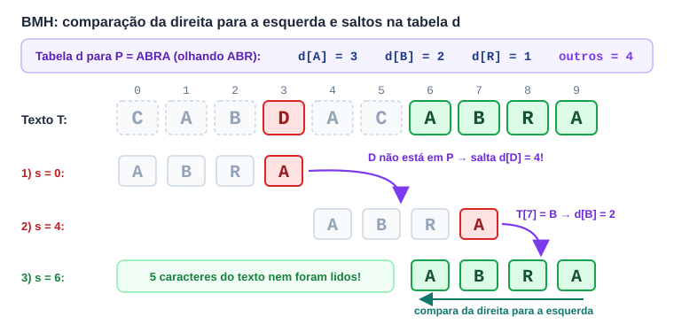

## Objetivos de aprendizagem

Ao final desta página, você deverá ser capaz de:

- Explicar por que comparar **da direita para a esquerda** permite saltos sublineares.
- Descrever as heurísticas da **ocorrência** (caractere ruim) e do **casamento** (sufixo bom) do **Boyer-Moore**.
- Construir a tabela e implementar o **Boyer-Moore-Horspool (BMH)** em C.

## Boyer-Moore

O algoritmo de **Boyer e Moore** compara cada janela do **último caractere para o primeiro**. Se o caractere do texto nem existe no padrão, a janela inteira salta $m$ posições após uma única comparação — alcançando desempenho **sublinear** $O(n / m)$ no melhor caso.

A cada falha na posição $j$ do padrão (contra $x = T[s + j]$), o algoritmo calcula dois deslocamentos e aplica o **maior**:

1. **Heurística da ocorrência (caractere ruim):** alinha a última aparição de $x$ no padrão com $T[s + j]$: deslocamento $j - \text{ult}[x]$ (com $\text{ult}[x] = -1$ se $x$ não ocorre em $P$).
2. **Heurística do casamento (sufixo bom):** se o sufixo $P[j+1..m-1]$ já casou, desloca o padrão até a próxima cópia desse sufixo precedida por caractere diferente de $P[j]$ (ou até o maior prefixo de $P$ que coincida com um final desse sufixo).

## Boyer-Moore-Horspool (BMH)

O **BMH** simplifica o Boyer-Moore descartando o sufixo bom e olhando sempre o caractere do texto alinhado com o **fim da janela**, $T[s + m - 1]$. A tabela de deslocamento considera apenas $P[0..m-2]$ (o último caractere fica de fora para não gerar salto zero):

$$d[c] = \begin{cases} m - 1 - \text{última posição de } c \text{ em } P[0..m-2], & \text{se } c \text{ aparece em } P[0..m-2] \\ m, & \text{caso contrário} \end{cases}$$

Para `ABRA` ($m = 4$), temos `d[A] = 3`, `d[B] = 2`, `d[R] = 1` e `d[outros] = 4`.

> Uma variante comum é o **BMHS** (*Sunday*), que consulta o caractere logo após a janela ($T[s + m]$), podendo saltar até $m + 1$ posições.

{align=center width=100%}

## Código em C e animação passo a passo (BMH)

Clique em **Executar** (ou use **Anterior** e **Próximo**) para acompanhar a comparação da direita para a esquerda e os saltos pela tabela `d`:

```codigo
{"title":"Boyer-Moore-Horspool (BMH) em C passo a passo","cols":10,"code":"#include <stdio.h>\n#include <string.h>\n\nvoid bmh(const char *T, const char *P) {\n    int n = strlen(T), m = strlen(P);\n    int d[256];\n    for (int c = 0; c < 256; c++)\n        d[c] = m;\n    for (int j = 0; j < m - 1; j++)\n        d[(unsigned char)P[j]] = m - 1 - j;\n\n    int s = 0;\n    while (s <= n - m) {\n        int j = m - 1;\n        while (j >= 0 && T[s + j] == P[j])\n            j--;\n        if (j < 0)\n            printf(\"ocorrencia na posicao %d\\n\", s);\n        s += d[(unsigned char)T[s + m - 1]];\n    }\n}\n\nint main(void) {\n    bmh(\"CABDACABRA\", \"ABRA\");\n    return 0;\n}","steps":[{"line":24,"caption":"Chamamos `bmh` com texto **CABDACABRA** (`n = 10`) e padrão **ABRA** (`m = 4`). A comparação será feita da **direita para a esquerda**.","vars":{"n":10,"m":4},"rows":[[{"s":0,"n":10,"i":[["C","",4],["A","",1],["B","",6],["D","",7],["A","",1],["C","",4],["A","",1],["B","",6],["R","",2],["A","",1]],"l":"texto T[0..9]"}],[{"s":0,"n":4,"i":[["A","",1],["B","",6],["R","",2],["A","",1]],"l":"padrão P[0..3] (s = 0)","a":1}],[{"i":[["A:3","",1],["B:2","",6],["R:1","",2],["*:4","",0]],"l":"tabela d (último caractere da janela)"}]],"stack":"main"},{"line":10,"caption":"Pré-processamento de `P[0..2] = ABR`: `d[A] = 3`, `d[B] = 2`, `d[R] = 1` e qualquer outro caractere (`*`) salta `m = 4`.","vars":{"d[A]":3,"d[B]":2,"d[R]":1,"outros":4},"rows":[[{"s":0,"n":10,"i":[["C","",4],["A","",1],["B","",6],["D","",7],["A","",1],["C","",4],["A","",1],["B","",6],["R","",2],["A","",1]],"l":"texto T[0..9]"}],[{"s":0,"n":4,"i":[["A","",1],["B","",6],["R","",2],["A","",1]],"l":"padrão P[0..3] (s = 0)","a":1}],[{"i":[["A:3","",1],["B:2","",6],["R:1","",2],["*:4","",0]],"l":"tabela d (último caractere da janela)"}]],"stack":"bmh ← main"},{"line":13,"caption":"Janela **s = 0**: padrão alinhado em `T[0..3] = CABD`. Começamos pelo último índice `j = 3`.","vars":{"s":0,"j":3,"comparacoes":0},"rows":[[{"s":0,"n":10,"i":[["C","",4],["A","",1],["B","",6],["D","",7],["A","",1],["C","",4],["A","",1],["B","",6],["R","",2],["A","",1]],"l":"texto T[0..9]"}],[{"s":0,"n":4,"i":[["A","",1],["B","",6],["R","",2],["A","",1]],"l":"padrão P[0..3] (s = 0)","a":1}],[{"i":[["A:3","",1],["B:2","",6],["R:1","",2],["*:4","",0]],"l":"tabela d (último caractere da janela)"}]],"stack":"bmh ← main"},{"line":15,"caption":"`T[3] = 'D'` != `P[3] = 'A'`: **diferentes!** Sai do laço interno.","vars":{"s":0,"j":3,"comparacoes":1},"rows":[[{"s":0,"n":10,"i":[["C","",4],["A","",1],["B","",6],["D","c",7],["A","",1],["C","",4],["A","",1],["B","",6],["R","",2],["A","",1]],"l":"texto T[0..9]"}],[{"s":0,"n":4,"i":[["A","",1],["B","",6],["R","",2],["A","c",1]],"l":"padrão P[0..3] (s = 0)","a":1}],[{"i":[["A:3","",1],["B:2","",6],["R:1","",2],["*:4","",0]],"l":"tabela d (último caractere da janela)"}]],"stack":"bmh ← main"},{"line":19,"caption":"Olha o último caractere da janela: `T[3] = 'D'`. Na tabela, `d['D'] = 4` → a janela salta para **s = 4**.","vars":{"s":"0 → 4","d['D']":4,"comparacoes":1},"rows":[[{"s":0,"n":10,"i":[["C","",4],["A","",1],["B","",6],["D","c",7],["A","",1],["C","",4],["A","",1],["B","",6],["R","",2],["A","",1]],"l":"texto T[0..9]"}],[{"s":0,"n":4,"i":[["A","",1],["B","",6],["R","",2],["A","c",1]],"l":"padrão P[0..3] (s = 0)","a":1}],[{"i":[["A:3","",1],["B:2","",6],["R:1","",2],["*:4","c",3]],"l":"tabela d (último caractere da janela)"}]],"stack":"bmh ← main"},{"line":13,"caption":"Janela **s = 4**: padrão alinhado em `T[4..7] = ACAB`. Começamos pelo último índice `j = 3`.","vars":{"s":4,"j":3,"comparacoes":1},"rows":[[{"s":0,"n":10,"i":[["C","",4],["A","",1],["B","",6],["D","",7],["A","",1],["C","",4],["A","",1],["B","",6],["R","",2],["A","",1]],"l":"texto T[0..9]"}],[{"s":4,"n":4,"i":[["A","",1],["B","",6],["R","",2],["A","",1]],"l":"padrão P[0..3] (s = 4)","a":1}],[{"i":[["A:3","",1],["B:2","",6],["R:1","",2],["*:4","",0]],"l":"tabela d (último caractere da janela)"}]],"stack":"bmh ← main"},{"line":15,"caption":"`T[7] = 'B'` != `P[3] = 'A'`: **diferentes!** Sai do laço interno.","vars":{"s":4,"j":3,"comparacoes":2},"rows":[[{"s":0,"n":10,"i":[["C","",4],["A","",1],["B","",6],["D","",7],["A","",1],["C","",4],["A","",1],["B","c",6],["R","",2],["A","",1]],"l":"texto T[0..9]"}],[{"s":4,"n":4,"i":[["A","",1],["B","",6],["R","",2],["A","c",1]],"l":"padrão P[0..3] (s = 4)","a":1}],[{"i":[["A:3","",1],["B:2","",6],["R:1","",2],["*:4","",0]],"l":"tabela d (último caractere da janela)"}]],"stack":"bmh ← main"},{"line":19,"caption":"Olha o último caractere da janela: `T[7] = 'B'`. Na tabela, `d['B'] = 2` → a janela salta para **s = 6**.","vars":{"s":"4 → 6","d['B']":2,"comparacoes":2},"rows":[[{"s":0,"n":10,"i":[["C","",4],["A","",1],["B","",6],["D","",7],["A","",1],["C","",4],["A","",1],["B","c",6],["R","",2],["A","",1]],"l":"texto T[0..9]"}],[{"s":4,"n":4,"i":[["A","",1],["B","",6],["R","",2],["A","c",1]],"l":"padrão P[0..3] (s = 4)","a":1}],[{"i":[["A:3","",1],["B:2","c",3],["R:1","",2],["*:4","",0]],"l":"tabela d (último caractere da janela)"}]],"stack":"bmh ← main"},{"line":13,"caption":"Janela **s = 6**: padrão alinhado em `T[6..9] = ABRA`. Começamos pelo último índice `j = 3`.","vars":{"s":6,"j":3,"comparacoes":2},"rows":[[{"s":0,"n":10,"i":[["C","",4],["A","",1],["B","",6],["D","",7],["A","",1],["C","",4],["A","",1],["B","",6],["R","",2],["A","",1]],"l":"texto T[0..9]"}],[{"s":6,"n":4,"i":[["A","",1],["B","",6],["R","",2],["A","",1]],"l":"padrão P[0..3] (s = 6)","a":1}],[{"i":[["A:3","",1],["B:2","",6],["R:1","",2],["*:4","",0]],"l":"tabela d (último caractere da janela)"}]],"stack":"bmh ← main"},{"line":15,"caption":"`T[9] = 'A'` == `P[3] = 'A'`: **iguais!** Recua para `j = 2`.","vars":{"s":6,"j":3,"comparacoes":3},"rows":[[{"s":0,"n":10,"i":[["C","",4],["A","",1],["B","",6],["D","",7],["A","",1],["C","",4],["A","",1],["B","",6],["R","",2],["A","c",1]],"l":"texto T[0..9]"}],[{"s":6,"n":4,"i":[["A","",1],["B","",6],["R","",2],["A","c",1]],"l":"padrão P[0..3] (s = 6)","a":1}],[{"i":[["A:3","",1],["B:2","",6],["R:1","",2],["*:4","",0]],"l":"tabela d (último caractere da janela)"}]],"stack":"bmh ← main"},{"line":15,"caption":"`T[8] = 'R'` == `P[2] = 'R'`: **iguais!** Recua para `j = 1`.","vars":{"s":6,"j":2,"comparacoes":4},"rows":[[{"s":0,"n":10,"i":[["C","",4],["A","",1],["B","",6],["D","",7],["A","",1],["C","",4],["A","",1],["B","",6],["R","c",2],["A","p",1]],"l":"texto T[0..9]"}],[{"s":6,"n":4,"i":[["A","",1],["B","",6],["R","c",2],["A","p",1]],"l":"padrão P[0..3] (s = 6)","a":1}],[{"i":[["A:3","",1],["B:2","",6],["R:1","",2],["*:4","",0]],"l":"tabela d (último caractere da janela)"}]],"stack":"bmh ← main"},{"line":15,"caption":"`T[7] = 'B'` == `P[1] = 'B'`: **iguais!** Recua para `j = 0`.","vars":{"s":6,"j":1,"comparacoes":5},"rows":[[{"s":0,"n":10,"i":[["C","",4],["A","",1],["B","",6],["D","",7],["A","",1],["C","",4],["A","",1],["B","c",6],["R","p",2],["A","p",1]],"l":"texto T[0..9]"}],[{"s":6,"n":4,"i":[["A","",1],["B","c",6],["R","p",2],["A","p",1]],"l":"padrão P[0..3] (s = 6)","a":1}],[{"i":[["A:3","",1],["B:2","",6],["R:1","",2],["*:4","",0]],"l":"tabela d (último caractere da janela)"}]],"stack":"bmh ← main"},{"line":15,"caption":"`T[6] = 'A'` == `P[0] = 'A'`: **iguais!** Recua para `j = -1`.","vars":{"s":6,"j":0,"comparacoes":6},"rows":[[{"s":0,"n":10,"i":[["C","",4],["A","",1],["B","",6],["D","",7],["A","",1],["C","",4],["A","c",1],["B","p",6],["R","p",2],["A","p",1]],"l":"texto T[0..9]"}],[{"s":6,"n":4,"i":[["A","c",1],["B","p",6],["R","p",2],["A","p",1]],"l":"padrão P[0..3] (s = 6)","a":1}],[{"i":[["A:3","",1],["B:2","",6],["R:1","",2],["*:4","",0]],"l":"tabela d (último caractere da janela)"}]],"stack":"bmh ← main"},{"line":18,"caption":"`j < 0`: todos os 4 caracteres casaram! **Ocorrência encontrada na posição 6.**","vars":{"s":6,"j":-1,"comparacoes":6},"rows":[[{"s":0,"n":10,"i":[["C","",4],["A","",1],["B","",6],["D","",7],["A","",1],["C","",4],["A","p",1],["B","p",6],["R","p",2],["A","p",1]],"l":"texto T[0..9]"}],[{"s":6,"n":4,"i":[["A","p",1],["B","p",6],["R","p",2],["A","p",1]],"l":"padrão P[0..3] (s = 6)","a":1}],[{"i":[["A:3","",1],["B:2","",6],["R:1","",2],["*:4","",0]],"l":"tabela d (último caractere da janela)"}]],"stack":"bmh ← main"},{"line":19,"caption":"Olha o último caractere da janela: `T[9] = 'A'`. Na tabela, `d['A'] = 3` → a janela salta para **s = 9**.","vars":{"s":"6 → 9","d['A']":3,"comparacoes":6},"rows":[[{"s":0,"n":10,"i":[["C","",4],["A","",1],["B","",6],["D","",7],["A","",1],["C","",4],["A","p",1],["B","p",6],["R","p",2],["A","p",1]],"l":"texto T[0..9]"}],[{"s":6,"n":4,"i":[["A","p",1],["B","p",6],["R","p",2],["A","p",1]],"l":"padrão P[0..3] (s = 6)","a":1}],[{"i":[["A:3","c",3],["B:2","",6],["R:1","",2],["*:4","",0]],"l":"tabela d (último caractere da janela)"}]],"stack":"bmh ← main"},{"line":25,"caption":"Fim: `s = 9 > n - m = 6`. Foram apenas **3 janelas** e **6 comparações** para achar **ABRA** na posição **6**!","vars":{"janelas":3,"comparacoes":6,"ocorrencias":"6"},"rows":[[{"s":0,"n":10,"i":[["C","",4],["A","",1],["B","",6],["D","",7],["A","",1],["C","",4],["A","p",1],["B","p",6],["R","p",2],["A","p",1]],"l":"texto T[0..9]"}],[{"s":6,"n":4,"i":[["A","p",1],["B","p",6],["R","p",2],["A","p",1]],"l":"padrão P[0..3] (s = 6)","a":1}],[{"i":[["A:3","",1],["B:2","",6],["R:1","",2],["*:4","",0]],"l":"tabela d (último caractere da janela)"}]],"stack":"main"}]}
```

## Complexidade

| Algoritmo | Pré-processamento | Melhor caso | Pior caso | Memória extra |
|:---|:---|:---|:---|:---|
| Boyer-Moore | $O(m + c)$ | $O(n / m)$ | $O(n \cdot m)$ | $O(m + c)$ |
| BMH | $O(m + c)$ | $O(n / m)$ | $O(n \cdot m)$ | $O(c)$ |

Na prática, em textos em linguagem natural (alfabeto grande e padrões médios ou longos), o BMH tem desempenho excelente com código muito simples. Em alfabetos muito pequenos (como DNA), os saltos diminuem.

## Teste de conhecimento

```quiz
{
  "question": "Por que o Boyer-Moore e o BMH conseguem atingir desempenho sublinear O(n / m) no melhor caso?",
  "options": [
    { "text": "Porque ordenam os caracteres do texto antes de iniciar a busca.", "correct": false },
    { "text": "Porque comparam da direita para a esquerda e, quando o caractere do texto não existe no padrão, saltam a janela inteira de m posições.", "correct": true },
    { "text": "Porque param a execução assim que encontram a primeira ocorrência.", "correct": false }
  ],
  "correctFeedback": "Correto! Uma única comparação no fim da janela pode descartar m posições do texto de uma vez, evitando examinar todos os caracteres.",
  "incorrectFeedback": "Pense no que acontece quando comparamos o último caractere da janela e descobrimos que ele nem existe no padrão."
}
```

```quiz
{
  "question": "No algoritmo Boyer-Moore original, quando ocorre uma falha durante a comparação de uma janela, como o deslocamento é definido?",
  "options": [
    { "text": "Aplica-se sempre o menor valor entre a heurística da ocorrência e a do casamento.", "correct": false },
    { "text": "Soma-se o valor da heurística da ocorrência com o da heurística do casamento.", "correct": false },
    { "text": "Calculam-se os deslocamentos das heurísticas da ocorrência (caractere ruim) e do casamento (sufixo bom), aplicando o maior dos dois.", "correct": true }
  ],
  "correctFeedback": "Correto! Ambas as heurísticas garantem deslocamentos seguros, então o Boyer-Moore sempre escolhe o maior deles para avançar o máximo possível.",
  "incorrectFeedback": "Revise a seção sobre o Boyer-Moore: as duas heurísticas propõem deslocamentos independentes e o algoritmo escolhe um deles."
}
```

```quiz
{
  "question": "No algoritmo BMH, qual é a tabela de deslocamentos d para o padrão BANANA (m = 6)?",
  "options": [
    { "text": "B = 5, A = 2, N = 1, outros = 6", "correct": true },
    { "text": "B = 5, A = 0, N = 1, outros = 6", "correct": false },
    { "text": "B = 6, A = 2, N = 1, outros = 6", "correct": false },
    { "text": "B = 1, A = 2, N = 5, outros = 6", "correct": false }
  ],
  "correctFeedback": "Correto! Considerando apenas BANAN (P[0..4]): B na pos 0 dá 5 - 0 = 5; última pos de A é 3, dando 5 - 3 = 2; última pos de N é 4, dando 5 - 4 = 1; demais caracteres deslocam m = 6.",
  "incorrectFeedback": "Use d[c] = m - 1 - última posição de c em P[0..m-2], lembrando de deixar o último caractere de fora."
}
```

```quiz
{
  "question": "Por que o pré-processamento do BMH percorre apenas P[0..m-2], deixando o último caractere P[m-1] de fora da tabela d?",
  "options": [
    { "text": "Porque o último caractere do padrão nunca é comparado durante a busca.", "correct": false },
    { "text": "Porque incluir P[m-1] resultaria em deslocamento 0, impedindo a janela de avançar.", "correct": true },
    { "text": "Porque a tabela d só tem espaço para m - 1 entradas.", "correct": false }
  ],
  "correctFeedback": "Correto! Para j = m - 1, a fórmula m - 1 - j daria 0, o que travaria a busca em laço infinito quando T[s + m - 1] fosse igual a P[m - 1].",
  "incorrectFeedback": "Substitua j = m - 1 na fórmula d[P[j]] = m - 1 - j e veja o que aconteceria com s += d[...]."
}
```
