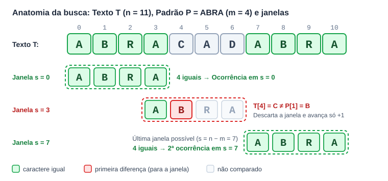

## Objetivos de aprendizagem

Ao final desta página, você deverá ser capaz de:

- Definir o problema do casamento de padrões em texto e seu vocabulário básico.
- Classificar algoritmos de busca conforme o que é pré-processado.
- Implementar o algoritmo de **força bruta** em C e analisar sua complexidade.

## Introdução

O **casamento de padrões** (*pattern matching*) consiste em encontrar todas as ocorrências de um **padrão** $P[0..m-1]$ dentro de um **texto** $T[0..n-1]$ ($m \le n$) sobre um alfabeto $\Sigma$ de tamanho $c$. Esse problema aparece em buscas de texto (`Ctrl+F`, `grep`), antivírus, compiladores e bioinformática.

| Termo | Significado |
|:---|:---|
| Janela | Trecho $T[s..s+m-1]$ de mesmo tamanho que o padrão |
| Deslocamento $s$ | Posição inicial da janela, variando de $0$ até $n - m$ ($n - m + 1$ janelas) |
| Ocorrência | Deslocamento $s$ em que $T[s + j] = P[j]$ para todo $0 \le j < m$ |

Os algoritmos se dividem em três categorias conforme o pré-processamento:

| Categoria | Exemplos | Quando usar |
|:---|:---|:---|
| Nada pré-processado | Força bruta | Textos e padrões muito pequenos |
| Padrão pré-processado | KMP, Boyer-Moore, BMH, Shift-And | Texto muda ou é lido uma vez |
| Texto pré-processado | Árvore Trie, Árvore Patricia, árvores de sufixos | Texto fixo com muitas consultas |

## Força bruta

A abordagem mais direta testa todas as $n - m + 1$ janelas da esquerda para a direita. No primeiro caractere diferente, descarta a janela e avança apenas uma posição ($s \leftarrow s + 1$), descartando tudo o que já foi comparado.

{align=center width=100%}

Acompanhe o código em C linha por linha clicando em **Executar** ou usando **Anterior** e **Próximo**:

```codigo
{"title":"Força bruta em C passo a passo","cols":8,"code":"#include <stdio.h>\n#include <string.h>\n\nvoid forcaBruta(const char *T, const char *P) {\n    int n = strlen(T), m = strlen(P);\n    for (int s = 0; s <= n - m; s++) {\n        int j = 0;\n        while (j < m && T[s + j] == P[j])\n            j++;\n        if (j == m)\n            printf(\"ocorrencia na posicao %d\\n\", s);\n    }\n}\n\nint main(void) {\n    forcaBruta(\"ABABACAB\", \"ABAC\");\n    return 0;\n}","steps":[{"line":16,"caption":"Chamamos `forcaBruta` com texto **ABABACAB** (`n = 8`) e padrão **ABAC** (`m = 4`). Existem `n - m + 1 = 5` janelas (`s` de 0 até 4).","vars":{"n":8,"m":4},"rows":[[{"s":0,"n":8,"i":[["A","",1],["B","",6],["A","",1],["B","",6],["A","",1],["C","",4],["A","",1],["B","",6]],"l":"texto T[0..7]"}],[{"s":0,"n":4,"i":[["A","",1],["B","",6],["A","",1],["C","",4]],"l":"padrão P[0..3] (s = 0)","a":1}]],"stack":"main"},{"line":6,"caption":"Inicia a janela **s = 0**: o padrão se alinha sobre `T[0..3] = ABAB`.","vars":{"s":0,"j":0,"comparacoes":0},"rows":[[{"s":0,"n":8,"i":[["A","",1],["B","",6],["A","",1],["B","",6],["A","",1],["C","",4],["A","",1],["B","",6]],"l":"texto T[0..7]"}],[{"s":0,"n":4,"i":[["A","",1],["B","",6],["A","",1],["C","",4]],"l":"padrão P[0..3] (s = 0)","a":1}]],"stack":"forcaBruta ← main"},{"line":8,"caption":"Compara `T[0] = 'A'` com `P[0] = 'A'`: **iguais!** `j` avança para 1.","vars":{"s":0,"j":0,"comparacoes":1},"rows":[[{"s":0,"n":8,"i":[["A","c",1],["B","",6],["A","",1],["B","",6],["A","",1],["C","",4],["A","",1],["B","",6]],"l":"texto T[0..7]"}],[{"s":0,"n":4,"i":[["A","c",1],["B","",6],["A","",1],["C","",4]],"l":"padrão P[0..3] (s = 0)","a":1}]],"stack":"forcaBruta ← main"},{"line":8,"caption":"Compara `T[1] = 'B'` com `P[1] = 'B'`: **iguais!** `j` avança para 2.","vars":{"s":0,"j":1,"comparacoes":2},"rows":[[{"s":0,"n":8,"i":[["A","p",1],["B","c",6],["A","",1],["B","",6],["A","",1],["C","",4],["A","",1],["B","",6]],"l":"texto T[0..7]"}],[{"s":0,"n":4,"i":[["A","p",1],["B","c",6],["A","",1],["C","",4]],"l":"padrão P[0..3] (s = 0)","a":1}]],"stack":"forcaBruta ← main"},{"line":8,"caption":"Compara `T[2] = 'A'` com `P[2] = 'A'`: **iguais!** `j` avança para 3.","vars":{"s":0,"j":2,"comparacoes":3},"rows":[[{"s":0,"n":8,"i":[["A","p",1],["B","p",6],["A","c",1],["B","",6],["A","",1],["C","",4],["A","",1],["B","",6]],"l":"texto T[0..7]"}],[{"s":0,"n":4,"i":[["A","p",1],["B","p",6],["A","c",1],["C","",4]],"l":"padrão P[0..3] (s = 0)","a":1}]],"stack":"forcaBruta ← main"},{"line":8,"caption":"Compara `T[3] = 'B'` com `P[3] = 'C'`: **diferentes!** A janela é descartada e `s` anda só 1 posição.","vars":{"s":0,"j":3,"comparacoes":4},"rows":[[{"s":0,"n":8,"i":[["A","p",1],["B","p",6],["A","p",1],["B","c",6],["A","",1],["C","",4],["A","",1],["B","",6]],"l":"texto T[0..7]"}],[{"s":0,"n":4,"i":[["A","p",1],["B","p",6],["A","p",1],["C","c",4]],"l":"padrão P[0..3] (s = 0)","a":1}]],"stack":"forcaBruta ← main"},{"line":6,"caption":"Inicia a janela **s = 1**: o padrão se alinha sobre `T[1..4] = BABA`.","vars":{"s":1,"j":0,"comparacoes":4},"rows":[[{"s":0,"n":8,"i":[["A","",1],["B","",6],["A","",1],["B","",6],["A","",1],["C","",4],["A","",1],["B","",6]],"l":"texto T[0..7]"}],[{"s":1,"n":4,"i":[["A","",1],["B","",6],["A","",1],["C","",4]],"l":"padrão P[0..3] (s = 1)","a":1}]],"stack":"forcaBruta ← main"},{"line":8,"caption":"Compara `T[1] = 'B'` com `P[0] = 'A'`: **diferentes!** A janela é descartada e `s` anda só 1 posição.","vars":{"s":1,"j":0,"comparacoes":5},"rows":[[{"s":0,"n":8,"i":[["A","",1],["B","c",6],["A","",1],["B","",6],["A","",1],["C","",4],["A","",1],["B","",6]],"l":"texto T[0..7]"}],[{"s":1,"n":4,"i":[["A","c",1],["B","",6],["A","",1],["C","",4]],"l":"padrão P[0..3] (s = 1)","a":1}]],"stack":"forcaBruta ← main"},{"line":6,"caption":"Inicia a janela **s = 2**: o padrão se alinha sobre `T[2..5] = ABAC`.","vars":{"s":2,"j":0,"comparacoes":5},"rows":[[{"s":0,"n":8,"i":[["A","",1],["B","",6],["A","",1],["B","",6],["A","",1],["C","",4],["A","",1],["B","",6]],"l":"texto T[0..7]"}],[{"s":2,"n":4,"i":[["A","",1],["B","",6],["A","",1],["C","",4]],"l":"padrão P[0..3] (s = 2)","a":1}]],"stack":"forcaBruta ← main"},{"line":8,"caption":"Compara `T[2] = 'A'` com `P[0] = 'A'`: **iguais!** `j` avança para 1.","vars":{"s":2,"j":0,"comparacoes":6},"rows":[[{"s":0,"n":8,"i":[["A","",1],["B","",6],["A","c",1],["B","",6],["A","",1],["C","",4],["A","",1],["B","",6]],"l":"texto T[0..7]"}],[{"s":2,"n":4,"i":[["A","c",1],["B","",6],["A","",1],["C","",4]],"l":"padrão P[0..3] (s = 2)","a":1}]],"stack":"forcaBruta ← main"},{"line":8,"caption":"Compara `T[3] = 'B'` com `P[1] = 'B'`: **iguais!** `j` avança para 2.","vars":{"s":2,"j":1,"comparacoes":7},"rows":[[{"s":0,"n":8,"i":[["A","",1],["B","",6],["A","p",1],["B","c",6],["A","",1],["C","",4],["A","",1],["B","",6]],"l":"texto T[0..7]"}],[{"s":2,"n":4,"i":[["A","p",1],["B","c",6],["A","",1],["C","",4]],"l":"padrão P[0..3] (s = 2)","a":1}]],"stack":"forcaBruta ← main"},{"line":8,"caption":"Compara `T[4] = 'A'` com `P[2] = 'A'`: **iguais!** `j` avança para 3.","vars":{"s":2,"j":2,"comparacoes":8},"rows":[[{"s":0,"n":8,"i":[["A","",1],["B","",6],["A","p",1],["B","p",6],["A","c",1],["C","",4],["A","",1],["B","",6]],"l":"texto T[0..7]"}],[{"s":2,"n":4,"i":[["A","p",1],["B","p",6],["A","c",1],["C","",4]],"l":"padrão P[0..3] (s = 2)","a":1}]],"stack":"forcaBruta ← main"},{"line":8,"caption":"Compara `T[5] = 'C'` com `P[3] = 'C'`: **iguais!** `j` avança para 4.","vars":{"s":2,"j":3,"comparacoes":9},"rows":[[{"s":0,"n":8,"i":[["A","",1],["B","",6],["A","p",1],["B","p",6],["A","p",1],["C","c",4],["A","",1],["B","",6]],"l":"texto T[0..7]"}],[{"s":2,"n":4,"i":[["A","p",1],["B","p",6],["A","p",1],["C","c",4]],"l":"padrão P[0..3] (s = 2)","a":1}]],"stack":"forcaBruta ← main"},{"line":11,"caption":"`j == m` (4): todos os caracteres casaram! **Ocorrência encontrada na posição 2.**","vars":{"s":2,"j":4,"comparacoes":9},"rows":[[{"s":0,"n":8,"i":[["A","",1],["B","",6],["A","p",1],["B","p",6],["A","p",1],["C","p",4],["A","",1],["B","",6]],"l":"texto T[0..7]"}],[{"s":2,"n":4,"i":[["A","p",1],["B","p",6],["A","p",1],["C","p",4]],"l":"padrão P[0..3] (s = 2)","a":1}]],"stack":"forcaBruta ← main"},{"line":6,"caption":"Inicia a janela **s = 3**: o padrão se alinha sobre `T[3..6] = BACA`.","vars":{"s":3,"j":0,"comparacoes":9},"rows":[[{"s":0,"n":8,"i":[["A","",1],["B","",6],["A","",1],["B","",6],["A","",1],["C","",4],["A","",1],["B","",6]],"l":"texto T[0..7]"}],[{"s":3,"n":4,"i":[["A","",1],["B","",6],["A","",1],["C","",4]],"l":"padrão P[0..3] (s = 3)","a":1}]],"stack":"forcaBruta ← main"},{"line":8,"caption":"Compara `T[3] = 'B'` com `P[0] = 'A'`: **diferentes!** A janela é descartada e `s` anda só 1 posição.","vars":{"s":3,"j":0,"comparacoes":10},"rows":[[{"s":0,"n":8,"i":[["A","",1],["B","",6],["A","",1],["B","c",6],["A","",1],["C","",4],["A","",1],["B","",6]],"l":"texto T[0..7]"}],[{"s":3,"n":4,"i":[["A","c",1],["B","",6],["A","",1],["C","",4]],"l":"padrão P[0..3] (s = 3)","a":1}]],"stack":"forcaBruta ← main"},{"line":6,"caption":"Inicia a janela **s = 4**: o padrão se alinha sobre `T[4..7] = ACAB`.","vars":{"s":4,"j":0,"comparacoes":10},"rows":[[{"s":0,"n":8,"i":[["A","",1],["B","",6],["A","",1],["B","",6],["A","",1],["C","",4],["A","",1],["B","",6]],"l":"texto T[0..7]"}],[{"s":4,"n":4,"i":[["A","",1],["B","",6],["A","",1],["C","",4]],"l":"padrão P[0..3] (s = 4)","a":1}]],"stack":"forcaBruta ← main"},{"line":8,"caption":"Compara `T[4] = 'A'` com `P[0] = 'A'`: **iguais!** `j` avança para 1.","vars":{"s":4,"j":0,"comparacoes":11},"rows":[[{"s":0,"n":8,"i":[["A","",1],["B","",6],["A","",1],["B","",6],["A","c",1],["C","",4],["A","",1],["B","",6]],"l":"texto T[0..7]"}],[{"s":4,"n":4,"i":[["A","c",1],["B","",6],["A","",1],["C","",4]],"l":"padrão P[0..3] (s = 4)","a":1}]],"stack":"forcaBruta ← main"},{"line":8,"caption":"Compara `T[5] = 'C'` com `P[1] = 'B'`: **diferentes!** A janela é descartada e `s` anda só 1 posição.","vars":{"s":4,"j":1,"comparacoes":12},"rows":[[{"s":0,"n":8,"i":[["A","",1],["B","",6],["A","",1],["B","",6],["A","p",1],["C","c",4],["A","",1],["B","",6]],"l":"texto T[0..7]"}],[{"s":4,"n":4,"i":[["A","p",1],["B","c",6],["A","",1],["C","",4]],"l":"padrão P[0..3] (s = 4)","a":1}]],"stack":"forcaBruta ← main"},{"line":17,"caption":"Fim da busca: **5 janelas** testadas, **12 comparações** e 1 ocorrência na posição **2**. Repare que após falhar em `s = 0` (com `ABA` já casado), o algoritmo releu tudo de novo.","vars":{"comparacoes":12,"ocorrencias":"2"},"rows":[[{"s":0,"n":8,"i":[["A","",1],["B","",6],["A","p",1],["B","p",6],["A","p",1],["C","p",4],["A","",1],["B","",6]],"l":"texto T[0..7]"}],[{"s":2,"n":4,"i":[["A","p",1],["B","p",6],["A","p",1],["C","p",4]],"l":"padrão P[0..3] (s = 2)","a":1}]],"stack":"main"}]}
```

## Complexidade

| Situação | Comparações | Exemplo |
|:---|:---|:---|
| Pior caso | $(n - m + 1) \cdot m = O(n \cdot m)$ | Texto `AAAA...A` e padrão `AAAB` |
| Caso médio (alfabeto grande) | Próximo de $O(n)$ | Palavra comum em texto em português |
| Memória extra | $O(1)$ | Apenas índices `s` e `j` |

> No pior caso, cada janela casa os $m - 1$ primeiros caracteres e falha apenas no último. Os próximos algoritmos eliminam esse retrabalho pré-processando o padrão.

## Teste de conhecimento

```quiz
{
  "question": "Um texto tem n = 20 caracteres e o padrão tem m = 5 caracteres. Quantas janelas (deslocamentos possíveis) a força bruta testa?",
  "options": [
    { "text": "15", "correct": false },
    { "text": "16", "correct": true },
    { "text": "20", "correct": false },
    { "text": "100", "correct": false }
  ],
  "correctFeedback": "Correto! Os deslocamentos válidos vão de 0 até n - m = 15, totalizando n - m + 1 = 16 janelas.",
  "incorrectFeedback": "Revise a definição de deslocamento: a última janela começa na posição n - m, contando a partir do índice 0."
}
```

```quiz
{
  "question": "Em um sistema em que um texto muito grande permanece fixo e recebe milhares de consultas por padrões diferentes, qual categoria de algoritmos de busca é a mais adequada?",
  "options": [
    { "text": "Algoritmos sem pré-processamento (força bruta).", "correct": false },
    { "text": "Algoritmos com padrão pré-processado (KMP, BMH).", "correct": false },
    { "text": "Algoritmos com texto pré-processado (Árvore Trie, Árvore Patricia, árvores de sufixos).", "correct": true }
  ],
  "correctFeedback": "Correto! Quando o texto é grande, quase não muda e sofre muitas consultas, compensa construir um índice sobre o texto.",
  "incorrectFeedback": "Consulte a tabela de categorias de pré-processamento: pense em qual estrutura evita reler o texto inteiro a cada nova consulta."
}
```

```quiz
{
  "question": "A força bruta procura P = AAB (m = 3) no texto T = AAAAAAAAAA (10 letras A). Quantas comparações de caracteres são feitas ao todo?",
  "options": [
    { "text": "8 comparações", "correct": false },
    { "text": "10 comparações", "correct": false },
    { "text": "24 comparações", "correct": true },
    { "text": "30 comparações", "correct": false }
  ],
  "correctFeedback": "Correto! Existem 10 - 3 + 1 = 8 janelas; em cada uma, os dois primeiros caracteres casam e o terceiro falha, somando 8 · 3 = 24 comparações.",
  "incorrectFeedback": "Calcule primeiro o número de janelas (n - m + 1) e multiplique por quantas comparações ocorrem em cada janela antes da falha."
}
```

```quiz
{
  "question": "Qual é a principal causa do pior caso O(n · m) na força bruta e quanto de memória extra ela utiliza?",
  "options": [
    { "text": "Ao falhar, avança apenas uma posição e relê caracteres já comparados; usa O(1) de memória extra.", "correct": true },
    { "text": "Constrói uma tabela do tamanho do texto antes da busca; usa O(n) de memória extra.", "correct": false },
    { "text": "Compara os caracteres da direita para a esquerda; usa O(m) de memória extra.", "correct": false }
  ],
  "correctFeedback": "Correto! A força bruta não guarda nenhuma tabela (memória O(1)), mas desperdiça comparações anteriores ao avançar sempre apenas 1 posição.",
  "incorrectFeedback": "Observe o código em C da força bruta: quais variáveis auxiliares ela cria e o que acontece com s e j após uma falha?"
}
```
