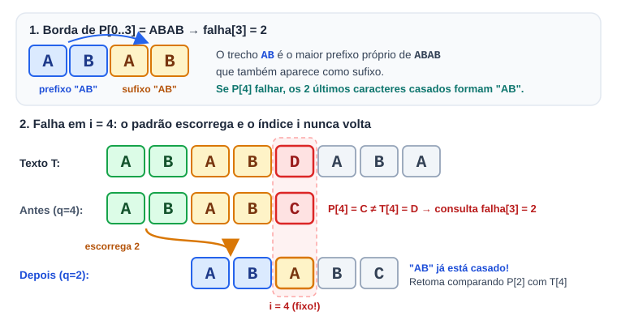

## Objetivos de aprendizagem

Ao final desta página, você deverá ser capaz de:

- Explicar como o algoritmo **Knuth-Morris-Pratt (KMP)** evita voltar no texto.
- Calcular a **tabela de falha** (maior borda) de um padrão.
- Implementar o KMP em C e justificar seu custo linear $O(n + m)$.

## Conceito principal

Quando a força bruta falha após casar $q$ caracteres, ela volta no texto e relê posições já examinadas. O **KMP** aproveita o fato de que o trecho recém-casado é conhecido (`P[0..q-1]`): ele escorrega o padrão para a direita até alinhar o maior prefixo próprio que também é sufixo desse trecho — chamado de **borda**. Assim, o índice `i` do texto **nunca volta**.

A tabela de falha armazena, para cada posição $q$, o tamanho da maior borda de $P[0..q]$:

| `q` | 0 | 1 | 2 | 3 | 4 | 5 | 6 | 7 | 8 |
|:---|---:|---:|---:|---:|---:|---:|---:|---:|---:|
| `P[q]` | A | B | A | B | C | A | B | A | B |
| `falha[q]` | 0 | 0 | 1 | 2 | 0 | 1 | 2 | 3 | 4 |

Quando `P[q] != T[i]`, o algoritmo faz `q = falha[q - 1]` repetidamente até voltar a casar ou zerar `q`. Após uma ocorrência completa (`q == m`), também faz `q = falha[m - 1]` para detectar ocorrências sobrepostas (como `ABA` em `ABABA`).

{align=center width=100%}

## Código em C e animação passo a passo

Clique em **Executar** (ou use **Anterior** e **Próximo**) para acompanhar a linha destacada, o escorregamento do padrão e as consultas à tabela `falha`:

```codigo
{"title":"KMP em C passo a passo","cols":10,"code":"#include <stdio.h>\n#include <string.h>\n\n#define MAXP 256\n\nvoid calculaFalha(const char *P, int m, int falha[]) {\n    int k = 0;\n    falha[0] = 0;\n    for (int q = 1; q < m; q++) {\n        while (k > 0 && P[k] != P[q])\n            k = falha[k - 1];\n        if (P[k] == P[q])\n            k++;\n        falha[q] = k;\n    }\n}\n\nvoid kmp(const char *T, const char *P) {\n    int n = strlen(T), m = strlen(P), falha[MAXP];\n    calculaFalha(P, m, falha);\n\n    int q = 0;\n    for (int i = 0; i < n; i++) {\n        while (q > 0 && P[q] != T[i])\n            q = falha[q - 1];\n        if (P[q] == T[i])\n            q++;\n        if (q == m) {\n            printf(\"ocorrencia na posicao %d\\n\", i - m + 1);\n            q = falha[q - 1];\n        }\n    }\n}\n\nint main(void) {\n    kmp(\"ABABDABABC\", \"ABABC\");\n    return 0;\n}","steps":[{"line":36,"caption":"Chamamos `kmp` com texto **ABABDABABC** (`n = 10`) e padrão **ABABC** (`m = 5`). O índice `i` do texto nunca vai voltar.","vars":{"n":10,"m":5},"rows":[[{"s":0,"n":10,"i":[["A","",1],["B","",6],["A","",1],["B","",6],["D","",7],["A","",1],["B","",6],["A","",1],["B","",6],["C","",4]],"l":"texto T[0..9]"}],[{"s":0,"n":5,"i":[["A","",1],["B","",6],["A","",1],["B","",6],["C","",4]],"l":"padrão P[0..4]","a":1}],[{"s":0,"n":5,"i":[[0,"",5],[0,"",5],[1,"",5],[2,"",5],[0,"",5]],"l":"tabela falha[0..4]"}]],"stack":"main"},{"line":20,"caption":"`calculaFalha` pré-processa **ABABC** em `O(m)` e gera `falha = [0, 0, 1, 2, 0]` (maior borda de cada prefixo).","vars":{"falha":"[0, 0, 1, 2, 0]","q":0},"rows":[[{"s":0,"n":10,"i":[["A","",1],["B","",6],["A","",1],["B","",6],["D","",7],["A","",1],["B","",6],["A","",1],["B","",6],["C","",4]],"l":"texto T[0..9]"}],[{"s":0,"n":5,"i":[["A","",1],["B","",6],["A","",1],["B","",6],["C","",4]],"l":"padrão P[0..4]","a":1}],[{"s":0,"n":5,"i":[[0,"",5],[0,"",5],[1,"",5],[2,"",5],[0,"",5]],"l":"tabela falha[0..4]"}]],"stack":"kmp ← main"},{"line":26,"caption":"`T[0] = 'A'` casa com `P[0] = 'A'`: `q` sobe para **1**.","vars":{"i":0,"q":1,"T[i]":"'A'"},"rows":[[{"s":0,"n":10,"i":[["A","p",1],["B","",6],["A","",1],["B","",6],["D","",7],["A","",1],["B","",6],["A","",1],["B","",6],["C","",4]],"l":"texto T[0..9]"}],[{"s":0,"n":5,"i":[["A","p",1],["B","",6],["A","",1],["B","",6],["C","",4]],"l":"padrão P[0..4]","a":1}],[{"s":0,"n":5,"i":[[0,"",5],[0,"",5],[1,"",5],[2,"",5],[0,"",5]],"l":"tabela falha[0..4]"}]],"stack":"kmp ← main"},{"line":26,"caption":"`T[1] = 'B'` casa com `P[1] = 'B'`: `q` sobe para **2**.","vars":{"i":1,"q":2,"T[i]":"'B'"},"rows":[[{"s":0,"n":10,"i":[["A","p",1],["B","p",6],["A","",1],["B","",6],["D","",7],["A","",1],["B","",6],["A","",1],["B","",6],["C","",4]],"l":"texto T[0..9]"}],[{"s":0,"n":5,"i":[["A","p",1],["B","p",6],["A","",1],["B","",6],["C","",4]],"l":"padrão P[0..4]","a":1}],[{"s":0,"n":5,"i":[[0,"",5],[0,"",5],[1,"",5],[2,"",5],[0,"",5]],"l":"tabela falha[0..4]"}]],"stack":"kmp ← main"},{"line":26,"caption":"`T[2] = 'A'` casa com `P[2] = 'A'`: `q` sobe para **3**.","vars":{"i":2,"q":3,"T[i]":"'A'"},"rows":[[{"s":0,"n":10,"i":[["A","p",1],["B","p",6],["A","p",1],["B","",6],["D","",7],["A","",1],["B","",6],["A","",1],["B","",6],["C","",4]],"l":"texto T[0..9]"}],[{"s":0,"n":5,"i":[["A","p",1],["B","p",6],["A","p",1],["B","",6],["C","",4]],"l":"padrão P[0..4]","a":1}],[{"s":0,"n":5,"i":[[0,"",5],[0,"",5],[1,"",5],[2,"",5],[0,"",5]],"l":"tabela falha[0..4]"}]],"stack":"kmp ← main"},{"line":26,"caption":"`T[3] = 'B'` casa com `P[3] = 'B'`: `q` sobe para **4**.","vars":{"i":3,"q":4,"T[i]":"'B'"},"rows":[[{"s":0,"n":10,"i":[["A","p",1],["B","p",6],["A","p",1],["B","p",6],["D","",7],["A","",1],["B","",6],["A","",1],["B","",6],["C","",4]],"l":"texto T[0..9]"}],[{"s":0,"n":5,"i":[["A","p",1],["B","p",6],["A","p",1],["B","p",6],["C","",4]],"l":"padrão P[0..4]","a":1}],[{"s":0,"n":5,"i":[[0,"",5],[0,"",5],[1,"",5],[2,"",5],[0,"",5]],"l":"tabela falha[0..4]"}]],"stack":"kmp ← main"},{"line":25,"caption":"Falha em `T[4] = 'D'` vs `P[4] = 'C'`. Sem voltar `i`, consulta `falha[3] = 2` e escorrega o padrão.","vars":{"i":4,"q":"4 → 2","T[i]":"'D'"},"rows":[[{"s":0,"n":10,"i":[["A","p",1],["B","p",6],["A","p",1],["B","p",6],["D","c",7],["A","",1],["B","",6],["A","",1],["B","",6],["C","",4]],"l":"texto T[0..9]"}],[{"s":0,"n":5,"i":[["A","p",1],["B","p",6],["A","p",1],["B","p",6],["C","c",4]],"l":"padrão P[0..4]","a":1}],[{"s":0,"n":5,"i":[[0,"",5],[0,"",5],[1,"",5],[2,"c",3],[0,"",5]],"l":"tabela falha[0..4]"}]],"stack":"kmp ← main"},{"line":25,"caption":"Falha em `T[4] = 'D'` vs `P[2] = 'A'`. Sem voltar `i`, consulta `falha[1] = 0` e escorrega o padrão.","vars":{"i":4,"q":"2 → 0","T[i]":"'D'"},"rows":[[{"s":0,"n":10,"i":[["A","",1],["B","",6],["A","p",1],["B","p",6],["D","c",7],["A","",1],["B","",6],["A","",1],["B","",6],["C","",4]],"l":"texto T[0..9]"}],[{"s":2,"n":5,"i":[["A","p",1],["B","p",6],["A","c",1],["B","",6],["C","",4]],"l":"padrão P[0..4]","a":1}],[{"s":0,"n":5,"i":[[0,"",5],[0,"c",3],[1,"",5],[2,"",5],[0,"",5]],"l":"tabela falha[0..4]"}]],"stack":"kmp ← main"},{"line":26,"caption":"`T[4] = 'D'` não casa com `P[0] = 'A'`. `q` permanece **0** e o texto avança para `i = 5`.","vars":{"i":4,"q":0,"T[i]":"'D'"},"rows":[[{"s":0,"n":10,"i":[["A","",1],["B","",6],["A","",1],["B","",6],["D","c",7],["A","",1],["B","",6],["A","",1],["B","",6],["C","",4]],"l":"texto T[0..9]"}],[{"s":4,"n":5,"i":[["A","c",1],["B","",6],["A","",1],["B","",6],["C","",4]],"l":"padrão P[0..4]","a":1}],[{"s":0,"n":5,"i":[[0,"",5],[0,"",5],[1,"",5],[2,"",5],[0,"",5]],"l":"tabela falha[0..4]"}]],"stack":"kmp ← main"},{"line":26,"caption":"`T[5] = 'A'` casa com `P[0] = 'A'`: `q` sobe para **1**.","vars":{"i":5,"q":1,"T[i]":"'A'"},"rows":[[{"s":0,"n":10,"i":[["A","",1],["B","",6],["A","",1],["B","",6],["D","",7],["A","p",1],["B","",6],["A","",1],["B","",6],["C","",4]],"l":"texto T[0..9]"}],[{"s":5,"n":5,"i":[["A","p",1],["B","",6],["A","",1],["B","",6],["C","",4]],"l":"padrão P[0..4]","a":1}],[{"s":0,"n":5,"i":[[0,"",5],[0,"",5],[1,"",5],[2,"",5],[0,"",5]],"l":"tabela falha[0..4]"}]],"stack":"kmp ← main"},{"line":26,"caption":"`T[6] = 'B'` casa com `P[1] = 'B'`: `q` sobe para **2**.","vars":{"i":6,"q":2,"T[i]":"'B'"},"rows":[[{"s":0,"n":10,"i":[["A","",1],["B","",6],["A","",1],["B","",6],["D","",7],["A","p",1],["B","p",6],["A","",1],["B","",6],["C","",4]],"l":"texto T[0..9]"}],[{"s":5,"n":5,"i":[["A","p",1],["B","p",6],["A","",1],["B","",6],["C","",4]],"l":"padrão P[0..4]","a":1}],[{"s":0,"n":5,"i":[[0,"",5],[0,"",5],[1,"",5],[2,"",5],[0,"",5]],"l":"tabela falha[0..4]"}]],"stack":"kmp ← main"},{"line":26,"caption":"`T[7] = 'A'` casa com `P[2] = 'A'`: `q` sobe para **3**.","vars":{"i":7,"q":3,"T[i]":"'A'"},"rows":[[{"s":0,"n":10,"i":[["A","",1],["B","",6],["A","",1],["B","",6],["D","",7],["A","p",1],["B","p",6],["A","p",1],["B","",6],["C","",4]],"l":"texto T[0..9]"}],[{"s":5,"n":5,"i":[["A","p",1],["B","p",6],["A","p",1],["B","",6],["C","",4]],"l":"padrão P[0..4]","a":1}],[{"s":0,"n":5,"i":[[0,"",5],[0,"",5],[1,"",5],[2,"",5],[0,"",5]],"l":"tabela falha[0..4]"}]],"stack":"kmp ← main"},{"line":26,"caption":"`T[8] = 'B'` casa com `P[3] = 'B'`: `q` sobe para **4**.","vars":{"i":8,"q":4,"T[i]":"'B'"},"rows":[[{"s":0,"n":10,"i":[["A","",1],["B","",6],["A","",1],["B","",6],["D","",7],["A","p",1],["B","p",6],["A","p",1],["B","p",6],["C","",4]],"l":"texto T[0..9]"}],[{"s":5,"n":5,"i":[["A","p",1],["B","p",6],["A","p",1],["B","p",6],["C","",4]],"l":"padrão P[0..4]","a":1}],[{"s":0,"n":5,"i":[[0,"",5],[0,"",5],[1,"",5],[2,"",5],[0,"",5]],"l":"tabela falha[0..4]"}]],"stack":"kmp ← main"},{"line":26,"caption":"`T[9] = 'C'` casa com `P[4] = 'C'`: `q` sobe para **5**.","vars":{"i":9,"q":5,"T[i]":"'C'"},"rows":[[{"s":0,"n":10,"i":[["A","",1],["B","",6],["A","",1],["B","",6],["D","",7],["A","p",1],["B","p",6],["A","p",1],["B","p",6],["C","p",4]],"l":"texto T[0..9]"}],[{"s":5,"n":5,"i":[["A","p",1],["B","p",6],["A","p",1],["B","p",6],["C","p",4]],"l":"padrão P[0..4]","a":1}],[{"s":0,"n":5,"i":[[0,"",5],[0,"",5],[1,"",5],[2,"",5],[0,"",5]],"l":"tabela falha[0..4]"}]],"stack":"kmp ← main"},{"line":29,"caption":"`q == m` (5): **ocorrência encontrada na posição 5** (`i - m + 1`)! Depois faz `q = falha[4] = 0` para continuar buscando.","vars":{"i":9,"q":5,"ocorrencia":5},"rows":[[{"s":0,"n":10,"i":[["A","",1],["B","",6],["A","",1],["B","",6],["D","",7],["A","p",1],["B","p",6],["A","p",1],["B","p",6],["C","p",4]],"l":"texto T[0..9]"}],[{"s":5,"n":5,"i":[["A","p",1],["B","p",6],["A","p",1],["B","p",6],["C","p",4]],"l":"padrão P[0..4]","a":1}],[{"s":0,"n":5,"i":[[0,"",5],[0,"",5],[1,"",5],[2,"",5],[0,"",5]],"l":"tabela falha[0..4]"}]],"stack":"kmp ← main"},{"line":37,"caption":"Fim da busca: o índice `i` percorreu o texto **uma única vez** (0 até 9) e encontrou **ABABC** na posição **5** em tempo linear `O(n + m)`.","vars":{"ocorrencias":"5"},"rows":[[{"s":0,"n":10,"i":[["A","",1],["B","",6],["A","",1],["B","",6],["D","",7],["A","p",1],["B","p",6],["A","p",1],["B","p",6],["C","p",4]],"l":"texto T[0..9]"}],[{"s":5,"n":5,"i":[["A","p",1],["B","p",6],["A","p",1],["B","p",6],["C","p",4]],"l":"padrão P[0..4]","a":1}],[{"s":0,"n":5,"i":[[0,"",5],[0,"",5],[1,"",5],[2,"",5],[0,"",5]],"l":"tabela falha[0..4]"}]],"stack":"main"}]}
```

## Complexidade

| Etapa | Custo | Motivo |
|:---|:---|:---|
| Tabela de falha | $O(m)$ | `k` sobe no máximo $m$ vezes e cada volta do `while` diminui `k` |
| Busca | $O(n)$ | `i` avança $n$ vezes; `q` sobe e desce no máximo $n$ vezes (análise amortizada) |
| Total / Memória | $O(n + m)$ / $O(m)$ | Pior caso linear garantido; vetor `falha` de tamanho $m$ |

> O KMP lê o texto em uma única passagem sem retroceder, sendo ideal para fluxos contínuos e entradas muito repetitivas. Porém, examina todos os caracteres do texto.

## Teste de conhecimento

```quiz
{
  "question": "Como o algoritmo KMP evita o custo quadrático da força bruta quando encontra uma diferença entre P[q] e T[i]?",
  "options": [
    { "text": "Saltando m posições para a frente no texto, sem olhar os caracteres intermediários.", "correct": false },
    { "text": "Mantendo o índice i do texto parado e escorregando o padrão com q = falha[q - 1], aproveitando a maior borda já casada.", "correct": true },
    { "text": "Voltando o índice i do texto em uma posição e recomeçando do início do padrão.", "correct": false }
  ],
  "correctFeedback": "Correto! Como o trecho P[0..q-1] já casou com o texto, a maior borda desse trecho indica exatamente onde continuar sem voltar no texto.",
  "incorrectFeedback": "Revise o conceito de borda e o que acontece com os índices i e q no laço principal do KMP."
}
```

```quiz
{
  "question": "Qual é a tabela de falha (tamanho da maior borda própria de cada prefixo P[0..q]) do padrão P = ABCABD?",
  "options": [
    { "text": "0 0 0 1 2 0", "correct": true },
    { "text": "0 0 0 1 2 3", "correct": false },
    { "text": "0 1 2 0 1 2", "correct": false },
    { "text": "0 0 1 1 2 0", "correct": false }
  ],
  "correctFeedback": "Correto! A: 0; AB: 0; ABC: 0; ABCA: borda A (1); ABCAB: borda AB (2); ABCABD: nenhuma borda (0).",
  "incorrectFeedback": "Para cada prefixo P[0..q], procure o maior prefixo próprio que também aparece como sufixo de P[0..q]."
}
```

```quiz
{
  "question": "No código do KMP, logo após encontrar uma ocorrência completa (q == m), por que se executa q = falha[q - 1] em vez de q = 0?",
  "options": [
    { "text": "Para impedir que o índice i ultrapasse o final do texto.", "correct": false },
    { "text": "Para pular automaticamente m posições no texto.", "correct": false },
    { "text": "Porque o final da ocorrência encontrada pode ser também o começo de uma nova ocorrência sobreposta.", "correct": true }
  ],
  "correctFeedback": "Correto! Ao buscar ABA em ABABA, o último A da primeira ocorrência já é o primeiro caractere da segunda ocorrência.",
  "incorrectFeedback": "Pense no exemplo de procurar ABA em ABABA: o que aconteceria com a segunda ocorrência se zerássemos q?"
}
```

```quiz
{
  "question": "Sobre a complexidade e o comportamento do KMP para um texto de tamanho n e padrão de tamanho m, qual afirmação está correta?",
  "options": [
    { "text": "Tem pré-processamento O(m), busca O(n) garantida no pior caso e memória extra O(m), mas examina todos os caracteres do texto.", "correct": true },
    { "text": "Tem melhor caso sublinear O(n / m) e pior caso O(n · m).", "correct": false },
    { "text": "Não usa memória extra, pois não precisa de tabela auxiliar.", "correct": false },
    { "text": "Tem custo O(n · m) no pior caso quando o texto é muito repetitivo.", "correct": false }
  ],
  "correctFeedback": "Correto! Pela análise amortizada, o KMP garante O(n + m) mesmo em textos repetitivos e usa o vetor falha de tamanho m, lendo o texto inteiro uma única vez.",
  "incorrectFeedback": "Revise a tabela de complexidade do KMP: ele garante tempo linear no pior caso, mas nunca pula caracteres do texto."
}
```
