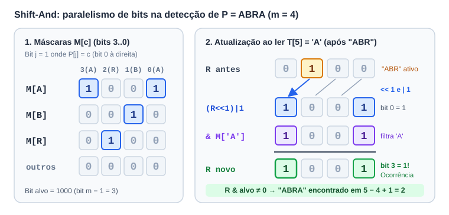

## Objetivos de aprendizagem

Ao final desta página, você deverá ser capaz de:

- Explicar como o **Shift-And** usa paralelismo de bits para testar todos os prefixos do padrão simultaneamente.
- Implementar o Shift-And em C e reconhecer suas extensões (classes de caracteres e busca aproximada).
- Comparar os cinco algoritmos estudados e escolher o mais adequado para cada cenário.

## Shift-And

O algoritmo **Shift-And** usa operações bit a bit (`<<`, `|`, `&`) sobre uma palavra do processador (32 ou 64 bits) para acompanhar todos os casamentos parciais ao mesmo tempo.

- **Máscaras `M[c]`:** o bit `j` de `M[c]` vale `1` se $P[j] = c$, e `0` caso contrário. Para `ABRA`: `M[A] = 1001`, `M[B] = 0010`, `M[R] = 0100` (bit 0 à direita).
- **Estado `R`:** começa em `0`. O bit `j` vale `1` quando o prefixo $P[0..j]$ termina na posição atual `i` do texto. A cada caractere lido:

$$R \leftarrow ((R \ll 1) \mid 1) \mathbin{\&} M[T[i]]$$

Se o bit $m - 1$ de `R` ficar ligado, há ocorrência na posição $i - m + 1$.

> **Flexibilidade:** o Shift-And aceita **classes de caracteres** (ex.: maiúsculas/minúsculas ou coringas) apenas ligando bits extras em `M[c]`, e se estende para **casamento aproximado** (até $k$ erros) mantendo vetores de estado adicionais em $O(k \cdot n)$.

{align=center width=100%}

## Código em C e animação passo a passo

Clique em **Executar** (ou use **Anterior** e **Próximo**) para ver o deslocamento de bits `(R << 1) | 1`, o `&` com `M[T[i]]` e a atualização de `R` a cada caractere:

```codigo
{"title":"Shift-And em C passo a passo","cols":8,"code":"#include <stdint.h>\n#include <stdio.h>\n#include <string.h>\n\nvoid shiftAnd(const char *T, const char *P) {\n    int n = strlen(T), m = strlen(P);\n    if (m == 0 || m > 64) return;\n    uint64_t M[256] = {0};\n    for (int j = 0; j < m; j++)\n        M[(unsigned char)P[j]] |= (1ULL << j);\n\n    uint64_t R = 0, alvo = 1ULL << (m - 1);\n    for (int i = 0; i < n; i++) {\n        R = ((R << 1) | 1ULL) & M[(unsigned char)T[i]];\n        if (R & alvo)\n            printf(\"ocorrencia na posicao %d\\n\", i - m + 1);\n    }\n}\n\nint main(void) {\n    shiftAnd(\"ACABRAXA\", \"ABRA\");\n    return 0;\n}","steps":[{"line":21,"caption":"Chamamos `shiftAnd` com texto **ACABRAXA** (`n = 8`) e padrão **ABRA** (`m = 4`). Cada bit de `R` acompanha um prefixo do padrão.","vars":{"n":8,"m":4,"alvo":"1000"},"rows":[[{"s":0,"n":8,"i":[["A","",1],["C","",4],["A","",1],["B","",6],["R","",2],["A","",1],["X","",9],["A","",1]],"l":"texto T[0..7]"}],[{"s":2,"n":4,"i":[["0","g",0],["0","g",0],["0","g",0],["0","g",0]],"l":"R novo (bit 3 = achou)","a":0}]],"stack":"main"},{"line":10,"caption":"Pré-processamento das máscaras (bits `3 2 1 0` para `P[3..0] = A R B A`): `M[A] = 1001`, `M[B] = 0010`, `M[R] = 0100`, outros = `0000`.","vars":{"M[A]":"1001","M[B]":"0010","M[R]":"0100"},"rows":[[{"s":0,"n":8,"i":[["A","",1],["C","",4],["A","",1],["B","",6],["R","",2],["A","",1],["X","",9],["A","",1]],"l":"texto T[0..7]"}],[{"s":2,"n":4,"i":[["0","g",0],["0","g",0],["0","g",0],["0","g",0]],"l":"R novo (bit 3 = achou)","a":0}]],"stack":"shiftAnd ← main"},{"line":14,"caption":"`i = 0` (`T[0] = 'A'`): `(0000 << 1 | 1) & 1001 = 0001`. Prefixo(s) ativo(s) terminando em `T[0]`: **\"A\"**.","vars":{"i":0,"T[i]":"'A'","R":"0001"},"rows":[[{"s":0,"n":8,"i":[["A","c",1],["C","",4],["A","",1],["B","",6],["R","",2],["A","",1],["X","",9],["A","",1]],"l":"texto T[0..7]"}],[{"s":0,"n":4,"i":[["0","g",0],["0","g",0],["0","g",0],["1","",6]],"l":"(R << 1) | 1"},{"s":4,"n":4,"i":[["1","",3],["0","g",0],["0","g",0],["1","",3]],"l":"M['A'] (bits 3..0)"}],[{"s":2,"n":4,"i":[["0","g",0],["0","g",0],["0","g",0],["1","",4]],"l":"R novo (bit 3 = achou)","a":0}]],"stack":"shiftAnd ← main"},{"line":14,"caption":"`i = 1` (`T[1] = 'C'`): `(0001 << 1 | 1) & 0000 = 0000`. Nenhum prefixo termina aqui: `R` zera.","vars":{"i":1,"T[i]":"'C'","R":"0000"},"rows":[[{"s":0,"n":8,"i":[["A","",1],["C","c",4],["A","",1],["B","",6],["R","",2],["A","",1],["X","",9],["A","",1]],"l":"texto T[0..7]"}],[{"s":0,"n":4,"i":[["0","g",0],["0","g",0],["1","",6],["1","",6]],"l":"(R << 1) | 1"},{"s":4,"n":4,"i":[["0","g",0],["0","g",0],["0","g",0],["0","g",0]],"l":"M['C'] (bits 3..0)"}],[{"s":2,"n":4,"i":[["0","g",0],["0","g",0],["0","g",0],["0","g",0]],"l":"R novo (bit 3 = achou)","a":0}]],"stack":"shiftAnd ← main"},{"line":14,"caption":"`i = 2` (`T[2] = 'A'`): `(0000 << 1 | 1) & 1001 = 0001`. Prefixo(s) ativo(s) terminando em `T[2]`: **\"A\"**.","vars":{"i":2,"T[i]":"'A'","R":"0001"},"rows":[[{"s":0,"n":8,"i":[["A","",1],["C","",4],["A","c",1],["B","",6],["R","",2],["A","",1],["X","",9],["A","",1]],"l":"texto T[0..7]"}],[{"s":0,"n":4,"i":[["0","g",0],["0","g",0],["0","g",0],["1","",6]],"l":"(R << 1) | 1"},{"s":4,"n":4,"i":[["1","",3],["0","g",0],["0","g",0],["1","",3]],"l":"M['A'] (bits 3..0)"}],[{"s":2,"n":4,"i":[["0","g",0],["0","g",0],["0","g",0],["1","",4]],"l":"R novo (bit 3 = achou)","a":0}]],"stack":"shiftAnd ← main"},{"line":14,"caption":"`i = 3` (`T[3] = 'B'`): `(0001 << 1 | 1) & 0010 = 0010`. Prefixo(s) ativo(s) terminando em `T[3]`: **\"AB\"**.","vars":{"i":3,"T[i]":"'B'","R":"0010"},"rows":[[{"s":0,"n":8,"i":[["A","",1],["C","",4],["A","",1],["B","c",6],["R","",2],["A","",1],["X","",9],["A","",1]],"l":"texto T[0..7]"}],[{"s":0,"n":4,"i":[["0","g",0],["0","g",0],["1","",6],["1","",6]],"l":"(R << 1) | 1"},{"s":4,"n":4,"i":[["0","g",0],["0","g",0],["1","",3],["0","g",0]],"l":"M['B'] (bits 3..0)"}],[{"s":2,"n":4,"i":[["0","g",0],["0","g",0],["1","",4],["0","g",0]],"l":"R novo (bit 3 = achou)","a":0}]],"stack":"shiftAnd ← main"},{"line":14,"caption":"`i = 4` (`T[4] = 'R'`): `(0010 << 1 | 1) & 0100 = 0100`. Prefixo(s) ativo(s) terminando em `T[4]`: **\"ABR\"**.","vars":{"i":4,"T[i]":"'R'","R":"0100"},"rows":[[{"s":0,"n":8,"i":[["A","",1],["C","",4],["A","",1],["B","",6],["R","c",2],["A","",1],["X","",9],["A","",1]],"l":"texto T[0..7]"}],[{"s":0,"n":4,"i":[["0","g",0],["1","",6],["0","g",0],["1","",6]],"l":"(R << 1) | 1"},{"s":4,"n":4,"i":[["0","g",0],["1","",3],["0","g",0],["0","g",0]],"l":"M['R'] (bits 3..0)"}],[{"s":2,"n":4,"i":[["0","g",0],["1","",4],["0","g",0],["0","g",0]],"l":"R novo (bit 3 = achou)","a":0}]],"stack":"shiftAnd ← main"},{"line":14,"caption":"`i = 5` (`T[5] = 'A'`): `(0100 << 1 | 1) & 1001 = 1001`. Prefixo(s) ativo(s) terminando em `T[5]`: **\"A\" e \"ABRA\"**.","vars":{"i":5,"T[i]":"'A'","R":"1001"},"rows":[[{"s":0,"n":8,"i":[["A","",1],["C","",4],["A","p",1],["B","p",6],["R","p",2],["A","p",1],["X","",9],["A","",1]],"l":"texto T[0..7]"}],[{"s":0,"n":4,"i":[["1","",6],["0","g",0],["0","g",0],["1","",6]],"l":"(R << 1) | 1"},{"s":4,"n":4,"i":[["1","",3],["0","g",0],["0","g",0],["1","",3]],"l":"M['A'] (bits 3..0)"}],[{"s":2,"n":4,"i":[["1","p",4],["0","g",0],["0","g",0],["1","",4]],"l":"R novo (bit 3 = achou)","a":1}]],"stack":"shiftAnd ← main"},{"line":16,"caption":"`R & alvo != 0` (bit 3 ligado!): **ocorrência encontrada na posição 2** (`i - m + 1`)!","vars":{"i":5,"R":"1001","ocorrencia":2},"rows":[[{"s":0,"n":8,"i":[["A","",1],["C","",4],["A","p",1],["B","p",6],["R","p",2],["A","p",1],["X","",9],["A","",1]],"l":"texto T[0..7]"}],[{"s":0,"n":4,"i":[["1","",6],["0","g",0],["0","g",0],["1","",6]],"l":"(R << 1) | 1"},{"s":4,"n":4,"i":[["1","",3],["0","g",0],["0","g",0],["1","",3]],"l":"M['A'] (bits 3..0)"}],[{"s":2,"n":4,"i":[["1","p",4],["0","g",0],["0","g",0],["1","",4]],"l":"R novo (bit 3 = achou)","a":1}]],"stack":"shiftAnd ← main"},{"line":14,"caption":"`i = 6` (`T[6] = 'X'`): `(1001 << 1 | 1) & 0000 = 0000`. Nenhum prefixo termina aqui: `R` zera.","vars":{"i":6,"T[i]":"'X'","R":"0000"},"rows":[[{"s":0,"n":8,"i":[["A","",1],["C","",4],["A","",1],["B","",6],["R","",2],["A","",1],["X","c",9],["A","",1]],"l":"texto T[0..7]"}],[{"s":0,"n":4,"i":[["0","g",0],["0","g",0],["1","",6],["1","",6]],"l":"(R << 1) | 1"},{"s":4,"n":4,"i":[["0","g",0],["0","g",0],["0","g",0],["0","g",0]],"l":"M['X'] (bits 3..0)"}],[{"s":2,"n":4,"i":[["0","g",0],["0","g",0],["0","g",0],["0","g",0]],"l":"R novo (bit 3 = achou)","a":0}]],"stack":"shiftAnd ← main"},{"line":14,"caption":"`i = 7` (`T[7] = 'A'`): `(0000 << 1 | 1) & 1001 = 0001`. Prefixo(s) ativo(s) terminando em `T[7]`: **\"A\"**.","vars":{"i":7,"T[i]":"'A'","R":"0001"},"rows":[[{"s":0,"n":8,"i":[["A","",1],["C","",4],["A","",1],["B","",6],["R","",2],["A","",1],["X","",9],["A","c",1]],"l":"texto T[0..7]"}],[{"s":0,"n":4,"i":[["0","g",0],["0","g",0],["0","g",0],["1","",6]],"l":"(R << 1) | 1"},{"s":4,"n":4,"i":[["1","",3],["0","g",0],["0","g",0],["1","",3]],"l":"M['A'] (bits 3..0)"}],[{"s":2,"n":4,"i":[["0","g",0],["0","g",0],["0","g",0],["1","",4]],"l":"R novo (bit 3 = achou)","a":0}]],"stack":"shiftAnd ← main"},{"line":22,"caption":"Fim da busca: o texto foi lido uma única vez em `O(n)` com operações bit a bit, encontrando **ABRA** na posição **2**.","vars":{"ocorrencias":"2"},"rows":[[{"s":0,"n":8,"i":[["A","",1],["C","",4],["A","p",1],["B","p",6],["R","p",2],["A","p",1],["X","",9],["A","",1]],"l":"texto T[0..7]"}],[{"s":2,"n":4,"i":[["1","p",4],["0","g",0],["0","g",0],["1","",4]],"l":"R novo (bit 3 = achou)","a":1}]],"stack":"main"}]}
```

## Comparação geral dos algoritmos

Considere texto de tamanho $n$, padrão de tamanho $m$, alfabeto de tamanho $c$ e palavra da máquina de $w$ bits:

| Algoritmo | Pré-proc. | Melhor caso | Pior caso | Memória | Quando escolher |
|:---|:---|:---|:---|:---|:---|
| **Força bruta** | Nenhum | $O(n)$ | $O(n \cdot m)$ | $O(1)$ | Buscas pontuais em textos muito curtos |
| **KMP** | $O(m)$ | $O(n)$ | $O(n)$ | $O(m)$ | Pior caso linear garantido, fluxos e alfabeto pequeno |
| **Boyer-Moore** | $O(m + c)$ | $O(n / m)$ | $O(n \cdot m)$ | $O(m + c)$ | Padrões longos com repetições internas |
| **BMH** | $O(m + c)$ | $O(n / m)$ | $O(n \cdot m)$ | $O(c)$ | Busca exata rápida em textos comuns, código curto |
| **Shift-And** | $O(m + c)$ | $O(n \cdot \lceil m / w \rceil)$ | $O(n \cdot \lceil m / w \rceil)$ | $O(c)$ | Padrões curtos com coringas, classes ou busca aproximada |

Se o mesmo texto grande receber milhares de consultas, vale pré-processar o **texto** com estruturas como **Árvore Trie** e **Árvore Patricia**, vistos nos próximos tópicos.

## Teste de conhecimento

```quiz
{
  "question": "No algoritmo Shift-And, qual é a máscara M[C] para o padrão P = CACA (com o bit 0 representando P[0], à direita)?",
  "options": [
    { "text": "1010", "correct": false },
    { "text": "0101", "correct": true },
    { "text": "1100", "correct": false },
    { "text": "0011", "correct": false }
  ],
  "correctFeedback": "Correto! A letra C aparece nos índices 0 e 2 de CACA. Escrevendo os bits da esquerda para a direita (3, 2, 1, 0), ficam ligados os bits 2 e 0: 0101.",
  "incorrectFeedback": "Identifique em quais posições (começando em 0) a letra C aparece em CACA e ligue esses bits com o bit 0 à direita."
}
```

```quiz
{
  "question": "Para o padrão P = CACA (M[C] = 0101, M[A] = 1010), partindo de R = 0000, qual será o valor de R após ler o texto T = CAC?",
  "options": [
    { "text": "0001 — apenas o prefixo C termina na posição 2.", "correct": false },
    { "text": "0100 — apenas o prefixo CAC termina na posição 2.", "correct": false },
    { "text": "0101 — os prefixos C e CAC terminam na posição 2.", "correct": true },
    { "text": "1010 — uma ocorrência completa foi encontrada.", "correct": false }
  ],
  "correctFeedback": "Correto! Em C: R = 0001; em A: ((0001 << 1) | 1) & 1010 = 0010; em C: ((0010 << 1) | 1) & 0101 = 0101 (bits 0 e 2 ligados).",
  "incorrectFeedback": "Aplique R = ((R << 1) | 1) & M[T[i]] passo a passo para T[0] = C, T[1] = A e T[2] = C."
}
```

```quiz
{
  "question": "Qual é o principal diferencial prático do Shift-And e qual é sua limitação ao usar uma única variável uint64_t?",
  "options": [
    { "text": "Aceita facilmente classes de caracteres, coringas e busca aproximada, mas em uma palavra de 64 bits limita-se a padrões com m <= 64.", "correct": true },
    { "text": "É sempre sublinear O(n / m), mas exige que o texto esteja ordenado.", "correct": false },
    { "text": "Não precisa de pré-processamento, mas tem pior caso O(n · m).", "correct": false }
  ],
  "correctFeedback": "Correto! Basta ajustar bits extras nas máscaras M[c] para classes/coringas ou usar vetores adicionais para até k erros; já padrões maiores que w bits exigem várias palavras.",
  "incorrectFeedback": "Revise a seção sobre flexibilidade do Shift-And e a condição if (m == 0 || m > 64) no código em C."
}
```

```quiz
{
  "question": "Em um editor de texto (Ctrl+F) que faz busca exata de palavras comuns em português em arquivos longos, qual algoritmo costuma ser a escolha padrão pela combinação de velocidade prática e código simples?",
  "options": [
    { "text": "Força bruta", "correct": false },
    { "text": "Boyer-Moore-Horspool (BMH)", "correct": true },
    { "text": "Shift-And", "correct": false },
    { "text": "KMP", "correct": false }
  ],
  "correctFeedback": "Correto! Em textos em linguagem natural (alfabeto grande), o BMH faz saltos longos (sublinear na prática) com implementação bem enxuta.",
  "incorrectFeedback": "Consulte a tabela de comparação geral dos algoritmos e veja a coluna \"Quando escolher\"."
}
```
