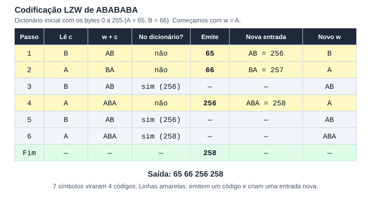

## Objetivos de aprendizagem

Ao final deste tópico, você deverá ser capaz de:

- Explicar como o **LZW** aprende um dicionário de subsequências durante a leitura da entrada.
- Executar a codificação e a decodificação LZW passo a passo.
- Resolver o **caso especial** da decodificação, em que o código lido ainda não existe no dicionário.
- Comparar RLE, Huffman e LZW quanto ao custo e às limitações.

## Introdução

O **LZW** (Lempel–Ziv–Welch) é um algoritmo de compressão **sem perdas** baseado em **dicionário**: ele explora **subsequências que se repetem** ao longo do texto, substituindo cada uma por um único código. É a base de formatos como GIF e do utilitário `compress` do Unix.

## Conceito principal

O codificador mantém um **dicionário** que começa com todos os 256 bytes (códigos `0` a `255`) e **aprende** novas sequências durante a leitura: sempre que encontra uma sequência inédita, emite o código do maior prefixo conhecido e registra a nova sequência com o próximo código livre (`256`, `257`, ...).

O dicionário **não é transmitido**: o decodificador o reconstrói sozinho, passo a passo, a partir dos próprios códigos.

### Como funciona

Para codificar:

1. Inicializamos o dicionário com os 256 bytes e definimos `w` como o primeiro símbolo da entrada.
2. Para cada próximo símbolo `c`: se `w + c` está no dicionário, fazemos `w = w + c`.
3. Caso contrário, emitimos o código de `w`, inserimos `w + c` no dicionário com o próximo código livre e fazemos `w = c`.
4. Ao final da entrada, emitimos o código de `w`.

Para decodificar, lemos os códigos em ordem, mantendo o **código anterior**. A cada código lido (a partir do segundo), inserimos no dicionário a entrada `string(anterior) + primeiro símbolo da string atual`.

> **Atenção:** isso faz o decodificador ficar sempre "um passo atrás" do codificador, o que gera um **caso especial**: se o código lido **ainda não existe** no dicionário, então ele é exatamente a entrada que está sendo criada, e vale `string(anterior) + primeiro símbolo de string(anterior)`.

---

## Exemplo

### Codificação



### Rastreamento da codificação de ABABABA

Dicionário inicial: `A = 65`, `B = 66` (demais bytes omitidos). Começamos com `w = A`.

1. Lê `B`: `AB` não existe → emite `65`, insere `AB = 256`, `w = B`.
2. Lê `A`: `BA` não existe → emite `66`, insere `BA = 257`, `w = A`.
3. Lê `B`: `AB` existe (`256`) → `w = AB`.
4. Lê `A`: `ABA` não existe → emite `256`, insere `ABA = 258`, `w = A`.
5. Lê `B`: `AB` existe → `w = AB`.
6. Lê `A`: `ABA` existe (`258`) → `w = ABA`.
7. Fim da entrada → emite `258`.

Saída: `65 66 256 258`. Os 7 símbolos viraram 4 códigos.

### Decodificação

Na decodificação, o dicionário é reconstruído a partir dos próprios códigos, sem receber nenhuma informação extra além da sequência comprimida.

### Rastreamento da decodificação de 65 66 256 258

1. `65` → `A`. Saída: `A`.
2. `66` → `B`. Insere `AB = 256` (anterior `A` + primeiro símbolo de `B`). Saída: `AB`.
3. `256` → `AB`. Insere `BA = 257` (anterior `B` + primeiro símbolo de `AB`). Saída: `ABAB`.
4. `258` **ainda não existe** (o dicionário vai só até `257`). Caso especial: `string(anterior) = AB`, então a entrada é `AB + A = ABA`. Insere `ABA = 258`. Saída: `ABABABA`.

O texto original foi recuperado integralmente.

### Visualização passo a passo

```codigo
{"title":"LZW passo a passo: ABABABA","code":"/* Código LZW: ABABABA */","steps":[{"line":1,"caption":"Vamos comprimir ABABABA com LZW. O dicionário começa com os 256 bytes (A = 65, B = 66, ...). Mantemos w, a maior sequência conhecida que estamos lendo, e começamos com w = A.","vars":{"w":"\"A\""},"rows":[[{"s":0,"n":7,"i":[["A","c",1],["B","",2],["A","",1],["B","",2],["A","",1],["B","",2],["A","",1]],"l":"entrada"}],[{"i":[["A=65","",1],["B=66","",2]],"l":"dicionário (mostrando A, B e as entradas novas)"}]],"stack":""},{"line":1,"caption":"Lemos B. A sequência AB ainda não está no dicionário: emitimos o código de A (65), inserimos AB = 256 e recomeçamos com w = B.","vars":{"w":"\"B\"","c":"'B'"},"rows":[[{"s":0,"n":7,"i":[["A","",1],["B","c",2],["A","",1],["B","",2],["A","",1],["B","",2],["A","",1]],"l":"entrada"}],[{"i":[["A=65","",1],["B=66","",2],["AB=256","p",3]],"l":"dicionário (mostrando A, B e as entradas novas)"}],[{"i":[["65","p",1]],"l":"saída (códigos)"}]],"stack":""},{"line":1,"caption":"Lemos A. A sequência BA ainda não está no dicionário: emitimos o código de B (66), inserimos BA = 257 e recomeçamos com w = A.","vars":{"w":"\"A\"","c":"'A'"},"rows":[[{"s":0,"n":7,"i":[["A","",1],["B","",2],["A","c",1],["B","",2],["A","",1],["B","",2],["A","",1]],"l":"entrada"}],[{"i":[["A=65","",1],["B=66","",2],["AB=256","",3],["BA=257","p",4]],"l":"dicionário (mostrando A, B e as entradas novas)"}],[{"i":[["65","",1],["66","p",2]],"l":"saída (códigos)"}]],"stack":""},{"line":1,"caption":"Lemos B. A sequência AB já está no dicionário (256): não emitimos nada e ampliamos w para AB.","vars":{"w":"\"AB\"","c":"'B'"},"rows":[[{"s":0,"n":7,"i":[["A","",1],["B","",2],["A","",1],["B","c",2],["A","",1],["B","",2],["A","",1]],"l":"entrada"}],[{"i":[["A=65","",1],["B=66","",2],["AB=256","c",3],["BA=257","",4]],"l":"dicionário (mostrando A, B e as entradas novas)"}],[{"i":[["65","",1],["66","",2]],"l":"saída (códigos)"}]],"stack":""},{"line":1,"caption":"Lemos A. A sequência ABA ainda não está no dicionário: emitimos o código de AB (256), inserimos ABA = 258 e recomeçamos com w = A.","vars":{"w":"\"A\"","c":"'A'"},"rows":[[{"s":0,"n":7,"i":[["A","",1],["B","",2],["A","",1],["B","",2],["A","c",1],["B","",2],["A","",1]],"l":"entrada"}],[{"i":[["A=65","",1],["B=66","",2],["AB=256","",3],["BA=257","",4],["ABA=258","p",5]],"l":"dicionário (mostrando A, B e as entradas novas)"}],[{"i":[["65","",1],["66","",2],["256","p",3]],"l":"saída (códigos)"}]],"stack":""},{"line":1,"caption":"Lemos B. A sequência AB já está no dicionário (256): não emitimos nada e ampliamos w para AB.","vars":{"w":"\"AB\"","c":"'B'"},"rows":[[{"s":0,"n":7,"i":[["A","",1],["B","",2],["A","",1],["B","",2],["A","",1],["B","c",2],["A","",1]],"l":"entrada"}],[{"i":[["A=65","",1],["B=66","",2],["AB=256","c",3],["BA=257","",4],["ABA=258","",5]],"l":"dicionário (mostrando A, B e as entradas novas)"}],[{"i":[["65","",1],["66","",2],["256","",3]],"l":"saída (códigos)"}]],"stack":""},{"line":1,"caption":"Lemos A. A sequência ABA já está no dicionário (258): não emitimos nada e ampliamos w para ABA.","vars":{"w":"\"ABA\"","c":"'A'"},"rows":[[{"s":0,"n":7,"i":[["A","",1],["B","",2],["A","",1],["B","",2],["A","",1],["B","",2],["A","c",1]],"l":"entrada"}],[{"i":[["A=65","",1],["B=66","",2],["AB=256","",3],["BA=257","",4],["ABA=258","c",5]],"l":"dicionário (mostrando A, B e as entradas novas)"}],[{"i":[["65","",1],["66","",2],["256","",3]],"l":"saída (códigos)"}]],"stack":""},{"line":1,"caption":"Fim da entrada: emitimos o código de w = ABA, que é 258. Saída: 65 66 256 258 — 7 símbolos viraram 4 códigos.","vars":{"w":"\"ABA\""},"rows":[[{"s":0,"n":7,"i":[["A","",1],["B","",2],["A","",1],["B","",2],["A","",1],["B","",2],["A","",1]],"l":"entrada"}],[{"i":[["A=65","",1],["B=66","",2],["AB=256","",3],["BA=257","",4],["ABA=258","",5]],"l":"dicionário (mostrando A, B e as entradas novas)"}],[{"i":[["65","",1],["66","",2],["256","",3],["258","p",5]],"l":"saída (códigos)"}]],"stack":""},{"line":1,"caption":"Agora o caminho inverso. O decodificador recebe só os códigos 65 66 256 258 e reconstrói o dicionário sozinho, sem receber nenhuma informação extra.","vars":{},"rows":[[{"s":0,"n":4,"i":[["65","",1],["66","",2],["256","",3],["258","",5]],"l":"entrada (códigos)"}],[{"i":[["A=65","",1],["B=66","",2]],"l":"dicionário (mostrando A, B e as entradas novas)"}]],"stack":""},{"line":1,"caption":"Lemos o primeiro código, 65, que corresponde a A. No começo só emitimos o símbolo e guardamos A como código anterior.","vars":{"anterior":"\"A\""},"rows":[[{"s":0,"n":4,"i":[["65","c",1],["66","",2],["256","",3],["258","",5]],"l":"entrada (códigos)"}],[{"i":[["A=65","",1],["B=66","",2]],"l":"dicionário (mostrando A, B e as entradas novas)"}],[{"s":0,"n":1,"i":[["A","p",1]],"l":"texto recuperado"}]],"stack":""},{"line":1,"caption":"Lemos o código 66, que corresponde a B. Inserimos no dicionário AB = 256 (anterior + primeiro símbolo de B). Texto recuperado até agora: AB.","vars":{"anterior":"\"A\""},"rows":[[{"s":0,"n":4,"i":[["65","",1],["66","c",2],["256","",3],["258","",5]],"l":"entrada (códigos)"}],[{"i":[["A=65","",1],["B=66","",2],["AB=256","p",3]],"l":"dicionário (mostrando A, B e as entradas novas)"}],[{"s":0,"n":2,"i":[["A","",1],["B","p",2]],"l":"texto recuperado"}]],"stack":""},{"line":1,"caption":"Lemos o código 256, que corresponde a AB. Inserimos no dicionário BA = 257 (anterior + primeiro símbolo de AB). Texto recuperado até agora: ABAB.","vars":{"anterior":"\"B\""},"rows":[[{"s":0,"n":4,"i":[["65","",1],["66","",2],["256","c",3],["258","",5]],"l":"entrada (códigos)"}],[{"i":[["A=65","",1],["B=66","",2],["AB=256","",3],["BA=257","p",4]],"l":"dicionário (mostrando A, B e as entradas novas)"}],[{"s":0,"n":4,"i":[["A","",1],["B","",2],["A","p",1],["B","p",2]],"l":"texto recuperado"}]],"stack":""},{"line":1,"caption":"Lemos o código 258, que ainda não existe no dicionário (ele vai só até 257). Caso especial: a sequência é a anterior (AB) mais o primeiro símbolo dela (A), ou seja, ABA. Inserimos ABA = 258. Texto recuperado até agora: ABABABA.","vars":{"anterior":"\"AB\""},"rows":[[{"s":0,"n":4,"i":[["65","",1],["66","",2],["256","",3],["258","c",5]],"l":"entrada (códigos)"}],[{"i":[["A=65","",1],["B=66","",2],["AB=256","",3],["BA=257","",4],["ABA=258","p",5]],"l":"dicionário (mostrando A, B e as entradas novas)"}],[{"s":0,"n":7,"i":[["A","",1],["B","",2],["A","",1],["B","",2],["A","p",1],["B","p",2],["A","p",1]],"l":"texto recuperado"}]],"stack":""},{"line":1,"caption":"O texto original ABABABA foi recuperado integralmente, e o dicionário foi reconstruído apenas a partir dos códigos.","vars":{},"rows":[[{"s":0,"n":7,"i":[["A","",1],["B","",2],["A","",1],["B","",2],["A","",1],["B","",2],["A","",1]],"l":"texto recuperado"}]],"stack":""}]}
```

## Comparação e complexidade

Considere uma entrada de $n$ símbolos e um dicionário de tamanho $D$:

| Aspecto | Descrição | Custo |
|:--|:--|--:|
| Codificar com trie ou tabela hash | Uma passagem, busca no dicionário em tempo médio constante | $O(n)$ |
| Codificar com busca linear | Cada símbolo pode percorrer todo o dicionário | $O(n \cdot D)$ |
| Decodificar | Uma passagem, reconstruindo o dicionário | $O(n)$ |

O melhor caso são textos com muitas subsequências repetidas. Dados aleatórios podem expandir, e um dicionário cheio deixa de aprender novas entradas.

### Comparação entre os três algoritmos

Considere uma entrada de $n$ símbolos e um alfabeto com $\sigma$ símbolos distintos ($\sigma \le 256$ para bytes):

| Algoritmo | Custo de codificação | Melhor caso | Pior caso / limitação |
|:--|:--|:--|:--|
| **RLE** | $O(n)$ | Longas corridas de um único símbolo | Sem repetições o dado **dobra** de tamanho |
| **Huffman** | $O(n + \sigma \log \sigma)$ (contagem + construção com Min-Heap) | Distribuição muito desigual de frequências | Frequências uniformes não comprimem; exige duas passagens e armazenar a árvore |
| **LZW** | $O(n)$ com trie/hash; $O(n \cdot D)$ com busca linear | Textos com muitas subsequências repetidas | Dados aleatórios podem expandir; dicionário cheio deixa de aprender |

| Característica | RLE | Huffman | LZW |
|:--|:--|:--|:--|
| Passagens sobre a entrada | 1 | 2 (frequências, depois codificação) | 1 |
| Precisa transmitir metadados? | Não | Sim (árvore ou frequências) | Não (dicionário reconstruído) |
| Código de tamanho variável? | Não (pares fixos) | Sim (bits) | Sim (códigos de 9 a 12 bits, em geral) |
| Ótimo em algum sentido? | Não | Sim (entre códigos de prefixo símbolo a símbolo) | Não |

## Teste de conhecimento

```quiz
{
  "question": "Durante a decodificação LZW, o decodificador lê um código que ainda não existe no dicionário. Como a string correspondente é obtida?",
  "options": [
    { "text": "É a string do código anterior concatenada com o primeiro símbolo dessa mesma string.", "correct": true },
    { "text": "É a string do código anterior concatenada com o próximo byte da entrada comprimida.", "correct": false },
    { "text": "É um erro: a entrada comprimida está corrompida e a decodificação deve ser interrompida.", "correct": false }
  ],
  "correctFeedback": "Correto! O decodificador está sempre um passo atrás do codificador, então esse código é a entrada que está sendo criada agora: anterior + primeiro símbolo de anterior (ex.: AB + A = ABA).",
  "incorrectFeedback": "Lembre que o decodificador só insere uma entrada depois de ler o código seguinte, ficando um passo atrás do codificador."
}
```
