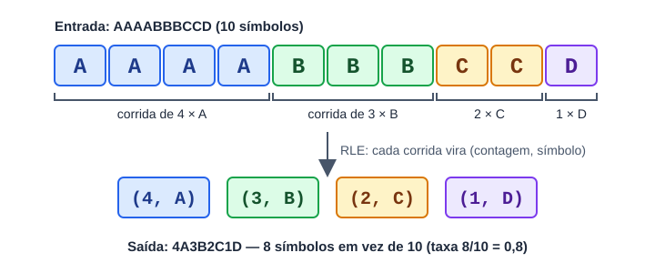

## Objetivos de aprendizagem

Ao final deste tópico, você deverá ser capaz de:

- Diferenciar compressão **sem perdas** (*lossless*) de compressão com perdas e calcular a **taxa de compressão** de um algoritmo.
- Comprimir e descomprimir dados com **Run-Length Encoding (RLE)**.
- Identificar o melhor e o pior caso do RLE.

## Introdução

**Compressão de dados** é o processo de representar uma informação usando **menos bits** do que a representação original, reduzindo custo de armazenamento e tempo de transmissão. Em AEDS2 estudamos algoritmos de compressão **sem perdas**: o dado original é recuperado **exatamente** após a descompressão — requisito para textos, código-fonte, planilhas e arquivos executáveis.

Os três algoritmos estudados nesta sequência exploram redundâncias diferentes:

| Algoritmo | Redundância explorada | Família |
|:--|:--|:--|
| **RLE** | Sequências repetidas de um mesmo símbolo | Substituição de repetições |
| **Huffman** | Símbolos com frequências desiguais | Estatística (código de tamanho variável) |
| **LZW** | Subsequências que se repetem ao longo do texto | Baseada em dicionário |

Neste tópico estudamos o **RLE**; Huffman e LZW têm tópicos próprios.

## Conceito principal

Seja $n_{\text{orig}}$ o tamanho original e $n_{\text{comp}}$ o tamanho comprimido (ambos em bits ou bytes). Definimos:

$$\text{Taxa de compressão} = \frac{n_{\text{comp}}}{n_{\text{orig}}} \qquad \text{Economia} = 1 - \frac{n_{\text{comp}}}{n_{\text{orig}}}$$

Uma taxa **menor que 1** indica que houve ganho; maior que 1 indica **expansão** (o "comprimido" ficou maior que o original).

> **Regra fundamental:** nenhum algoritmo sem perdas consegue comprimir **todas** as entradas possíveis. Se alguns arquivos encolhem, outros necessariamente crescem ou permanecem do mesmo tamanho (princípio da casa dos pombos).

### Como funciona

No **Run-Length Encoding (RLE)**, cada sequência maximal de símbolos iguais (uma *corrida*, ou *run*) é substituída por um par **(contagem, símbolo)**. A string `AAAABBBCCD` torna-se `4A3B2C1D`. Funciona bem quando há longas corridas (imagens com áreas uniformes, bitmaps) e mal quando há pouca repetição.

---

## Exemplo

### Codificação e decodificação

Para codificar:

1. Percorremos a entrada e contamos o tamanho de cada corrida de símbolos iguais.
2. Emitimos o par `(contagem, símbolo)` e avançamos o índice pelo tamanho da corrida.

Para decodificar, basta repetir cada símbolo o número de vezes indicado.

### Rastreamento da codificação de AAAABBBCCD

1. Índice `0`: `A` se repete 4 vezes → emite `(4, A)`.
2. Índice `4`: `B` se repete 3 vezes → emite `(3, B)`.
3. Índice `7`: `C` se repete 2 vezes → emite `(2, C)`.
4. Índice `9`: `D` aparece 1 vez → emite `(1, D)`.
5. Resultado: `4A3B2C1D` — 10 símbolos viraram 8, taxa de $8/10 = 0{,}8$.

### Visualização passo a passo
```codigo
{"title":"RLE passo a passo: AAAABBBCCD","code":"/* Código RLE: AAAABBBCCD */","steps":[{"line":1,"caption":"Vamos comprimir AAAABBBCCD (10 símbolos) com RLE: cada corrida de símbolos iguais vira um par (contagem, símbolo).","vars":{},"rows":[[{"s":0,"n":10,"i":[["A","",1],["A","",1],["A","",1],["A","",1],["B","",2],["B","",2],["B","",2],["C","",3],["C","",3],["D","",4]],"l":"entrada"}]],"stack":""},{"line":1,"caption":"No índice 0 começa uma corrida de A. Contando os símbolos iguais que vêm em seguida, ela tem tamanho 4.","vars":{"i":0,"simbolo":"'A'","cont":4},"rows":[[{"s":0,"n":10,"i":[["A","c",1],["A","c",1],["A","c",1],["A","c",1],["B","",2],["B","",2],["B","",2],["C","",3],["C","",3],["D","",4]],"l":"entrada"}]],"stack":""},{"line":1,"caption":"Emitimos o par (4, A) e avançamos o índice em 4, até 4.","vars":{"i":4},"rows":[[{"s":0,"n":10,"i":[["A","p",1],["A","p",1],["A","p",1],["A","p",1],["B","",2],["B","",2],["B","",2],["C","",3],["C","",3],["D","",4]],"l":"entrada"}],[{"i":[["(4,A)","p",1]],"l":"saída: pares (contagem, símbolo)"}]],"stack":""},{"line":1,"caption":"No índice 4 começa uma corrida de B. Contando os símbolos iguais que vêm em seguida, ela tem tamanho 3.","vars":{"i":4,"simbolo":"'B'","cont":3},"rows":[[{"s":0,"n":10,"i":[["A","",1],["A","",1],["A","",1],["A","",1],["B","c",2],["B","c",2],["B","c",2],["C","",3],["C","",3],["D","",4]],"l":"entrada"}],[{"i":[["(4,A)","",1]],"l":"saída: pares (contagem, símbolo)"}]],"stack":""},{"line":1,"caption":"Emitimos o par (3, B) e avançamos o índice em 3, até 7.","vars":{"i":7},"rows":[[{"s":0,"n":10,"i":[["A","",1],["A","",1],["A","",1],["A","",1],["B","p",2],["B","p",2],["B","p",2],["C","",3],["C","",3],["D","",4]],"l":"entrada"}],[{"i":[["(4,A)","",1],["(3,B)","p",2]],"l":"saída: pares (contagem, símbolo)"}]],"stack":""},{"line":1,"caption":"No índice 7 começa uma corrida de C. Contando os símbolos iguais que vêm em seguida, ela tem tamanho 2.","vars":{"i":7,"simbolo":"'C'","cont":2},"rows":[[{"s":0,"n":10,"i":[["A","",1],["A","",1],["A","",1],["A","",1],["B","",2],["B","",2],["B","",2],["C","c",3],["C","c",3],["D","",4]],"l":"entrada"}],[{"i":[["(4,A)","",1],["(3,B)","",2]],"l":"saída: pares (contagem, símbolo)"}]],"stack":""},{"line":1,"caption":"Emitimos o par (2, C) e avançamos o índice em 2, até 9.","vars":{"i":9},"rows":[[{"s":0,"n":10,"i":[["A","",1],["A","",1],["A","",1],["A","",1],["B","",2],["B","",2],["B","",2],["C","p",3],["C","p",3],["D","",4]],"l":"entrada"}],[{"i":[["(4,A)","",1],["(3,B)","",2],["(2,C)","p",3]],"l":"saída: pares (contagem, símbolo)"}]],"stack":""},{"line":1,"caption":"No índice 9 começa uma corrida de D. Contando os símbolos iguais que vêm em seguida, ela tem tamanho 1.","vars":{"i":9,"simbolo":"'D'","cont":1},"rows":[[{"s":0,"n":10,"i":[["A","",1],["A","",1],["A","",1],["A","",1],["B","",2],["B","",2],["B","",2],["C","",3],["C","",3],["D","c",4]],"l":"entrada"}],[{"i":[["(4,A)","",1],["(3,B)","",2],["(2,C)","",3]],"l":"saída: pares (contagem, símbolo)"}]],"stack":""},{"line":1,"caption":"Emitimos o par (1, D) e avançamos o índice em 1, até 10, o fim da entrada.","vars":{"i":10},"rows":[[{"s":0,"n":10,"i":[["A","",1],["A","",1],["A","",1],["A","",1],["B","",2],["B","",2],["B","",2],["C","",3],["C","",3],["D","p",4]],"l":"entrada"}],[{"i":[["(4,A)","",1],["(3,B)","",2],["(2,C)","",3],["(1,D)","p",4]],"l":"saída: pares (contagem, símbolo)"}]],"stack":""},{"line":1,"caption":"Fim da codificação. Saída: 4A3B2C1D — 8 símbolos no lugar de 10, taxa 8/10 = 0,8.","vars":{},"rows":[[{"s":0,"n":10,"i":[["A","",1],["A","",1],["A","",1],["A","",1],["B","",2],["B","",2],["B","",2],["C","",3],["C","",3],["D","",4]],"l":"entrada"}],[{"i":[["(4,A)","",1],["(3,B)","",2],["(2,C)","",3],["(1,D)","",4]],"l":"saída: pares (contagem, símbolo)"}]],"stack":""},{"line":1,"caption":"Agora o caminho inverso: para cada par (contagem, símbolo), repetimos o símbolo 'contagem' vezes.","vars":{},"rows":[[{"i":[["(4,A)","",1],["(3,B)","",2],["(2,C)","",3],["(1,D)","",4]],"l":"saída: pares (contagem, símbolo)"}]],"stack":""},{"line":1,"caption":"Lemos o par (4, A) e repetimos A 4 vez(es). Texto recuperado até agora: AAAA.","vars":{"i":0},"rows":[[{"i":[["(4,A)","c",1],["(3,B)","",2],["(2,C)","",3],["(1,D)","",4]],"l":"saída: pares (contagem, símbolo)"}],[{"s":0,"n":4,"i":[["A","p",1],["A","p",1],["A","p",1],["A","p",1]],"l":"texto recuperado"}]],"stack":""},{"line":1,"caption":"Lemos o par (3, B) e repetimos B 3 vez(es). Texto recuperado até agora: AAAABBB.","vars":{"i":1},"rows":[[{"i":[["(4,A)","",1],["(3,B)","c",2],["(2,C)","",3],["(1,D)","",4]],"l":"saída: pares (contagem, símbolo)"}],[{"s":0,"n":7,"i":[["A","",1],["A","",1],["A","",1],["A","",1],["B","p",2],["B","p",2],["B","p",2]],"l":"texto recuperado"}]],"stack":""},{"line":1,"caption":"Lemos o par (2, C) e repetimos C 2 vez(es). Texto recuperado até agora: AAAABBBCC.","vars":{"i":2},"rows":[[{"i":[["(4,A)","",1],["(3,B)","",2],["(2,C)","c",3],["(1,D)","",4]],"l":"saída: pares (contagem, símbolo)"}],[{"s":0,"n":9,"i":[["A","",1],["A","",1],["A","",1],["A","",1],["B","",2],["B","",2],["B","",2],["C","p",3],["C","p",3]],"l":"texto recuperado"}]],"stack":""},{"line":1,"caption":"Lemos o par (1, D) e repetimos D 1 vez(es). Texto recuperado até agora: AAAABBBCCD.","vars":{"i":3},"rows":[[{"i":[["(4,A)","",1],["(3,B)","",2],["(2,C)","",3],["(1,D)","c",4]],"l":"saída: pares (contagem, símbolo)"}],[{"s":0,"n":10,"i":[["A","",1],["A","",1],["A","",1],["A","",1],["B","",2],["B","",2],["B","",2],["C","",3],["C","",3],["D","p",4]],"l":"texto recuperado"}]],"stack":""},{"line":1,"caption":"O texto original AAAABBBCCD foi recuperado integralmente: a compressão RLE não perde informação.","vars":{},"rows":[[{"s":0,"n":10,"i":[["A","",1],["A","",1],["A","",1],["A","",1],["B","",2],["B","",2],["B","",2],["C","",3],["C","",3],["D","",4]],"l":"texto recuperado"}]],"stack":""}]}
```

### Exemplo visual



### Pior caso

Na entrada `ABCD`, cada corrida tem tamanho 1 e o resultado é `1A1B1C1D`: o dado **dobra** de tamanho (taxa $= 2$).

## Comparação e complexidade

Considere uma entrada de $n$ símbolos:

| Aspecto | Descrição | Custo / resultado |
|:--|:--|--:|
| Codificar | Percorre a entrada uma única vez, contando as corridas | $O(n)$ |
| Decodificar | Repete cada símbolo conforme a contagem | $O(n)$ |
| Melhor caso | Uma única corrida de $n$ símbolos gera apenas um par (taxa $\approx 2/n$) | muito menor que o original |
| Pior caso | Nenhuma repetição: cada símbolo gera um par $(1, \text{símbolo})$ | o dobro do original |

## Teste de conhecimento

```quiz
{
  "question": "Ao aplicar RLE com pares (contagem, símbolo) sobre a entrada ABCDEFGH (nenhum símbolo se repete em sequência), qual é o resultado em relação ao tamanho original?",
  "options": [
    { "text": "A saída tem o dobro do tamanho original, pois cada símbolo gera um par (1, símbolo).", "correct": true },
    { "text": "A saída tem metade do tamanho original, pois o RLE sempre comprime.", "correct": false },
    { "text": "A saída tem exatamente o mesmo tamanho da entrada.", "correct": false }
  ],
  "correctFeedback": "Correto! Sem corridas, cada símbolo vira o par (1, símbolo) e o RLE expande o dado. Esse é o seu pior caso.",
  "incorrectFeedback": "Lembre que cada corrida, mesmo de tamanho 1, gera um par completo (contagem, símbolo)."
}
```
