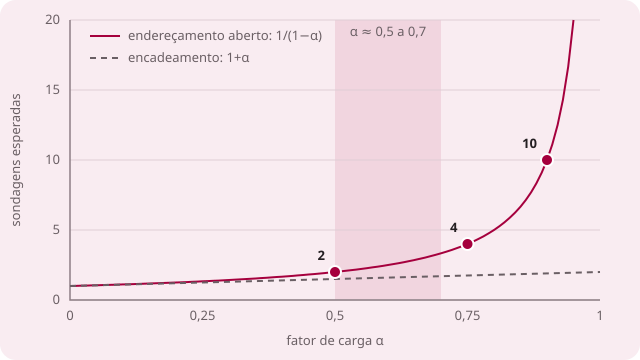

## Objetivos de aprendizagem

Ao final deste tópico, você deverá ser capaz de:

- **Definir** e calcular o fator de carga ($\alpha = n/m$) de uma tabela hash.
- **Analisar** o custo médio e de pior caso das operações com encadeamento e com endereçamento aberto.
- **Explicar** como o rehashing mantém o custo amortizado das inserções em $O(1)$ e como mitigar o pior caso $O(n)$.
- **Identificar** em quais problemas tabelas hash são indicadas e quando outras estruturas (como árvores balanceadas) são mais adequadas.

## Como este tópico se liga à trilha

Esta página fecha a base teórica de **Tabelas Hash**, usando a análise assintótica de AEDS I para medir o custo das estratégias vistas antes e compará-las com árvores balanceadas.

1. [Função de dispersão](../../../../topico.html?trilha=aeds-ii&id=hash&pagina=funcao-dispersao)
2. [Tratamento de colisões](../../../../topico.html?trilha=aeds-ii&id=hash&pagina=tratamento-colisoes)
3. **Eficiência de tabelas hash** *(você está aqui)*
4. [Exemplos e aplicações](../../../../topico.html?trilha=aeds-ii&id=hash&pagina=exemplos-aplicacoes)
5. [Exercícios](../../../../topico.html?trilha=aeds-ii&id=hash&pagina=exercicios)

| Conteúdo relacionado | Trilha | Como se conecta a esta página |
|:---|:---|:---|
| [Análise Assintótica](../../../../topico.html?trilha=aeds-i&id=analise-de-complexidade&pagina=analise-assintotica) | AEDS I | Define as notações $O$ e $\Theta$ usadas para expressar o caso médio $\Theta(1 + \alpha)$ e o pior caso $\Theta(n)$ |
| [Árvores Vermelho e Preto](../../../../topico.html?trilha=aeds-i&id=estruturas-dados-hierarquicas&pagina=arvores-vermelho-preto) | AEDS I | Alternativa para buscas ordenadas ou por intervalo e solução adotada em bibliotecas para buckets muito longos |
| [Tratamento de colisões](../../../../topico.html?trilha=aeds-ii&id=hash&pagina=tratamento-colisoes) | AEDS II · Hash | Apresenta o encadeamento e a sondagem cujos custos em função de $\alpha$ são analisados aqui |
| [Exemplos e aplicações](../../../../topico.html?trilha=aeds-ii&id=hash&pagina=exemplos-aplicacoes) | AEDS II · Hash | Próxima etapa: permite experimentar $\alpha$, colisões e rehashing na prática nos laboratórios |

---

## Fator de carga

O principal indicador de desempenho é o **fator de carga**:

$$\alpha = \frac{n}{m}$$

onde $n$ é o número de elementos armazenados e $m$ o tamanho da tabela.

## Análise com encadeamento

Sob hashing uniforme simples, o tamanho médio de cada lista é $\alpha$. Portanto:

| Operação | Tempo médio | Pior caso |
|:---|:---|:---|
| Busca sem sucesso | $\Theta(1 + \alpha)$ | $\Theta(n)$ |
| Busca com sucesso | $\Theta(1 + \alpha)$ | $\Theta(n)$ |
| Inserção | $\Theta(1)$ | $\Theta(1)$, ou $\Theta(n)$ se verificar duplicatas |
| Remoção | $\Theta(1 + \alpha)$ | $\Theta(n)$ |

Se $n = O(m)$, então $\alpha = O(1)$ e todas as operações são **$O(1)$ em média**.

## Análise com endereçamento aberto

Com hashing uniforme, o número esperado de sondagens é aproximadamente:

$$\text{Busca sem sucesso: } \frac{1}{1 - \alpha} \qquad \text{Busca com sucesso: } \frac{1}{\alpha} \cdot \ln\left(\frac{1}{1 - \alpha}\right)$$

| $\alpha$ | Sondagens (sem sucesso) |
|:---|---:|
| 0,50 | 2 |
| 0,75 | 4 |
| 0,90 | 10 |
| 0,99 | 100 |

Quando a tabela se aproxima de cheia, o desempenho cai drasticamente. Por isso costuma-se manter $\alpha$ abaixo de cerca de **0,5 a 0,7**.



## Rehashing

Para manter $\alpha$ sob controle, a tabela é **redimensionada** quando o fator de carga ultrapassa um limite (por exemplo, 0,75):

1. Aloca-se um novo vetor, geralmente com o **dobro** do tamanho (de preferência um número primo próximo).
2. Cada elemento é **reinserido** com a nova função hash, pois $h(k) \bmod m$ muda quando $m$ muda.

Cada rehashing custa $O(n)$, mas como ocorre raramente, o custo **amortizado** por inserção continua sendo **$O(1)$**.

## Pior caso e como evitá-lo

No pior caso todas as chaves caem na mesma posição e a tabela se comporta como uma lista, com operações em $O(n)$. As causas mais comuns são:

- uma função hash ruim ou mal ajustada ao tipo de dado;
- um tamanho $m$ inadequado, como potências de 2 com o método da divisão;
- chaves escolhidas propositalmente para colidir (ataques de negação de serviço).

> **Como mitigar:** usar funções hash bem testadas, $m$ primo, redimensionamento automático, hash universal ou randomizado, e estruturas mais robustas nos buckets (algumas bibliotecas trocam listas longas por árvores balanceadas).

## Quando usar tabelas hash

- **Indicadas para:** busca, inserção e remoção rápidas por chave; contagem de frequências; conjuntos e dicionários; caches; detecção de duplicatas.
- **Não indicadas para:** acesso ordenado às chaves, buscas por intervalo, mínimo/máximo ou sucessor. Nesses casos, árvores balanceadas são mais adequadas.

---

## Resumo

- Fator de carga: $\alpha = n/m$. Com $\alpha$ limitado, as operações custam $O(1)$ em média.
- Endereçamento aberto degrada rapidamente quando $\alpha$ se aproxima de 1; mantenha $\alpha$ abaixo de cerca de 0,5 a 0,7.
- Rehashing dobra o tamanho da tabela e reinsere os elementos, com custo $O(1)$ amortizado por inserção.
- O pior caso é $O(n)$ e é mitigado por boas funções hash e redimensionamento.

## Teste de conhecimento

```quiz
{
  "question": "Como é definido o fator de carga de uma tabela hash com n elementos e m posições?",
  "options": [
    { "text": "α = n / m", "correct": true },
    { "text": "α = m / n", "correct": false },
    { "text": "α = n · m", "correct": false },
    { "text": "α = n − m", "correct": false }
  ],
  "correctFeedback": "Correto! O fator de carga é a razão entre elementos armazenados e posições disponíveis, α = n/m.",
  "incorrectFeedback": "Incorreto. O fator de carga é a razão entre elementos armazenados e posições disponíveis, α = n/m."
}
```

```quiz
{
  "question": "Em uma tabela com endereçamento aberto e α = 0,9, qual o número esperado de sondagens em uma busca sem sucesso?",
  "options": [
    { "text": "2", "correct": false },
    { "text": "5", "correct": false },
    { "text": "90", "correct": false },
    { "text": "10", "correct": true }
  ],
  "correctFeedback": "Correto! O número esperado é 1/(1 − α) = 1/0,1 = 10. Com α = 0,5 seriam apenas 2.",
  "incorrectFeedback": "Incorreto. O número esperado é 1/(1 − α) = 1/0,1 = 10. Com α = 0,5 seriam apenas 2."
}
```

```quiz
{
  "question": "Por que o rehashing, mesmo custando O(n), mantém a inserção em O(1) amortizado?",
  "options": [
    { "text": "Porque cada rehashing custa O(1)", "correct": false },
    { "text": "Porque ele elimina todas as colisões", "correct": false },
    { "text": "Porque ele ocorre raramente e seu custo se dilui entre muitas inserções", "correct": true },
    { "text": "Porque dispensa recalcular a função hash", "correct": false }
  ],
  "correctFeedback": "Correto! Ao dobrar o tamanho a cada redimensionamento, o custo total de todos os rehashings é proporcional ao número de inserções, o que dá O(1) por inserção em média.",
  "incorrectFeedback": "Incorreto. Ao dobrar o tamanho a cada redimensionamento, o custo total de todos os rehashings é proporcional ao número de inserções, o que dá O(1) por inserção em média."
}
```
