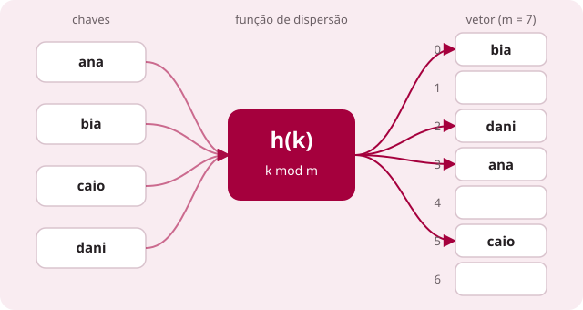

## Objetivos de aprendizagem

Ao final deste tópico, você deverá ser capaz de:

- Explicar o que é uma **tabela hash** e qual o papel da **função de dispersão** no acesso em tempo médio $O(1)$.
- Identificar as propriedades desejáveis de uma boa função de dispersão e o conceito de **hashing uniforme simples**.
- Aplicar os métodos clássicos de dispersão (**divisão**, **multiplicação** e **hash polinomial para strings**) e escolher adequadamente o tamanho $m$ da tabela.
- Reconhecer por que colisões são inevitáveis quando o universo de chaves é maior que $m$.

## Introdução

Imagine uma biblioteca em que cada livro tem uma etiqueta com o número da prateleira, calculado a partir do título. Para achar um livro, você não percorre a biblioteca inteira: calcula o número e vai direto ao lugar. Essa é a ideia de uma **tabela hash** (ou tabela de dispersão).

Uma tabela hash associa **chaves** a **valores** e permite inserir, buscar e remover elementos em tempo médio **$O(1)$**. Ela usa um vetor de tamanho $m$ e uma **função de dispersão** que converte cada chave em um índice desse vetor.



## Definição

Uma função de dispersão $h$ mapeia o universo de chaves $U$ para os índices do vetor:

$$h : U \to \{0, 1, \dots, m - 1\}$$

O universo de chaves (todas as strings possíveis, por exemplo) é muito maior que $m$. Por isso é impossível evitar que chaves diferentes recebam o mesmo índice. Quando isso acontece, ocorre uma **colisão**, assunto da próxima página.

## Propriedades desejáveis

- **Determinística:** a mesma chave sempre gera o mesmo índice.
- **Eficiente:** calculada em tempo $O(1)$, ou proporcional ao tamanho da chave.
- **Uniforme:** distribui as chaves de forma equilibrada pelas $m$ posições.
- **Dispersora:** chaves parecidas resultam em índices bem diferentes, evitando agrupamentos.

O cenário ideal é o **hashing uniforme simples**: cada chave tem probabilidade $1/m$ de cair em qualquer posição, independentemente das demais. A análise de eficiência parte dessa hipótese.

---

## Métodos clássicos

### Método da divisão

Usa o resto da divisão da chave inteira $k$ por $m$:

$$h(k) = k \bmod m$$

É simples e rápido. A escolha de $m$ importa: o ideal é um **número primo** não muito próximo de uma potência de 2, o que reduz padrões indesejados na distribuição.

> **Exemplo:** com $m = 11$ e $k = 25$, temos $h(25) = 25 \bmod 11 = 3$.

### Método da multiplicação

Multiplica a chave por uma constante $A$, com $0 < A < 1$, pega a parte fracionária e multiplica por $m$:

$$h(k) = \lfloor m \cdot (k \cdot A \bmod 1) \rfloor$$

Uma constante muito usada é $A \approx 0{,}6180339887$ (inverso da razão áurea, sugerida por Knuth). Aqui o valor de $m$ não é crítico e pode ser uma potência de 2.

### Hash para strings

Para strings, é comum tratar os caracteres como coeficientes de um polinômio. Cada caractere é combinado ao acumulado anterior multiplicado por uma constante (31, por exemplo), e o resultado final é reduzido módulo $m$:

$$h(s) = (s_0 \cdot 31^{n-1} + s_1 \cdot 31^{n-2} + \dots + s_{n-1}) \bmod m$$

O multiplicador faz com que a **posição** de cada caractere influencie o resultado, então `"abc"` e `"cba"` geram valores diferentes. Somar apenas os códigos dos caracteres seria uma função ruim, porque anagramas sempre colidiriam.

## Resumo

- A função de dispersão converte uma chave em um índice de $0$ a $m - 1$ e deve ser determinística, rápida e uniforme.
- Divisão: $h(k) = k \bmod m$, com $m$ primo. Multiplicação: usa uma constante $A$ e permite $m$ potência de 2.
- Em strings, o hash polinomial faz a posição de cada caractere influenciar o resultado.
- Como o universo de chaves é maior que $m$, colisões são inevitáveis.

## Teste de conhecimento

```quiz
{
  "question": "O que significa dizer que uma função de dispersão é determinística?",
  "options": [
    { "text": "Ela gera um índice diferente a cada chamada com a mesma chave", "correct": false },
    { "text": "Ela nunca produz colisões", "correct": false },
    { "text": "A mesma chave sempre gera o mesmo índice", "correct": true },
    { "text": "O índice depende de quantos elementos já foram inseridos", "correct": false }
  ],
  "correctFeedback": "Correto! Uma função determinística devolve sempre o mesmo índice para a mesma chave. Sem isso seria impossível encontrar um elemento depois de inseri-lo.",
  "incorrectFeedback": "Incorreto. Uma função determinística devolve sempre o mesmo índice para a mesma chave. Sem isso seria impossível encontrar um elemento depois de inseri-lo."
}
```

```quiz
{
  "question": "Usando o método da divisão com m = 11, qual é o índice da chave 25?",
  "options": [
    { "text": "2", "correct": false },
    { "text": "3", "correct": true },
    { "text": "4", "correct": false },
    { "text": "25", "correct": false }
  ],
  "correctFeedback": "Correto! h(25) = 25 mod 11 = 3, pois 25 = 2·11 + 3.",
  "incorrectFeedback": "Incorreto. h(25) = 25 mod 11 = 3, pois 25 = 2·11 + 3."
}
```

```quiz
{
  "question": "Por que somar apenas os códigos dos caracteres é uma má função hash para strings?",
  "options": [
    { "text": "Anagramas, como \"abc\" e \"cba\", sempre colidem", "correct": true },
    { "text": "O resultado nunca cabe no vetor", "correct": false },
    { "text": "A soma é muito lenta de calcular", "correct": false },
    { "text": "A função deixa de ser determinística", "correct": false }
  ],
  "correctFeedback": "Correto! A soma ignora a posição dos caracteres, então qualquer permutação da mesma string gera o mesmo valor. O hash polinomial resolve isso ao multiplicar o acumulado por uma constante.",
  "incorrectFeedback": "Incorreto. A soma ignora a posição dos caracteres, então qualquer permutação da mesma string gera o mesmo valor. O hash polinomial resolve isso ao multiplicar o acumulado por uma constante."
}
```
