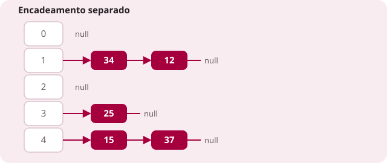
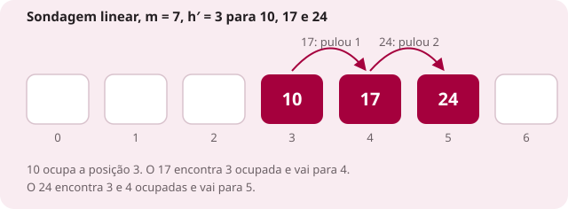

## Objetivos de aprendizagem

Ao final deste tópico, você deverá ser capaz de:

- Explicar o que é uma **colisão** em tabelas hash e por que ela ocorre mesmo com poucas chaves (princípio da casa dos pombos e paradoxo do aniversário).
- Aplicar o **encadeamento separado** e o **endereçamento aberto** (**sondagem linear**, **sondagem quadrática** e **hash duplo**) na inserção e busca de chaves.
- Explicar o papel do marcador de remoção (*tombstone*) no endereçamento aberto.
- Comparar encadeamento e endereçamento aberto quanto a memória, fator de carga, remoção e localidade de cache.

## O que é uma colisão

Uma colisão ocorre quando duas chaves distintas $k_1 \neq k_2$ produzem $h(k_1) = h(k_2)$.

Pelo **princípio da casa dos pombos**, se há mais chaves que posições, colisões são inevitáveis. Mesmo com poucas chaves elas aparecem com frequência: pelo **paradoxo do aniversário**, com apenas 23 chaves em uma tabela de 365 posições, a probabilidade de haver ao menos uma colisão já passa de 50%.

Por isso toda tabela hash precisa de uma estratégia de tratamento. As duas famílias principais são o **encadeamento** e o **endereçamento aberto**.

## Encadeamento separado

Cada posição da tabela guarda uma **lista encadeada** com todos os elementos que caíram naquele índice.



- **Inserção:** calcula $h(k)$ e adiciona o elemento na lista correspondente.
- **Busca:** calcula $h(k)$ e percorre a lista dessa posição.
- **Remoção:** busca o elemento na lista e o remove.

**Vantagens:** implementação simples, remoção direta, degradação gradual quando a tabela enche e capacidade para guardar mais elementos que $m$.

**Desvantagens:** memória extra para os ponteiros e pior localidade de cache.

---

## Endereçamento aberto

Todos os elementos ficam **dentro do próprio vetor**. Quando a posição calculada está ocupada, procura-se outra seguindo uma **sequência de sondagem**:

$$h(k, i) = (h'(k) + f(i)) \bmod m, \quad i = 0, 1, 2, \dots$$

Aqui $i$ é o número da tentativa e $f(i)$ define o tipo de sondagem.

### Sondagem linear

$$h(k, i) = (h'(k) + i) \bmod m$$

Tenta a posição seguinte, depois a seguinte, e assim por diante. É simples e boa para o cache, mas sofre de **agrupamento primário**: blocos contíguos de posições ocupadas crescem e aumentam a chance de novas colisões.

### Sondagem quadrática

$$h(k, i) = (h'(k) + c_1 \cdot i + c_2 \cdot i^2) \bmod m$$

Espalha mais as tentativas e reduz o agrupamento primário. Ainda pode causar **agrupamento secundário**: chaves com o mesmo $h'(k)$ seguem a mesma sequência. Para que toda a tabela possa ser percorrida, $m$ e as constantes precisam ser escolhidos com cuidado.

### Hash duplo

$$h(k, i) = (h_1(k) + i \cdot h_2(k)) \bmod m$$

Usa uma **segunda função hash** para definir o passo, então chaves diferentes tendem a seguir sequências diferentes. É o método que mais se aproxima do hashing uniforme. É preciso que $h_2(k)$ nunca seja 0 e seja coprimo com $m$; usar $m$ primo resolve.

> **Exemplo (sondagem linear, $m = 7$):** inserir `10`, `17` e `24`, todos com $h' = 3$:
>
> - `10` → posição 3, livre.
> - `17` → posição 3 ocupada; tenta 4, livre.
> - `24` → posições 3 e 4 ocupadas; tenta 5, livre.



### Atenção à remoção

No endereçamento aberto, **não basta esvaziar a posição** ao remover um elemento: isso quebraria a sequência de sondagem e faria buscas posteriores falharem. A solução é marcar a posição como **removida** (*tombstone*). A busca continua passando por ela, e uma inserção pode reutilizá-la.

## Comparação e resumo

| Critério | Encadeamento | Endereçamento aberto |
|:---|:---|:---|
| Local de armazenamento | Fora do vetor (listas) | Dentro do vetor |
| Fator de carga $\alpha$ | Pode ser maior que 1 | Sempre $\alpha \le 1$ |
| Remoção | Simples | Requer marcador de remoção |
| Uso de memória | Maior (ponteiros) | Menor |
| Localidade de cache | Pior | Melhor |
| Sensibilidade a $\alpha$ alto | Baixa | Alta |

- Colisão: duas chaves distintas com o mesmo índice. Ela é inevitável e precisa ser tratada.
- Encadeamento separado: cada posição guarda uma lista com os elementos daquele índice.
- Endereçamento aberto: tudo fica no vetor e uma sequência de sondagem (linear, quadrática ou hash duplo) procura a próxima posição livre.
- Na remoção com endereçamento aberto, usa-se um marcador para não quebrar a sequência de sondagem.

## Teste de conhecimento

```quiz
{
  "question": "Qual estratégia de tratamento de colisões guarda os elementos fora do vetor, em listas?",
  "options": [
    { "text": "Sondagem linear", "correct": false },
    { "text": "Hash duplo", "correct": false },
    { "text": "Encadeamento separado", "correct": true },
    { "text": "Sondagem quadrática", "correct": false }
  ],
  "correctFeedback": "Correto! No encadeamento separado, cada posição do vetor aponta para uma lista com os elementos daquele índice. As demais são formas de endereçamento aberto.",
  "incorrectFeedback": "Incorreto. No encadeamento separado, cada posição do vetor aponta para uma lista com os elementos daquele índice. As demais são formas de endereçamento aberto."
}
```

```quiz
{
  "question": "Com sondagem linear e m = 7, inserimos 10, 17 e 24, todos com h′ = 3. Em que posição fica o 24?",
  "options": [
    { "text": "3", "correct": false },
    { "text": "4", "correct": false },
    { "text": "6", "correct": false },
    { "text": "5", "correct": true }
  ],
  "correctFeedback": "Correto! O 10 ocupa a posição 3 e o 17 a posição 4. O 24 encontra 3 e 4 ocupadas e fica na posição 5.",
  "incorrectFeedback": "Incorreto. O 10 ocupa a posição 3 e o 17 a posição 4. O 24 encontra 3 e 4 ocupadas e fica na posição 5."
}
```

```quiz
{
  "question": "Por que, no endereçamento aberto, a remoção usa um marcador (tombstone) em vez de apenas esvaziar a posição?",
  "options": [
    { "text": "Para economizar memória", "correct": false },
    { "text": "Esvaziar a posição quebraria a sequência de sondagem e buscas posteriores falhariam", "correct": true },
    { "text": "Para manter as chaves ordenadas", "correct": false },
    { "text": "Porque a remoção exige rehashing da tabela", "correct": false }
  ],
  "correctFeedback": "Correto! A busca para ao encontrar uma posição livre. Se uma posição no meio da sequência fosse esvaziada, chaves inseridas depois dela ficariam inalcançáveis.",
  "incorrectFeedback": "Incorreto. A busca para ao encontrar uma posição livre. Se uma posição no meio da sequência fosse esvaziada, chaves inseridas depois dela ficariam inalcançáveis."
}
```
