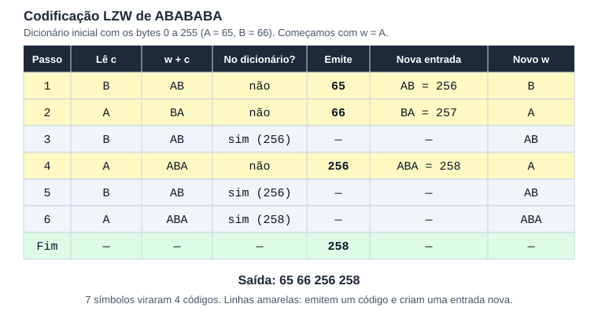

## Objetivos de aprendizagem

Ao final deste tópico, você deverá ser capaz de:

- Explicar como o **LZW** aprende um dicionário de subsequências durante a leitura da entrada.
- Executar a codificação e a decodificação LZW passo a passo.
- Resolver o **caso especial** da decodificação, em que o código lido ainda não existe no dicionário.
- Comparar RLE, Huffman e LZW quanto ao custo e às limitações.

## Introdução

O **LZW** (Lempel–Ziv–Welch) é um algoritmo de compressão **sem perdas** baseado em **dicionário**: ele explora **subsequências que se repetem** ao longo do texto, substituindo cada uma por um único código. É a base de formatos como GIF e do utilitário `compress` do Unix.

## Conceito principal

O codificador mantém um **dicionário** que começa com todos os 256 bytes (códigos `0` a `255`) e **aprende** novas sequências durante a leitura: sempre que encontra uma sequência inédita, emite o código do maior prefixo conhecido e registra a nova sequência com o próximo código livre (`256`, `257`, ...).

O dicionário **não é transmitido**: o decodificador o reconstrói sozinho, passo a passo, a partir dos próprios códigos.

### Como funciona

Para codificar:

1. Inicializamos o dicionário com os 256 bytes e definimos `w` como o primeiro símbolo da entrada.
2. Para cada próximo símbolo `c`: se `w + c` está no dicionário, fazemos `w = w + c`.
3. Caso contrário, emitimos o código de `w`, inserimos `w + c` no dicionário com o próximo código livre e fazemos `w = c`.
4. Ao final da entrada, emitimos o código de `w`.

Para decodificar, lemos os códigos em ordem, mantendo o **código anterior**. A cada código lido (a partir do segundo), inserimos no dicionário a entrada `string(anterior) + primeiro símbolo da string atual`.

> **Atenção:** isso faz o decodificador ficar sempre "um passo atrás" do codificador, o que gera um **caso especial**: se o código lido **ainda não existe** no dicionário, então ele é exatamente a entrada que está sendo criada, e vale `string(anterior) + primeiro símbolo de string(anterior)`.

---

## Exemplo

### Rastreamento da codificação de ABABABA

Dicionário inicial: `A = 65`, `B = 66` (demais bytes omitidos). Começamos com `w = A`.

1. Lê `B`: `AB` não existe → emite `65`, insere `AB = 256`, `w = B`.
2. Lê `A`: `BA` não existe → emite `66`, insere `BA = 257`, `w = A`.
3. Lê `B`: `AB` existe (`256`) → `w = AB`.
4. Lê `A`: `ABA` não existe → emite `256`, insere `ABA = 258`, `w = A`.
5. Lê `B`: `AB` existe → `w = AB`.
6. Lê `A`: `ABA` existe (`258`) → `w = ABA`.
7. Fim da entrada → emite `258`.

Saída: `65 66 256 258`. Os 7 símbolos viraram 4 códigos.

### Decodificação

Na decodificação, o dicionário é reconstruído a partir dos próprios códigos, sem receber nenhuma informação extra além da sequência comprimida.

### Rastreamento da decodificação de 65 66 256 258

1. `65` → `A`. Saída: `A`.
2. `66` → `B`. Insere `AB = 256` (anterior `A` + primeiro símbolo de `B`). Saída: `AB`.
3. `256` → `AB`. Insere `BA = 257` (anterior `B` + primeiro símbolo de `AB`). Saída: `ABAB`.
4. `258` **ainda não existe** (o dicionário vai só até `257`). Caso especial: `string(anterior) = AB`, então a entrada é `AB + A = ABA`. Insere `ABA = 258`. Saída: `ABABABA`.

O texto original foi recuperado integralmente.

### Exemplo visual


## Comparação e complexidade

Considere uma entrada de $n$ símbolos e um dicionário de tamanho $D$:

| Aspecto | Descrição | Custo |
|:--|:--|--:|
| Codificar com trie ou tabela hash | Uma passagem, busca no dicionário em tempo médio constante | $O(n)$ |
| Codificar com busca linear | Cada símbolo pode percorrer todo o dicionário | $O(n \cdot D)$ |
| Decodificar | Uma passagem, reconstruindo o dicionário | $O(n)$ |

O melhor caso são textos com muitas subsequências repetidas. Dados aleatórios podem expandir, e um dicionário cheio deixa de aprender novas entradas.


## Teste de conhecimento

```quiz
{
  "question": "Durante a decodificação LZW, o decodificador lê um código que ainda não existe no dicionário. Como a string correspondente é obtida?",
  "options": [
    { "text": "É a string do código anterior concatenada com o primeiro símbolo dessa mesma string.", "correct": true },
    { "text": "É a string do código anterior concatenada com o próximo byte da entrada comprimida.", "correct": false },
    { "text": "É um erro: a entrada comprimida está corrompida e a decodificação deve ser interrompida.", "correct": false }
  ],
  "correctFeedback": "Correto! O decodificador está sempre um passo atrás do codificador, então esse código é a entrada que está sendo criada agora: anterior + primeiro símbolo de anterior (ex.: AB + A = ABA).",
  "incorrectFeedback": "Lembre que o decodificador só insere uma entrada depois de ler o código seguinte, ficando um passo atrás do codificador."
}
```