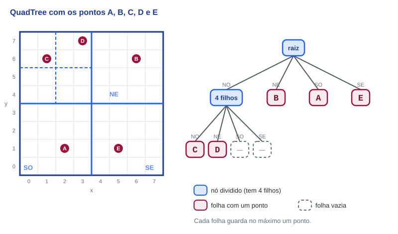
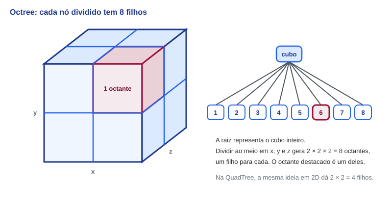

## Objetivos de aprendizagem

Ao final deste tópico, você deverá ser capaz de:

- Explicar que problema a QuadTree e a Octree resolvem e por que uma lista de pontos não basta.
- Representar uma QuadTree de pontos: a região de cada nó, os quatro quadrantes e as folhas.
- Implementar a inserção (com divisão de folhas), a busca de um ponto e a consulta de região.
- Explicar como a Octree estende a mesma ideia para três dimensões.
- Analisar o custo dessas operações e reconhecer quando a árvore fica desequilibrada.

## Introdução

Muitos programas guardam **pontos no espaço**: os restaurantes de um mapa, os inimigos de um jogo, as estrelas de uma simulação. A pergunta mais comum sobre esses pontos é espacial: **quais estão nesta região?** Quais restaurantes aparecem na parte do mapa que está na tela? Quais objetos estão perto do jogador e podem colidir com ele?

Com os pontos numa lista, cada pergunta obriga a olhar **todos** os *n* pontos, mesmo que a região seja pequena. Ordenar por x não resolve: dois pontos com x parecido podem estar em extremos opostos do mapa.

A **QuadTree** organiza os pontos pela posição. Ela divide o plano em quatro partes, divide de novo as partes que têm muitos pontos, e assim por diante. Para responder a uma consulta, ela descarta de uma vez regiões inteiras que não encostam na área procurada. A **Octree** faz o mesmo no espaço 3D.

## Conceito principal

Neste tópico usamos a QuadTree de pontos mais simples, em que **cada folha guarda no máximo um ponto**. Ela é uma árvore em que:

- cada nó representa uma **região quadrada** do plano; a raiz representa o plano inteiro;
- um nó **dividido** tem exatamente **quatro filhos**, um para cada quadrante da sua região: **NO** (noroeste), **NE** (nordeste), **SO** (sudoeste) e **SE** (sudeste);
- as **folhas** são os nós que não foram divididos: cada uma guarda um ponto ou está vazia;
- quando um ponto novo cai numa folha que **já tem** um ponto, essa folha é **dividida** em quatro, e os dois pontos são distribuídos entre os quadrantes.

> A árvore se adapta aos dados: regiões com pontos próximos são divididas muitas vezes, e regiões vazias continuam como uma folha só.

### Exemplo de estrutura

Considere um plano de 8 por 8, com x e y indo de 0 a 7, e os pontos A = (2, 1), B = (6, 6), C = (1, 6), D = (3, 7) e E = (5, 1). O y cresce para cima, como num mapa.

{align=center width=100%}

A raiz foi dividida em quatro quadrantes de lado 4. Cada um dos quadrantes NE, SO e SE tem um único ponto, então continua sendo uma folha. O quadrante NO tem **dois** pontos, C e D, e por isso foi dividido de novo, em quadrantes de lado 2. Ali, C e D ficam em folhas diferentes, e as outras duas folhas ficam vazias.

### Octree: a mesma ideia em 3D

A **Octree** guarda pontos no espaço, com coordenadas x, y e z. Cada nó representa um **cubo**, e dividir um nó significa cortar o cubo ao meio nas **três** direções. Isso gera 2 × 2 × 2 = **8 cubos menores**, os **octantes**, então cada nó dividido tem **oito filhos**.

{align=center width=100%}

Todo o resto é igual à QuadTree: a inserção desce escolhendo o octante do ponto, a folha cheia é dividida e a consulta descarta cubos inteiros que não encostam na região procurada. Para escolher o octante, basta comparar o ponto com o meio do cubo nos três eixos, em vez de dois.

## Representação em C

Cada nó guarda a sua região (o canto inferior esquerdo `x0`, `y0` e o `lado`), o ponto, se for uma folha, e o vetor com os quatro filhos.

```c
typedef struct {
    int x, y;
    char nome;
} Ponto;

typedef struct NoQuad {
    int x0, y0, lado;              /* região: x0 <= x < x0 + lado e y0 <= y < y0 + lado */
    Ponto *ponto;                  /* numa folha: o ponto guardado, ou NULL */
    struct NoQuad *filhos[4];      /* 0 = NO, 1 = NE, 2 = SO, 3 = SE; NULL numa folha */
} NoQuad;
```

- Um nó é **folha** quando `filhos[0]` é `NULL`. Ao dividir, os quatro filhos são criados juntos.
- O **meio** da região é `lado / 2`. Um ponto está a **leste** se `x >= x0 + lado / 2` e ao **norte** se `y >= y0 + lado / 2`. Essas duas comparações escolhem o quadrante.
- O **lado do plano precisa ser uma potência de 2** (4, 8, 16...). A função `dividir` cria quatro quadrados de lado `lado / 2`, e essa divisão inteira só cobre a região inteira, sem sobrar nem faltar coordenada, quando o lado é par em todos os níveis, até chegar a 1. O exemplo usa lado 8.
- Numa Octree, o vetor teria 8 filhos, e o nó guardaria também `z0`.

> Neste tópico os pontos são diferentes entre si. Se dois pontos tivessem as mesmas coordenadas, a folha seria dividida para sempre. Implementações reais limitam a profundidade ou deixam cada folha guardar alguns pontos.

## Operações

Nos programas abaixo, clique em **Executar** ou em **Próximo** e acompanhe a linha amarela. Na tela escura, cada linha é um nível da árvore, e cada folha ocupa uma coluna. O nome embaixo de cada nó é o quadrante que ele representa no pai. Um ponto é a folha que guarda esse ponto, `·` é uma folha vazia e `+` é um nó dividido. A última linha lista os pontos. O colchete amarelo marca o nó em que o programa está, o verde destaca um nó novo ou contado e os apagados foram descartados.

### Inserção

A inserção desce da raiz até uma folha, escolhendo em cada nó o quadrante do ponto. Se a folha estiver vazia, o ponto fica nela. Se a folha já tiver um ponto, ela é **dividida** em quatro, e os dois pontos são inseridos de novo a partir dali. Se eles caírem outra vez no mesmo quadrante, a divisão se repete um nível abaixo.

O programa abaixo traz a estrutura, as funções `criarNo`, `ehFolha`, `quadrante`, `dividir` e `inserir`, e insere A, B, C, D e E numa árvore vazia. Repare em duas divisões: a raiz é dividida quando chega B, e o quadrante NO é dividido quando chega D, que fica perto de C.

```codigo
{"title":"Inserindo A, B, C, D e E na QuadTree","cols":7,"code":"#include <stdlib.h>\n\ntypedef struct {\n    int x, y;\n    char nome;\n} Ponto;\n\ntypedef struct NoQuad {\n    int x0, y0, lado;              /* região: x0 <= x < x0 + lado e y0 <= y < y0 + lado */\n    Ponto *ponto;                  /* numa folha: o ponto guardado, ou NULL */\n    struct NoQuad *filhos[4];      /* 0 = NO, 1 = NE, 2 = SO, 3 = SE; NULL numa folha */\n} NoQuad;\n\nNoQuad *criarNo(int x0, int y0, int lado) {\n    NoQuad *no = malloc(sizeof(NoQuad));\n    no->x0 = x0;\n    no->y0 = y0;\n    no->lado = lado;\n    no->ponto = NULL;\n    for (int i = 0; i < 4; i++) {\n        no->filhos[i] = NULL;\n    }\n    return no;\n}\n\nint ehFolha(NoQuad *no) {\n    return no->filhos[0] == NULL;\n}\n\n/* em qual quadrante de no fica (x, y): 0 = NO, 1 = NE, 2 = SO, 3 = SE */\nint quadrante(NoQuad *no, int x, int y) {\n    int meio = no->lado / 2;\n    int leste = x >= no->x0 + meio;\n    int norte = y >= no->y0 + meio;\n    if (norte) return leste ? 1 : 0;\n    return leste ? 3 : 2;\n}\n\n/* transforma a folha no em um nó com 4 filhos vazios */\nvoid dividir(NoQuad *no) {\n    int m = no->lado / 2;\n    no->filhos[0] = criarNo(no->x0, no->y0 + m, m);\n    no->filhos[1] = criarNo(no->x0 + m, no->y0 + m, m);\n    no->filhos[2] = criarNo(no->x0, no->y0, m);\n    no->filhos[3] = criarNo(no->x0 + m, no->y0, m);\n}\n\nvoid inserir(NoQuad *no, Ponto *p) {\n    while (!ehFolha(no)) {\n        int q = quadrante(no, p->x, p->y);\n        no = no->filhos[q];\n    }\n    if (no->ponto == NULL) {\n        no->ponto = p;\n        return;\n    }\n    Ponto *antigo = no->ponto;\n    no->ponto = NULL;\n    dividir(no);\n    inserir(no, antigo);\n    inserir(no, p);\n}\n\nint main(void) {\n    Ponto pontos[] = {{2, 1, 'A'}, {6, 6, 'B'}, {1, 6, 'C'}, {3, 7, 'D'}, {5, 1, 'E'}};\n    NoQuad *raiz = criarNo(0, 0, 8);\n    for (int i = 0; i < 5; i++) {\n        inserir(raiz, &pontos[i]);\n    }\n    return 0;\n}","steps":[{"line":67,"caption":"A raiz cobre o quadrado inteiro: x de 0 a 7, y de 0 a 7. Ela começa como uma **folha vazia**.","vars":{"no":"raiz (lado 8)"},"rows":[[{"s":3,"n":1,"i":[["·","g",0]],"l":"raiz","a":1}],[],[],[{"i":[["A","g",1],["B","g",3],["C","g",5],["D","g",7],["E","g",9]],"l":"pontos: A(2,1) B(6,6) C(1,6) D(3,7) E(5,1)"}]],"stack":"main"},{"line":49,"caption":"Inserindo A = (2, 1). Começamos pela raiz.","vars":{"no":"raiz (lado 8)","p.x":2,"p.y":1},"rows":[[{"s":3,"n":1,"i":[["·","g",0]],"l":"raiz","a":1}],[],[],[{"i":[["A","c",1],["B","g",3],["C","g",5],["D","g",7],["E","g",9]],"l":"pontos: A(2,1) B(6,6) C(1,6) D(3,7) E(5,1)"}]],"stack":"inserir ← main"},{"line":53,"caption":"Chegamos a uma **folha vazia**.","vars":{"no":"raiz (lado 8)","p.x":2,"p.y":1},"rows":[[{"s":3,"n":1,"i":[["·","g",0]],"l":"raiz","a":1}],[],[],[{"i":[["A","c",1],["B","g",3],["C","g",5],["D","g",7],["E","g",9]],"l":"pontos: A(2,1) B(6,6) C(1,6) D(3,7) E(5,1)"}]],"stack":"inserir ← main"},{"line":55,"caption":"A fica guardado nesta folha.","vars":{"no":"raiz (lado 8)","p.x":2,"p.y":1},"rows":[[{"s":3,"n":1,"i":[["A","",1]],"l":"raiz","a":1}],[],[],[{"i":[["A","",1],["B","g",3],["C","g",5],["D","g",7],["E","g",9]],"l":"pontos: A(2,1) B(6,6) C(1,6) D(3,7) E(5,1)"}]],"stack":"inserir ← main"},{"line":49,"caption":"Inserindo B = (6, 6). Começamos pela raiz.","vars":{"no":"raiz (lado 8)","p.x":6,"p.y":6},"rows":[[{"s":3,"n":1,"i":[["A","",1]],"l":"raiz","a":1}],[],[],[{"i":[["A","",1],["B","c",3],["C","g",5],["D","g",7],["E","g",9]],"l":"pontos: A(2,1) B(6,6) C(1,6) D(3,7) E(5,1)"}]],"stack":"inserir ← main"},{"line":53,"caption":"Chegamos a uma folha que **já guarda** A = (2, 1).","vars":{"no":"raiz (lado 8)","p.x":6,"p.y":6},"rows":[[{"s":3,"n":1,"i":[["A","",1]],"l":"raiz","a":1}],[],[],[{"i":[["A","",1],["B","c",3],["C","g",5],["D","g",7],["E","g",9]],"l":"pontos: A(2,1) B(6,6) C(1,6) D(3,7) E(5,1)"}]],"stack":"inserir ← main"},{"line":60,"caption":"Cada folha guarda no máximo um ponto, então a folha é **dividida** em 4 quadrantes de lado 4 (os nós novos). O ponto que estava nela, (2, 1), e o ponto novo serão inseridos de novo a partir daqui.","vars":{"no":"raiz (lado 8)","antigo->x":2,"antigo->y":1},"rows":[[{"s":1,"n":4,"i":[["+","",6]],"l":"raiz","a":1}],[{"s":1,"n":1,"i":[["·","g",0]],"l":"NO"},{"s":2,"n":1,"i":[["·","g",0]],"l":"NE"},{"s":3,"n":1,"i":[["·","g",0]],"l":"SO"},{"s":4,"n":1,"i":[["·","g",0]],"l":"SE"}],[],[{"i":[["A","",1],["B","c",3],["C","g",5],["D","g",7],["E","g",9]],"l":"pontos: A(2,1) B(6,6) C(1,6) D(3,7) E(5,1)"}]],"stack":"inserir ← main"},{"line":49,"caption":"Primeiro, A = (2, 1), que estava na folha, é **reinserido** a partir do nó que acabou de ser dividido.","vars":{"no":"raiz (lado 8)","p.x":2,"p.y":1},"rows":[[{"s":1,"n":4,"i":[["+","",6]],"l":"raiz","a":1}],[{"s":1,"n":1,"i":[["·","g",0]],"l":"NO"},{"s":2,"n":1,"i":[["·","g",0]],"l":"NE"},{"s":3,"n":1,"i":[["·","g",0]],"l":"SO"},{"s":4,"n":1,"i":[["·","g",0]],"l":"SE"}],[],[{"i":[["A","c",1],["B","g",3],["C","g",5],["D","g",7],["E","g",9]],"l":"pontos: A(2,1) B(6,6) C(1,6) D(3,7) E(5,1)"}]],"stack":"inserir ← inserir ← main"},{"line":51,"caption":"(2, 1) fica no quadrante **SO**: x < 4 e y < 4. Descemos para ele, que cobre x de 0 a 3, y de 0 a 3.","vars":{"no":"SO (lado 4)","q":2,"p.x":2,"p.y":1},"rows":[[{"s":1,"n":4,"i":[["+","",6]],"l":"raiz"}],[{"s":1,"n":1,"i":[["·","g",0]],"l":"NO"},{"s":2,"n":1,"i":[["·","g",0]],"l":"NE"},{"s":3,"n":1,"i":[["·","g",0]],"l":"SO","a":1},{"s":4,"n":1,"i":[["·","g",0]],"l":"SE"}],[],[{"i":[["A","c",1],["B","g",3],["C","g",5],["D","g",7],["E","g",9]],"l":"pontos: A(2,1) B(6,6) C(1,6) D(3,7) E(5,1)"}]],"stack":"inserir ← inserir ← main"},{"line":53,"caption":"Chegamos a uma **folha vazia**.","vars":{"no":"SO (lado 4)","p.x":2,"p.y":1},"rows":[[{"s":1,"n":4,"i":[["+","",6]],"l":"raiz"}],[{"s":1,"n":1,"i":[["·","g",0]],"l":"NO"},{"s":2,"n":1,"i":[["·","g",0]],"l":"NE"},{"s":3,"n":1,"i":[["·","g",0]],"l":"SO","a":1},{"s":4,"n":1,"i":[["·","g",0]],"l":"SE"}],[],[{"i":[["A","c",1],["B","g",3],["C","g",5],["D","g",7],["E","g",9]],"l":"pontos: A(2,1) B(6,6) C(1,6) D(3,7) E(5,1)"}]],"stack":"inserir ← inserir ← main"},{"line":55,"caption":"A fica guardado nesta folha.","vars":{"no":"SO (lado 4)","p.x":2,"p.y":1},"rows":[[{"s":1,"n":4,"i":[["+","",6]],"l":"raiz"}],[{"s":1,"n":1,"i":[["·","g",0]],"l":"NO"},{"s":2,"n":1,"i":[["·","g",0]],"l":"NE"},{"s":3,"n":1,"i":[["A","",1]],"l":"SO","a":1},{"s":4,"n":1,"i":[["·","g",0]],"l":"SE"}],[],[{"i":[["A","",1],["B","g",3],["C","g",5],["D","g",7],["E","g",9]],"l":"pontos: A(2,1) B(6,6) C(1,6) D(3,7) E(5,1)"}]],"stack":"inserir ← inserir ← main"},{"line":49,"caption":"Agora a inserção de B = (6, 6) recomeça a partir do mesmo nó dividido.","vars":{"no":"raiz (lado 8)","p.x":6,"p.y":6},"rows":[[{"s":1,"n":4,"i":[["+","",6]],"l":"raiz","a":1}],[{"s":1,"n":1,"i":[["·","g",0]],"l":"NO"},{"s":2,"n":1,"i":[["·","g",0]],"l":"NE"},{"s":3,"n":1,"i":[["A","",1]],"l":"SO"},{"s":4,"n":1,"i":[["·","g",0]],"l":"SE"}],[],[{"i":[["A","",1],["B","c",3],["C","g",5],["D","g",7],["E","g",9]],"l":"pontos: A(2,1) B(6,6) C(1,6) D(3,7) E(5,1)"}]],"stack":"inserir ← inserir ← main"},{"line":51,"caption":"(6, 6) fica no quadrante **NE**: x ≥ 4 e y ≥ 4. Descemos para ele, que cobre x de 4 a 7, y de 4 a 7.","vars":{"no":"NE (lado 4)","q":1,"p.x":6,"p.y":6},"rows":[[{"s":1,"n":4,"i":[["+","",6]],"l":"raiz"}],[{"s":1,"n":1,"i":[["·","g",0]],"l":"NO"},{"s":2,"n":1,"i":[["·","g",0]],"l":"NE","a":1},{"s":3,"n":1,"i":[["A","",1]],"l":"SO"},{"s":4,"n":1,"i":[["·","g",0]],"l":"SE"}],[],[{"i":[["A","",1],["B","c",3],["C","g",5],["D","g",7],["E","g",9]],"l":"pontos: A(2,1) B(6,6) C(1,6) D(3,7) E(5,1)"}]],"stack":"inserir ← inserir ← main"},{"line":53,"caption":"Chegamos a uma **folha vazia**.","vars":{"no":"NE (lado 4)","p.x":6,"p.y":6},"rows":[[{"s":1,"n":4,"i":[["+","",6]],"l":"raiz"}],[{"s":1,"n":1,"i":[["·","g",0]],"l":"NO"},{"s":2,"n":1,"i":[["·","g",0]],"l":"NE","a":1},{"s":3,"n":1,"i":[["A","",1]],"l":"SO"},{"s":4,"n":1,"i":[["·","g",0]],"l":"SE"}],[],[{"i":[["A","",1],["B","c",3],["C","g",5],["D","g",7],["E","g",9]],"l":"pontos: A(2,1) B(6,6) C(1,6) D(3,7) E(5,1)"}]],"stack":"inserir ← inserir ← main"},{"line":55,"caption":"B fica guardado nesta folha.","vars":{"no":"NE (lado 4)","p.x":6,"p.y":6},"rows":[[{"s":1,"n":4,"i":[["+","",6]],"l":"raiz"}],[{"s":1,"n":1,"i":[["·","g",0]],"l":"NO"},{"s":2,"n":1,"i":[["B","",3]],"l":"NE","a":1},{"s":3,"n":1,"i":[["A","",1]],"l":"SO"},{"s":4,"n":1,"i":[["·","g",0]],"l":"SE"}],[],[{"i":[["A","",1],["B","",3],["C","g",5],["D","g",7],["E","g",9]],"l":"pontos: A(2,1) B(6,6) C(1,6) D(3,7) E(5,1)"}]],"stack":"inserir ← inserir ← main"},{"line":49,"caption":"Inserindo C = (1, 6). Começamos pela raiz.","vars":{"no":"raiz (lado 8)","p.x":1,"p.y":6},"rows":[[{"s":1,"n":4,"i":[["+","",6]],"l":"raiz","a":1}],[{"s":1,"n":1,"i":[["·","g",0]],"l":"NO"},{"s":2,"n":1,"i":[["B","",3]],"l":"NE"},{"s":3,"n":1,"i":[["A","",1]],"l":"SO"},{"s":4,"n":1,"i":[["·","g",0]],"l":"SE"}],[],[{"i":[["A","",1],["B","",3],["C","c",5],["D","g",7],["E","g",9]],"l":"pontos: A(2,1) B(6,6) C(1,6) D(3,7) E(5,1)"}]],"stack":"inserir ← main"},{"line":51,"caption":"(1, 6) fica no quadrante **NO**: x < 4 e y ≥ 4. Descemos para ele, que cobre x de 0 a 3, y de 4 a 7.","vars":{"no":"NO (lado 4)","q":0,"p.x":1,"p.y":6},"rows":[[{"s":1,"n":4,"i":[["+","",6]],"l":"raiz"}],[{"s":1,"n":1,"i":[["·","g",0]],"l":"NO","a":1},{"s":2,"n":1,"i":[["B","",3]],"l":"NE"},{"s":3,"n":1,"i":[["A","",1]],"l":"SO"},{"s":4,"n":1,"i":[["·","g",0]],"l":"SE"}],[],[{"i":[["A","",1],["B","",3],["C","c",5],["D","g",7],["E","g",9]],"l":"pontos: A(2,1) B(6,6) C(1,6) D(3,7) E(5,1)"}]],"stack":"inserir ← main"},{"line":53,"caption":"Chegamos a uma **folha vazia**.","vars":{"no":"NO (lado 4)","p.x":1,"p.y":6},"rows":[[{"s":1,"n":4,"i":[["+","",6]],"l":"raiz"}],[{"s":1,"n":1,"i":[["·","g",0]],"l":"NO","a":1},{"s":2,"n":1,"i":[["B","",3]],"l":"NE"},{"s":3,"n":1,"i":[["A","",1]],"l":"SO"},{"s":4,"n":1,"i":[["·","g",0]],"l":"SE"}],[],[{"i":[["A","",1],["B","",3],["C","c",5],["D","g",7],["E","g",9]],"l":"pontos: A(2,1) B(6,6) C(1,6) D(3,7) E(5,1)"}]],"stack":"inserir ← main"},{"line":55,"caption":"C fica guardado nesta folha.","vars":{"no":"NO (lado 4)","p.x":1,"p.y":6},"rows":[[{"s":1,"n":4,"i":[["+","",6]],"l":"raiz"}],[{"s":1,"n":1,"i":[["C","",5]],"l":"NO","a":1},{"s":2,"n":1,"i":[["B","",3]],"l":"NE"},{"s":3,"n":1,"i":[["A","",1]],"l":"SO"},{"s":4,"n":1,"i":[["·","g",0]],"l":"SE"}],[],[{"i":[["A","",1],["B","",3],["C","",5],["D","g",7],["E","g",9]],"l":"pontos: A(2,1) B(6,6) C(1,6) D(3,7) E(5,1)"}]],"stack":"inserir ← main"},{"line":49,"caption":"Inserindo D = (3, 7). Começamos pela raiz.","vars":{"no":"raiz (lado 8)","p.x":3,"p.y":7},"rows":[[{"s":1,"n":4,"i":[["+","",6]],"l":"raiz","a":1}],[{"s":1,"n":1,"i":[["C","",5]],"l":"NO"},{"s":2,"n":1,"i":[["B","",3]],"l":"NE"},{"s":3,"n":1,"i":[["A","",1]],"l":"SO"},{"s":4,"n":1,"i":[["·","g",0]],"l":"SE"}],[],[{"i":[["A","",1],["B","",3],["C","",5],["D","c",7],["E","g",9]],"l":"pontos: A(2,1) B(6,6) C(1,6) D(3,7) E(5,1)"}]],"stack":"inserir ← main"},{"line":51,"caption":"(3, 7) fica no quadrante **NO**: x < 4 e y ≥ 4. Descemos para ele, que cobre x de 0 a 3, y de 4 a 7.","vars":{"no":"NO (lado 4)","q":0,"p.x":3,"p.y":7},"rows":[[{"s":1,"n":4,"i":[["+","",6]],"l":"raiz"}],[{"s":1,"n":1,"i":[["C","",5]],"l":"NO","a":1},{"s":2,"n":1,"i":[["B","",3]],"l":"NE"},{"s":3,"n":1,"i":[["A","",1]],"l":"SO"},{"s":4,"n":1,"i":[["·","g",0]],"l":"SE"}],[],[{"i":[["A","",1],["B","",3],["C","",5],["D","c",7],["E","g",9]],"l":"pontos: A(2,1) B(6,6) C(1,6) D(3,7) E(5,1)"}]],"stack":"inserir ← main"},{"line":53,"caption":"Chegamos a uma folha que **já guarda** C = (1, 6).","vars":{"no":"NO (lado 4)","p.x":3,"p.y":7},"rows":[[{"s":1,"n":4,"i":[["+","",6]],"l":"raiz"}],[{"s":1,"n":1,"i":[["C","",5]],"l":"NO","a":1},{"s":2,"n":1,"i":[["B","",3]],"l":"NE"},{"s":3,"n":1,"i":[["A","",1]],"l":"SO"},{"s":4,"n":1,"i":[["·","g",0]],"l":"SE"}],[],[{"i":[["A","",1],["B","",3],["C","",5],["D","c",7],["E","g",9]],"l":"pontos: A(2,1) B(6,6) C(1,6) D(3,7) E(5,1)"}]],"stack":"inserir ← main"},{"line":60,"caption":"Cada folha guarda no máximo um ponto, então a folha é **dividida** em 4 quadrantes de lado 2 (os nós novos). O ponto que estava nela, (1, 6), e o ponto novo serão inseridos de novo a partir daqui.","vars":{"no":"NO (lado 4)","antigo->x":1,"antigo->y":6},"rows":[[{"s":0,"n":7,"i":[["+","",6]],"l":"raiz"}],[{"s":0,"n":4,"i":[["+","",6]],"l":"NO","a":1},{"s":4,"n":1,"i":[["B","",3]],"l":"NE"},{"s":5,"n":1,"i":[["A","",1]],"l":"SO"},{"s":6,"n":1,"i":[["·","g",0]],"l":"SE"}],[{"s":0,"n":1,"i":[["·","g",0]],"l":"NO"},{"s":1,"n":1,"i":[["·","g",0]],"l":"NE"},{"s":2,"n":1,"i":[["·","g",0]],"l":"SO"},{"s":3,"n":1,"i":[["·","g",0]],"l":"SE"}],[{"i":[["A","",1],["B","",3],["C","",5],["D","c",7],["E","g",9]],"l":"pontos: A(2,1) B(6,6) C(1,6) D(3,7) E(5,1)"}]],"stack":"inserir ← main"},{"line":49,"caption":"Primeiro, C = (1, 6), que estava na folha, é **reinserido** a partir do nó que acabou de ser dividido.","vars":{"no":"NO (lado 4)","p.x":1,"p.y":6},"rows":[[{"s":0,"n":7,"i":[["+","",6]],"l":"raiz"}],[{"s":0,"n":4,"i":[["+","",6]],"l":"NO","a":1},{"s":4,"n":1,"i":[["B","",3]],"l":"NE"},{"s":5,"n":1,"i":[["A","",1]],"l":"SO"},{"s":6,"n":1,"i":[["·","g",0]],"l":"SE"}],[{"s":0,"n":1,"i":[["·","g",0]],"l":"NO"},{"s":1,"n":1,"i":[["·","g",0]],"l":"NE"},{"s":2,"n":1,"i":[["·","g",0]],"l":"SO"},{"s":3,"n":1,"i":[["·","g",0]],"l":"SE"}],[{"i":[["A","",1],["B","",3],["C","c",5],["D","g",7],["E","g",9]],"l":"pontos: A(2,1) B(6,6) C(1,6) D(3,7) E(5,1)"}]],"stack":"inserir ← inserir ← main"},{"line":51,"caption":"(1, 6) fica no quadrante **NO**: x < 2 e y ≥ 6. Descemos para ele, que cobre x de 0 a 1, y de 6 a 7.","vars":{"no":"NO (lado 2)","q":0,"p.x":1,"p.y":6},"rows":[[{"s":0,"n":7,"i":[["+","",6]],"l":"raiz"}],[{"s":0,"n":4,"i":[["+","",6]],"l":"NO"},{"s":4,"n":1,"i":[["B","",3]],"l":"NE"},{"s":5,"n":1,"i":[["A","",1]],"l":"SO"},{"s":6,"n":1,"i":[["·","g",0]],"l":"SE"}],[{"s":0,"n":1,"i":[["·","g",0]],"l":"NO","a":1},{"s":1,"n":1,"i":[["·","g",0]],"l":"NE"},{"s":2,"n":1,"i":[["·","g",0]],"l":"SO"},{"s":3,"n":1,"i":[["·","g",0]],"l":"SE"}],[{"i":[["A","",1],["B","",3],["C","c",5],["D","g",7],["E","g",9]],"l":"pontos: A(2,1) B(6,6) C(1,6) D(3,7) E(5,1)"}]],"stack":"inserir ← inserir ← main"},{"line":53,"caption":"Chegamos a uma **folha vazia**.","vars":{"no":"NO (lado 2)","p.x":1,"p.y":6},"rows":[[{"s":0,"n":7,"i":[["+","",6]],"l":"raiz"}],[{"s":0,"n":4,"i":[["+","",6]],"l":"NO"},{"s":4,"n":1,"i":[["B","",3]],"l":"NE"},{"s":5,"n":1,"i":[["A","",1]],"l":"SO"},{"s":6,"n":1,"i":[["·","g",0]],"l":"SE"}],[{"s":0,"n":1,"i":[["·","g",0]],"l":"NO","a":1},{"s":1,"n":1,"i":[["·","g",0]],"l":"NE"},{"s":2,"n":1,"i":[["·","g",0]],"l":"SO"},{"s":3,"n":1,"i":[["·","g",0]],"l":"SE"}],[{"i":[["A","",1],["B","",3],["C","c",5],["D","g",7],["E","g",9]],"l":"pontos: A(2,1) B(6,6) C(1,6) D(3,7) E(5,1)"}]],"stack":"inserir ← inserir ← main"},{"line":55,"caption":"C fica guardado nesta folha.","vars":{"no":"NO (lado 2)","p.x":1,"p.y":6},"rows":[[{"s":0,"n":7,"i":[["+","",6]],"l":"raiz"}],[{"s":0,"n":4,"i":[["+","",6]],"l":"NO"},{"s":4,"n":1,"i":[["B","",3]],"l":"NE"},{"s":5,"n":1,"i":[["A","",1]],"l":"SO"},{"s":6,"n":1,"i":[["·","g",0]],"l":"SE"}],[{"s":0,"n":1,"i":[["C","",5]],"l":"NO","a":1},{"s":1,"n":1,"i":[["·","g",0]],"l":"NE"},{"s":2,"n":1,"i":[["·","g",0]],"l":"SO"},{"s":3,"n":1,"i":[["·","g",0]],"l":"SE"}],[{"i":[["A","",1],["B","",3],["C","",5],["D","g",7],["E","g",9]],"l":"pontos: A(2,1) B(6,6) C(1,6) D(3,7) E(5,1)"}]],"stack":"inserir ← inserir ← main"},{"line":49,"caption":"Agora a inserção de D = (3, 7) recomeça a partir do mesmo nó dividido.","vars":{"no":"NO (lado 4)","p.x":3,"p.y":7},"rows":[[{"s":0,"n":7,"i":[["+","",6]],"l":"raiz"}],[{"s":0,"n":4,"i":[["+","",6]],"l":"NO","a":1},{"s":4,"n":1,"i":[["B","",3]],"l":"NE"},{"s":5,"n":1,"i":[["A","",1]],"l":"SO"},{"s":6,"n":1,"i":[["·","g",0]],"l":"SE"}],[{"s":0,"n":1,"i":[["C","",5]],"l":"NO"},{"s":1,"n":1,"i":[["·","g",0]],"l":"NE"},{"s":2,"n":1,"i":[["·","g",0]],"l":"SO"},{"s":3,"n":1,"i":[["·","g",0]],"l":"SE"}],[{"i":[["A","",1],["B","",3],["C","",5],["D","c",7],["E","g",9]],"l":"pontos: A(2,1) B(6,6) C(1,6) D(3,7) E(5,1)"}]],"stack":"inserir ← inserir ← main"},{"line":51,"caption":"(3, 7) fica no quadrante **NE**: x ≥ 2 e y ≥ 6. Descemos para ele, que cobre x de 2 a 3, y de 6 a 7.","vars":{"no":"NE (lado 2)","q":1,"p.x":3,"p.y":7},"rows":[[{"s":0,"n":7,"i":[["+","",6]],"l":"raiz"}],[{"s":0,"n":4,"i":[["+","",6]],"l":"NO"},{"s":4,"n":1,"i":[["B","",3]],"l":"NE"},{"s":5,"n":1,"i":[["A","",1]],"l":"SO"},{"s":6,"n":1,"i":[["·","g",0]],"l":"SE"}],[{"s":0,"n":1,"i":[["C","",5]],"l":"NO"},{"s":1,"n":1,"i":[["·","g",0]],"l":"NE","a":1},{"s":2,"n":1,"i":[["·","g",0]],"l":"SO"},{"s":3,"n":1,"i":[["·","g",0]],"l":"SE"}],[{"i":[["A","",1],["B","",3],["C","",5],["D","c",7],["E","g",9]],"l":"pontos: A(2,1) B(6,6) C(1,6) D(3,7) E(5,1)"}]],"stack":"inserir ← inserir ← main"},{"line":53,"caption":"Chegamos a uma **folha vazia**.","vars":{"no":"NE (lado 2)","p.x":3,"p.y":7},"rows":[[{"s":0,"n":7,"i":[["+","",6]],"l":"raiz"}],[{"s":0,"n":4,"i":[["+","",6]],"l":"NO"},{"s":4,"n":1,"i":[["B","",3]],"l":"NE"},{"s":5,"n":1,"i":[["A","",1]],"l":"SO"},{"s":6,"n":1,"i":[["·","g",0]],"l":"SE"}],[{"s":0,"n":1,"i":[["C","",5]],"l":"NO"},{"s":1,"n":1,"i":[["·","g",0]],"l":"NE","a":1},{"s":2,"n":1,"i":[["·","g",0]],"l":"SO"},{"s":3,"n":1,"i":[["·","g",0]],"l":"SE"}],[{"i":[["A","",1],["B","",3],["C","",5],["D","c",7],["E","g",9]],"l":"pontos: A(2,1) B(6,6) C(1,6) D(3,7) E(5,1)"}]],"stack":"inserir ← inserir ← main"},{"line":55,"caption":"D fica guardado nesta folha.","vars":{"no":"NE (lado 2)","p.x":3,"p.y":7},"rows":[[{"s":0,"n":7,"i":[["+","",6]],"l":"raiz"}],[{"s":0,"n":4,"i":[["+","",6]],"l":"NO"},{"s":4,"n":1,"i":[["B","",3]],"l":"NE"},{"s":5,"n":1,"i":[["A","",1]],"l":"SO"},{"s":6,"n":1,"i":[["·","g",0]],"l":"SE"}],[{"s":0,"n":1,"i":[["C","",5]],"l":"NO"},{"s":1,"n":1,"i":[["D","",7]],"l":"NE","a":1},{"s":2,"n":1,"i":[["·","g",0]],"l":"SO"},{"s":3,"n":1,"i":[["·","g",0]],"l":"SE"}],[{"i":[["A","",1],["B","",3],["C","",5],["D","",7],["E","g",9]],"l":"pontos: A(2,1) B(6,6) C(1,6) D(3,7) E(5,1)"}]],"stack":"inserir ← inserir ← main"},{"line":49,"caption":"Inserindo E = (5, 1). Começamos pela raiz.","vars":{"no":"raiz (lado 8)","p.x":5,"p.y":1},"rows":[[{"s":0,"n":7,"i":[["+","",6]],"l":"raiz","a":1}],[{"s":0,"n":4,"i":[["+","",6]],"l":"NO"},{"s":4,"n":1,"i":[["B","",3]],"l":"NE"},{"s":5,"n":1,"i":[["A","",1]],"l":"SO"},{"s":6,"n":1,"i":[["·","g",0]],"l":"SE"}],[{"s":0,"n":1,"i":[["C","",5]],"l":"NO"},{"s":1,"n":1,"i":[["D","",7]],"l":"NE"},{"s":2,"n":1,"i":[["·","g",0]],"l":"SO"},{"s":3,"n":1,"i":[["·","g",0]],"l":"SE"}],[{"i":[["A","",1],["B","",3],["C","",5],["D","",7],["E","c",9]],"l":"pontos: A(2,1) B(6,6) C(1,6) D(3,7) E(5,1)"}]],"stack":"inserir ← main"},{"line":51,"caption":"(5, 1) fica no quadrante **SE**: x ≥ 4 e y < 4. Descemos para ele, que cobre x de 4 a 7, y de 0 a 3.","vars":{"no":"SE (lado 4)","q":3,"p.x":5,"p.y":1},"rows":[[{"s":0,"n":7,"i":[["+","",6]],"l":"raiz"}],[{"s":0,"n":4,"i":[["+","",6]],"l":"NO"},{"s":4,"n":1,"i":[["B","",3]],"l":"NE"},{"s":5,"n":1,"i":[["A","",1]],"l":"SO"},{"s":6,"n":1,"i":[["·","g",0]],"l":"SE","a":1}],[{"s":0,"n":1,"i":[["C","",5]],"l":"NO"},{"s":1,"n":1,"i":[["D","",7]],"l":"NE"},{"s":2,"n":1,"i":[["·","g",0]],"l":"SO"},{"s":3,"n":1,"i":[["·","g",0]],"l":"SE"}],[{"i":[["A","",1],["B","",3],["C","",5],["D","",7],["E","c",9]],"l":"pontos: A(2,1) B(6,6) C(1,6) D(3,7) E(5,1)"}]],"stack":"inserir ← main"},{"line":53,"caption":"Chegamos a uma **folha vazia**.","vars":{"no":"SE (lado 4)","p.x":5,"p.y":1},"rows":[[{"s":0,"n":7,"i":[["+","",6]],"l":"raiz"}],[{"s":0,"n":4,"i":[["+","",6]],"l":"NO"},{"s":4,"n":1,"i":[["B","",3]],"l":"NE"},{"s":5,"n":1,"i":[["A","",1]],"l":"SO"},{"s":6,"n":1,"i":[["·","g",0]],"l":"SE","a":1}],[{"s":0,"n":1,"i":[["C","",5]],"l":"NO"},{"s":1,"n":1,"i":[["D","",7]],"l":"NE"},{"s":2,"n":1,"i":[["·","g",0]],"l":"SO"},{"s":3,"n":1,"i":[["·","g",0]],"l":"SE"}],[{"i":[["A","",1],["B","",3],["C","",5],["D","",7],["E","c",9]],"l":"pontos: A(2,1) B(6,6) C(1,6) D(3,7) E(5,1)"}]],"stack":"inserir ← main"},{"line":55,"caption":"E fica guardado nesta folha.","vars":{"no":"SE (lado 4)","p.x":5,"p.y":1},"rows":[[{"s":0,"n":7,"i":[["+","",6]],"l":"raiz"}],[{"s":0,"n":4,"i":[["+","",6]],"l":"NO"},{"s":4,"n":1,"i":[["B","",3]],"l":"NE"},{"s":5,"n":1,"i":[["A","",1]],"l":"SO"},{"s":6,"n":1,"i":[["E","",9]],"l":"SE","a":1}],[{"s":0,"n":1,"i":[["C","",5]],"l":"NO"},{"s":1,"n":1,"i":[["D","",7]],"l":"NE"},{"s":2,"n":1,"i":[["·","g",0]],"l":"SO"},{"s":3,"n":1,"i":[["·","g",0]],"l":"SE"}],[{"i":[["A","",1],["B","",3],["C","",5],["D","",7],["E","",9]],"l":"pontos: A(2,1) B(6,6) C(1,6) D(3,7) E(5,1)"}]],"stack":"inserir ← main"},{"line":70,"caption":"Pronto: 5 pontos em 9 nós, sendo 7 folhas (2 vazias). Só o quadrante NO, onde C e D estão próximos, precisou ser dividido de novo.","vars":{},"rows":[[{"s":0,"n":7,"i":[["+","",6]],"l":"raiz"}],[{"s":0,"n":4,"i":[["+","",6]],"l":"NO"},{"s":4,"n":1,"i":[["B","",3]],"l":"NE"},{"s":5,"n":1,"i":[["A","",1]],"l":"SO"},{"s":6,"n":1,"i":[["E","",9]],"l":"SE"}],[{"s":0,"n":1,"i":[["C","",5]],"l":"NO"},{"s":1,"n":1,"i":[["D","",7]],"l":"NE"},{"s":2,"n":1,"i":[["·","g",0]],"l":"SO"},{"s":3,"n":1,"i":[["·","g",0]],"l":"SE"}],[{"i":[["A","",1],["B","",3],["C","",5],["D","",7],["E","",9]],"l":"pontos: A(2,1) B(6,6) C(1,6) D(3,7) E(5,1)"}]],"stack":"main"}]}
```

> A forma da árvore depende de **onde** os pontos estão, e não da ordem em que chegam. Os mesmos pontos, inseridos em outra ordem, geram a mesma QuadTree.

### Busca de um ponto

A busca segue o mesmo caminho da inserção até uma folha e, no fim, compara as coordenadas. Chegar a uma folha com um ponto não basta: ele pode ser **outro ponto da mesma região**.

```codigo
{"title":"Buscando (3, 7), (3, 6) e (7, 2) na QuadTree","cols":7,"code":"#include <stdio.h>\n/* Ponto, NoQuad, criarNo, ehFolha, quadrante, dividir e inserir: veja o primeiro programa */\n\n/* devolve 1 se o ponto (x, y) está na árvore */\nint buscar(NoQuad *no, int x, int y) {\n    while (!ehFolha(no)) {\n        int q = quadrante(no, x, y);\n        no = no->filhos[q];\n    }\n    Ponto *p = no->ponto;\n    return p != NULL && p->x == x && p->y == y;\n}\n\nint main(void) {\n    Ponto pontos[] = {{2, 1, 'A'}, {6, 6, 'B'}, {1, 6, 'C'}, {3, 7, 'D'}, {5, 1, 'E'}};\n    NoQuad *raiz = criarNo(0, 0, 8);\n    for (int i = 0; i < 5; i++) {\n        inserir(raiz, &pontos[i]);\n    }\n    printf(\"%d\\n\", buscar(raiz, 3, 7));\n    printf(\"%d\\n\", buscar(raiz, 3, 6));\n    printf(\"%d\\n\", buscar(raiz, 7, 2));\n    return 0;\n}","steps":[{"line":20,"caption":"A árvore já guarda os 5 pontos. Vamos buscar (3, 7), (3, 6) e (7, 2).","vars":{},"rows":[[{"s":0,"n":7,"i":[["+","",6]],"l":"raiz"}],[{"s":0,"n":4,"i":[["+","",6]],"l":"NO"},{"s":4,"n":1,"i":[["B","",3]],"l":"NE"},{"s":5,"n":1,"i":[["A","",1]],"l":"SO"},{"s":6,"n":1,"i":[["E","",9]],"l":"SE"}],[{"s":0,"n":1,"i":[["C","",5]],"l":"NO"},{"s":1,"n":1,"i":[["D","",7]],"l":"NE"},{"s":2,"n":1,"i":[["·","g",0]],"l":"SO"},{"s":3,"n":1,"i":[["·","g",0]],"l":"SE"}],[{"i":[["A","",1],["B","",3],["C","",5],["D","",7],["E","",9]],"l":"pontos: A(2,1) B(6,6) C(1,6) D(3,7) E(5,1)"}]],"stack":"main"},{"line":6,"caption":"Buscando (3, 7). A busca desce pela árvore como a inserção, sem dividir nada.","vars":{"no":"raiz (lado 8)","x":3,"y":7},"rows":[[{"s":0,"n":7,"i":[["+","",6]],"l":"raiz","a":1}],[{"s":0,"n":4,"i":[["+","",6]],"l":"NO"},{"s":4,"n":1,"i":[["B","",3]],"l":"NE"},{"s":5,"n":1,"i":[["A","",1]],"l":"SO"},{"s":6,"n":1,"i":[["E","",9]],"l":"SE"}],[{"s":0,"n":1,"i":[["C","",5]],"l":"NO"},{"s":1,"n":1,"i":[["D","",7]],"l":"NE"},{"s":2,"n":1,"i":[["·","g",0]],"l":"SO"},{"s":3,"n":1,"i":[["·","g",0]],"l":"SE"}],[{"i":[["A","",1],["B","",3],["C","",5],["D","",7],["E","",9]],"l":"pontos: A(2,1) B(6,6) C(1,6) D(3,7) E(5,1)"}]],"stack":"buscar ← main"},{"line":8,"caption":"(3, 7) fica no quadrante **NO** (x < 4, y ≥ 4), que cobre x de 0 a 3, y de 4 a 7.","vars":{"no":"NO (lado 4)","q":0,"x":3,"y":7},"rows":[[{"s":0,"n":7,"i":[["+","",6]],"l":"raiz"}],[{"s":0,"n":4,"i":[["+","",6]],"l":"NO","a":1},{"s":4,"n":1,"i":[["B","",3]],"l":"NE"},{"s":5,"n":1,"i":[["A","",1]],"l":"SO"},{"s":6,"n":1,"i":[["E","",9]],"l":"SE"}],[{"s":0,"n":1,"i":[["C","",5]],"l":"NO"},{"s":1,"n":1,"i":[["D","",7]],"l":"NE"},{"s":2,"n":1,"i":[["·","g",0]],"l":"SO"},{"s":3,"n":1,"i":[["·","g",0]],"l":"SE"}],[{"i":[["A","",1],["B","",3],["C","",5],["D","",7],["E","",9]],"l":"pontos: A(2,1) B(6,6) C(1,6) D(3,7) E(5,1)"}]],"stack":"buscar ← main"},{"line":8,"caption":"(3, 7) fica no quadrante **NE** (x ≥ 2, y ≥ 6), que cobre x de 2 a 3, y de 6 a 7.","vars":{"no":"NE (lado 2)","q":1,"x":3,"y":7},"rows":[[{"s":0,"n":7,"i":[["+","",6]],"l":"raiz"}],[{"s":0,"n":4,"i":[["+","",6]],"l":"NO"},{"s":4,"n":1,"i":[["B","",3]],"l":"NE"},{"s":5,"n":1,"i":[["A","",1]],"l":"SO"},{"s":6,"n":1,"i":[["E","",9]],"l":"SE"}],[{"s":0,"n":1,"i":[["C","",5]],"l":"NO"},{"s":1,"n":1,"i":[["D","",7]],"l":"NE","a":1},{"s":2,"n":1,"i":[["·","g",0]],"l":"SO"},{"s":3,"n":1,"i":[["·","g",0]],"l":"SE"}],[{"i":[["A","",1],["B","",3],["C","",5],["D","",7],["E","",9]],"l":"pontos: A(2,1) B(6,6) C(1,6) D(3,7) E(5,1)"}]],"stack":"buscar ← main"},{"line":10,"caption":"A folha guarda D = (3, 7), que é o ponto procurado: `buscar` devolve **1**.","vars":{"no":"NE (lado 2)","x":3,"y":7},"rows":[[{"s":0,"n":7,"i":[["+","",6]],"l":"raiz"}],[{"s":0,"n":4,"i":[["+","",6]],"l":"NO"},{"s":4,"n":1,"i":[["B","",3]],"l":"NE"},{"s":5,"n":1,"i":[["A","",1]],"l":"SO"},{"s":6,"n":1,"i":[["E","",9]],"l":"SE"}],[{"s":0,"n":1,"i":[["C","",5]],"l":"NO"},{"s":1,"n":1,"i":[["D","",7]],"l":"NE","a":1},{"s":2,"n":1,"i":[["·","g",0]],"l":"SO"},{"s":3,"n":1,"i":[["·","g",0]],"l":"SE"}],[{"i":[["A","",1],["B","",3],["C","",5],["D","",7],["E","",9]],"l":"pontos: A(2,1) B(6,6) C(1,6) D(3,7) E(5,1)"}]],"stack":"buscar ← main"},{"line":6,"caption":"Buscando (3, 6). A busca desce pela árvore como a inserção, sem dividir nada.","vars":{"no":"raiz (lado 8)","x":3,"y":6},"rows":[[{"s":0,"n":7,"i":[["+","",6]],"l":"raiz","a":1}],[{"s":0,"n":4,"i":[["+","",6]],"l":"NO"},{"s":4,"n":1,"i":[["B","",3]],"l":"NE"},{"s":5,"n":1,"i":[["A","",1]],"l":"SO"},{"s":6,"n":1,"i":[["E","",9]],"l":"SE"}],[{"s":0,"n":1,"i":[["C","",5]],"l":"NO"},{"s":1,"n":1,"i":[["D","",7]],"l":"NE"},{"s":2,"n":1,"i":[["·","g",0]],"l":"SO"},{"s":3,"n":1,"i":[["·","g",0]],"l":"SE"}],[{"i":[["A","",1],["B","",3],["C","",5],["D","",7],["E","",9]],"l":"pontos: A(2,1) B(6,6) C(1,6) D(3,7) E(5,1)"}]],"stack":"buscar ← main"},{"line":8,"caption":"(3, 6) fica no quadrante **NO** (x < 4, y ≥ 4), que cobre x de 0 a 3, y de 4 a 7.","vars":{"no":"NO (lado 4)","q":0,"x":3,"y":6},"rows":[[{"s":0,"n":7,"i":[["+","",6]],"l":"raiz"}],[{"s":0,"n":4,"i":[["+","",6]],"l":"NO","a":1},{"s":4,"n":1,"i":[["B","",3]],"l":"NE"},{"s":5,"n":1,"i":[["A","",1]],"l":"SO"},{"s":6,"n":1,"i":[["E","",9]],"l":"SE"}],[{"s":0,"n":1,"i":[["C","",5]],"l":"NO"},{"s":1,"n":1,"i":[["D","",7]],"l":"NE"},{"s":2,"n":1,"i":[["·","g",0]],"l":"SO"},{"s":3,"n":1,"i":[["·","g",0]],"l":"SE"}],[{"i":[["A","",1],["B","",3],["C","",5],["D","",7],["E","",9]],"l":"pontos: A(2,1) B(6,6) C(1,6) D(3,7) E(5,1)"}]],"stack":"buscar ← main"},{"line":8,"caption":"(3, 6) fica no quadrante **NE** (x ≥ 2, y ≥ 6), que cobre x de 2 a 3, y de 6 a 7.","vars":{"no":"NE (lado 2)","q":1,"x":3,"y":6},"rows":[[{"s":0,"n":7,"i":[["+","",6]],"l":"raiz"}],[{"s":0,"n":4,"i":[["+","",6]],"l":"NO"},{"s":4,"n":1,"i":[["B","",3]],"l":"NE"},{"s":5,"n":1,"i":[["A","",1]],"l":"SO"},{"s":6,"n":1,"i":[["E","",9]],"l":"SE"}],[{"s":0,"n":1,"i":[["C","",5]],"l":"NO"},{"s":1,"n":1,"i":[["D","",7]],"l":"NE","a":1},{"s":2,"n":1,"i":[["·","g",0]],"l":"SO"},{"s":3,"n":1,"i":[["·","g",0]],"l":"SE"}],[{"i":[["A","",1],["B","",3],["C","",5],["D","",7],["E","",9]],"l":"pontos: A(2,1) B(6,6) C(1,6) D(3,7) E(5,1)"}]],"stack":"buscar ← main"},{"line":10,"caption":"A folha guarda D = (3, 7), outro ponto da mesma região. As coordenadas não batem: `buscar` devolve **0**.","vars":{"no":"NE (lado 2)","x":3,"y":6},"rows":[[{"s":0,"n":7,"i":[["+","",6]],"l":"raiz"}],[{"s":0,"n":4,"i":[["+","",6]],"l":"NO"},{"s":4,"n":1,"i":[["B","",3]],"l":"NE"},{"s":5,"n":1,"i":[["A","",1]],"l":"SO"},{"s":6,"n":1,"i":[["E","",9]],"l":"SE"}],[{"s":0,"n":1,"i":[["C","",5]],"l":"NO"},{"s":1,"n":1,"i":[["D","",7]],"l":"NE","a":1},{"s":2,"n":1,"i":[["·","g",0]],"l":"SO"},{"s":3,"n":1,"i":[["·","g",0]],"l":"SE"}],[{"i":[["A","",1],["B","",3],["C","",5],["D","",7],["E","",9]],"l":"pontos: A(2,1) B(6,6) C(1,6) D(3,7) E(5,1)"}]],"stack":"buscar ← main"},{"line":6,"caption":"Buscando (7, 2). A busca desce pela árvore como a inserção, sem dividir nada.","vars":{"no":"raiz (lado 8)","x":7,"y":2},"rows":[[{"s":0,"n":7,"i":[["+","",6]],"l":"raiz","a":1}],[{"s":0,"n":4,"i":[["+","",6]],"l":"NO"},{"s":4,"n":1,"i":[["B","",3]],"l":"NE"},{"s":5,"n":1,"i":[["A","",1]],"l":"SO"},{"s":6,"n":1,"i":[["E","",9]],"l":"SE"}],[{"s":0,"n":1,"i":[["C","",5]],"l":"NO"},{"s":1,"n":1,"i":[["D","",7]],"l":"NE"},{"s":2,"n":1,"i":[["·","g",0]],"l":"SO"},{"s":3,"n":1,"i":[["·","g",0]],"l":"SE"}],[{"i":[["A","",1],["B","",3],["C","",5],["D","",7],["E","",9]],"l":"pontos: A(2,1) B(6,6) C(1,6) D(3,7) E(5,1)"}]],"stack":"buscar ← main"},{"line":8,"caption":"(7, 2) fica no quadrante **SE** (x ≥ 4, y < 4), que cobre x de 4 a 7, y de 0 a 3.","vars":{"no":"SE (lado 4)","q":3,"x":7,"y":2},"rows":[[{"s":0,"n":7,"i":[["+","",6]],"l":"raiz"}],[{"s":0,"n":4,"i":[["+","",6]],"l":"NO"},{"s":4,"n":1,"i":[["B","",3]],"l":"NE"},{"s":5,"n":1,"i":[["A","",1]],"l":"SO"},{"s":6,"n":1,"i":[["E","",9]],"l":"SE","a":1}],[{"s":0,"n":1,"i":[["C","",5]],"l":"NO"},{"s":1,"n":1,"i":[["D","",7]],"l":"NE"},{"s":2,"n":1,"i":[["·","g",0]],"l":"SO"},{"s":3,"n":1,"i":[["·","g",0]],"l":"SE"}],[{"i":[["A","",1],["B","",3],["C","",5],["D","",7],["E","",9]],"l":"pontos: A(2,1) B(6,6) C(1,6) D(3,7) E(5,1)"}]],"stack":"buscar ← main"},{"line":10,"caption":"A folha guarda E = (5, 1), outro ponto da mesma região. As coordenadas não batem: `buscar` devolve **0**.","vars":{"no":"SE (lado 4)","x":7,"y":2},"rows":[[{"s":0,"n":7,"i":[["+","",6]],"l":"raiz"}],[{"s":0,"n":4,"i":[["+","",6]],"l":"NO"},{"s":4,"n":1,"i":[["B","",3]],"l":"NE"},{"s":5,"n":1,"i":[["A","",1]],"l":"SO"},{"s":6,"n":1,"i":[["E","",9]],"l":"SE","a":1}],[{"s":0,"n":1,"i":[["C","",5]],"l":"NO"},{"s":1,"n":1,"i":[["D","",7]],"l":"NE"},{"s":2,"n":1,"i":[["·","g",0]],"l":"SO"},{"s":3,"n":1,"i":[["·","g",0]],"l":"SE"}],[{"i":[["A","",1],["B","",3],["C","",5],["D","",7],["E","",9]],"l":"pontos: A(2,1) B(6,6) C(1,6) D(3,7) E(5,1)"}]],"stack":"buscar ← main"}]}
```

### Consulta de região

A consulta mais útil é **contar ou listar os pontos dentro de um retângulo**. Ela começa na raiz e, em cada nó, compara a região do nó com o retângulo:

1. **Não encosta:** a região do nó fica inteira fora do retângulo. O nó é descartado com todos os seus descendentes, sem olhar nenhum ponto.
2. **É uma folha:** confere se o ponto guardado, se houver, está dentro do retângulo.
3. **Encosta e foi dividido:** a consulta continua nos quatro filhos e soma as respostas.

```codigo
{"title":"Contando os pontos do retângulo x de 0 a 3, y de 5 a 7","cols":7,"code":"#include <stdio.h>\n/* Ponto, NoQuad, criarNo, ehFolha, quadrante, dividir e inserir: veja o primeiro programa */\n\n/* conta quantos pontos da árvore estão no retângulo ax <= x <= bx, ay <= y <= by */\nint contar(NoQuad *no, int ax, int ay, int bx, int by) {\n    if (no->x0 > bx || no->x0 + no->lado - 1 < ax ||\n        no->y0 > by || no->y0 + no->lado - 1 < ay) {\n        return 0;                  /* a região não encosta no retângulo */\n    }\n    if (ehFolha(no)) {\n        Ponto *p = no->ponto;\n        return p != NULL && p->x >= ax && p->x <= bx && p->y >= ay && p->y <= by;\n    }\n    int total = 0;\n    for (int i = 0; i < 4; i++) {\n        total += contar(no->filhos[i], ax, ay, bx, by);\n    }\n    return total;\n}\n\nint main(void) {\n    Ponto pontos[] = {{2, 1, 'A'}, {6, 6, 'B'}, {1, 6, 'C'}, {3, 7, 'D'}, {5, 1, 'E'}};\n    NoQuad *raiz = criarNo(0, 0, 8);\n    for (int i = 0; i < 5; i++) {\n        inserir(raiz, &pontos[i]);\n    }\n    int n = contar(raiz, 0, 5, 3, 7);\n    printf(\"%d\\n\", n);\n    return 0;\n}","steps":[{"line":27,"caption":"Vamos contar os pontos do retângulo x de 0 a 3, y de 5 a 7, o canto de cima, à esquerda.","vars":{},"rows":[[{"s":0,"n":7,"i":[["+","",6]],"l":"raiz"}],[{"s":0,"n":4,"i":[["+","",6]],"l":"NO"},{"s":4,"n":1,"i":[["B","",3]],"l":"NE"},{"s":5,"n":1,"i":[["A","",1]],"l":"SO"},{"s":6,"n":1,"i":[["E","",9]],"l":"SE"}],[{"s":0,"n":1,"i":[["C","",5]],"l":"NO"},{"s":1,"n":1,"i":[["D","",7]],"l":"NE"},{"s":2,"n":1,"i":[["·","g",0]],"l":"SO"},{"s":3,"n":1,"i":[["·","g",0]],"l":"SE"}],[{"i":[["A","",1],["B","",3],["C","",5],["D","",7],["E","",9]],"l":"pontos: A(2,1) B(6,6) C(1,6) D(3,7) E(5,1)"}]],"stack":"main"},{"line":6,"caption":"`contar` chega ao nó raiz, que cobre x de 0 a 7, y de 0 a 7. A região encosta no retângulo?","vars":{"no":"raiz (lado 8)"},"rows":[[{"s":0,"n":7,"i":[["+","",6]],"l":"raiz","a":1}],[{"s":0,"n":4,"i":[["+","",6]],"l":"NO"},{"s":4,"n":1,"i":[["B","",3]],"l":"NE"},{"s":5,"n":1,"i":[["A","",1]],"l":"SO"},{"s":6,"n":1,"i":[["E","",9]],"l":"SE"}],[{"s":0,"n":1,"i":[["C","",5]],"l":"NO"},{"s":1,"n":1,"i":[["D","",7]],"l":"NE"},{"s":2,"n":1,"i":[["·","g",0]],"l":"SO"},{"s":3,"n":1,"i":[["·","g",0]],"l":"SE"}],[{"i":[["A","",1],["B","",3],["C","",5],["D","",7],["E","",9]],"l":"pontos: A(2,1) B(6,6) C(1,6) D(3,7) E(5,1)"}]],"stack":"contar ← main"},{"line":6,"caption":"`contar` chega ao nó NO, que cobre x de 0 a 3, y de 4 a 7. A região encosta no retângulo?","vars":{"no":"NO (lado 4)"},"rows":[[{"s":0,"n":7,"i":[["+","",6]],"l":"raiz"}],[{"s":0,"n":4,"i":[["+","",6]],"l":"NO","a":1},{"s":4,"n":1,"i":[["B","",3]],"l":"NE"},{"s":5,"n":1,"i":[["A","",1]],"l":"SO"},{"s":6,"n":1,"i":[["E","",9]],"l":"SE"}],[{"s":0,"n":1,"i":[["C","",5]],"l":"NO"},{"s":1,"n":1,"i":[["D","",7]],"l":"NE"},{"s":2,"n":1,"i":[["·","g",0]],"l":"SO"},{"s":3,"n":1,"i":[["·","g",0]],"l":"SE"}],[{"i":[["A","",1],["B","",3],["C","",5],["D","",7],["E","",9]],"l":"pontos: A(2,1) B(6,6) C(1,6) D(3,7) E(5,1)"}]],"stack":"contar ← contar ← main"},{"line":6,"caption":"`contar` chega ao nó NO, que cobre x de 0 a 1, y de 6 a 7. A região encosta no retângulo?","vars":{"no":"NO (lado 2)"},"rows":[[{"s":0,"n":7,"i":[["+","",6]],"l":"raiz"}],[{"s":0,"n":4,"i":[["+","",6]],"l":"NO"},{"s":4,"n":1,"i":[["B","",3]],"l":"NE"},{"s":5,"n":1,"i":[["A","",1]],"l":"SO"},{"s":6,"n":1,"i":[["E","",9]],"l":"SE"}],[{"s":0,"n":1,"i":[["C","",5]],"l":"NO","a":1},{"s":1,"n":1,"i":[["D","",7]],"l":"NE"},{"s":2,"n":1,"i":[["·","g",0]],"l":"SO"},{"s":3,"n":1,"i":[["·","g",0]],"l":"SE"}],[{"i":[["A","",1],["B","",3],["C","",5],["D","",7],["E","",9]],"l":"pontos: A(2,1) B(6,6) C(1,6) D(3,7) E(5,1)"}]],"stack":"contar ← contar ← contar ← main"},{"line":12,"caption":"É uma folha com C = (1, 6), que está dentro do retângulo: conta **1**.","vars":{"no":"NO (lado 2)"},"rows":[[{"s":0,"n":7,"i":[["+","",6]],"l":"raiz"}],[{"s":0,"n":4,"i":[["+","",6]],"l":"NO"},{"s":4,"n":1,"i":[["B","",3]],"l":"NE"},{"s":5,"n":1,"i":[["A","",1]],"l":"SO"},{"s":6,"n":1,"i":[["E","",9]],"l":"SE"}],[{"s":0,"n":1,"i":[["C","",5]],"l":"NO","a":1},{"s":1,"n":1,"i":[["D","",7]],"l":"NE"},{"s":2,"n":1,"i":[["·","g",0]],"l":"SO"},{"s":3,"n":1,"i":[["·","g",0]],"l":"SE"}],[{"i":[["A","",1],["B","",3],["C","p",5],["D","",7],["E","",9]],"l":"pontos: A(2,1) B(6,6) C(1,6) D(3,7) E(5,1)"}]],"stack":"contar ← contar ← contar ← main"},{"line":6,"caption":"`contar` chega ao nó NE, que cobre x de 2 a 3, y de 6 a 7. A região encosta no retângulo?","vars":{"no":"NE (lado 2)"},"rows":[[{"s":0,"n":7,"i":[["+","",6]],"l":"raiz"}],[{"s":0,"n":4,"i":[["+","",6]],"l":"NO"},{"s":4,"n":1,"i":[["B","",3]],"l":"NE"},{"s":5,"n":1,"i":[["A","",1]],"l":"SO"},{"s":6,"n":1,"i":[["E","",9]],"l":"SE"}],[{"s":0,"n":1,"i":[["C","p",5]],"l":"NO"},{"s":1,"n":1,"i":[["D","",7]],"l":"NE","a":1},{"s":2,"n":1,"i":[["·","g",0]],"l":"SO"},{"s":3,"n":1,"i":[["·","g",0]],"l":"SE"}],[{"i":[["A","",1],["B","",3],["C","p",5],["D","",7],["E","",9]],"l":"pontos: A(2,1) B(6,6) C(1,6) D(3,7) E(5,1)"}]],"stack":"contar ← contar ← contar ← main"},{"line":12,"caption":"É uma folha com D = (3, 7), que está dentro do retângulo: conta **1**.","vars":{"no":"NE (lado 2)"},"rows":[[{"s":0,"n":7,"i":[["+","",6]],"l":"raiz"}],[{"s":0,"n":4,"i":[["+","",6]],"l":"NO"},{"s":4,"n":1,"i":[["B","",3]],"l":"NE"},{"s":5,"n":1,"i":[["A","",1]],"l":"SO"},{"s":6,"n":1,"i":[["E","",9]],"l":"SE"}],[{"s":0,"n":1,"i":[["C","p",5]],"l":"NO"},{"s":1,"n":1,"i":[["D","",7]],"l":"NE","a":1},{"s":2,"n":1,"i":[["·","g",0]],"l":"SO"},{"s":3,"n":1,"i":[["·","g",0]],"l":"SE"}],[{"i":[["A","",1],["B","",3],["C","p",5],["D","p",7],["E","",9]],"l":"pontos: A(2,1) B(6,6) C(1,6) D(3,7) E(5,1)"}]],"stack":"contar ← contar ← contar ← main"},{"line":6,"caption":"`contar` chega ao nó SO, que cobre x de 0 a 1, y de 4 a 5. A região encosta no retângulo?","vars":{"no":"SO (lado 2)"},"rows":[[{"s":0,"n":7,"i":[["+","",6]],"l":"raiz"}],[{"s":0,"n":4,"i":[["+","",6]],"l":"NO"},{"s":4,"n":1,"i":[["B","",3]],"l":"NE"},{"s":5,"n":1,"i":[["A","",1]],"l":"SO"},{"s":6,"n":1,"i":[["E","",9]],"l":"SE"}],[{"s":0,"n":1,"i":[["C","p",5]],"l":"NO"},{"s":1,"n":1,"i":[["D","p",7]],"l":"NE"},{"s":2,"n":1,"i":[["·","g",0]],"l":"SO","a":1},{"s":3,"n":1,"i":[["·","g",0]],"l":"SE"}],[{"i":[["A","",1],["B","",3],["C","p",5],["D","p",7],["E","",9]],"l":"pontos: A(2,1) B(6,6) C(1,6) D(3,7) E(5,1)"}]],"stack":"contar ← contar ← contar ← main"},{"line":12,"caption":"A região encosta no retângulo, mas a folha está vazia: conta 0.","vars":{"no":"SO (lado 2)"},"rows":[[{"s":0,"n":7,"i":[["+","",6]],"l":"raiz"}],[{"s":0,"n":4,"i":[["+","",6]],"l":"NO"},{"s":4,"n":1,"i":[["B","",3]],"l":"NE"},{"s":5,"n":1,"i":[["A","",1]],"l":"SO"},{"s":6,"n":1,"i":[["E","",9]],"l":"SE"}],[{"s":0,"n":1,"i":[["C","p",5]],"l":"NO"},{"s":1,"n":1,"i":[["D","p",7]],"l":"NE"},{"s":2,"n":1,"i":[["·","g",0]],"l":"SO","a":1},{"s":3,"n":1,"i":[["·","g",0]],"l":"SE"}],[{"i":[["A","",1],["B","",3],["C","p",5],["D","p",7],["E","",9]],"l":"pontos: A(2,1) B(6,6) C(1,6) D(3,7) E(5,1)"}]],"stack":"contar ← contar ← contar ← main"},{"line":6,"caption":"`contar` chega ao nó SE, que cobre x de 2 a 3, y de 4 a 5. A região encosta no retângulo?","vars":{"no":"SE (lado 2)"},"rows":[[{"s":0,"n":7,"i":[["+","",6]],"l":"raiz"}],[{"s":0,"n":4,"i":[["+","",6]],"l":"NO"},{"s":4,"n":1,"i":[["B","",3]],"l":"NE"},{"s":5,"n":1,"i":[["A","",1]],"l":"SO"},{"s":6,"n":1,"i":[["E","",9]],"l":"SE"}],[{"s":0,"n":1,"i":[["C","p",5]],"l":"NO"},{"s":1,"n":1,"i":[["D","p",7]],"l":"NE"},{"s":2,"n":1,"i":[["·","g",0]],"l":"SO"},{"s":3,"n":1,"i":[["·","g",0]],"l":"SE","a":1}],[{"i":[["A","",1],["B","",3],["C","p",5],["D","p",7],["E","",9]],"l":"pontos: A(2,1) B(6,6) C(1,6) D(3,7) E(5,1)"}]],"stack":"contar ← contar ← contar ← main"},{"line":12,"caption":"A região encosta no retângulo, mas a folha está vazia: conta 0.","vars":{"no":"SE (lado 2)"},"rows":[[{"s":0,"n":7,"i":[["+","",6]],"l":"raiz"}],[{"s":0,"n":4,"i":[["+","",6]],"l":"NO"},{"s":4,"n":1,"i":[["B","",3]],"l":"NE"},{"s":5,"n":1,"i":[["A","",1]],"l":"SO"},{"s":6,"n":1,"i":[["E","",9]],"l":"SE"}],[{"s":0,"n":1,"i":[["C","p",5]],"l":"NO"},{"s":1,"n":1,"i":[["D","p",7]],"l":"NE"},{"s":2,"n":1,"i":[["·","g",0]],"l":"SO"},{"s":3,"n":1,"i":[["·","g",0]],"l":"SE","a":1}],[{"i":[["A","",1],["B","",3],["C","p",5],["D","p",7],["E","",9]],"l":"pontos: A(2,1) B(6,6) C(1,6) D(3,7) E(5,1)"}]],"stack":"contar ← contar ← contar ← main"},{"line":18,"caption":"De volta ao nó NO: os quatro filhos somam **2**.","vars":{"no":"NO (lado 4)","total":2},"rows":[[{"s":0,"n":7,"i":[["+","",6]],"l":"raiz"}],[{"s":0,"n":4,"i":[["+","",6]],"l":"NO","a":1},{"s":4,"n":1,"i":[["B","",3]],"l":"NE"},{"s":5,"n":1,"i":[["A","",1]],"l":"SO"},{"s":6,"n":1,"i":[["E","",9]],"l":"SE"}],[{"s":0,"n":1,"i":[["C","p",5]],"l":"NO"},{"s":1,"n":1,"i":[["D","p",7]],"l":"NE"},{"s":2,"n":1,"i":[["·","g",0]],"l":"SO"},{"s":3,"n":1,"i":[["·","g",0]],"l":"SE"}],[{"i":[["A","",1],["B","",3],["C","p",5],["D","p",7],["E","",9]],"l":"pontos: A(2,1) B(6,6) C(1,6) D(3,7) E(5,1)"}]],"stack":"contar ← contar ← main"},{"line":6,"caption":"`contar` chega ao nó NE, que cobre x de 4 a 7, y de 4 a 7. A região encosta no retângulo?","vars":{"no":"NE (lado 4)"},"rows":[[{"s":0,"n":7,"i":[["+","",6]],"l":"raiz"}],[{"s":0,"n":4,"i":[["+","",6]],"l":"NO"},{"s":4,"n":1,"i":[["B","",3]],"l":"NE","a":1},{"s":5,"n":1,"i":[["A","",1]],"l":"SO"},{"s":6,"n":1,"i":[["E","",9]],"l":"SE"}],[{"s":0,"n":1,"i":[["C","p",5]],"l":"NO"},{"s":1,"n":1,"i":[["D","p",7]],"l":"NE"},{"s":2,"n":1,"i":[["·","g",0]],"l":"SO"},{"s":3,"n":1,"i":[["·","g",0]],"l":"SE"}],[{"i":[["A","",1],["B","",3],["C","p",5],["D","p",7],["E","",9]],"l":"pontos: A(2,1) B(6,6) C(1,6) D(3,7) E(5,1)"}]],"stack":"contar ← contar ← main"},{"line":8,"caption":"Não encosta: a região fica fora de x de 0 a 3, y de 5 a 7. O nó é **descartado inteiro**, com tudo o que está abaixo dele.","vars":{"no":"NE (lado 4)"},"rows":[[{"s":0,"n":7,"i":[["+","",6]],"l":"raiz"}],[{"s":0,"n":4,"i":[["+","",6]],"l":"NO"},{"s":4,"n":1,"i":[["B","",3]],"l":"NE","a":1},{"s":5,"n":1,"i":[["A","",1]],"l":"SO"},{"s":6,"n":1,"i":[["E","",9]],"l":"SE"}],[{"s":0,"n":1,"i":[["C","p",5]],"l":"NO"},{"s":1,"n":1,"i":[["D","p",7]],"l":"NE"},{"s":2,"n":1,"i":[["·","g",0]],"l":"SO"},{"s":3,"n":1,"i":[["·","g",0]],"l":"SE"}],[{"i":[["A","",1],["B","",3],["C","p",5],["D","p",7],["E","",9]],"l":"pontos: A(2,1) B(6,6) C(1,6) D(3,7) E(5,1)"}]],"stack":"contar ← contar ← main"},{"line":6,"caption":"`contar` chega ao nó SO, que cobre x de 0 a 3, y de 0 a 3. A região encosta no retângulo?","vars":{"no":"SO (lado 4)"},"rows":[[{"s":0,"n":7,"i":[["+","",6]],"l":"raiz"}],[{"s":0,"n":4,"i":[["+","",6]],"l":"NO"},{"s":4,"n":1,"i":[["B","g",3]],"l":"NE"},{"s":5,"n":1,"i":[["A","",1]],"l":"SO","a":1},{"s":6,"n":1,"i":[["E","",9]],"l":"SE"}],[{"s":0,"n":1,"i":[["C","p",5]],"l":"NO"},{"s":1,"n":1,"i":[["D","p",7]],"l":"NE"},{"s":2,"n":1,"i":[["·","g",0]],"l":"SO"},{"s":3,"n":1,"i":[["·","g",0]],"l":"SE"}],[{"i":[["A","",1],["B","",3],["C","p",5],["D","p",7],["E","",9]],"l":"pontos: A(2,1) B(6,6) C(1,6) D(3,7) E(5,1)"}]],"stack":"contar ← contar ← main"},{"line":8,"caption":"Não encosta: a região fica fora de x de 0 a 3, y de 5 a 7. O nó é **descartado inteiro**, com tudo o que está abaixo dele.","vars":{"no":"SO (lado 4)"},"rows":[[{"s":0,"n":7,"i":[["+","",6]],"l":"raiz"}],[{"s":0,"n":4,"i":[["+","",6]],"l":"NO"},{"s":4,"n":1,"i":[["B","g",3]],"l":"NE"},{"s":5,"n":1,"i":[["A","",1]],"l":"SO","a":1},{"s":6,"n":1,"i":[["E","",9]],"l":"SE"}],[{"s":0,"n":1,"i":[["C","p",5]],"l":"NO"},{"s":1,"n":1,"i":[["D","p",7]],"l":"NE"},{"s":2,"n":1,"i":[["·","g",0]],"l":"SO"},{"s":3,"n":1,"i":[["·","g",0]],"l":"SE"}],[{"i":[["A","",1],["B","",3],["C","p",5],["D","p",7],["E","",9]],"l":"pontos: A(2,1) B(6,6) C(1,6) D(3,7) E(5,1)"}]],"stack":"contar ← contar ← main"},{"line":6,"caption":"`contar` chega ao nó SE, que cobre x de 4 a 7, y de 0 a 3. A região encosta no retângulo?","vars":{"no":"SE (lado 4)"},"rows":[[{"s":0,"n":7,"i":[["+","",6]],"l":"raiz"}],[{"s":0,"n":4,"i":[["+","",6]],"l":"NO"},{"s":4,"n":1,"i":[["B","g",3]],"l":"NE"},{"s":5,"n":1,"i":[["A","g",1]],"l":"SO"},{"s":6,"n":1,"i":[["E","",9]],"l":"SE","a":1}],[{"s":0,"n":1,"i":[["C","p",5]],"l":"NO"},{"s":1,"n":1,"i":[["D","p",7]],"l":"NE"},{"s":2,"n":1,"i":[["·","g",0]],"l":"SO"},{"s":3,"n":1,"i":[["·","g",0]],"l":"SE"}],[{"i":[["A","",1],["B","",3],["C","p",5],["D","p",7],["E","",9]],"l":"pontos: A(2,1) B(6,6) C(1,6) D(3,7) E(5,1)"}]],"stack":"contar ← contar ← main"},{"line":8,"caption":"Não encosta: a região fica fora de x de 0 a 3, y de 5 a 7. O nó é **descartado inteiro**, com tudo o que está abaixo dele.","vars":{"no":"SE (lado 4)"},"rows":[[{"s":0,"n":7,"i":[["+","",6]],"l":"raiz"}],[{"s":0,"n":4,"i":[["+","",6]],"l":"NO"},{"s":4,"n":1,"i":[["B","g",3]],"l":"NE"},{"s":5,"n":1,"i":[["A","g",1]],"l":"SO"},{"s":6,"n":1,"i":[["E","",9]],"l":"SE","a":1}],[{"s":0,"n":1,"i":[["C","p",5]],"l":"NO"},{"s":1,"n":1,"i":[["D","p",7]],"l":"NE"},{"s":2,"n":1,"i":[["·","g",0]],"l":"SO"},{"s":3,"n":1,"i":[["·","g",0]],"l":"SE"}],[{"i":[["A","",1],["B","",3],["C","p",5],["D","p",7],["E","",9]],"l":"pontos: A(2,1) B(6,6) C(1,6) D(3,7) E(5,1)"}]],"stack":"contar ← contar ← main"},{"line":18,"caption":"De volta ao nó raiz: os quatro filhos somam **2**.","vars":{"no":"raiz (lado 8)","total":2},"rows":[[{"s":0,"n":7,"i":[["+","",6]],"l":"raiz","a":1}],[{"s":0,"n":4,"i":[["+","",6]],"l":"NO"},{"s":4,"n":1,"i":[["B","g",3]],"l":"NE"},{"s":5,"n":1,"i":[["A","g",1]],"l":"SO"},{"s":6,"n":1,"i":[["E","g",9]],"l":"SE"}],[{"s":0,"n":1,"i":[["C","p",5]],"l":"NO"},{"s":1,"n":1,"i":[["D","p",7]],"l":"NE"},{"s":2,"n":1,"i":[["·","g",0]],"l":"SO"},{"s":3,"n":1,"i":[["·","g",0]],"l":"SE"}],[{"i":[["A","",1],["B","",3],["C","p",5],["D","p",7],["E","",9]],"l":"pontos: A(2,1) B(6,6) C(1,6) D(3,7) E(5,1)"}]],"stack":"contar ← main"},{"line":28,"caption":"Resultado: **2** pontos no retângulo (C e D). Três quadrantes da raiz foram descartados sem olhar nenhum ponto deles.","vars":{"n":2},"rows":[[{"s":0,"n":7,"i":[["+","",6]],"l":"raiz"}],[{"s":0,"n":4,"i":[["+","",6]],"l":"NO"},{"s":4,"n":1,"i":[["B","g",3]],"l":"NE"},{"s":5,"n":1,"i":[["A","g",1]],"l":"SO"},{"s":6,"n":1,"i":[["E","g",9]],"l":"SE"}],[{"s":0,"n":1,"i":[["C","p",5]],"l":"NO"},{"s":1,"n":1,"i":[["D","p",7]],"l":"NE"},{"s":2,"n":1,"i":[["·","g",0]],"l":"SO"},{"s":3,"n":1,"i":[["·","g",0]],"l":"SE"}],[{"i":[["A","",1],["B","",3],["C","p",5],["D","p",7],["E","",9]],"l":"pontos: A(2,1) B(6,6) C(1,6) D(3,7) E(5,1)"}]],"stack":"main"}]}
```

> É o mesmo raciocínio da Segment Tree: regiões que não encostam na área procurada são descartadas inteiras. A diferença é que agora a região tem duas dimensões e cada nó tem quatro filhos.

## Análise de complexidade

Sejam *n* o número de pontos, *L* o lado do plano e *d* a **profundidade** da árvore.

| Operação | Custo | Observação |
|:--|:--|:--|
| Busca de um ponto | O(*d*) | Desce um nível por vez até uma folha |
| Inserção | O(*d*) | Desce até uma folha; pode dividir alguns níveis seguidos se os pontos forem muito próximos |
| Consulta de região | depende da região | Visita só os nós que encostam no retângulo; regiões vazias e distantes são descartadas de uma vez |
| Espaço | O(*n* · *d*) no pior caso | Cada divisão cria 4 nós, e pontos muito próximos podem exigir várias divisões seguidas |

A profundidade depende de **quão próximos** os pontos estão, e não só de quantos são. Cada divisão corta o lado da região pela metade. Como aqui as coordenadas são **inteiras** numa grade finita, de 0 a *L* − 1, uma região de lado 1 só tem uma posição possível e não precisa ser dividida de novo: *d* fica limitada a log₂ *L*, que é 3 num plano de 8 por 8. Com coordenadas reais, como 1,0001 e 1,0002, não existe esse limite, e pontos muito próximos podem deixar a árvore tão funda quanto a precisão dos números permitir. Com pontos bem espalhados, *d* fica perto de log₄ *n*. Com muitos pontos amontoados num canto, a árvore fica funda naquele canto e rasa no resto.

Na Octree vale o mesmo, com 8 filhos por nó: a profundidade com pontos bem espalhados fica perto de log₈ *n*.

## Comparação com outras estruturas

| Estrutura | Divide o espaço | Filhos por nó | Consulta "quais pontos estão nesta região?" |
|:--|:--|:--|:--|
| Lista de pontos | não divide | — | olha todos os *n* pontos |
| QuadTree | ao meio em x e em y (2D) | 4 | descarta quadrantes inteiros |
| Octree | ao meio em x, y e z (3D) | 8 | descarta cubos inteiros |
| Segment Tree | ao meio num vetor (1D) | 2 | descarta trechos inteiros do vetor |

A Segment Tree, a QuadTree e a Octree são a mesma ideia em uma, duas e três dimensões: cortar a região ao meio em cada eixo e descartar as partes que não interessam.

## Aplicações

- **Mapas e geolocalização:** mostrar só os lugares que aparecem na parte do mapa visível na tela, ou encontrar os pontos de interesse perto de uma posição.
- **Jogos:** encontrar os **pares candidatos** a colisão, os objetos que estão em regiões próximas, em vez de comparar cada par de objetos do jogo. Como um objeto ocupa uma área e pode cruzar o limite entre quadrantes, ele é procurado em todas as regiões que a sua área encosta, e o teste final de colisão ainda compara as áreas dos candidatos.
- **Processamento de imagens:** compressão por QuadTree, em que uma região de uma cor só vira uma única folha.
- **Gráficos 3D e simulações (Octree):** decidir que objetos estão visíveis, guardar mundos feitos de blocos (*voxels*) e organizar nuvens de pontos de scanners 3D.

### Exemplo: lugares num mapa

Um aplicativo de mapa guarda a posição de vários lugares e, a cada movimento da tela, precisa mostrar só os que estão na área visível. Com uma QuadTree, ele descarta de uma vez as regiões do mapa que ficaram fora da tela.

Veja a QuadTree sendo montada com seis lugares e, depois, respondendo a duas consultas. Clique em **Executar** (automático) ou em **Próximo passo**. No mapa, a área em destaque é a região do nó em que o algoritmo está, e o retângulo tracejado é a área da consulta. Na árvore, o contorno vermelho é o caminho, o vermelho forte marca os lugares encontrados e os nós apagados foram descartados sem descer. Repare em três momentos:

- **Mercado** cai na mesma folha que **Padaria** e obriga a dividi-la, porque os dois ficam perto.
- A consulta "centro" encosta nos quatro quadrantes da raiz, mas, dentro do quadrante NO, três dos quatro filhos são descartados sem olhar o lugar que guardam.
- A consulta "canto de cima, à esquerda" descarta três quadrantes da raiz logo no primeiro nível e só desce onde os lugares estão amontoados.

```quadtree
{
  "title": "Lugares num mapa: montando e consultando a QuadTree",
  "lado": 8,
  "pontos": [
    { "nome": "Padaria", "x": 1, "y": 6 },
    { "nome": "Escola", "x": 6, "y": 2 },
    { "nome": "Mercado", "x": 2, "y": 7 },
    { "nome": "Hospital", "x": 5, "y": 5 },
    { "nome": "Farmácia", "x": 1, "y": 1 },
    { "nome": "Café", "x": 3, "y": 4 }
  ],
  "consultas": [
    { "nome": "centro", "x0": 2, "y0": 2, "x1": 5, "y1": 5 },
    { "nome": "canto de cima, à esquerda", "x0": 0, "y0": 6, "x1": 3, "y1": 7 }
  ]
}
```
