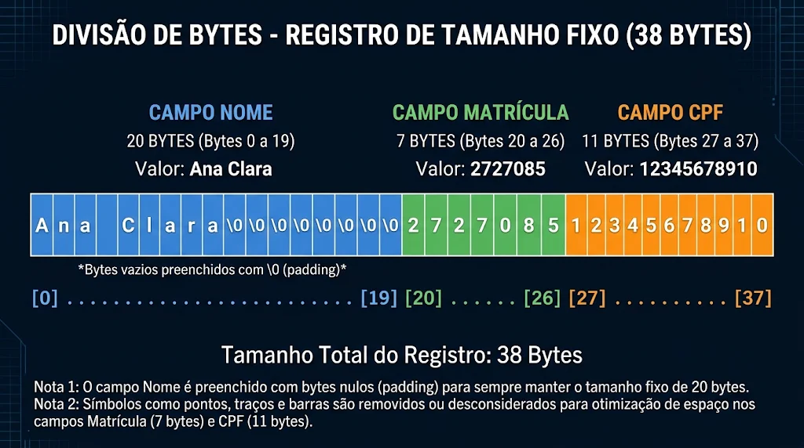

# Tópico 6: Registros de tamanho fixo

## Objetivos de aprendizagem

Ao final deste tópico, você deverá ser capaz de:

- Como dados são organizados em registros de tamanho fixo.
- Vantagens e desvantagens do uso deste formato.

## 1. Conceito

É a estruturação de dados em registros que ocupam a **mesma** quantidade de bytes, **independentemente** do conteúdo.

## 2. Como funciona

### Exemplo: Registro de estudante

| Tipo de Dado | Espaço ocupado |
| :--- | :--- |
| **Nome** | 20 bytes |
| **Matrícula** | 7 bytes |
| **CPF** | 11 bytes |



## 3. Fragmentação interna

Como pode ser visto no exemplo anterior, o campo nome teve apenas 9 bytes ocupados e 8 bytes desperdiçados. Esse problema é conhecido como **fragmentação interna de arquivos**, em que o dado inserido é menor que o bloco reservado. Com isso, é deixado um espaço ocioso dentro do próprio registro, o que pode resultar no **aumento desnecessário** do tamanho do arquivo.

## 4. Cálculo de acesso direto ou randômico

É feito o deslocamento exato a partir do índice zero. Com custo O(1).

$$ Byte = (N - 1) * Tamanho $$

> Exemplo: 10º aluno
> (10 - 1) × 100 bytes = Byte 900

## 5. Exclusão e reaproveitamento de espaço

Ao ocorrer a exclusão de um registro, o espaço, agora inutilizado, deve registrar a exclusão para impedir buscas e poder ser reaproveitado. Usa-se duas estratégias:

- Marcação lógica: Coloca-se um caractere especial(como $ ou #) no primeiro byte do registro removido, indicando que está livre e deve ser ignorado em buscas.

- Lista de disponíveis: Guarda-se um ponteiro no cabeçalho do arquivo indicando o número do último registro apagado. Dentro do registro removido, é colocado o índice do registro apagado anteriormente. Assim, formando uma lista encadeada de "buracos" dentro do arquivo que podem ser reaproveitados na inserção de um novo elemento.

## Quiz

Questão 1:

```quiz
{
  "question": "Um arquivo binário organiza dados de produtos utilizando registros de tamanho fixo de $64$ bytes. No início do arquivo, há um cabeçalho de metadados com tamanho fixo de $24$ bytes. Considerando que a indexação de bytes começa em $0$, em qual byte exato inicia o $15^{\circ}$ registro cadastrado nesse arquivo?",
  "options": [
    { "text": "Byte 984", "correct": false },
    { "text": "Byte 960", "correct": false },
    { "text": "Byte 920", "correct": true },
    { "text": "Byte 856", "correct": false }
  ],
  "correctFeedback": "Correto! Como a indexação inicia em 0, o  registro 15 possui índice 14. Somando o cabeçalho ao deslocamento dos 14 registros anteriores, obtém-se 24 + (14 * 64) = 920",
  "incorrectFeedback": "Incorreto. O resultado é obtido pelo cálculo: (N - 1) * bytes + cabeçalho."
}
```

Questão 2:

```quiz
{
  "question": "Um registro de tamanho fixo de $35$ bytes é estruturado em três campos consecutivos: Código ($5$ bytes), Descrição ($22$ bytes) e Categoria ($8$ bytes). Ao gravar uma descrição com apenas $10$ caracteres seguida de uma categoria com $12$ caracteres, qual comportamento ocorre na estrutura física desse registro?",
  "options": [
    { "text": "Preenchimento de $12$ bytes com caracteres nulos na 'Descrição' e perda de $4$ caracteres na 'Categoria'.", "correct": true },
    { "text": "Expansão dinâmica do registro para $39$ bytes, deslocando os registros subsequentes.", "correct": false },
    { "text": "Perda de $12$ caracteres na 'Descrição' e preenchimento de $4$ bytes na 'Categoria'", "correct": false },
    { "text": "Invasão dos $4$ bytes excedentes da 'Categoria' no campo 'Código' do próximo registro.", "correct": false}
  ],
  "correctFeedback": "Correto!",
  "incorrectFeedback": "Incorreto. A inserção de um dado menor que o bloco reservado resulta em um espaço ocioso(fragmentação interna). Já um dado maior resulta na gravação parcial da informação."
}
```

Questão 3:

```quiz
{
    "question": "No contexto de organização de dados em memória secundária, os registros de tamanho fixo facilitam o cálculo de deslocamento (offset) para o acesso randômico, mas introduzem um problema estrutural conhecido como fragmentação interna. Assinale a alternativa que define corretamente esse fenômeno:",
    "options": [
        { "text": "É o acúmulo de lacunas livres de tamanhos variados espalhadas entre diferentes registros no arquivo, resultante da exclusão de registros de tamanho variável que não conseguem acomodar novas inserções maiores.", "correct": false },
        { "text": "É a divisão física de um único registro em múltiplos blocos não contíguos no disco rígido, exigindo o uso de ponteiros encadeados para reconstruir a informação durante uma leitura sequencial.", "correct": false },
        { "text": "É a perda irreversível de caracteres excedentes no final de um campo quando o dado inserido ultrapassa a capacidade máxima de bytes reservada na estrutura do registro.", "correct": false },
        { "text": "É o desperdício de espaço em disco que ocorre dentro da área alocada para um registro, gerado quando o dado armazenado possui tamanho inferior ao limite determinado, deixando bytes ociosos preenchidos com caracteres nulos ou espaços.", "correct": true }
    ],
    "correctFeedback": "Correto!",
    "incorrectFeedback": "Incorreto"
}
```
