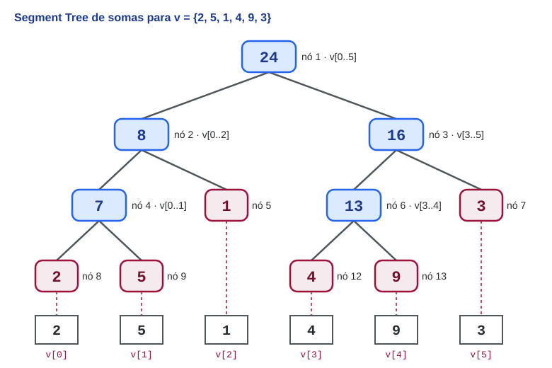

## Objetivos de aprendizagem

Ao final deste tópico, você deverá ser capaz de:

- Explicar que problema a Segment Tree resolve e por que um vetor comum ou um vetor de somas acumuladas não bastam.
- Representar uma Segment Tree de somas num vetor, com a raiz na posição 1 e os filhos de `no` em `2 * no` e `2 * no + 1`.
- Implementar a construção, a consulta de soma num intervalo e a atualização de uma posição.
- Analisar o custo dessas operações e o espaço ocupado pela árvore.

## Introdução

Imagine um vetor `v` com *n* números e duas operações que se repetem milhares de vezes, misturadas: **somar um trecho** `v[a..b]` e **trocar um valor** `v[i]`. Há duas soluções simples, e cada uma é ruim numa das operações:

- **Vetor comum:** trocar `v[i]` custa O(1), mas somar `v[a..b]` exige percorrer o trecho, O(*n*).
- **Vetor de somas acumuladas** (`acum[i]` = `v[0] + ... + v[i]`): a soma de um trecho sai em O(1), com `acum[b] - acum[a - 1]` (ou só `acum[b]` quando `a` = 0, porque `acum[-1]` não existe), mas trocar um valor obriga a refazer todas as somas depois dele, O(*n*).

A **Segment Tree** (árvore de segmentos) fica no meio do caminho: as **duas operações custam O(log n)**. A ideia é guardar, além dos valores, as somas de alguns trechos escolhidos, de modo que qualquer intervalo possa ser montado juntando poucos desses trechos.

## Conceito principal

Uma **Segment Tree** de somas é uma árvore binária em que:

- cada nó cobre um **trecho** `v[ini..fim]` do vetor e guarda a **soma** desse trecho;
- a raiz cobre o vetor inteiro, `v[0..n-1]`;
- um nó cujo trecho tem mais de um elemento é dividido ao meio, em `meio = (ini + fim) / 2`: o filho esquerdo cobre `v[ini..meio]` e o direito, `v[meio+1..fim]`;
- as **folhas** cobrem um único elemento e guardam o próprio `v[i]`.

> Por causa da última regra, todo nó interno vale a soma dos seus dois filhos. É isso que permite atualizar a árvore de baixo para cima e responder consultas sem descer até as folhas.

### Exemplo de estrutura

Para `v = {2, 5, 1, 4, 9, 3}`, a Segment Tree fica assim (os nós azuis guardam as somas de trechos, os vermelhos são as folhas, e cada folha fica sobre a posição do vetor que guarda):

{align=center width=100%}

A raiz guarda 24, a soma do vetor inteiro. O nó 2 guarda 8 = 2 + 5 + 1, a soma de `v[0..2]`, e o nó 6 guarda 13 = 4 + 9, a soma de `v[3..4]`. Como 6 não é potência de 2, as folhas não ficam todas no mesmo nível: `v[2]` e `v[5]` aparecem um nível acima das outras.

### Uso em outras operações

A soma é o exemplo mais comum, mas a mesma estrutura funciona com outras operações que juntam dois resultados em um, como **mínimo**, **máximo** ou **máximo divisor comum**. A operação precisa ser **associativa**: juntar `(x, y)` e depois `z` tem de dar o mesmo que juntar `x` com `(y, z)`, porque a consulta combina os pedaços do intervalo em grupos que dependem da forma da árvore.

Para trocar de operação, mudam duas coisas: o `+` que junta os filhos e o valor devolvido por um nó que está fora do intervalo. Esse valor é o **elemento neutro** da operação, aquele que não muda o resultado:

| Operação | Junta os filhos com | Nó fora do intervalo devolve |
|:--|:--|:--|
| Soma | `esq + dir` | 0 |
| Mínimo | o menor dos dois | +∞ (em C, `INT_MAX`) |
| Máximo | o maior dos dois | −∞ (em C, `INT_MIN`) |
| Máximo divisor comum | `mdc(esq, dir)` | 0, porque `mdc(x, 0)` = `x` |

## Representação em C

A Segment Tree é guardada num **vetor**, do mesmo jeito que o heap: a raiz fica em `arvore[1]` e os filhos do nó `no` ficam em `arvore[2 * no]` e `arvore[2 * no + 1]`. Não há ponteiros: o índice do nó já diz onde estão os filhos.

```c
#define MAX 100

int arvore[4 * MAX];   /* arvore[no] = soma do trecho do vetor que o nó cobre */
```

O tamanho 4 · `MAX` é uma margem segura. A árvore tem 2*n* − 1 nós, mas, quando *n* não é potência de 2, alguns índices ficam sem uso e o maior índice pode passar de 2*n*. Com 4*n* posições, ele nunca sai do vetor. A posição `arvore[0]` não é usada.

Cada função recebe, junto com `no`, o trecho `ini` e `fim` que esse nó cobre. A árvore não guarda os trechos: eles são recalculados durante a descida, a partir de `0` e `n - 1` na raiz.

## Operações

Nos programas abaixo, clique em **Executar** ou em **Próximo** e acompanhe a linha amarela. Na tela escura, cada linha é um nível da árvore, e cada nó fica exatamente sobre o trecho do vetor que cobre (o número embaixo dele é esse trecho). A última linha é o vetor `v`. O colchete amarelo marca o nó em que o programa está, o contorno amarelo indica um nó no caminho ou uma posição do vetor em destaque e o verde, um nó que acabou de ser calculado ou que entrou na resposta.

### Construção

A construção é **recursiva**. Se o trecho tem um único elemento, o nó é uma folha e guarda `v[ini]`. Senão, a função constrói os dois filhos e, na volta, guarda a soma dos dois. Os nós são calculados de baixo para cima: um nó só recebe o seu valor quando os dois filhos já têm o deles.

```codigo
{"title":"Construindo a Segment Tree de v = {2, 5, 1, 4, 9, 3}","cols":6,"code":"#include <stdio.h>\n\n#define MAX 100\n\nint arvore[4 * MAX];   /* arvore[no] = soma do trecho do vetor que o nó cobre */\n\n/* monta o nó no, que cobre v[ini..fim] */\nvoid construir(int v[], int no, int ini, int fim) {\n    if (ini == fim) {\n        arvore[no] = v[ini];\n        return;\n    }\n    int meio = (ini + fim) / 2;\n    construir(v, 2 * no, ini, meio);\n    construir(v, 2 * no + 1, meio + 1, fim);\n    arvore[no] = arvore[2 * no] + arvore[2 * no + 1];\n}\n\nint main(void) {\n    int v[] = {2, 5, 1, 4, 9, 3};\n    int n = 6;\n    construir(v, 1, 0, n - 1);\n    printf(\"%d\\n\", arvore[1]);\n    return 0;\n}","steps":[{"line":22,"caption":"O vetor `v` tem 6 números. Cada nó da Segment Tree vai guardar a **soma de um trecho** do vetor, e o trecho fica embaixo do nó. Os pontos de interrogação são somas que ainda não foram calculadas.","vars":{},"rows":[[{"s":0,"n":6,"i":[["?","g",0]],"l":"0–5"}],[{"s":0,"n":3,"i":[["?","g",0]],"l":"0–2"},{"s":3,"n":3,"i":[["?","g",0]],"l":"3–5"}],[{"s":0,"n":2,"i":[["?","g",0]],"l":"0–1"},{"s":2,"n":1,"i":[["?","g",0]],"l":"2"},{"s":3,"n":2,"i":[["?","g",0]],"l":"3–4"},{"s":5,"n":1,"i":[["?","g",0]],"l":"5"}],[{"s":0,"n":1,"i":[["?","g",0]],"l":"0"},{"s":1,"n":1,"i":[["?","g",0]],"l":"1"},{"s":3,"n":1,"i":[["?","g",0]],"l":"3"},{"s":4,"n":1,"i":[["?","g",0]],"l":"4"}],[{"s":0,"n":1,"i":["2"],"l":"v[0]"},{"s":1,"n":1,"i":["5"],"l":"v[1]"},{"s":2,"n":1,"i":["1"],"l":"v[2]"},{"s":3,"n":1,"i":["4"],"l":"v[3]"},{"s":4,"n":1,"i":["9"],"l":"v[4]"},{"s":5,"n":1,"i":["3"],"l":"v[5]"}]],"stack":"main"},{"line":9,"caption":"`construir` começa pela **raiz** (`no` = 1), que cobre o vetor inteiro, `v[0..5]` (em amarelo no vetor).","vars":{"no":1,"ini":0,"fim":5},"rows":[[{"s":0,"n":6,"i":[["?","g",0]],"l":"0–5","a":1}],[{"s":0,"n":3,"i":[["?","g",0]],"l":"0–2"},{"s":3,"n":3,"i":[["?","g",0]],"l":"3–5"}],[{"s":0,"n":2,"i":[["?","g",0]],"l":"0–1"},{"s":2,"n":1,"i":[["?","g",0]],"l":"2"},{"s":3,"n":2,"i":[["?","g",0]],"l":"3–4"},{"s":5,"n":1,"i":[["?","g",0]],"l":"5"}],[{"s":0,"n":1,"i":[["?","g",0]],"l":"0"},{"s":1,"n":1,"i":[["?","g",0]],"l":"1"},{"s":3,"n":1,"i":[["?","g",0]],"l":"3"},{"s":4,"n":1,"i":[["?","g",0]],"l":"4"}],[{"s":0,"n":1,"i":[["2","c",null]],"l":"v[0]"},{"s":1,"n":1,"i":[["5","c",null]],"l":"v[1]"},{"s":2,"n":1,"i":[["1","c",null]],"l":"v[2]"},{"s":3,"n":1,"i":[["4","c",null]],"l":"v[3]"},{"s":4,"n":1,"i":[["9","c",null]],"l":"v[4]"},{"s":5,"n":1,"i":[["3","c",null]],"l":"v[5]"}]],"stack":"construir ← main"},{"line":14,"caption":"O trecho tem mais de um elemento. `meio` = (0 + 5) / 2 = 2: o filho esquerdo (nó 2) fica com `v[0..2]` e o direito (nó 3), com `v[3..5]`.","vars":{"no":1,"ini":0,"fim":5,"meio":2},"rows":[[{"s":0,"n":6,"i":[["?","g",0]],"l":"0–5","a":1}],[{"s":0,"n":3,"i":[["?","g",0]],"l":"0–2"},{"s":3,"n":3,"i":[["?","g",0]],"l":"3–5"}],[{"s":0,"n":2,"i":[["?","g",0]],"l":"0–1"},{"s":2,"n":1,"i":[["?","g",0]],"l":"2"},{"s":3,"n":2,"i":[["?","g",0]],"l":"3–4"},{"s":5,"n":1,"i":[["?","g",0]],"l":"5"}],[{"s":0,"n":1,"i":[["?","g",0]],"l":"0"},{"s":1,"n":1,"i":[["?","g",0]],"l":"1"},{"s":3,"n":1,"i":[["?","g",0]],"l":"3"},{"s":4,"n":1,"i":[["?","g",0]],"l":"4"}],[{"s":0,"n":1,"i":[["2","c",null]],"l":"v[0]"},{"s":1,"n":1,"i":[["5","c",null]],"l":"v[1]"},{"s":2,"n":1,"i":[["1","c",null]],"l":"v[2]"},{"s":3,"n":1,"i":[["4","c",null]],"l":"v[3]"},{"s":4,"n":1,"i":[["9","c",null]],"l":"v[4]"},{"s":5,"n":1,"i":[["3","c",null]],"l":"v[5]"}]],"stack":"construir ← main"},{"line":9,"caption":"Chegamos ao nó 2, que cobre `v[0..2]` (em amarelo no vetor).","vars":{"no":2,"ini":0,"fim":2},"rows":[[{"s":0,"n":6,"i":[["?","g",0]],"l":"0–5"}],[{"s":0,"n":3,"i":[["?","g",0]],"l":"0–2","a":1},{"s":3,"n":3,"i":[["?","g",0]],"l":"3–5"}],[{"s":0,"n":2,"i":[["?","g",0]],"l":"0–1"},{"s":2,"n":1,"i":[["?","g",0]],"l":"2"},{"s":3,"n":2,"i":[["?","g",0]],"l":"3–4"},{"s":5,"n":1,"i":[["?","g",0]],"l":"5"}],[{"s":0,"n":1,"i":[["?","g",0]],"l":"0"},{"s":1,"n":1,"i":[["?","g",0]],"l":"1"},{"s":3,"n":1,"i":[["?","g",0]],"l":"3"},{"s":4,"n":1,"i":[["?","g",0]],"l":"4"}],[{"s":0,"n":1,"i":[["2","c",null]],"l":"v[0]"},{"s":1,"n":1,"i":[["5","c",null]],"l":"v[1]"},{"s":2,"n":1,"i":[["1","c",null]],"l":"v[2]"},{"s":3,"n":1,"i":["4"],"l":"v[3]"},{"s":4,"n":1,"i":["9"],"l":"v[4]"},{"s":5,"n":1,"i":["3"],"l":"v[5]"}]],"stack":"construir ← construir ← main"},{"line":14,"caption":"O trecho tem mais de um elemento. `meio` = (0 + 2) / 2 = 1: o filho esquerdo (nó 4) fica com `v[0..1]` e o direito (nó 5), com `v[2]`.","vars":{"no":2,"ini":0,"fim":2,"meio":1},"rows":[[{"s":0,"n":6,"i":[["?","g",0]],"l":"0–5"}],[{"s":0,"n":3,"i":[["?","g",0]],"l":"0–2","a":1},{"s":3,"n":3,"i":[["?","g",0]],"l":"3–5"}],[{"s":0,"n":2,"i":[["?","g",0]],"l":"0–1"},{"s":2,"n":1,"i":[["?","g",0]],"l":"2"},{"s":3,"n":2,"i":[["?","g",0]],"l":"3–4"},{"s":5,"n":1,"i":[["?","g",0]],"l":"5"}],[{"s":0,"n":1,"i":[["?","g",0]],"l":"0"},{"s":1,"n":1,"i":[["?","g",0]],"l":"1"},{"s":3,"n":1,"i":[["?","g",0]],"l":"3"},{"s":4,"n":1,"i":[["?","g",0]],"l":"4"}],[{"s":0,"n":1,"i":[["2","c",null]],"l":"v[0]"},{"s":1,"n":1,"i":[["5","c",null]],"l":"v[1]"},{"s":2,"n":1,"i":[["1","c",null]],"l":"v[2]"},{"s":3,"n":1,"i":["4"],"l":"v[3]"},{"s":4,"n":1,"i":["9"],"l":"v[4]"},{"s":5,"n":1,"i":["3"],"l":"v[5]"}]],"stack":"construir ← construir ← main"},{"line":9,"caption":"Chegamos ao nó 4, que cobre `v[0..1]` (em amarelo no vetor).","vars":{"no":4,"ini":0,"fim":1},"rows":[[{"s":0,"n":6,"i":[["?","g",0]],"l":"0–5"}],[{"s":0,"n":3,"i":[["?","g",0]],"l":"0–2"},{"s":3,"n":3,"i":[["?","g",0]],"l":"3–5"}],[{"s":0,"n":2,"i":[["?","g",0]],"l":"0–1","a":1},{"s":2,"n":1,"i":[["?","g",0]],"l":"2"},{"s":3,"n":2,"i":[["?","g",0]],"l":"3–4"},{"s":5,"n":1,"i":[["?","g",0]],"l":"5"}],[{"s":0,"n":1,"i":[["?","g",0]],"l":"0"},{"s":1,"n":1,"i":[["?","g",0]],"l":"1"},{"s":3,"n":1,"i":[["?","g",0]],"l":"3"},{"s":4,"n":1,"i":[["?","g",0]],"l":"4"}],[{"s":0,"n":1,"i":[["2","c",null]],"l":"v[0]"},{"s":1,"n":1,"i":[["5","c",null]],"l":"v[1]"},{"s":2,"n":1,"i":["1"],"l":"v[2]"},{"s":3,"n":1,"i":["4"],"l":"v[3]"},{"s":4,"n":1,"i":["9"],"l":"v[4]"},{"s":5,"n":1,"i":["3"],"l":"v[5]"}]],"stack":"construir ← construir ← construir ← main"},{"line":14,"caption":"O trecho tem mais de um elemento. `meio` = (0 + 1) / 2 = 0: o filho esquerdo (nó 8) fica com `v[0]` e o direito (nó 9), com `v[1]`.","vars":{"no":4,"ini":0,"fim":1,"meio":0},"rows":[[{"s":0,"n":6,"i":[["?","g",0]],"l":"0–5"}],[{"s":0,"n":3,"i":[["?","g",0]],"l":"0–2"},{"s":3,"n":3,"i":[["?","g",0]],"l":"3–5"}],[{"s":0,"n":2,"i":[["?","g",0]],"l":"0–1","a":1},{"s":2,"n":1,"i":[["?","g",0]],"l":"2"},{"s":3,"n":2,"i":[["?","g",0]],"l":"3–4"},{"s":5,"n":1,"i":[["?","g",0]],"l":"5"}],[{"s":0,"n":1,"i":[["?","g",0]],"l":"0"},{"s":1,"n":1,"i":[["?","g",0]],"l":"1"},{"s":3,"n":1,"i":[["?","g",0]],"l":"3"},{"s":4,"n":1,"i":[["?","g",0]],"l":"4"}],[{"s":0,"n":1,"i":[["2","c",null]],"l":"v[0]"},{"s":1,"n":1,"i":[["5","c",null]],"l":"v[1]"},{"s":2,"n":1,"i":["1"],"l":"v[2]"},{"s":3,"n":1,"i":["4"],"l":"v[3]"},{"s":4,"n":1,"i":["9"],"l":"v[4]"},{"s":5,"n":1,"i":["3"],"l":"v[5]"}]],"stack":"construir ← construir ← construir ← main"},{"line":9,"caption":"Chegamos ao nó 8, que cobre `v[0]` (em amarelo no vetor).","vars":{"no":8,"ini":0,"fim":0},"rows":[[{"s":0,"n":6,"i":[["?","g",0]],"l":"0–5"}],[{"s":0,"n":3,"i":[["?","g",0]],"l":"0–2"},{"s":3,"n":3,"i":[["?","g",0]],"l":"3–5"}],[{"s":0,"n":2,"i":[["?","g",0]],"l":"0–1"},{"s":2,"n":1,"i":[["?","g",0]],"l":"2"},{"s":3,"n":2,"i":[["?","g",0]],"l":"3–4"},{"s":5,"n":1,"i":[["?","g",0]],"l":"5"}],[{"s":0,"n":1,"i":[["?","g",0]],"l":"0","a":1},{"s":1,"n":1,"i":[["?","g",0]],"l":"1"},{"s":3,"n":1,"i":[["?","g",0]],"l":"3"},{"s":4,"n":1,"i":[["?","g",0]],"l":"4"}],[{"s":0,"n":1,"i":[["2","c",null]],"l":"v[0]"},{"s":1,"n":1,"i":["5"],"l":"v[1]"},{"s":2,"n":1,"i":["1"],"l":"v[2]"},{"s":3,"n":1,"i":["4"],"l":"v[3]"},{"s":4,"n":1,"i":["9"],"l":"v[4]"},{"s":5,"n":1,"i":["3"],"l":"v[5]"}]],"stack":"construir ← construir ← construir ← construir ← main"},{"line":11,"caption":"O trecho tem um único elemento: o nó 8 é uma **folha** e guarda `v[0]` = 2.","vars":{"no":8,"ini":0},"rows":[[{"s":0,"n":6,"i":[["?","g",0]],"l":"0–5"}],[{"s":0,"n":3,"i":[["?","g",0]],"l":"0–2"},{"s":3,"n":3,"i":[["?","g",0]],"l":"3–5"}],[{"s":0,"n":2,"i":[["?","g",0]],"l":"0–1"},{"s":2,"n":1,"i":[["?","g",0]],"l":"2"},{"s":3,"n":2,"i":[["?","g",0]],"l":"3–4"},{"s":5,"n":1,"i":[["?","g",0]],"l":"5"}],[{"s":0,"n":1,"i":[["2","p",null]],"l":"0","a":1},{"s":1,"n":1,"i":[["?","g",0]],"l":"1"},{"s":3,"n":1,"i":[["?","g",0]],"l":"3"},{"s":4,"n":1,"i":[["?","g",0]],"l":"4"}],[{"s":0,"n":1,"i":[["2","c",null]],"l":"v[0]"},{"s":1,"n":1,"i":["5"],"l":"v[1]"},{"s":2,"n":1,"i":["1"],"l":"v[2]"},{"s":3,"n":1,"i":["4"],"l":"v[3]"},{"s":4,"n":1,"i":["9"],"l":"v[4]"},{"s":5,"n":1,"i":["3"],"l":"v[5]"}]],"stack":"construir ← construir ← construir ← construir ← main"},{"line":9,"caption":"Chegamos ao nó 9, que cobre `v[1]` (em amarelo no vetor).","vars":{"no":9,"ini":1,"fim":1},"rows":[[{"s":0,"n":6,"i":[["?","g",0]],"l":"0–5"}],[{"s":0,"n":3,"i":[["?","g",0]],"l":"0–2"},{"s":3,"n":3,"i":[["?","g",0]],"l":"3–5"}],[{"s":0,"n":2,"i":[["?","g",0]],"l":"0–1"},{"s":2,"n":1,"i":[["?","g",0]],"l":"2"},{"s":3,"n":2,"i":[["?","g",0]],"l":"3–4"},{"s":5,"n":1,"i":[["?","g",0]],"l":"5"}],[{"s":0,"n":1,"i":["2"],"l":"0"},{"s":1,"n":1,"i":[["?","g",0]],"l":"1","a":1},{"s":3,"n":1,"i":[["?","g",0]],"l":"3"},{"s":4,"n":1,"i":[["?","g",0]],"l":"4"}],[{"s":0,"n":1,"i":["2"],"l":"v[0]"},{"s":1,"n":1,"i":[["5","c",null]],"l":"v[1]"},{"s":2,"n":1,"i":["1"],"l":"v[2]"},{"s":3,"n":1,"i":["4"],"l":"v[3]"},{"s":4,"n":1,"i":["9"],"l":"v[4]"},{"s":5,"n":1,"i":["3"],"l":"v[5]"}]],"stack":"construir ← construir ← construir ← construir ← main"},{"line":11,"caption":"O trecho tem um único elemento: o nó 9 é uma **folha** e guarda `v[1]` = 5.","vars":{"no":9,"ini":1},"rows":[[{"s":0,"n":6,"i":[["?","g",0]],"l":"0–5"}],[{"s":0,"n":3,"i":[["?","g",0]],"l":"0–2"},{"s":3,"n":3,"i":[["?","g",0]],"l":"3–5"}],[{"s":0,"n":2,"i":[["?","g",0]],"l":"0–1"},{"s":2,"n":1,"i":[["?","g",0]],"l":"2"},{"s":3,"n":2,"i":[["?","g",0]],"l":"3–4"},{"s":5,"n":1,"i":[["?","g",0]],"l":"5"}],[{"s":0,"n":1,"i":["2"],"l":"0"},{"s":1,"n":1,"i":[["5","p",null]],"l":"1","a":1},{"s":3,"n":1,"i":[["?","g",0]],"l":"3"},{"s":4,"n":1,"i":[["?","g",0]],"l":"4"}],[{"s":0,"n":1,"i":["2"],"l":"v[0]"},{"s":1,"n":1,"i":[["5","c",null]],"l":"v[1]"},{"s":2,"n":1,"i":["1"],"l":"v[2]"},{"s":3,"n":1,"i":["4"],"l":"v[3]"},{"s":4,"n":1,"i":["9"],"l":"v[4]"},{"s":5,"n":1,"i":["3"],"l":"v[5]"}]],"stack":"construir ← construir ← construir ← construir ← main"},{"line":17,"caption":"Os dois filhos estão prontos. O nó 4 guarda a soma deles: 2 + 5 = 7.","vars":{"no":4,"ini":0,"fim":1},"rows":[[{"s":0,"n":6,"i":[["?","g",0]],"l":"0–5"}],[{"s":0,"n":3,"i":[["?","g",0]],"l":"0–2"},{"s":3,"n":3,"i":[["?","g",0]],"l":"3–5"}],[{"s":0,"n":2,"i":[["7","p",null]],"l":"0–1","a":1},{"s":2,"n":1,"i":[["?","g",0]],"l":"2"},{"s":3,"n":2,"i":[["?","g",0]],"l":"3–4"},{"s":5,"n":1,"i":[["?","g",0]],"l":"5"}],[{"s":0,"n":1,"i":["2"],"l":"0"},{"s":1,"n":1,"i":["5"],"l":"1"},{"s":3,"n":1,"i":[["?","g",0]],"l":"3"},{"s":4,"n":1,"i":[["?","g",0]],"l":"4"}],[{"s":0,"n":1,"i":[["2","c",null]],"l":"v[0]"},{"s":1,"n":1,"i":[["5","c",null]],"l":"v[1]"},{"s":2,"n":1,"i":["1"],"l":"v[2]"},{"s":3,"n":1,"i":["4"],"l":"v[3]"},{"s":4,"n":1,"i":["9"],"l":"v[4]"},{"s":5,"n":1,"i":["3"],"l":"v[5]"}]],"stack":"construir ← construir ← construir ← main"},{"line":9,"caption":"Chegamos ao nó 5, que cobre `v[2]` (em amarelo no vetor).","vars":{"no":5,"ini":2,"fim":2},"rows":[[{"s":0,"n":6,"i":[["?","g",0]],"l":"0–5"}],[{"s":0,"n":3,"i":[["?","g",0]],"l":"0–2"},{"s":3,"n":3,"i":[["?","g",0]],"l":"3–5"}],[{"s":0,"n":2,"i":["7"],"l":"0–1"},{"s":2,"n":1,"i":[["?","g",0]],"l":"2","a":1},{"s":3,"n":2,"i":[["?","g",0]],"l":"3–4"},{"s":5,"n":1,"i":[["?","g",0]],"l":"5"}],[{"s":0,"n":1,"i":["2"],"l":"0"},{"s":1,"n":1,"i":["5"],"l":"1"},{"s":3,"n":1,"i":[["?","g",0]],"l":"3"},{"s":4,"n":1,"i":[["?","g",0]],"l":"4"}],[{"s":0,"n":1,"i":["2"],"l":"v[0]"},{"s":1,"n":1,"i":["5"],"l":"v[1]"},{"s":2,"n":1,"i":[["1","c",null]],"l":"v[2]"},{"s":3,"n":1,"i":["4"],"l":"v[3]"},{"s":4,"n":1,"i":["9"],"l":"v[4]"},{"s":5,"n":1,"i":["3"],"l":"v[5]"}]],"stack":"construir ← construir ← construir ← main"},{"line":11,"caption":"O trecho tem um único elemento: o nó 5 é uma **folha** e guarda `v[2]` = 1.","vars":{"no":5,"ini":2},"rows":[[{"s":0,"n":6,"i":[["?","g",0]],"l":"0–5"}],[{"s":0,"n":3,"i":[["?","g",0]],"l":"0–2"},{"s":3,"n":3,"i":[["?","g",0]],"l":"3–5"}],[{"s":0,"n":2,"i":["7"],"l":"0–1"},{"s":2,"n":1,"i":[["1","p",null]],"l":"2","a":1},{"s":3,"n":2,"i":[["?","g",0]],"l":"3–4"},{"s":5,"n":1,"i":[["?","g",0]],"l":"5"}],[{"s":0,"n":1,"i":["2"],"l":"0"},{"s":1,"n":1,"i":["5"],"l":"1"},{"s":3,"n":1,"i":[["?","g",0]],"l":"3"},{"s":4,"n":1,"i":[["?","g",0]],"l":"4"}],[{"s":0,"n":1,"i":["2"],"l":"v[0]"},{"s":1,"n":1,"i":["5"],"l":"v[1]"},{"s":2,"n":1,"i":[["1","c",null]],"l":"v[2]"},{"s":3,"n":1,"i":["4"],"l":"v[3]"},{"s":4,"n":1,"i":["9"],"l":"v[4]"},{"s":5,"n":1,"i":["3"],"l":"v[5]"}]],"stack":"construir ← construir ← construir ← main"},{"line":17,"caption":"Os dois filhos estão prontos. O nó 2 guarda a soma deles: 7 + 1 = 8.","vars":{"no":2,"ini":0,"fim":2},"rows":[[{"s":0,"n":6,"i":[["?","g",0]],"l":"0–5"}],[{"s":0,"n":3,"i":[["8","p",null]],"l":"0–2","a":1},{"s":3,"n":3,"i":[["?","g",0]],"l":"3–5"}],[{"s":0,"n":2,"i":["7"],"l":"0–1"},{"s":2,"n":1,"i":["1"],"l":"2"},{"s":3,"n":2,"i":[["?","g",0]],"l":"3–4"},{"s":5,"n":1,"i":[["?","g",0]],"l":"5"}],[{"s":0,"n":1,"i":["2"],"l":"0"},{"s":1,"n":1,"i":["5"],"l":"1"},{"s":3,"n":1,"i":[["?","g",0]],"l":"3"},{"s":4,"n":1,"i":[["?","g",0]],"l":"4"}],[{"s":0,"n":1,"i":[["2","c",null]],"l":"v[0]"},{"s":1,"n":1,"i":[["5","c",null]],"l":"v[1]"},{"s":2,"n":1,"i":[["1","c",null]],"l":"v[2]"},{"s":3,"n":1,"i":["4"],"l":"v[3]"},{"s":4,"n":1,"i":["9"],"l":"v[4]"},{"s":5,"n":1,"i":["3"],"l":"v[5]"}]],"stack":"construir ← construir ← main"},{"line":9,"caption":"Chegamos ao nó 3, que cobre `v[3..5]` (em amarelo no vetor).","vars":{"no":3,"ini":3,"fim":5},"rows":[[{"s":0,"n":6,"i":[["?","g",0]],"l":"0–5"}],[{"s":0,"n":3,"i":["8"],"l":"0–2"},{"s":3,"n":3,"i":[["?","g",0]],"l":"3–5","a":1}],[{"s":0,"n":2,"i":["7"],"l":"0–1"},{"s":2,"n":1,"i":["1"],"l":"2"},{"s":3,"n":2,"i":[["?","g",0]],"l":"3–4"},{"s":5,"n":1,"i":[["?","g",0]],"l":"5"}],[{"s":0,"n":1,"i":["2"],"l":"0"},{"s":1,"n":1,"i":["5"],"l":"1"},{"s":3,"n":1,"i":[["?","g",0]],"l":"3"},{"s":4,"n":1,"i":[["?","g",0]],"l":"4"}],[{"s":0,"n":1,"i":["2"],"l":"v[0]"},{"s":1,"n":1,"i":["5"],"l":"v[1]"},{"s":2,"n":1,"i":["1"],"l":"v[2]"},{"s":3,"n":1,"i":[["4","c",null]],"l":"v[3]"},{"s":4,"n":1,"i":[["9","c",null]],"l":"v[4]"},{"s":5,"n":1,"i":[["3","c",null]],"l":"v[5]"}]],"stack":"construir ← construir ← main"},{"line":14,"caption":"O trecho tem mais de um elemento. `meio` = (3 + 5) / 2 = 4: o filho esquerdo (nó 6) fica com `v[3..4]` e o direito (nó 7), com `v[5]`.","vars":{"no":3,"ini":3,"fim":5,"meio":4},"rows":[[{"s":0,"n":6,"i":[["?","g",0]],"l":"0–5"}],[{"s":0,"n":3,"i":["8"],"l":"0–2"},{"s":3,"n":3,"i":[["?","g",0]],"l":"3–5","a":1}],[{"s":0,"n":2,"i":["7"],"l":"0–1"},{"s":2,"n":1,"i":["1"],"l":"2"},{"s":3,"n":2,"i":[["?","g",0]],"l":"3–4"},{"s":5,"n":1,"i":[["?","g",0]],"l":"5"}],[{"s":0,"n":1,"i":["2"],"l":"0"},{"s":1,"n":1,"i":["5"],"l":"1"},{"s":3,"n":1,"i":[["?","g",0]],"l":"3"},{"s":4,"n":1,"i":[["?","g",0]],"l":"4"}],[{"s":0,"n":1,"i":["2"],"l":"v[0]"},{"s":1,"n":1,"i":["5"],"l":"v[1]"},{"s":2,"n":1,"i":["1"],"l":"v[2]"},{"s":3,"n":1,"i":[["4","c",null]],"l":"v[3]"},{"s":4,"n":1,"i":[["9","c",null]],"l":"v[4]"},{"s":5,"n":1,"i":[["3","c",null]],"l":"v[5]"}]],"stack":"construir ← construir ← main"},{"line":9,"caption":"Chegamos ao nó 6, que cobre `v[3..4]` (em amarelo no vetor).","vars":{"no":6,"ini":3,"fim":4},"rows":[[{"s":0,"n":6,"i":[["?","g",0]],"l":"0–5"}],[{"s":0,"n":3,"i":["8"],"l":"0–2"},{"s":3,"n":3,"i":[["?","g",0]],"l":"3–5"}],[{"s":0,"n":2,"i":["7"],"l":"0–1"},{"s":2,"n":1,"i":["1"],"l":"2"},{"s":3,"n":2,"i":[["?","g",0]],"l":"3–4","a":1},{"s":5,"n":1,"i":[["?","g",0]],"l":"5"}],[{"s":0,"n":1,"i":["2"],"l":"0"},{"s":1,"n":1,"i":["5"],"l":"1"},{"s":3,"n":1,"i":[["?","g",0]],"l":"3"},{"s":4,"n":1,"i":[["?","g",0]],"l":"4"}],[{"s":0,"n":1,"i":["2"],"l":"v[0]"},{"s":1,"n":1,"i":["5"],"l":"v[1]"},{"s":2,"n":1,"i":["1"],"l":"v[2]"},{"s":3,"n":1,"i":[["4","c",null]],"l":"v[3]"},{"s":4,"n":1,"i":[["9","c",null]],"l":"v[4]"},{"s":5,"n":1,"i":["3"],"l":"v[5]"}]],"stack":"construir ← construir ← construir ← main"},{"line":14,"caption":"O trecho tem mais de um elemento. `meio` = (3 + 4) / 2 = 3: o filho esquerdo (nó 12) fica com `v[3]` e o direito (nó 13), com `v[4]`.","vars":{"no":6,"ini":3,"fim":4,"meio":3},"rows":[[{"s":0,"n":6,"i":[["?","g",0]],"l":"0–5"}],[{"s":0,"n":3,"i":["8"],"l":"0–2"},{"s":3,"n":3,"i":[["?","g",0]],"l":"3–5"}],[{"s":0,"n":2,"i":["7"],"l":"0–1"},{"s":2,"n":1,"i":["1"],"l":"2"},{"s":3,"n":2,"i":[["?","g",0]],"l":"3–4","a":1},{"s":5,"n":1,"i":[["?","g",0]],"l":"5"}],[{"s":0,"n":1,"i":["2"],"l":"0"},{"s":1,"n":1,"i":["5"],"l":"1"},{"s":3,"n":1,"i":[["?","g",0]],"l":"3"},{"s":4,"n":1,"i":[["?","g",0]],"l":"4"}],[{"s":0,"n":1,"i":["2"],"l":"v[0]"},{"s":1,"n":1,"i":["5"],"l":"v[1]"},{"s":2,"n":1,"i":["1"],"l":"v[2]"},{"s":3,"n":1,"i":[["4","c",null]],"l":"v[3]"},{"s":4,"n":1,"i":[["9","c",null]],"l":"v[4]"},{"s":5,"n":1,"i":["3"],"l":"v[5]"}]],"stack":"construir ← construir ← construir ← main"},{"line":9,"caption":"Chegamos ao nó 12, que cobre `v[3]` (em amarelo no vetor).","vars":{"no":12,"ini":3,"fim":3},"rows":[[{"s":0,"n":6,"i":[["?","g",0]],"l":"0–5"}],[{"s":0,"n":3,"i":["8"],"l":"0–2"},{"s":3,"n":3,"i":[["?","g",0]],"l":"3–5"}],[{"s":0,"n":2,"i":["7"],"l":"0–1"},{"s":2,"n":1,"i":["1"],"l":"2"},{"s":3,"n":2,"i":[["?","g",0]],"l":"3–4"},{"s":5,"n":1,"i":[["?","g",0]],"l":"5"}],[{"s":0,"n":1,"i":["2"],"l":"0"},{"s":1,"n":1,"i":["5"],"l":"1"},{"s":3,"n":1,"i":[["?","g",0]],"l":"3","a":1},{"s":4,"n":1,"i":[["?","g",0]],"l":"4"}],[{"s":0,"n":1,"i":["2"],"l":"v[0]"},{"s":1,"n":1,"i":["5"],"l":"v[1]"},{"s":2,"n":1,"i":["1"],"l":"v[2]"},{"s":3,"n":1,"i":[["4","c",null]],"l":"v[3]"},{"s":4,"n":1,"i":["9"],"l":"v[4]"},{"s":5,"n":1,"i":["3"],"l":"v[5]"}]],"stack":"construir ← construir ← construir ← construir ← main"},{"line":11,"caption":"O trecho tem um único elemento: o nó 12 é uma **folha** e guarda `v[3]` = 4.","vars":{"no":12,"ini":3},"rows":[[{"s":0,"n":6,"i":[["?","g",0]],"l":"0–5"}],[{"s":0,"n":3,"i":["8"],"l":"0–2"},{"s":3,"n":3,"i":[["?","g",0]],"l":"3–5"}],[{"s":0,"n":2,"i":["7"],"l":"0–1"},{"s":2,"n":1,"i":["1"],"l":"2"},{"s":3,"n":2,"i":[["?","g",0]],"l":"3–4"},{"s":5,"n":1,"i":[["?","g",0]],"l":"5"}],[{"s":0,"n":1,"i":["2"],"l":"0"},{"s":1,"n":1,"i":["5"],"l":"1"},{"s":3,"n":1,"i":[["4","p",null]],"l":"3","a":1},{"s":4,"n":1,"i":[["?","g",0]],"l":"4"}],[{"s":0,"n":1,"i":["2"],"l":"v[0]"},{"s":1,"n":1,"i":["5"],"l":"v[1]"},{"s":2,"n":1,"i":["1"],"l":"v[2]"},{"s":3,"n":1,"i":[["4","c",null]],"l":"v[3]"},{"s":4,"n":1,"i":["9"],"l":"v[4]"},{"s":5,"n":1,"i":["3"],"l":"v[5]"}]],"stack":"construir ← construir ← construir ← construir ← main"},{"line":9,"caption":"Chegamos ao nó 13, que cobre `v[4]` (em amarelo no vetor).","vars":{"no":13,"ini":4,"fim":4},"rows":[[{"s":0,"n":6,"i":[["?","g",0]],"l":"0–5"}],[{"s":0,"n":3,"i":["8"],"l":"0–2"},{"s":3,"n":3,"i":[["?","g",0]],"l":"3–5"}],[{"s":0,"n":2,"i":["7"],"l":"0–1"},{"s":2,"n":1,"i":["1"],"l":"2"},{"s":3,"n":2,"i":[["?","g",0]],"l":"3–4"},{"s":5,"n":1,"i":[["?","g",0]],"l":"5"}],[{"s":0,"n":1,"i":["2"],"l":"0"},{"s":1,"n":1,"i":["5"],"l":"1"},{"s":3,"n":1,"i":["4"],"l":"3"},{"s":4,"n":1,"i":[["?","g",0]],"l":"4","a":1}],[{"s":0,"n":1,"i":["2"],"l":"v[0]"},{"s":1,"n":1,"i":["5"],"l":"v[1]"},{"s":2,"n":1,"i":["1"],"l":"v[2]"},{"s":3,"n":1,"i":["4"],"l":"v[3]"},{"s":4,"n":1,"i":[["9","c",null]],"l":"v[4]"},{"s":5,"n":1,"i":["3"],"l":"v[5]"}]],"stack":"construir ← construir ← construir ← construir ← main"},{"line":11,"caption":"O trecho tem um único elemento: o nó 13 é uma **folha** e guarda `v[4]` = 9.","vars":{"no":13,"ini":4},"rows":[[{"s":0,"n":6,"i":[["?","g",0]],"l":"0–5"}],[{"s":0,"n":3,"i":["8"],"l":"0–2"},{"s":3,"n":3,"i":[["?","g",0]],"l":"3–5"}],[{"s":0,"n":2,"i":["7"],"l":"0–1"},{"s":2,"n":1,"i":["1"],"l":"2"},{"s":3,"n":2,"i":[["?","g",0]],"l":"3–4"},{"s":5,"n":1,"i":[["?","g",0]],"l":"5"}],[{"s":0,"n":1,"i":["2"],"l":"0"},{"s":1,"n":1,"i":["5"],"l":"1"},{"s":3,"n":1,"i":["4"],"l":"3"},{"s":4,"n":1,"i":[["9","p",null]],"l":"4","a":1}],[{"s":0,"n":1,"i":["2"],"l":"v[0]"},{"s":1,"n":1,"i":["5"],"l":"v[1]"},{"s":2,"n":1,"i":["1"],"l":"v[2]"},{"s":3,"n":1,"i":["4"],"l":"v[3]"},{"s":4,"n":1,"i":[["9","c",null]],"l":"v[4]"},{"s":5,"n":1,"i":["3"],"l":"v[5]"}]],"stack":"construir ← construir ← construir ← construir ← main"},{"line":17,"caption":"Os dois filhos estão prontos. O nó 6 guarda a soma deles: 4 + 9 = 13.","vars":{"no":6,"ini":3,"fim":4},"rows":[[{"s":0,"n":6,"i":[["?","g",0]],"l":"0–5"}],[{"s":0,"n":3,"i":["8"],"l":"0–2"},{"s":3,"n":3,"i":[["?","g",0]],"l":"3–5"}],[{"s":0,"n":2,"i":["7"],"l":"0–1"},{"s":2,"n":1,"i":["1"],"l":"2"},{"s":3,"n":2,"i":[["13","p",null]],"l":"3–4","a":1},{"s":5,"n":1,"i":[["?","g",0]],"l":"5"}],[{"s":0,"n":1,"i":["2"],"l":"0"},{"s":1,"n":1,"i":["5"],"l":"1"},{"s":3,"n":1,"i":["4"],"l":"3"},{"s":4,"n":1,"i":["9"],"l":"4"}],[{"s":0,"n":1,"i":["2"],"l":"v[0]"},{"s":1,"n":1,"i":["5"],"l":"v[1]"},{"s":2,"n":1,"i":["1"],"l":"v[2]"},{"s":3,"n":1,"i":[["4","c",null]],"l":"v[3]"},{"s":4,"n":1,"i":[["9","c",null]],"l":"v[4]"},{"s":5,"n":1,"i":["3"],"l":"v[5]"}]],"stack":"construir ← construir ← construir ← main"},{"line":9,"caption":"Chegamos ao nó 7, que cobre `v[5]` (em amarelo no vetor).","vars":{"no":7,"ini":5,"fim":5},"rows":[[{"s":0,"n":6,"i":[["?","g",0]],"l":"0–5"}],[{"s":0,"n":3,"i":["8"],"l":"0–2"},{"s":3,"n":3,"i":[["?","g",0]],"l":"3–5"}],[{"s":0,"n":2,"i":["7"],"l":"0–1"},{"s":2,"n":1,"i":["1"],"l":"2"},{"s":3,"n":2,"i":["13"],"l":"3–4"},{"s":5,"n":1,"i":[["?","g",0]],"l":"5","a":1}],[{"s":0,"n":1,"i":["2"],"l":"0"},{"s":1,"n":1,"i":["5"],"l":"1"},{"s":3,"n":1,"i":["4"],"l":"3"},{"s":4,"n":1,"i":["9"],"l":"4"}],[{"s":0,"n":1,"i":["2"],"l":"v[0]"},{"s":1,"n":1,"i":["5"],"l":"v[1]"},{"s":2,"n":1,"i":["1"],"l":"v[2]"},{"s":3,"n":1,"i":["4"],"l":"v[3]"},{"s":4,"n":1,"i":["9"],"l":"v[4]"},{"s":5,"n":1,"i":[["3","c",null]],"l":"v[5]"}]],"stack":"construir ← construir ← construir ← main"},{"line":11,"caption":"O trecho tem um único elemento: o nó 7 é uma **folha** e guarda `v[5]` = 3.","vars":{"no":7,"ini":5},"rows":[[{"s":0,"n":6,"i":[["?","g",0]],"l":"0–5"}],[{"s":0,"n":3,"i":["8"],"l":"0–2"},{"s":3,"n":3,"i":[["?","g",0]],"l":"3–5"}],[{"s":0,"n":2,"i":["7"],"l":"0–1"},{"s":2,"n":1,"i":["1"],"l":"2"},{"s":3,"n":2,"i":["13"],"l":"3–4"},{"s":5,"n":1,"i":[["3","p",null]],"l":"5","a":1}],[{"s":0,"n":1,"i":["2"],"l":"0"},{"s":1,"n":1,"i":["5"],"l":"1"},{"s":3,"n":1,"i":["4"],"l":"3"},{"s":4,"n":1,"i":["9"],"l":"4"}],[{"s":0,"n":1,"i":["2"],"l":"v[0]"},{"s":1,"n":1,"i":["5"],"l":"v[1]"},{"s":2,"n":1,"i":["1"],"l":"v[2]"},{"s":3,"n":1,"i":["4"],"l":"v[3]"},{"s":4,"n":1,"i":["9"],"l":"v[4]"},{"s":5,"n":1,"i":[["3","c",null]],"l":"v[5]"}]],"stack":"construir ← construir ← construir ← main"},{"line":17,"caption":"Os dois filhos estão prontos. O nó 3 guarda a soma deles: 13 + 3 = 16.","vars":{"no":3,"ini":3,"fim":5},"rows":[[{"s":0,"n":6,"i":[["?","g",0]],"l":"0–5"}],[{"s":0,"n":3,"i":["8"],"l":"0–2"},{"s":3,"n":3,"i":[["16","p",null]],"l":"3–5","a":1}],[{"s":0,"n":2,"i":["7"],"l":"0–1"},{"s":2,"n":1,"i":["1"],"l":"2"},{"s":3,"n":2,"i":["13"],"l":"3–4"},{"s":5,"n":1,"i":["3"],"l":"5"}],[{"s":0,"n":1,"i":["2"],"l":"0"},{"s":1,"n":1,"i":["5"],"l":"1"},{"s":3,"n":1,"i":["4"],"l":"3"},{"s":4,"n":1,"i":["9"],"l":"4"}],[{"s":0,"n":1,"i":["2"],"l":"v[0]"},{"s":1,"n":1,"i":["5"],"l":"v[1]"},{"s":2,"n":1,"i":["1"],"l":"v[2]"},{"s":3,"n":1,"i":[["4","c",null]],"l":"v[3]"},{"s":4,"n":1,"i":[["9","c",null]],"l":"v[4]"},{"s":5,"n":1,"i":[["3","c",null]],"l":"v[5]"}]],"stack":"construir ← construir ← main"},{"line":17,"caption":"Os dois filhos estão prontos. O nó 1 guarda a soma deles: 8 + 16 = 24. Essa é a soma do vetor inteiro.","vars":{"no":1,"ini":0,"fim":5},"rows":[[{"s":0,"n":6,"i":[["24","p",null]],"l":"0–5","a":1}],[{"s":0,"n":3,"i":["8"],"l":"0–2"},{"s":3,"n":3,"i":["16"],"l":"3–5"}],[{"s":0,"n":2,"i":["7"],"l":"0–1"},{"s":2,"n":1,"i":["1"],"l":"2"},{"s":3,"n":2,"i":["13"],"l":"3–4"},{"s":5,"n":1,"i":["3"],"l":"5"}],[{"s":0,"n":1,"i":["2"],"l":"0"},{"s":1,"n":1,"i":["5"],"l":"1"},{"s":3,"n":1,"i":["4"],"l":"3"},{"s":4,"n":1,"i":["9"],"l":"4"}],[{"s":0,"n":1,"i":[["2","c",null]],"l":"v[0]"},{"s":1,"n":1,"i":[["5","c",null]],"l":"v[1]"},{"s":2,"n":1,"i":[["1","c",null]],"l":"v[2]"},{"s":3,"n":1,"i":[["4","c",null]],"l":"v[3]"},{"s":4,"n":1,"i":[["9","c",null]],"l":"v[4]"},{"s":5,"n":1,"i":[["3","c",null]],"l":"v[5]"}]],"stack":"construir ← main"},{"line":23,"caption":"Pronto: 11 nós para 6 números. Cada nó interno vale a soma dos dois filhos, e `arvore[1]` = 24 é a soma de todo o vetor.","vars":{},"rows":[[{"s":0,"n":6,"i":["24"],"l":"0–5"}],[{"s":0,"n":3,"i":["8"],"l":"0–2"},{"s":3,"n":3,"i":["16"],"l":"3–5"}],[{"s":0,"n":2,"i":["7"],"l":"0–1"},{"s":2,"n":1,"i":["1"],"l":"2"},{"s":3,"n":2,"i":["13"],"l":"3–4"},{"s":5,"n":1,"i":["3"],"l":"5"}],[{"s":0,"n":1,"i":["2"],"l":"0"},{"s":1,"n":1,"i":["5"],"l":"1"},{"s":3,"n":1,"i":["4"],"l":"3"},{"s":4,"n":1,"i":["9"],"l":"4"}],[{"s":0,"n":1,"i":["2"],"l":"v[0]"},{"s":1,"n":1,"i":["5"],"l":"v[1]"},{"s":2,"n":1,"i":["1"],"l":"v[2]"},{"s":3,"n":1,"i":["4"],"l":"v[3]"},{"s":4,"n":1,"i":["9"],"l":"v[4]"},{"s":5,"n":1,"i":["3"],"l":"v[5]"}]],"stack":"main"}]}
```

> Cada nó é visitado uma única vez e faz uma soma, por isso a construção custa O(*n*).

### Consulta de soma num intervalo

Para somar `v[a..b]`, a consulta começa na raiz e compara o trecho de cada nó com o intervalo pedido. Há três situações:

1. **Fora:** o trecho do nó não tem nada em comum com `v[a..b]`. O nó devolve 0, sem descer.
2. **Dentro:** o trecho do nó cabe inteiro em `v[a..b]`. O nó devolve o valor que já guarda, sem descer.
3. **Parcial:** só uma parte do trecho está em `v[a..b]`. A pergunta vai para os dois filhos, e o nó devolve a soma das duas respostas.

O programa abaixo faz duas consultas: `v[1..4]`, que precisa juntar três nós, e `v[0..2]`, que é exatamente o trecho do nó 2.

```codigo
{"title":"Somando v[1..4] e v[0..2] na Segment Tree","cols":6,"code":"/* arvore e construir: veja o primeiro programa */\n\n/* soma de v[a..b], olhando o nó no, que cobre v[ini..fim] */\nint consultar(int no, int ini, int fim, int a, int b) {\n    if (b < ini || fim < a) {\n        return 0;                  /* fora: nada a somar */\n    }\n    if (a <= ini && fim <= b) {\n        return arvore[no];         /* dentro: o nó serve inteiro */\n    }\n    int meio = (ini + fim) / 2;    /* parcial: pergunta aos dois filhos */\n    int esq = consultar(2 * no, ini, meio, a, b);\n    int dir = consultar(2 * no + 1, meio + 1, fim, a, b);\n    return esq + dir;\n}\n\nint main(void) {\n    int v[] = {2, 5, 1, 4, 9, 3};\n    int n = 6;\n    construir(v, 1, 0, n - 1);\n    int s = consultar(1, 0, n - 1, 1, 4);\n    printf(\"%d\\n\", s);\n    s = consultar(1, 0, n - 1, 0, 2);\n    printf(\"%d\\n\", s);\n    return 0;\n}","steps":[{"line":21,"caption":"A árvore já está montada para v = {2, 5, 1, 4, 9, 3}. Vamos pedir a soma de `v[1..4]` e, depois, a de `v[0..2]`.","vars":{},"rows":[[{"s":0,"n":6,"i":["24"],"l":"0–5"}],[{"s":0,"n":3,"i":["8"],"l":"0–2"},{"s":3,"n":3,"i":["16"],"l":"3–5"}],[{"s":0,"n":2,"i":["7"],"l":"0–1"},{"s":2,"n":1,"i":["1"],"l":"2"},{"s":3,"n":2,"i":["13"],"l":"3–4"},{"s":5,"n":1,"i":["3"],"l":"5"}],[{"s":0,"n":1,"i":["2"],"l":"0"},{"s":1,"n":1,"i":["5"],"l":"1"},{"s":3,"n":1,"i":["4"],"l":"3"},{"s":4,"n":1,"i":["9"],"l":"4"}],[{"s":0,"n":1,"i":["2"],"l":"v[0]"},{"s":1,"n":1,"i":["5"],"l":"v[1]"},{"s":2,"n":1,"i":["1"],"l":"v[2]"},{"s":3,"n":1,"i":["4"],"l":"v[3]"},{"s":4,"n":1,"i":["9"],"l":"v[4]"},{"s":5,"n":1,"i":["3"],"l":"v[5]"}]],"stack":"main"},{"line":5,"caption":"Consulta de `v[1..4]` (em amarelo no vetor). Começa pela raiz, que cobre `v[0..5]`.","vars":{"no":1,"ini":0,"fim":5,"a":1,"b":4},"rows":[[{"s":0,"n":6,"i":["24"],"l":"0–5","a":1}],[{"s":0,"n":3,"i":["8"],"l":"0–2"},{"s":3,"n":3,"i":["16"],"l":"3–5"}],[{"s":0,"n":2,"i":["7"],"l":"0–1"},{"s":2,"n":1,"i":["1"],"l":"2"},{"s":3,"n":2,"i":["13"],"l":"3–4"},{"s":5,"n":1,"i":["3"],"l":"5"}],[{"s":0,"n":1,"i":["2"],"l":"0"},{"s":1,"n":1,"i":["5"],"l":"1"},{"s":3,"n":1,"i":["4"],"l":"3"},{"s":4,"n":1,"i":["9"],"l":"4"}],[{"s":0,"n":1,"i":["2"],"l":"v[0]"},{"s":1,"n":1,"i":[["5","c",null]],"l":"v[1]"},{"s":2,"n":1,"i":[["1","c",null]],"l":"v[2]"},{"s":3,"n":1,"i":[["4","c",null]],"l":"v[3]"},{"s":4,"n":1,"i":[["9","c",null]],"l":"v[4]"},{"s":5,"n":1,"i":["3"],"l":"v[5]"}]],"stack":"consultar ← main"},{"line":12,"caption":"Só uma parte de `v[0..5]` está em `v[1..4]`: o nó é **parcial**. Com `meio` = 2, a pergunta vai para os dois filhos.","vars":{"no":1,"ini":0,"fim":5,"meio":2,"a":1,"b":4},"rows":[[{"s":0,"n":6,"i":[["24","c",null]],"l":"0–5","a":1}],[{"s":0,"n":3,"i":["8"],"l":"0–2"},{"s":3,"n":3,"i":["16"],"l":"3–5"}],[{"s":0,"n":2,"i":["7"],"l":"0–1"},{"s":2,"n":1,"i":["1"],"l":"2"},{"s":3,"n":2,"i":["13"],"l":"3–4"},{"s":5,"n":1,"i":["3"],"l":"5"}],[{"s":0,"n":1,"i":["2"],"l":"0"},{"s":1,"n":1,"i":["5"],"l":"1"},{"s":3,"n":1,"i":["4"],"l":"3"},{"s":4,"n":1,"i":["9"],"l":"4"}],[{"s":0,"n":1,"i":["2"],"l":"v[0]"},{"s":1,"n":1,"i":[["5","c",null]],"l":"v[1]"},{"s":2,"n":1,"i":[["1","c",null]],"l":"v[2]"},{"s":3,"n":1,"i":[["4","c",null]],"l":"v[3]"},{"s":4,"n":1,"i":[["9","c",null]],"l":"v[4]"},{"s":5,"n":1,"i":["3"],"l":"v[5]"}]],"stack":"consultar ← main"},{"line":5,"caption":"O nó 2 cobre `v[0..2]`. Como esse trecho se encaixa em `v[1..4]`?","vars":{"no":2,"ini":0,"fim":2,"a":1,"b":4},"rows":[[{"s":0,"n":6,"i":[["24","c",null]],"l":"0–5"}],[{"s":0,"n":3,"i":["8"],"l":"0–2","a":1},{"s":3,"n":3,"i":["16"],"l":"3–5"}],[{"s":0,"n":2,"i":["7"],"l":"0–1"},{"s":2,"n":1,"i":["1"],"l":"2"},{"s":3,"n":2,"i":["13"],"l":"3–4"},{"s":5,"n":1,"i":["3"],"l":"5"}],[{"s":0,"n":1,"i":["2"],"l":"0"},{"s":1,"n":1,"i":["5"],"l":"1"},{"s":3,"n":1,"i":["4"],"l":"3"},{"s":4,"n":1,"i":["9"],"l":"4"}],[{"s":0,"n":1,"i":["2"],"l":"v[0]"},{"s":1,"n":1,"i":[["5","c",null]],"l":"v[1]"},{"s":2,"n":1,"i":[["1","c",null]],"l":"v[2]"},{"s":3,"n":1,"i":[["4","c",null]],"l":"v[3]"},{"s":4,"n":1,"i":[["9","c",null]],"l":"v[4]"},{"s":5,"n":1,"i":["3"],"l":"v[5]"}]],"stack":"consultar ← consultar ← main"},{"line":12,"caption":"Só uma parte de `v[0..2]` está em `v[1..4]`: o nó é **parcial**. Com `meio` = 1, a pergunta vai para os dois filhos.","vars":{"no":2,"ini":0,"fim":2,"meio":1,"a":1,"b":4},"rows":[[{"s":0,"n":6,"i":[["24","c",null]],"l":"0–5"}],[{"s":0,"n":3,"i":[["8","c",null]],"l":"0–2","a":1},{"s":3,"n":3,"i":["16"],"l":"3–5"}],[{"s":0,"n":2,"i":["7"],"l":"0–1"},{"s":2,"n":1,"i":["1"],"l":"2"},{"s":3,"n":2,"i":["13"],"l":"3–4"},{"s":5,"n":1,"i":["3"],"l":"5"}],[{"s":0,"n":1,"i":["2"],"l":"0"},{"s":1,"n":1,"i":["5"],"l":"1"},{"s":3,"n":1,"i":["4"],"l":"3"},{"s":4,"n":1,"i":["9"],"l":"4"}],[{"s":0,"n":1,"i":["2"],"l":"v[0]"},{"s":1,"n":1,"i":[["5","c",null]],"l":"v[1]"},{"s":2,"n":1,"i":[["1","c",null]],"l":"v[2]"},{"s":3,"n":1,"i":[["4","c",null]],"l":"v[3]"},{"s":4,"n":1,"i":[["9","c",null]],"l":"v[4]"},{"s":5,"n":1,"i":["3"],"l":"v[5]"}]],"stack":"consultar ← consultar ← main"},{"line":5,"caption":"O nó 4 cobre `v[0..1]`. Como esse trecho se encaixa em `v[1..4]`?","vars":{"no":4,"ini":0,"fim":1,"a":1,"b":4},"rows":[[{"s":0,"n":6,"i":[["24","c",null]],"l":"0–5"}],[{"s":0,"n":3,"i":[["8","c",null]],"l":"0–2"},{"s":3,"n":3,"i":["16"],"l":"3–5"}],[{"s":0,"n":2,"i":["7"],"l":"0–1","a":1},{"s":2,"n":1,"i":["1"],"l":"2"},{"s":3,"n":2,"i":["13"],"l":"3–4"},{"s":5,"n":1,"i":["3"],"l":"5"}],[{"s":0,"n":1,"i":["2"],"l":"0"},{"s":1,"n":1,"i":["5"],"l":"1"},{"s":3,"n":1,"i":["4"],"l":"3"},{"s":4,"n":1,"i":["9"],"l":"4"}],[{"s":0,"n":1,"i":["2"],"l":"v[0]"},{"s":1,"n":1,"i":[["5","c",null]],"l":"v[1]"},{"s":2,"n":1,"i":[["1","c",null]],"l":"v[2]"},{"s":3,"n":1,"i":[["4","c",null]],"l":"v[3]"},{"s":4,"n":1,"i":[["9","c",null]],"l":"v[4]"},{"s":5,"n":1,"i":["3"],"l":"v[5]"}]],"stack":"consultar ← consultar ← consultar ← main"},{"line":12,"caption":"Só uma parte de `v[0..1]` está em `v[1..4]`: o nó é **parcial**. Com `meio` = 0, a pergunta vai para os dois filhos.","vars":{"no":4,"ini":0,"fim":1,"meio":0,"a":1,"b":4},"rows":[[{"s":0,"n":6,"i":[["24","c",null]],"l":"0–5"}],[{"s":0,"n":3,"i":[["8","c",null]],"l":"0–2"},{"s":3,"n":3,"i":["16"],"l":"3–5"}],[{"s":0,"n":2,"i":[["7","c",null]],"l":"0–1","a":1},{"s":2,"n":1,"i":["1"],"l":"2"},{"s":3,"n":2,"i":["13"],"l":"3–4"},{"s":5,"n":1,"i":["3"],"l":"5"}],[{"s":0,"n":1,"i":["2"],"l":"0"},{"s":1,"n":1,"i":["5"],"l":"1"},{"s":3,"n":1,"i":["4"],"l":"3"},{"s":4,"n":1,"i":["9"],"l":"4"}],[{"s":0,"n":1,"i":["2"],"l":"v[0]"},{"s":1,"n":1,"i":[["5","c",null]],"l":"v[1]"},{"s":2,"n":1,"i":[["1","c",null]],"l":"v[2]"},{"s":3,"n":1,"i":[["4","c",null]],"l":"v[3]"},{"s":4,"n":1,"i":[["9","c",null]],"l":"v[4]"},{"s":5,"n":1,"i":["3"],"l":"v[5]"}]],"stack":"consultar ← consultar ← consultar ← main"},{"line":5,"caption":"O nó 8 cobre `v[0]`. Como esse trecho se encaixa em `v[1..4]`?","vars":{"no":8,"ini":0,"fim":0,"a":1,"b":4},"rows":[[{"s":0,"n":6,"i":[["24","c",null]],"l":"0–5"}],[{"s":0,"n":3,"i":[["8","c",null]],"l":"0–2"},{"s":3,"n":3,"i":["16"],"l":"3–5"}],[{"s":0,"n":2,"i":[["7","c",null]],"l":"0–1"},{"s":2,"n":1,"i":["1"],"l":"2"},{"s":3,"n":2,"i":["13"],"l":"3–4"},{"s":5,"n":1,"i":["3"],"l":"5"}],[{"s":0,"n":1,"i":["2"],"l":"0","a":1},{"s":1,"n":1,"i":["5"],"l":"1"},{"s":3,"n":1,"i":["4"],"l":"3"},{"s":4,"n":1,"i":["9"],"l":"4"}],[{"s":0,"n":1,"i":["2"],"l":"v[0]"},{"s":1,"n":1,"i":[["5","c",null]],"l":"v[1]"},{"s":2,"n":1,"i":[["1","c",null]],"l":"v[2]"},{"s":3,"n":1,"i":[["4","c",null]],"l":"v[3]"},{"s":4,"n":1,"i":[["9","c",null]],"l":"v[4]"},{"s":5,"n":1,"i":["3"],"l":"v[5]"}]],"stack":"consultar ← consultar ← consultar ← consultar ← main"},{"line":6,"caption":"`v[0]` não tem nada em comum com `v[1..4]`: o nó está **fora**. Ele devolve 0 e a busca nem desce por ali.","vars":{"no":8,"ini":0,"fim":0,"a":1,"b":4},"rows":[[{"s":0,"n":6,"i":[["24","c",null]],"l":"0–5"}],[{"s":0,"n":3,"i":[["8","c",null]],"l":"0–2"},{"s":3,"n":3,"i":["16"],"l":"3–5"}],[{"s":0,"n":2,"i":[["7","c",null]],"l":"0–1"},{"s":2,"n":1,"i":["1"],"l":"2"},{"s":3,"n":2,"i":["13"],"l":"3–4"},{"s":5,"n":1,"i":["3"],"l":"5"}],[{"s":0,"n":1,"i":[["2","g",null]],"l":"0","a":1},{"s":1,"n":1,"i":["5"],"l":"1"},{"s":3,"n":1,"i":["4"],"l":"3"},{"s":4,"n":1,"i":["9"],"l":"4"}],[{"s":0,"n":1,"i":["2"],"l":"v[0]"},{"s":1,"n":1,"i":[["5","c",null]],"l":"v[1]"},{"s":2,"n":1,"i":[["1","c",null]],"l":"v[2]"},{"s":3,"n":1,"i":[["4","c",null]],"l":"v[3]"},{"s":4,"n":1,"i":[["9","c",null]],"l":"v[4]"},{"s":5,"n":1,"i":["3"],"l":"v[5]"}]],"stack":"consultar ← consultar ← consultar ← consultar ← main"},{"line":5,"caption":"O nó 9 cobre `v[1]`. Como esse trecho se encaixa em `v[1..4]`?","vars":{"no":9,"ini":1,"fim":1,"a":1,"b":4},"rows":[[{"s":0,"n":6,"i":[["24","c",null]],"l":"0–5"}],[{"s":0,"n":3,"i":[["8","c",null]],"l":"0–2"},{"s":3,"n":3,"i":["16"],"l":"3–5"}],[{"s":0,"n":2,"i":[["7","c",null]],"l":"0–1"},{"s":2,"n":1,"i":["1"],"l":"2"},{"s":3,"n":2,"i":["13"],"l":"3–4"},{"s":5,"n":1,"i":["3"],"l":"5"}],[{"s":0,"n":1,"i":[["2","g",null]],"l":"0"},{"s":1,"n":1,"i":["5"],"l":"1","a":1},{"s":3,"n":1,"i":["4"],"l":"3"},{"s":4,"n":1,"i":["9"],"l":"4"}],[{"s":0,"n":1,"i":["2"],"l":"v[0]"},{"s":1,"n":1,"i":[["5","c",null]],"l":"v[1]"},{"s":2,"n":1,"i":[["1","c",null]],"l":"v[2]"},{"s":3,"n":1,"i":[["4","c",null]],"l":"v[3]"},{"s":4,"n":1,"i":[["9","c",null]],"l":"v[4]"},{"s":5,"n":1,"i":["3"],"l":"v[5]"}]],"stack":"consultar ← consultar ← consultar ← consultar ← main"},{"line":9,"caption":"`v[1]` cabe inteiro em `v[1..4]`: o nó está **dentro**. Ele devolve 5 direto, sem olhar os filhos.","vars":{"no":9,"ini":1,"fim":1,"arvore[no]":5,"a":1,"b":4},"rows":[[{"s":0,"n":6,"i":[["24","c",null]],"l":"0–5"}],[{"s":0,"n":3,"i":[["8","c",null]],"l":"0–2"},{"s":3,"n":3,"i":["16"],"l":"3–5"}],[{"s":0,"n":2,"i":[["7","c",null]],"l":"0–1"},{"s":2,"n":1,"i":["1"],"l":"2"},{"s":3,"n":2,"i":["13"],"l":"3–4"},{"s":5,"n":1,"i":["3"],"l":"5"}],[{"s":0,"n":1,"i":[["2","g",null]],"l":"0"},{"s":1,"n":1,"i":[["5","p",null]],"l":"1","a":1},{"s":3,"n":1,"i":["4"],"l":"3"},{"s":4,"n":1,"i":["9"],"l":"4"}],[{"s":0,"n":1,"i":["2"],"l":"v[0]"},{"s":1,"n":1,"i":[["5","c",null]],"l":"v[1]"},{"s":2,"n":1,"i":[["1","c",null]],"l":"v[2]"},{"s":3,"n":1,"i":[["4","c",null]],"l":"v[3]"},{"s":4,"n":1,"i":[["9","c",null]],"l":"v[4]"},{"s":5,"n":1,"i":["3"],"l":"v[5]"}]],"stack":"consultar ← consultar ← consultar ← consultar ← main"},{"line":14,"caption":"De volta ao nó 4: o filho esquerdo devolveu 0 e o direito, 5. O nó devolve 0 + 5 = 5.","vars":{"no":4,"ini":0,"fim":1,"esq":0,"dir":5,"a":1,"b":4},"rows":[[{"s":0,"n":6,"i":[["24","c",null]],"l":"0–5"}],[{"s":0,"n":3,"i":[["8","c",null]],"l":"0–2"},{"s":3,"n":3,"i":["16"],"l":"3–5"}],[{"s":0,"n":2,"i":[["7","c",null]],"l":"0–1","a":1},{"s":2,"n":1,"i":["1"],"l":"2"},{"s":3,"n":2,"i":["13"],"l":"3–4"},{"s":5,"n":1,"i":["3"],"l":"5"}],[{"s":0,"n":1,"i":[["2","g",null]],"l":"0"},{"s":1,"n":1,"i":[["5","p",null]],"l":"1"},{"s":3,"n":1,"i":["4"],"l":"3"},{"s":4,"n":1,"i":["9"],"l":"4"}],[{"s":0,"n":1,"i":["2"],"l":"v[0]"},{"s":1,"n":1,"i":[["5","c",null]],"l":"v[1]"},{"s":2,"n":1,"i":[["1","c",null]],"l":"v[2]"},{"s":3,"n":1,"i":[["4","c",null]],"l":"v[3]"},{"s":4,"n":1,"i":[["9","c",null]],"l":"v[4]"},{"s":5,"n":1,"i":["3"],"l":"v[5]"}]],"stack":"consultar ← consultar ← consultar ← main"},{"line":5,"caption":"O nó 5 cobre `v[2]`. Como esse trecho se encaixa em `v[1..4]`?","vars":{"no":5,"ini":2,"fim":2,"a":1,"b":4},"rows":[[{"s":0,"n":6,"i":[["24","c",null]],"l":"0–5"}],[{"s":0,"n":3,"i":[["8","c",null]],"l":"0–2"},{"s":3,"n":3,"i":["16"],"l":"3–5"}],[{"s":0,"n":2,"i":[["7","c",null]],"l":"0–1"},{"s":2,"n":1,"i":["1"],"l":"2","a":1},{"s":3,"n":2,"i":["13"],"l":"3–4"},{"s":5,"n":1,"i":["3"],"l":"5"}],[{"s":0,"n":1,"i":[["2","g",null]],"l":"0"},{"s":1,"n":1,"i":[["5","p",null]],"l":"1"},{"s":3,"n":1,"i":["4"],"l":"3"},{"s":4,"n":1,"i":["9"],"l":"4"}],[{"s":0,"n":1,"i":["2"],"l":"v[0]"},{"s":1,"n":1,"i":[["5","c",null]],"l":"v[1]"},{"s":2,"n":1,"i":[["1","c",null]],"l":"v[2]"},{"s":3,"n":1,"i":[["4","c",null]],"l":"v[3]"},{"s":4,"n":1,"i":[["9","c",null]],"l":"v[4]"},{"s":5,"n":1,"i":["3"],"l":"v[5]"}]],"stack":"consultar ← consultar ← consultar ← main"},{"line":9,"caption":"`v[2]` cabe inteiro em `v[1..4]`: o nó está **dentro**. Ele devolve 1 direto, sem olhar os filhos.","vars":{"no":5,"ini":2,"fim":2,"arvore[no]":1,"a":1,"b":4},"rows":[[{"s":0,"n":6,"i":[["24","c",null]],"l":"0–5"}],[{"s":0,"n":3,"i":[["8","c",null]],"l":"0–2"},{"s":3,"n":3,"i":["16"],"l":"3–5"}],[{"s":0,"n":2,"i":[["7","c",null]],"l":"0–1"},{"s":2,"n":1,"i":[["1","p",null]],"l":"2","a":1},{"s":3,"n":2,"i":["13"],"l":"3–4"},{"s":5,"n":1,"i":["3"],"l":"5"}],[{"s":0,"n":1,"i":[["2","g",null]],"l":"0"},{"s":1,"n":1,"i":[["5","p",null]],"l":"1"},{"s":3,"n":1,"i":["4"],"l":"3"},{"s":4,"n":1,"i":["9"],"l":"4"}],[{"s":0,"n":1,"i":["2"],"l":"v[0]"},{"s":1,"n":1,"i":[["5","c",null]],"l":"v[1]"},{"s":2,"n":1,"i":[["1","c",null]],"l":"v[2]"},{"s":3,"n":1,"i":[["4","c",null]],"l":"v[3]"},{"s":4,"n":1,"i":[["9","c",null]],"l":"v[4]"},{"s":5,"n":1,"i":["3"],"l":"v[5]"}]],"stack":"consultar ← consultar ← consultar ← main"},{"line":14,"caption":"De volta ao nó 2: o filho esquerdo devolveu 5 e o direito, 1. O nó devolve 5 + 1 = 6.","vars":{"no":2,"ini":0,"fim":2,"esq":5,"dir":1,"a":1,"b":4},"rows":[[{"s":0,"n":6,"i":[["24","c",null]],"l":"0–5"}],[{"s":0,"n":3,"i":[["8","c",null]],"l":"0–2","a":1},{"s":3,"n":3,"i":["16"],"l":"3–5"}],[{"s":0,"n":2,"i":[["7","c",null]],"l":"0–1"},{"s":2,"n":1,"i":[["1","p",null]],"l":"2"},{"s":3,"n":2,"i":["13"],"l":"3–4"},{"s":5,"n":1,"i":["3"],"l":"5"}],[{"s":0,"n":1,"i":[["2","g",null]],"l":"0"},{"s":1,"n":1,"i":[["5","p",null]],"l":"1"},{"s":3,"n":1,"i":["4"],"l":"3"},{"s":4,"n":1,"i":["9"],"l":"4"}],[{"s":0,"n":1,"i":["2"],"l":"v[0]"},{"s":1,"n":1,"i":[["5","c",null]],"l":"v[1]"},{"s":2,"n":1,"i":[["1","c",null]],"l":"v[2]"},{"s":3,"n":1,"i":[["4","c",null]],"l":"v[3]"},{"s":4,"n":1,"i":[["9","c",null]],"l":"v[4]"},{"s":5,"n":1,"i":["3"],"l":"v[5]"}]],"stack":"consultar ← consultar ← main"},{"line":5,"caption":"O nó 3 cobre `v[3..5]`. Como esse trecho se encaixa em `v[1..4]`?","vars":{"no":3,"ini":3,"fim":5,"a":1,"b":4},"rows":[[{"s":0,"n":6,"i":[["24","c",null]],"l":"0–5"}],[{"s":0,"n":3,"i":[["8","c",null]],"l":"0–2"},{"s":3,"n":3,"i":["16"],"l":"3–5","a":1}],[{"s":0,"n":2,"i":[["7","c",null]],"l":"0–1"},{"s":2,"n":1,"i":[["1","p",null]],"l":"2"},{"s":3,"n":2,"i":["13"],"l":"3–4"},{"s":5,"n":1,"i":["3"],"l":"5"}],[{"s":0,"n":1,"i":[["2","g",null]],"l":"0"},{"s":1,"n":1,"i":[["5","p",null]],"l":"1"},{"s":3,"n":1,"i":["4"],"l":"3"},{"s":4,"n":1,"i":["9"],"l":"4"}],[{"s":0,"n":1,"i":["2"],"l":"v[0]"},{"s":1,"n":1,"i":[["5","c",null]],"l":"v[1]"},{"s":2,"n":1,"i":[["1","c",null]],"l":"v[2]"},{"s":3,"n":1,"i":[["4","c",null]],"l":"v[3]"},{"s":4,"n":1,"i":[["9","c",null]],"l":"v[4]"},{"s":5,"n":1,"i":["3"],"l":"v[5]"}]],"stack":"consultar ← consultar ← main"},{"line":12,"caption":"Só uma parte de `v[3..5]` está em `v[1..4]`: o nó é **parcial**. Com `meio` = 4, a pergunta vai para os dois filhos.","vars":{"no":3,"ini":3,"fim":5,"meio":4,"a":1,"b":4},"rows":[[{"s":0,"n":6,"i":[["24","c",null]],"l":"0–5"}],[{"s":0,"n":3,"i":[["8","c",null]],"l":"0–2"},{"s":3,"n":3,"i":[["16","c",null]],"l":"3–5","a":1}],[{"s":0,"n":2,"i":[["7","c",null]],"l":"0–1"},{"s":2,"n":1,"i":[["1","p",null]],"l":"2"},{"s":3,"n":2,"i":["13"],"l":"3–4"},{"s":5,"n":1,"i":["3"],"l":"5"}],[{"s":0,"n":1,"i":[["2","g",null]],"l":"0"},{"s":1,"n":1,"i":[["5","p",null]],"l":"1"},{"s":3,"n":1,"i":["4"],"l":"3"},{"s":4,"n":1,"i":["9"],"l":"4"}],[{"s":0,"n":1,"i":["2"],"l":"v[0]"},{"s":1,"n":1,"i":[["5","c",null]],"l":"v[1]"},{"s":2,"n":1,"i":[["1","c",null]],"l":"v[2]"},{"s":3,"n":1,"i":[["4","c",null]],"l":"v[3]"},{"s":4,"n":1,"i":[["9","c",null]],"l":"v[4]"},{"s":5,"n":1,"i":["3"],"l":"v[5]"}]],"stack":"consultar ← consultar ← main"},{"line":5,"caption":"O nó 6 cobre `v[3..4]`. Como esse trecho se encaixa em `v[1..4]`?","vars":{"no":6,"ini":3,"fim":4,"a":1,"b":4},"rows":[[{"s":0,"n":6,"i":[["24","c",null]],"l":"0–5"}],[{"s":0,"n":3,"i":[["8","c",null]],"l":"0–2"},{"s":3,"n":3,"i":[["16","c",null]],"l":"3–5"}],[{"s":0,"n":2,"i":[["7","c",null]],"l":"0–1"},{"s":2,"n":1,"i":[["1","p",null]],"l":"2"},{"s":3,"n":2,"i":["13"],"l":"3–4","a":1},{"s":5,"n":1,"i":["3"],"l":"5"}],[{"s":0,"n":1,"i":[["2","g",null]],"l":"0"},{"s":1,"n":1,"i":[["5","p",null]],"l":"1"},{"s":3,"n":1,"i":["4"],"l":"3"},{"s":4,"n":1,"i":["9"],"l":"4"}],[{"s":0,"n":1,"i":["2"],"l":"v[0]"},{"s":1,"n":1,"i":[["5","c",null]],"l":"v[1]"},{"s":2,"n":1,"i":[["1","c",null]],"l":"v[2]"},{"s":3,"n":1,"i":[["4","c",null]],"l":"v[3]"},{"s":4,"n":1,"i":[["9","c",null]],"l":"v[4]"},{"s":5,"n":1,"i":["3"],"l":"v[5]"}]],"stack":"consultar ← consultar ← consultar ← main"},{"line":9,"caption":"`v[3..4]` cabe inteiro em `v[1..4]`: o nó está **dentro**. Ele devolve 13 direto, sem olhar os filhos.","vars":{"no":6,"ini":3,"fim":4,"arvore[no]":13,"a":1,"b":4},"rows":[[{"s":0,"n":6,"i":[["24","c",null]],"l":"0–5"}],[{"s":0,"n":3,"i":[["8","c",null]],"l":"0–2"},{"s":3,"n":3,"i":[["16","c",null]],"l":"3–5"}],[{"s":0,"n":2,"i":[["7","c",null]],"l":"0–1"},{"s":2,"n":1,"i":[["1","p",null]],"l":"2"},{"s":3,"n":2,"i":[["13","p",null]],"l":"3–4","a":1},{"s":5,"n":1,"i":["3"],"l":"5"}],[{"s":0,"n":1,"i":[["2","g",null]],"l":"0"},{"s":1,"n":1,"i":[["5","p",null]],"l":"1"},{"s":3,"n":1,"i":["4"],"l":"3"},{"s":4,"n":1,"i":["9"],"l":"4"}],[{"s":0,"n":1,"i":["2"],"l":"v[0]"},{"s":1,"n":1,"i":[["5","c",null]],"l":"v[1]"},{"s":2,"n":1,"i":[["1","c",null]],"l":"v[2]"},{"s":3,"n":1,"i":[["4","c",null]],"l":"v[3]"},{"s":4,"n":1,"i":[["9","c",null]],"l":"v[4]"},{"s":5,"n":1,"i":["3"],"l":"v[5]"}]],"stack":"consultar ← consultar ← consultar ← main"},{"line":5,"caption":"O nó 7 cobre `v[5]`. Como esse trecho se encaixa em `v[1..4]`?","vars":{"no":7,"ini":5,"fim":5,"a":1,"b":4},"rows":[[{"s":0,"n":6,"i":[["24","c",null]],"l":"0–5"}],[{"s":0,"n":3,"i":[["8","c",null]],"l":"0–2"},{"s":3,"n":3,"i":[["16","c",null]],"l":"3–5"}],[{"s":0,"n":2,"i":[["7","c",null]],"l":"0–1"},{"s":2,"n":1,"i":[["1","p",null]],"l":"2"},{"s":3,"n":2,"i":[["13","p",null]],"l":"3–4"},{"s":5,"n":1,"i":["3"],"l":"5","a":1}],[{"s":0,"n":1,"i":[["2","g",null]],"l":"0"},{"s":1,"n":1,"i":[["5","p",null]],"l":"1"},{"s":3,"n":1,"i":["4"],"l":"3"},{"s":4,"n":1,"i":["9"],"l":"4"}],[{"s":0,"n":1,"i":["2"],"l":"v[0]"},{"s":1,"n":1,"i":[["5","c",null]],"l":"v[1]"},{"s":2,"n":1,"i":[["1","c",null]],"l":"v[2]"},{"s":3,"n":1,"i":[["4","c",null]],"l":"v[3]"},{"s":4,"n":1,"i":[["9","c",null]],"l":"v[4]"},{"s":5,"n":1,"i":["3"],"l":"v[5]"}]],"stack":"consultar ← consultar ← consultar ← main"},{"line":6,"caption":"`v[5]` não tem nada em comum com `v[1..4]`: o nó está **fora**. Ele devolve 0 e a busca nem desce por ali.","vars":{"no":7,"ini":5,"fim":5,"a":1,"b":4},"rows":[[{"s":0,"n":6,"i":[["24","c",null]],"l":"0–5"}],[{"s":0,"n":3,"i":[["8","c",null]],"l":"0–2"},{"s":3,"n":3,"i":[["16","c",null]],"l":"3–5"}],[{"s":0,"n":2,"i":[["7","c",null]],"l":"0–1"},{"s":2,"n":1,"i":[["1","p",null]],"l":"2"},{"s":3,"n":2,"i":[["13","p",null]],"l":"3–4"},{"s":5,"n":1,"i":[["3","g",null]],"l":"5","a":1}],[{"s":0,"n":1,"i":[["2","g",null]],"l":"0"},{"s":1,"n":1,"i":[["5","p",null]],"l":"1"},{"s":3,"n":1,"i":["4"],"l":"3"},{"s":4,"n":1,"i":["9"],"l":"4"}],[{"s":0,"n":1,"i":["2"],"l":"v[0]"},{"s":1,"n":1,"i":[["5","c",null]],"l":"v[1]"},{"s":2,"n":1,"i":[["1","c",null]],"l":"v[2]"},{"s":3,"n":1,"i":[["4","c",null]],"l":"v[3]"},{"s":4,"n":1,"i":[["9","c",null]],"l":"v[4]"},{"s":5,"n":1,"i":["3"],"l":"v[5]"}]],"stack":"consultar ← consultar ← consultar ← main"},{"line":14,"caption":"De volta ao nó 3: o filho esquerdo devolveu 13 e o direito, 0. O nó devolve 13 + 0 = 13.","vars":{"no":3,"ini":3,"fim":5,"esq":13,"dir":0,"a":1,"b":4},"rows":[[{"s":0,"n":6,"i":[["24","c",null]],"l":"0–5"}],[{"s":0,"n":3,"i":[["8","c",null]],"l":"0–2"},{"s":3,"n":3,"i":[["16","c",null]],"l":"3–5","a":1}],[{"s":0,"n":2,"i":[["7","c",null]],"l":"0–1"},{"s":2,"n":1,"i":[["1","p",null]],"l":"2"},{"s":3,"n":2,"i":[["13","p",null]],"l":"3–4"},{"s":5,"n":1,"i":[["3","g",null]],"l":"5"}],[{"s":0,"n":1,"i":[["2","g",null]],"l":"0"},{"s":1,"n":1,"i":[["5","p",null]],"l":"1"},{"s":3,"n":1,"i":["4"],"l":"3"},{"s":4,"n":1,"i":["9"],"l":"4"}],[{"s":0,"n":1,"i":["2"],"l":"v[0]"},{"s":1,"n":1,"i":[["5","c",null]],"l":"v[1]"},{"s":2,"n":1,"i":[["1","c",null]],"l":"v[2]"},{"s":3,"n":1,"i":[["4","c",null]],"l":"v[3]"},{"s":4,"n":1,"i":[["9","c",null]],"l":"v[4]"},{"s":5,"n":1,"i":["3"],"l":"v[5]"}]],"stack":"consultar ← consultar ← main"},{"line":14,"caption":"De volta ao nó 1: o filho esquerdo devolveu 6 e o direito, 13. O nó devolve 6 + 13 = 19.","vars":{"no":1,"ini":0,"fim":5,"esq":6,"dir":13,"a":1,"b":4},"rows":[[{"s":0,"n":6,"i":[["24","c",null]],"l":"0–5","a":1}],[{"s":0,"n":3,"i":[["8","c",null]],"l":"0–2"},{"s":3,"n":3,"i":[["16","c",null]],"l":"3–5"}],[{"s":0,"n":2,"i":[["7","c",null]],"l":"0–1"},{"s":2,"n":1,"i":[["1","p",null]],"l":"2"},{"s":3,"n":2,"i":[["13","p",null]],"l":"3–4"},{"s":5,"n":1,"i":[["3","g",null]],"l":"5"}],[{"s":0,"n":1,"i":[["2","g",null]],"l":"0"},{"s":1,"n":1,"i":[["5","p",null]],"l":"1"},{"s":3,"n":1,"i":["4"],"l":"3"},{"s":4,"n":1,"i":["9"],"l":"4"}],[{"s":0,"n":1,"i":["2"],"l":"v[0]"},{"s":1,"n":1,"i":[["5","c",null]],"l":"v[1]"},{"s":2,"n":1,"i":[["1","c",null]],"l":"v[2]"},{"s":3,"n":1,"i":[["4","c",null]],"l":"v[3]"},{"s":4,"n":1,"i":[["9","c",null]],"l":"v[4]"},{"s":5,"n":1,"i":["3"],"l":"v[5]"}]],"stack":"consultar ← main"},{"line":22,"caption":"`consultar` devolveu **19** = 5 + 1 + 13, a soma dos 3 nós verdes. Foram visitados 9 dos 11 nós. Agora, a segunda consulta.","vars":{"s":19,"a":1,"b":4},"rows":[[{"s":0,"n":6,"i":[["24","c",null]],"l":"0–5"}],[{"s":0,"n":3,"i":[["8","c",null]],"l":"0–2"},{"s":3,"n":3,"i":[["16","c",null]],"l":"3–5"}],[{"s":0,"n":2,"i":[["7","c",null]],"l":"0–1"},{"s":2,"n":1,"i":[["1","p",null]],"l":"2"},{"s":3,"n":2,"i":[["13","p",null]],"l":"3–4"},{"s":5,"n":1,"i":[["3","g",null]],"l":"5"}],[{"s":0,"n":1,"i":[["2","g",null]],"l":"0"},{"s":1,"n":1,"i":[["5","p",null]],"l":"1"},{"s":3,"n":1,"i":["4"],"l":"3"},{"s":4,"n":1,"i":["9"],"l":"4"}],[{"s":0,"n":1,"i":["2"],"l":"v[0]"},{"s":1,"n":1,"i":[["5","c",null]],"l":"v[1]"},{"s":2,"n":1,"i":[["1","c",null]],"l":"v[2]"},{"s":3,"n":1,"i":[["4","c",null]],"l":"v[3]"},{"s":4,"n":1,"i":[["9","c",null]],"l":"v[4]"},{"s":5,"n":1,"i":["3"],"l":"v[5]"}]],"stack":"main"},{"line":5,"caption":"Consulta de `v[0..2]` (em amarelo no vetor). Começa pela raiz, que cobre `v[0..5]`.","vars":{"no":1,"ini":0,"fim":5,"a":0,"b":2},"rows":[[{"s":0,"n":6,"i":["24"],"l":"0–5","a":1}],[{"s":0,"n":3,"i":["8"],"l":"0–2"},{"s":3,"n":3,"i":["16"],"l":"3–5"}],[{"s":0,"n":2,"i":["7"],"l":"0–1"},{"s":2,"n":1,"i":["1"],"l":"2"},{"s":3,"n":2,"i":["13"],"l":"3–4"},{"s":5,"n":1,"i":["3"],"l":"5"}],[{"s":0,"n":1,"i":["2"],"l":"0"},{"s":1,"n":1,"i":["5"],"l":"1"},{"s":3,"n":1,"i":["4"],"l":"3"},{"s":4,"n":1,"i":["9"],"l":"4"}],[{"s":0,"n":1,"i":[["2","c",null]],"l":"v[0]"},{"s":1,"n":1,"i":[["5","c",null]],"l":"v[1]"},{"s":2,"n":1,"i":[["1","c",null]],"l":"v[2]"},{"s":3,"n":1,"i":["4"],"l":"v[3]"},{"s":4,"n":1,"i":["9"],"l":"v[4]"},{"s":5,"n":1,"i":["3"],"l":"v[5]"}]],"stack":"consultar ← main"},{"line":12,"caption":"Só uma parte de `v[0..5]` está em `v[0..2]`: o nó é **parcial**. Com `meio` = 2, a pergunta vai para os dois filhos.","vars":{"no":1,"ini":0,"fim":5,"meio":2,"a":0,"b":2},"rows":[[{"s":0,"n":6,"i":[["24","c",null]],"l":"0–5","a":1}],[{"s":0,"n":3,"i":["8"],"l":"0–2"},{"s":3,"n":3,"i":["16"],"l":"3–5"}],[{"s":0,"n":2,"i":["7"],"l":"0–1"},{"s":2,"n":1,"i":["1"],"l":"2"},{"s":3,"n":2,"i":["13"],"l":"3–4"},{"s":5,"n":1,"i":["3"],"l":"5"}],[{"s":0,"n":1,"i":["2"],"l":"0"},{"s":1,"n":1,"i":["5"],"l":"1"},{"s":3,"n":1,"i":["4"],"l":"3"},{"s":4,"n":1,"i":["9"],"l":"4"}],[{"s":0,"n":1,"i":[["2","c",null]],"l":"v[0]"},{"s":1,"n":1,"i":[["5","c",null]],"l":"v[1]"},{"s":2,"n":1,"i":[["1","c",null]],"l":"v[2]"},{"s":3,"n":1,"i":["4"],"l":"v[3]"},{"s":4,"n":1,"i":["9"],"l":"v[4]"},{"s":5,"n":1,"i":["3"],"l":"v[5]"}]],"stack":"consultar ← main"},{"line":5,"caption":"O nó 2 cobre `v[0..2]`. Como esse trecho se encaixa em `v[0..2]`?","vars":{"no":2,"ini":0,"fim":2,"a":0,"b":2},"rows":[[{"s":0,"n":6,"i":[["24","c",null]],"l":"0–5"}],[{"s":0,"n":3,"i":["8"],"l":"0–2","a":1},{"s":3,"n":3,"i":["16"],"l":"3–5"}],[{"s":0,"n":2,"i":["7"],"l":"0–1"},{"s":2,"n":1,"i":["1"],"l":"2"},{"s":3,"n":2,"i":["13"],"l":"3–4"},{"s":5,"n":1,"i":["3"],"l":"5"}],[{"s":0,"n":1,"i":["2"],"l":"0"},{"s":1,"n":1,"i":["5"],"l":"1"},{"s":3,"n":1,"i":["4"],"l":"3"},{"s":4,"n":1,"i":["9"],"l":"4"}],[{"s":0,"n":1,"i":[["2","c",null]],"l":"v[0]"},{"s":1,"n":1,"i":[["5","c",null]],"l":"v[1]"},{"s":2,"n":1,"i":[["1","c",null]],"l":"v[2]"},{"s":3,"n":1,"i":["4"],"l":"v[3]"},{"s":4,"n":1,"i":["9"],"l":"v[4]"},{"s":5,"n":1,"i":["3"],"l":"v[5]"}]],"stack":"consultar ← consultar ← main"},{"line":9,"caption":"`v[0..2]` cabe inteiro em `v[0..2]`: o nó está **dentro**. Ele devolve 8 direto, sem olhar os filhos.","vars":{"no":2,"ini":0,"fim":2,"arvore[no]":8,"a":0,"b":2},"rows":[[{"s":0,"n":6,"i":[["24","c",null]],"l":"0–5"}],[{"s":0,"n":3,"i":[["8","p",null]],"l":"0–2","a":1},{"s":3,"n":3,"i":["16"],"l":"3–5"}],[{"s":0,"n":2,"i":["7"],"l":"0–1"},{"s":2,"n":1,"i":["1"],"l":"2"},{"s":3,"n":2,"i":["13"],"l":"3–4"},{"s":5,"n":1,"i":["3"],"l":"5"}],[{"s":0,"n":1,"i":["2"],"l":"0"},{"s":1,"n":1,"i":["5"],"l":"1"},{"s":3,"n":1,"i":["4"],"l":"3"},{"s":4,"n":1,"i":["9"],"l":"4"}],[{"s":0,"n":1,"i":[["2","c",null]],"l":"v[0]"},{"s":1,"n":1,"i":[["5","c",null]],"l":"v[1]"},{"s":2,"n":1,"i":[["1","c",null]],"l":"v[2]"},{"s":3,"n":1,"i":["4"],"l":"v[3]"},{"s":4,"n":1,"i":["9"],"l":"v[4]"},{"s":5,"n":1,"i":["3"],"l":"v[5]"}]],"stack":"consultar ← consultar ← main"},{"line":5,"caption":"O nó 3 cobre `v[3..5]`. Como esse trecho se encaixa em `v[0..2]`?","vars":{"no":3,"ini":3,"fim":5,"a":0,"b":2},"rows":[[{"s":0,"n":6,"i":[["24","c",null]],"l":"0–5"}],[{"s":0,"n":3,"i":[["8","p",null]],"l":"0–2"},{"s":3,"n":3,"i":["16"],"l":"3–5","a":1}],[{"s":0,"n":2,"i":["7"],"l":"0–1"},{"s":2,"n":1,"i":["1"],"l":"2"},{"s":3,"n":2,"i":["13"],"l":"3–4"},{"s":5,"n":1,"i":["3"],"l":"5"}],[{"s":0,"n":1,"i":["2"],"l":"0"},{"s":1,"n":1,"i":["5"],"l":"1"},{"s":3,"n":1,"i":["4"],"l":"3"},{"s":4,"n":1,"i":["9"],"l":"4"}],[{"s":0,"n":1,"i":[["2","c",null]],"l":"v[0]"},{"s":1,"n":1,"i":[["5","c",null]],"l":"v[1]"},{"s":2,"n":1,"i":[["1","c",null]],"l":"v[2]"},{"s":3,"n":1,"i":["4"],"l":"v[3]"},{"s":4,"n":1,"i":["9"],"l":"v[4]"},{"s":5,"n":1,"i":["3"],"l":"v[5]"}]],"stack":"consultar ← consultar ← main"},{"line":6,"caption":"`v[3..5]` não tem nada em comum com `v[0..2]`: o nó está **fora**. Ele devolve 0 e a busca nem desce por ali.","vars":{"no":3,"ini":3,"fim":5,"a":0,"b":2},"rows":[[{"s":0,"n":6,"i":[["24","c",null]],"l":"0–5"}],[{"s":0,"n":3,"i":[["8","p",null]],"l":"0–2"},{"s":3,"n":3,"i":[["16","g",null]],"l":"3–5","a":1}],[{"s":0,"n":2,"i":["7"],"l":"0–1"},{"s":2,"n":1,"i":["1"],"l":"2"},{"s":3,"n":2,"i":["13"],"l":"3–4"},{"s":5,"n":1,"i":["3"],"l":"5"}],[{"s":0,"n":1,"i":["2"],"l":"0"},{"s":1,"n":1,"i":["5"],"l":"1"},{"s":3,"n":1,"i":["4"],"l":"3"},{"s":4,"n":1,"i":["9"],"l":"4"}],[{"s":0,"n":1,"i":[["2","c",null]],"l":"v[0]"},{"s":1,"n":1,"i":[["5","c",null]],"l":"v[1]"},{"s":2,"n":1,"i":[["1","c",null]],"l":"v[2]"},{"s":3,"n":1,"i":["4"],"l":"v[3]"},{"s":4,"n":1,"i":["9"],"l":"v[4]"},{"s":5,"n":1,"i":["3"],"l":"v[5]"}]],"stack":"consultar ← consultar ← main"},{"line":14,"caption":"De volta ao nó 1: o filho esquerdo devolveu 8 e o direito, 0. O nó devolve 8 + 0 = 8.","vars":{"no":1,"ini":0,"fim":5,"esq":8,"dir":0,"a":0,"b":2},"rows":[[{"s":0,"n":6,"i":[["24","c",null]],"l":"0–5","a":1}],[{"s":0,"n":3,"i":[["8","p",null]],"l":"0–2"},{"s":3,"n":3,"i":[["16","g",null]],"l":"3–5"}],[{"s":0,"n":2,"i":["7"],"l":"0–1"},{"s":2,"n":1,"i":["1"],"l":"2"},{"s":3,"n":2,"i":["13"],"l":"3–4"},{"s":5,"n":1,"i":["3"],"l":"5"}],[{"s":0,"n":1,"i":["2"],"l":"0"},{"s":1,"n":1,"i":["5"],"l":"1"},{"s":3,"n":1,"i":["4"],"l":"3"},{"s":4,"n":1,"i":["9"],"l":"4"}],[{"s":0,"n":1,"i":[["2","c",null]],"l":"v[0]"},{"s":1,"n":1,"i":[["5","c",null]],"l":"v[1]"},{"s":2,"n":1,"i":[["1","c",null]],"l":"v[2]"},{"s":3,"n":1,"i":["4"],"l":"v[3]"},{"s":4,"n":1,"i":["9"],"l":"v[4]"},{"s":5,"n":1,"i":["3"],"l":"v[5]"}]],"stack":"consultar ← main"},{"line":24,"caption":"`consultar` devolveu **8**, o valor de um único nó verde, o nó 2. Foram visitados 3 dos 11 nós. Os nós cinza foram descartados inteiros, sem descer até as folhas.","vars":{"s":8,"a":0,"b":2},"rows":[[{"s":0,"n":6,"i":[["24","c",null]],"l":"0–5"}],[{"s":0,"n":3,"i":[["8","p",null]],"l":"0–2"},{"s":3,"n":3,"i":[["16","g",null]],"l":"3–5"}],[{"s":0,"n":2,"i":["7"],"l":"0–1"},{"s":2,"n":1,"i":["1"],"l":"2"},{"s":3,"n":2,"i":["13"],"l":"3–4"},{"s":5,"n":1,"i":["3"],"l":"5"}],[{"s":0,"n":1,"i":["2"],"l":"0"},{"s":1,"n":1,"i":["5"],"l":"1"},{"s":3,"n":1,"i":["4"],"l":"3"},{"s":4,"n":1,"i":["9"],"l":"4"}],[{"s":0,"n":1,"i":[["2","c",null]],"l":"v[0]"},{"s":1,"n":1,"i":[["5","c",null]],"l":"v[1]"},{"s":2,"n":1,"i":[["1","c",null]],"l":"v[2]"},{"s":3,"n":1,"i":["4"],"l":"v[3]"},{"s":4,"n":1,"i":["9"],"l":"v[4]"},{"s":5,"n":1,"i":["3"],"l":"v[5]"}]],"stack":"main"}]}
```

> Na primeira consulta, a resposta 19 sai de apenas três nós verdes: `v[1]`, `v[2]` e o nó que já guarda `v[3..4]`. Em cada nível da árvore, no máximo dois nós ficam no estado parcial, por isso a consulta visita O(log n) nós, qualquer que seja o tamanho do intervalo.

### Atualização de uma posição

Trocar `v[pos]` afeta só os nós cujo trecho contém `pos`: a folha de `pos` e os seus ancestrais, um caminho da raiz até a folha. A atualização desce por esse caminho escolhendo, em cada nó, o filho que contém `pos`, troca o valor da folha e, na volta, recalcula a soma de cada nó do caminho.

```codigo
{"title":"Trocando v[2] de 1 para 6 na Segment Tree","cols":6,"code":"/* arvore e construir: veja o primeiro programa */\n\n/* v[pos] passa a valer valor; corrige as somas do caminho até a folha */\nvoid atualizar(int no, int ini, int fim, int pos, int valor) {\n    if (ini == fim) {\n        arvore[no] = valor;\n        return;\n    }\n    int meio = (ini + fim) / 2;\n    if (pos <= meio) {\n        atualizar(2 * no, ini, meio, pos, valor);\n    } else {\n        atualizar(2 * no + 1, meio + 1, fim, pos, valor);\n    }\n    arvore[no] = arvore[2 * no] + arvore[2 * no + 1];\n}\n\nint main(void) {\n    int v[] = {2, 5, 1, 4, 9, 3};\n    int n = 6;\n    construir(v, 1, 0, n - 1);\n    atualizar(1, 0, n - 1, 2, 6);   /* v[2]: de 1 para 6 */\n    printf(\"%d\\n\", arvore[1]);\n    return 0;\n}","steps":[{"line":22,"caption":"A árvore está montada e a soma total é 24. Vamos trocar `v[2]` de 1 para 6. Só os nós cujo trecho contém a posição 2 precisam mudar.","vars":{"arvore[1]":24},"rows":[[{"s":0,"n":6,"i":["24"],"l":"0–5"}],[{"s":0,"n":3,"i":["8"],"l":"0–2"},{"s":3,"n":3,"i":["16"],"l":"3–5"}],[{"s":0,"n":2,"i":["7"],"l":"0–1"},{"s":2,"n":1,"i":["1"],"l":"2"},{"s":3,"n":2,"i":["13"],"l":"3–4"},{"s":5,"n":1,"i":["3"],"l":"5"}],[{"s":0,"n":1,"i":["2"],"l":"0"},{"s":1,"n":1,"i":["5"],"l":"1"},{"s":3,"n":1,"i":["4"],"l":"3"},{"s":4,"n":1,"i":["9"],"l":"4"}],[{"s":0,"n":1,"i":["2"],"l":"v[0]"},{"s":1,"n":1,"i":["5"],"l":"v[1]"},{"s":2,"n":1,"i":[["1","c",null]],"l":"v[2]"},{"s":3,"n":1,"i":["4"],"l":"v[3]"},{"s":4,"n":1,"i":["9"],"l":"v[4]"},{"s":5,"n":1,"i":["3"],"l":"v[5]"}]],"stack":"main"},{"line":5,"caption":"O nó 1 cobre `v[0..5]`, que contém a posição 2. Ele está no caminho (amarelo).","vars":{"no":1,"ini":0,"fim":5},"rows":[[{"s":0,"n":6,"i":[["24","c",null]],"l":"0–5","a":1}],[{"s":0,"n":3,"i":["8"],"l":"0–2"},{"s":3,"n":3,"i":["16"],"l":"3–5"}],[{"s":0,"n":2,"i":["7"],"l":"0–1"},{"s":2,"n":1,"i":["1"],"l":"2"},{"s":3,"n":2,"i":["13"],"l":"3–4"},{"s":5,"n":1,"i":["3"],"l":"5"}],[{"s":0,"n":1,"i":["2"],"l":"0"},{"s":1,"n":1,"i":["5"],"l":"1"},{"s":3,"n":1,"i":["4"],"l":"3"},{"s":4,"n":1,"i":["9"],"l":"4"}],[{"s":0,"n":1,"i":["2"],"l":"v[0]"},{"s":1,"n":1,"i":["5"],"l":"v[1]"},{"s":2,"n":1,"i":[["1","c",null]],"l":"v[2]"},{"s":3,"n":1,"i":["4"],"l":"v[3]"},{"s":4,"n":1,"i":["9"],"l":"v[4]"},{"s":5,"n":1,"i":["3"],"l":"v[5]"}]],"stack":"atualizar ← main"},{"line":10,"caption":"`meio` = 2. Como `pos` = 2 ≤ 2, a posição está no filho esquerdo (nó 2). O outro filho não muda e nem é visitado.","vars":{"no":1,"ini":0,"fim":5,"meio":2,"pos":2},"rows":[[{"s":0,"n":6,"i":[["24","c",null]],"l":"0–5","a":1}],[{"s":0,"n":3,"i":["8"],"l":"0–2"},{"s":3,"n":3,"i":["16"],"l":"3–5"}],[{"s":0,"n":2,"i":["7"],"l":"0–1"},{"s":2,"n":1,"i":["1"],"l":"2"},{"s":3,"n":2,"i":["13"],"l":"3–4"},{"s":5,"n":1,"i":["3"],"l":"5"}],[{"s":0,"n":1,"i":["2"],"l":"0"},{"s":1,"n":1,"i":["5"],"l":"1"},{"s":3,"n":1,"i":["4"],"l":"3"},{"s":4,"n":1,"i":["9"],"l":"4"}],[{"s":0,"n":1,"i":["2"],"l":"v[0]"},{"s":1,"n":1,"i":["5"],"l":"v[1]"},{"s":2,"n":1,"i":[["1","c",null]],"l":"v[2]"},{"s":3,"n":1,"i":["4"],"l":"v[3]"},{"s":4,"n":1,"i":["9"],"l":"v[4]"},{"s":5,"n":1,"i":["3"],"l":"v[5]"}]],"stack":"atualizar ← main"},{"line":5,"caption":"O nó 2 cobre `v[0..2]`, que contém a posição 2. Ele está no caminho (amarelo).","vars":{"no":2,"ini":0,"fim":2},"rows":[[{"s":0,"n":6,"i":[["24","c",null]],"l":"0–5"}],[{"s":0,"n":3,"i":[["8","c",null]],"l":"0–2","a":1},{"s":3,"n":3,"i":["16"],"l":"3–5"}],[{"s":0,"n":2,"i":["7"],"l":"0–1"},{"s":2,"n":1,"i":["1"],"l":"2"},{"s":3,"n":2,"i":["13"],"l":"3–4"},{"s":5,"n":1,"i":["3"],"l":"5"}],[{"s":0,"n":1,"i":["2"],"l":"0"},{"s":1,"n":1,"i":["5"],"l":"1"},{"s":3,"n":1,"i":["4"],"l":"3"},{"s":4,"n":1,"i":["9"],"l":"4"}],[{"s":0,"n":1,"i":["2"],"l":"v[0]"},{"s":1,"n":1,"i":["5"],"l":"v[1]"},{"s":2,"n":1,"i":[["1","c",null]],"l":"v[2]"},{"s":3,"n":1,"i":["4"],"l":"v[3]"},{"s":4,"n":1,"i":["9"],"l":"v[4]"},{"s":5,"n":1,"i":["3"],"l":"v[5]"}]],"stack":"atualizar ← atualizar ← main"},{"line":10,"caption":"`meio` = 1. Como `pos` = 2 > 1, a posição está no filho direito (nó 5). O outro filho não muda e nem é visitado.","vars":{"no":2,"ini":0,"fim":2,"meio":1,"pos":2},"rows":[[{"s":0,"n":6,"i":[["24","c",null]],"l":"0–5"}],[{"s":0,"n":3,"i":[["8","c",null]],"l":"0–2","a":1},{"s":3,"n":3,"i":["16"],"l":"3–5"}],[{"s":0,"n":2,"i":["7"],"l":"0–1"},{"s":2,"n":1,"i":["1"],"l":"2"},{"s":3,"n":2,"i":["13"],"l":"3–4"},{"s":5,"n":1,"i":["3"],"l":"5"}],[{"s":0,"n":1,"i":["2"],"l":"0"},{"s":1,"n":1,"i":["5"],"l":"1"},{"s":3,"n":1,"i":["4"],"l":"3"},{"s":4,"n":1,"i":["9"],"l":"4"}],[{"s":0,"n":1,"i":["2"],"l":"v[0]"},{"s":1,"n":1,"i":["5"],"l":"v[1]"},{"s":2,"n":1,"i":[["1","c",null]],"l":"v[2]"},{"s":3,"n":1,"i":["4"],"l":"v[3]"},{"s":4,"n":1,"i":["9"],"l":"v[4]"},{"s":5,"n":1,"i":["3"],"l":"v[5]"}]],"stack":"atualizar ← atualizar ← main"},{"line":5,"caption":"O nó 5 cobre `v[2]`, que contém a posição 2. Ele está no caminho (amarelo).","vars":{"no":5,"ini":2,"fim":2},"rows":[[{"s":0,"n":6,"i":[["24","c",null]],"l":"0–5"}],[{"s":0,"n":3,"i":[["8","c",null]],"l":"0–2"},{"s":3,"n":3,"i":["16"],"l":"3–5"}],[{"s":0,"n":2,"i":["7"],"l":"0–1"},{"s":2,"n":1,"i":[["1","c",null]],"l":"2","a":1},{"s":3,"n":2,"i":["13"],"l":"3–4"},{"s":5,"n":1,"i":["3"],"l":"5"}],[{"s":0,"n":1,"i":["2"],"l":"0"},{"s":1,"n":1,"i":["5"],"l":"1"},{"s":3,"n":1,"i":["4"],"l":"3"},{"s":4,"n":1,"i":["9"],"l":"4"}],[{"s":0,"n":1,"i":["2"],"l":"v[0]"},{"s":1,"n":1,"i":["5"],"l":"v[1]"},{"s":2,"n":1,"i":[["1","c",null]],"l":"v[2]"},{"s":3,"n":1,"i":["4"],"l":"v[3]"},{"s":4,"n":1,"i":["9"],"l":"v[4]"},{"s":5,"n":1,"i":["3"],"l":"v[5]"}]],"stack":"atualizar ← atualizar ← atualizar ← main"},{"line":7,"caption":"Chegamos à folha de `v[2]`: ela passa de 1 para 6.","vars":{"no":5,"ini":2,"antes":1,"valor":6},"rows":[[{"s":0,"n":6,"i":[["24","c",null]],"l":"0–5"}],[{"s":0,"n":3,"i":[["8","c",null]],"l":"0–2"},{"s":3,"n":3,"i":["16"],"l":"3–5"}],[{"s":0,"n":2,"i":["7"],"l":"0–1"},{"s":2,"n":1,"i":[["6","p",null]],"l":"2","a":1},{"s":3,"n":2,"i":["13"],"l":"3–4"},{"s":5,"n":1,"i":["3"],"l":"5"}],[{"s":0,"n":1,"i":["2"],"l":"0"},{"s":1,"n":1,"i":["5"],"l":"1"},{"s":3,"n":1,"i":["4"],"l":"3"},{"s":4,"n":1,"i":["9"],"l":"4"}],[{"s":0,"n":1,"i":["2"],"l":"v[0]"},{"s":1,"n":1,"i":["5"],"l":"v[1]"},{"s":2,"n":1,"i":[["6","c",null]],"l":"v[2]"},{"s":3,"n":1,"i":["4"],"l":"v[3]"},{"s":4,"n":1,"i":["9"],"l":"v[4]"},{"s":5,"n":1,"i":["3"],"l":"v[5]"}]],"stack":"atualizar ← atualizar ← atualizar ← main"},{"line":16,"caption":"De volta ao nó 2: ele recalcula a soma dos filhos, 7 + 6 = 13 (antes era 8).","vars":{"no":2,"ini":0,"fim":2,"antes":8},"rows":[[{"s":0,"n":6,"i":[["24","c",null]],"l":"0–5"}],[{"s":0,"n":3,"i":[["13","p",null]],"l":"0–2","a":1},{"s":3,"n":3,"i":["16"],"l":"3–5"}],[{"s":0,"n":2,"i":["7"],"l":"0–1"},{"s":2,"n":1,"i":[["6","p",null]],"l":"2"},{"s":3,"n":2,"i":["13"],"l":"3–4"},{"s":5,"n":1,"i":["3"],"l":"5"}],[{"s":0,"n":1,"i":["2"],"l":"0"},{"s":1,"n":1,"i":["5"],"l":"1"},{"s":3,"n":1,"i":["4"],"l":"3"},{"s":4,"n":1,"i":["9"],"l":"4"}],[{"s":0,"n":1,"i":["2"],"l":"v[0]"},{"s":1,"n":1,"i":["5"],"l":"v[1]"},{"s":2,"n":1,"i":[["6","c",null]],"l":"v[2]"},{"s":3,"n":1,"i":["4"],"l":"v[3]"},{"s":4,"n":1,"i":["9"],"l":"v[4]"},{"s":5,"n":1,"i":["3"],"l":"v[5]"}]],"stack":"atualizar ← atualizar ← main"},{"line":16,"caption":"De volta ao nó 1: ele recalcula a soma dos filhos, 13 + 16 = 29 (antes era 24).","vars":{"no":1,"ini":0,"fim":5,"antes":24},"rows":[[{"s":0,"n":6,"i":[["29","p",null]],"l":"0–5","a":1}],[{"s":0,"n":3,"i":[["13","p",null]],"l":"0–2"},{"s":3,"n":3,"i":["16"],"l":"3–5"}],[{"s":0,"n":2,"i":["7"],"l":"0–1"},{"s":2,"n":1,"i":[["6","p",null]],"l":"2"},{"s":3,"n":2,"i":["13"],"l":"3–4"},{"s":5,"n":1,"i":["3"],"l":"5"}],[{"s":0,"n":1,"i":["2"],"l":"0"},{"s":1,"n":1,"i":["5"],"l":"1"},{"s":3,"n":1,"i":["4"],"l":"3"},{"s":4,"n":1,"i":["9"],"l":"4"}],[{"s":0,"n":1,"i":["2"],"l":"v[0]"},{"s":1,"n":1,"i":["5"],"l":"v[1]"},{"s":2,"n":1,"i":[["6","c",null]],"l":"v[2]"},{"s":3,"n":1,"i":["4"],"l":"v[3]"},{"s":4,"n":1,"i":["9"],"l":"v[4]"},{"s":5,"n":1,"i":["3"],"l":"v[5]"}]],"stack":"atualizar ← main"},{"line":23,"caption":"Pronto: só os 3 nós do caminho entre a raiz e a folha mudaram, e os outros 8 ficaram como estavam. A raiz agora vale 29.","vars":{"arvore[1]":29},"rows":[[{"s":0,"n":6,"i":["29"],"l":"0–5"}],[{"s":0,"n":3,"i":["13"],"l":"0–2"},{"s":3,"n":3,"i":["16"],"l":"3–5"}],[{"s":0,"n":2,"i":["7"],"l":"0–1"},{"s":2,"n":1,"i":["6"],"l":"2"},{"s":3,"n":2,"i":["13"],"l":"3–4"},{"s":5,"n":1,"i":["3"],"l":"5"}],[{"s":0,"n":1,"i":["2"],"l":"0"},{"s":1,"n":1,"i":["5"],"l":"1"},{"s":3,"n":1,"i":["4"],"l":"3"},{"s":4,"n":1,"i":["9"],"l":"4"}],[{"s":0,"n":1,"i":["2"],"l":"v[0]"},{"s":1,"n":1,"i":["5"],"l":"v[1]"},{"s":2,"n":1,"i":[["6","c",null]],"l":"v[2]"},{"s":3,"n":1,"i":["4"],"l":"v[3]"},{"s":4,"n":1,"i":["9"],"l":"v[4]"},{"s":5,"n":1,"i":["3"],"l":"v[5]"}]],"stack":"main"}]}
```

> O outro filho de cada nó do caminho não é visitado: o trecho dele não contém `pos`, então a soma dele continua certa.

## Análise de complexidade

Seja *n* o número de elementos do vetor. A altura da árvore é ⌈log₂ n⌉.

| Operação | Custo | Observação |
|:--|:--|:--|
| Construção | O(n) | Cada um dos 2*n* − 1 nós é calculado uma vez |
| Consulta de intervalo | O(log n) | No máximo dois nós parciais por nível; os outros param na hora |
| Atualização de uma posição | O(log n) | Só o caminho da raiz até a folha é recalculado |
| Espaço | O(n) | O vetor da árvore tem 4*n* posições |

Compare com as soluções da introdução para uma sequência de *q* operações misturadas: com o vetor comum ou o de somas acumuladas, o custo total chega a O(*q* · *n*). Com a Segment Tree, ele cai para O(*n* + *q* · log *n*).

## Comparação com outras estruturas

| Estrutura | Soma de `v[a..b]` | Trocar `v[i]` | Construção |
|:--|:--|:--|:--|
| Vetor comum | O(n) | O(1) | Nenhuma |
| Vetor de somas acumuladas | O(1) | O(n) | O(n) |
| Segment Tree | O(log n) | O(log n) | O(n) |

## Aplicações

- **Consultas em séries de dados que mudam**: somas, mínimos e máximos em intervalos de tempo de medições, preços ou acessos, enquanto novos valores chegam.
- **Computação gráfica e geometria**: cálculo da área coberta por retângulos e de intervalos que se sobrepõem, varrendo a cena com uma Segment Tree.
- **Bancos de dados e planilhas**: agregações sobre faixas de linhas que continuam corretas depois de cada edição.
- **Programação competitiva**: é uma das estruturas mais usadas em problemas de consultas em intervalos com atualizações.

### Exemplo: banco de dados e planilha

Numa planilha, a fórmula `=SOMA(B3:B6)` soma um trecho de uma coluna e precisa ser refeita toda vez que alguém edita uma célula. Num banco de dados acontece o mesmo com uma consulta como “total de vendas de fevereiro a maio”, que precisa continuar correta enquanto novos lançamentos são corrigidos. Com milhares de linhas e muitas fórmulas, somar célula por célula a cada mudança fica caro.

Uma Segment Tree montada sobre a coluna resolve as duas coisas. A fórmula junta poucos nós que já guardam somas prontas, e a edição de uma célula corrige só o caminho da folha até a raiz. Aqui a planilha tem 6 meses de vendas, o mesmo tamanho do vetor da aula.

Clique em **Executar** (automático) ou em **Próximo passo**. Na árvore, os nós com contorno vermelho estão no caminho, os pintados de vermelho forte entram na resposta e os apagados foram descartados sem descer. Na planilha, as linhas da fórmula ficam em azul e a célula editada, em vermelho. Um nó recalculado depois da edição ganha contorno azul. Repare em três momentos:

- A primeira `=SOMA(B3:B6)` junta só três nós: `Fev`, `Mar` e o nó que já guarda `Abr–Mai`.
- A edição de `B5` recalcula só a folha de `Abr` e os seus ancestrais, até a raiz.
- A última fórmula, `=SOMA(B2:B7)`, pega a coluna inteira e é respondida pela raiz, sem descer.

```segtree
{
  "title": "Planilha de vendas: fórmulas =SOMA com Segment Tree",
  "coluna": "Vendas",
  "linhas": [
    { "rotulo": "Jan", "valor": 12 },
    { "rotulo": "Fev", "valor": 8 },
    { "rotulo": "Mar", "valor": 15 },
    { "rotulo": "Abr", "valor": 6 },
    { "rotulo": "Mai", "valor": 20 },
    { "rotulo": "Jun", "valor": 9 }
  ],
  "operacoes": [
    { "tipo": "soma", "de": 1, "ate": 4 },
    { "tipo": "editar", "linha": 3, "valor": 11 },
    { "tipo": "soma", "de": 1, "ate": 4 },
    { "tipo": "soma", "de": 0, "ate": 5 }
  ]
}
```
