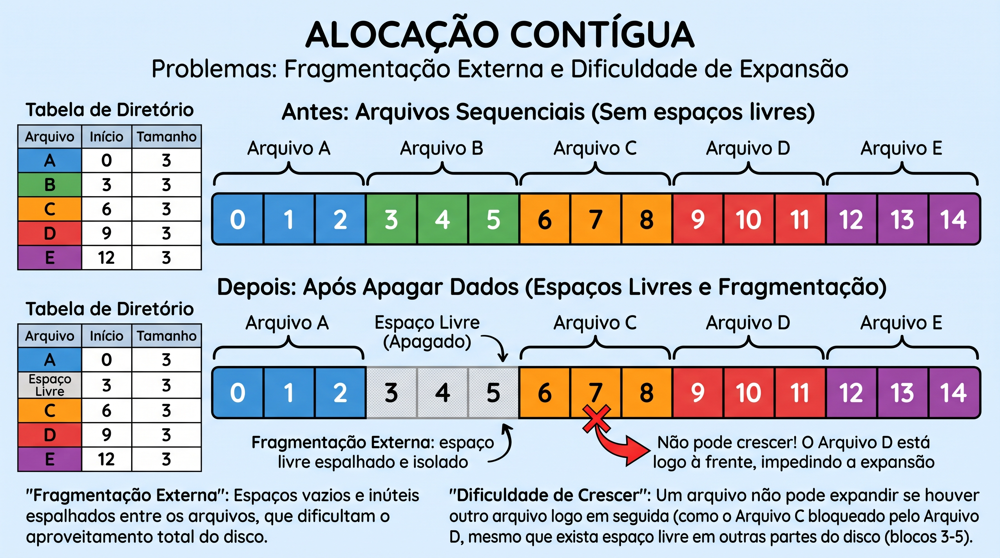

# Tópico 2: Arquivos

> **Material de Apoio — Algoritmos e Estruturas de Dados II (AEDS 2)**

No Tópico 1, entendemos por que precisamos da Memória Secundária e conhecemos a hierarquia básica dos dados (Campo, Registro e Bloco). Agora, vamos abrir a "caixa-preta" do **Arquivo** para entender como ele funciona por dentro, como o Sistema Operacional o gerencia e quais operações podemos realizar sobre ele.

---

## 1. Conceituação: Visão Lógica vs. Visão Física

Quando você programa em C, Java ou Python e abre um arquivo, a forma como você interage com ele é bem diferente da forma como ele está realmente gravado lá dentro do HD ou SSD. Por isso, dividimos o conceito de arquivo em duas visões:

### 1.1. Visão Lógica (A visão do Programador)
Para o seu programa, um arquivo é uma **sequência contínua e linear de bytes** (ou uma coleção sequencial de registros), com um início bem definido (byte $0$) e um fim (*EOF — End of File*). Você não precisa saber em qual trilha ou setor magnético do disco o dado está; você apenas pede: *"leia os próximos $100\text{ bytes}$"*.

### 1.2. Visão Física (A visão do Hardware/Disco)
Fisicamente, o arquivo quase nunca é uma linha contínua. Ele é fatiado em **Blocos** (de $4\text{ KB}$, por exemplo) que podem estar espalhados por várias partes diferentes do disco rígido ou dos chips de memória flash do SSD.

### 1.3. O Papel do Sistema Operacional e do Sistema de Arquivos
Quem faz a "mágica" de traduzir a Visão Lógica para a Visão Física é o **Sistema Operacional (SO)**, através do **Sistema de Arquivos (*File System*)** — como NTFS, ext4, FAT32 ou APFS.

```
[ Seu Programa ] 
       │  "Quero ler o Registro #5 (bytes 500 a 599)" -> (Visão Lógica)
       ▼
[ Sistema de Arquivos (SO) ] 
       │  "Os bytes 500 a 599 estão no Bloco Físico #8421 do disco" -> (Tradução)
       ▼
[ Disco / SSD ] 
          Transfere o Bloco #8421 inteiro para a Memória RAM -> (Visão Física)
```

---

## 2. Arquivos de Texto vs. Arquivos Binários

Em um computador, absolutamente tudo é armazenado em binário ($0$s e $1$s). Porém, a **forma como interpretamos e codificamos** esses bits divide os arquivos em duas categorias principais:

### 2.1. Diferenças na Representação Interna
* **Arquivos de Texto (`.txt`, `.csv`, `.json`, `.c`):** Todos os dados são convertidos e salvos como códigos de caracteres legíveis por humanos (usando tabelas como ASCII ou UTF-8). 
* **Arquivos Binários (`.bin`, `.dat`, `.db`, `.jpg`):** Os dados são gravados no disco exatamente como estão representados na Memória RAM, byte a byte, sem conversão para texto.

#### Exemplo Prático: Salvando o número inteiro `123456789`
Imagine uma variável `int x = 123456789;` na linguagem C (onde um `int` ocupa $4\text{ bytes}$ na RAM):

* **No Arquivo de Texto:** O número é transformado em uma sequência de $9$ caracteres (`'1'`, `'2'`, `'3'`, `'4'`, `'5'`, `'6'`, `'7'`, `'8'`, `'9'`). Como cada caractere ASCII ocupa $1\text{ byte}$, esse número gastará **$9\text{ bytes}$** no disco.
* **No Arquivo Binário:** O programa copia diretamente os bytes da variável `x` da RAM para o disco. Ele ocupará exatamente **$4\text{ bytes}$**, independentemente de o número ser `1` ou `123456789`.

| Característica | Arquivo de Texto | Arquivo Binário |
| :--- | :--- | :--- |
| **Leitura Humana** | Fácil (abre no Bloco de Notas) | Ilegível em editores comuns (aparecem símbolos estranhos) |
| **Espaço Ocupado** | Maior (e varia conforme o número de dígitos) | Menor e padronizado (fiel aos tipos da RAM) |
| **Velocidade (I/O)** | Mais lento (exige conversão texto $\leftrightarrow$ número) | **Muito rápido** (cópia direta de bytes entre RAM e Disco) |
| **Acesso Direto** | Difícil (tamanhos irregulares) | **Excelente** (fácil calcular a posição exata dos registros) |

### 2.2. Por que arquivos binários são o padrão em AEDS 2?
Em AEDS 2, buscamos máxima performance e controle sobre o disco. Usamos arquivos binários porque:
1. **Economia de Espaço:** Menos bytes por registro significa que **mais registros cabem em um único Bloco de disco** (maior Fator de Bloco).
2. **Zero Custo de Conversão:** Funções de texto (como `fprintf` e `fscanf`) gastam tempo de CPU convertendo números em strings e vice-versa. Funções binárias (`fwrite` e `fread`) copiam blocos de memória diretamente.
3. **Tamanho Previsível:** Uma `struct` de $64\text{ bytes}$ na RAM terá exatamente $64\text{ bytes}$ no arquivo binário, permitindo pular instantaneamente para qualquer registro.

---

## 3. Alocação de Arquivos no Disco (Visão Geral)

Quando um arquivo cresce e precisa de vários blocos no disco, como o Sistema de Arquivos organiza esses blocos? Existem três estratégias clássicas (que inclusive inspiram as estruturas que criamos em AEDS 2):

### 3.1. Alocação Contígua
Os blocos do arquivo são salvos um ao lado do outro, em sequência física no disco.
* **Vantagem:** Acesso extremamente rápido (tanto sequencial quanto direto), pois a cabeça de leitura do disco quase não precisa se mover (baixo tempo de *seek*).
* **Desvantagem:** Gera **Fragmentação Externa** (sobras de espaço espalhadas pelo disco que são pequenas demais para novos arquivos) e dificulta o crescimento do arquivo se houver outro arquivo logo à frente.



### 3.2. Alocação Encadeada
Funciona como uma **Lista Encadeada**: os blocos podem ficar espalhados em qualquer lugar do disco. O final de cada bloco guarda um "ponteiro" (endereço) para o próximo bloco do arquivo.
* **Vantagem:** Elimina a fragmentação externa e o arquivo pode crescer livremente.
* **Desvantagem:** **Péssimo para acesso direto!** Para chegar ao $50^\circ$ bloco, o disco precisa ler os $49$ blocos anteriores seguindo os ponteiros, gerando alto tempo de *seek*.

### 3.3. Alocação Indexada
Cria-se um **Bloco de Índice** especial que funciona como um sumário (um vetor de ponteiros), guardando os endereços de todos os blocos de dados daquele arquivo.
* **Vantagem:** Permite acesso direto rápido sem sofrer com fragmentação externa. É a base de como os Sistemas de Arquivos modernos e as **Árvores B** funcionam!

---

## 4. Cabeçalho de Arquivo (*File Header*)

Um arquivo de dados profissional não começa jogando os registros de alunos ou clientes logo no byte $0$. Os primeiros bytes do arquivo são reservados para uma estrutura especial chamada **Cabeçalho (*File Header*)**.

O Cabeçalho guarda **metadados** (dados sobre os próprios dados) essenciais para gerenciar o arquivo sem precisar lê-lo inteiro:

```
+-----------------------------------------------------------------------+
| CABEÇALHO (Ex: primeiros 16 bytes)                                    |
| [Assinatura: "AED2"] [Versão: 1] [Total Registros: 500] [TopoLixo: -1]|
+-----------------------------------------------------------------------+
| DADOS (Começam a partir do byte 16)                                   |
| [ Registro 0 ] [ Registro 1 ] [ Registro 2 ] ...                      |
+-----------------------------------------------------------------------+
```

**O que geralmente colocamos no Cabeçalho?**
* **Quantidade de registros ativos:** Para saber o tamanho lógico sem varrer o arquivo todo.
* **Ponteiro para registros removidos:** O endereço do primeiro espaço vazio disponível para reaproveitamento (veremos isso em detalhes nos próximos tópicos).
* **Assinatura (*Magic Number*) e Versão:** Bytes iniciais que identificam o formato do arquivo (é assim que o sistema sabe se um arquivo é realmente um `.pdf` ou `.png`, mesmo que alguém mude o nome dele).
* **Status de Consistência:** Uma *flag* que indica se o arquivo foi fechado corretamente na última vez ou se o programa travou no meio de uma escrita.

---

## 5. Operações Feitas em Arquivos

Para construir estruturas de dados em memória secundária, combinamos três famílias de operações sobre os arquivos:

### 5.1. Operações de Controle e Gerenciamento
Preparam a comunicação entre o seu programa (na RAM) e o Sistema Operacional (no Disco):
* **Criação (`create`):** Solicita ao SO um novo espaço no diretório e inicializa o arquivo (geralmente gravando o Cabeçalho inicial).
* **Abertura (`open`):** Abre um canal de comunicação (*stream*) com o arquivo e aloca um **Buffer** na memória RAM.
* **Fechamento (`close` / `flush`):** **Operação crítica!** Quando você escreve em um arquivo, os dados ficam temporariamente em um *buffer* na RAM para economizar viagens ao disco. O comando `close` força a descarga (*flush*) de tudo o que está pendente na RAM para o disco físico e libera o arquivo.
* **Exclusão Física (`delete` / `unlink`):** Apaga o arquivo inteiro do Sistema de Arquivos.

### 5.2. Operações de Manipulação de Conteúdo (CRUD)
São as operações que lidam diretamente com os **Registros** dentro do arquivo:
* **Leitura (`read`):** Copia bytes do arquivo (disco) para variáveis ou `structs` na memória RAM.
* **Escrita / Inserção (`write` / `append`):** Grava um novo registro no arquivo (seja no final do arquivo ou reaproveitando o espaço de um registro antigo removido).
* **Atualização (`update`):** Modifica os campos de um registro já existente. Se o registro mantiver o mesmo tamanho em bytes, podemos sobrescrevê-lo no próprio lugar (*in-place*).
* **Remoção (`remove`):** Remove um registro específico do arquivo (geralmente feita de forma lógica, marcando o espaço como livre para evitar reescrever todo o arquivo).

### 5.3. Operações de Navegação e Manutenção
Garantem que o acesso aos dados continue rápido e organizado ao longo do tempo:
* **Posicionamento (`seek`):** Move o "cursor" de leitura/escrita diretamente para um byte específico do arquivo (a base do Acesso Randômico, tema do nosso **Tópico 3**!).
* **Reorganização / Compactação:** Como remoções e atualizações deixam "buracos" (fragmentação) no arquivo, de tempos em tempos é necessário criar uma cópia limpa do arquivo, contendo apenas os registros ativos.
* **Ordenação Externa (*Sort*):** Algoritmos especiais (como o *MergeSort Externo*) capazes de ordenar arquivos de $100\text{ GB}$ usando apenas poucos Megabytes de memória RAM.

---

Exercícios de Fixação - Arquivos

Chegou a hora de testar seus conhecimentos sobre Arquivos! Responda às questões abaixo para avaliar o seu entendimento.


Questão 1: Texto vs. Binário na Prática
```quiz
{
  "question": "Se armazenarmos 1.000.000 de números inteiros de 9 dígitos (tipo int de 4 bytes na RAM) em um Arquivo Binário em vez de um Arquivo de Texto (com quebra de linha), qual será o impacto principal?",
  "options": [
    { "text": "O arquivo binário ocupará exatamente 4 MB (contra ~10 MB em texto) e será lido mais rápido por não exigir conversão de caracteres ASCII.", "correct": true },
    { "text": "O arquivo de texto ocupará menos espaço, pois caracteres ASCII são comprimidos automaticamente pelo Sistema Operacional.", "correct": false },
    { "text": "Ambos terão o mesmo tamanho em disco, mas o arquivo binário poderá ser editado facilmente no Bloco de Notas.", "correct": false }
  ],
  "correctFeedback": "✅ Correto! Em binário, cada int ocupa fixos 4 bytes (4 MB no total) e os bytes vão direto para a RAM sem conversão. Em texto, 9 dígitos + '\\n' consomem 10 bytes por número (~10 MB).",
  "incorrectFeedback": "❌ Quase lá! Lembre-se de quantos bytes um número de 9 dígitos gasta quando escrito caractere por caractere em texto versus o tamanho fixo de um 'int' na memória RAM."
}
```

Questão 2: Alocação de Arquivos no Disco
```quiz
{
  "question": "Qual método de alocação de blocos no disco elimina a fragmentação externa e permite acesso direto rápido usando um bloco especial que reúne os ponteiros do arquivo?",
  "options": [
    { "text": "Alocação Indexada.", "correct": true },
    { "text": "Alocação Contígua.", "correct": false },
    { "text": "Alocação Encadeada.", "correct": false }
  ],
  "correctFeedback": "✅ Correto! A Alocação Indexada permite que os blocos fiquem espalhados pelo disco (sem fragmentação externa), mas mantém um bloco de índice que funciona como um sumário para acesso direto rápido.",
  "incorrectFeedback": "❌ Cuidado! A Alocação Contígua sofre com fragmentação externa ao crescer, e a Encadeada exige percorrer bloco por bloco sequencialmente. Qual delas usa uma tabela de ponteiros?"
}
```

Questão 3: Cabeçalho e Fechamento de Arquivo
```quiz
{
  "question": "O que acontece se um programa escrever novos registros em um arquivo e travar antes de executar a operação 'close()' (fechamento)?",
  "options": [
    { "text": "Os dados recentes que ainda estavam retidos no buffer da memória RAM podem ser perdidos e não chegar ao disco.", "correct": true },
    { "text": "O arquivo inteiro é apagado automaticamente do disco rígido por segurança do Sistema de Arquivos.", "correct": false },
    { "text": "Nada se perde, pois toda operação de escrita ('write') grava cada byte instantaneamente no disco sem passar pela RAM.", "correct": false }
  ],
  "correctFeedback": "✅ Correto! Para economizar operações lentas de I/O, o sistema acumula escritas em um buffer na RAM. O comando 'close()' força a descarga (flush) desse buffer para o disco físico.",
  "incorrectFeedback": "❌ Atenção ao funcionamento do buffer! Gravar byte por byte direto no disco seria muito lento. Onde os dados ficam esperando antes de o arquivo ser fechado?"
}
```


## 💡 Resumo para Fixação

1. **Visão Lógica $\neq$ Visão Física:** Você programa pensando em uma fita contínua de bytes, mas o Sistema Operacional guarda tudo em blocos espalhados pelo disco.
2. **Arquivos Binários são o padrão em AEDS 2:** Eles não gastam tempo convertendo texto, economizam espaço e mantêm os tamanhos das estruturas idênticos aos da memória RAM.
3. **Nunca esqueça o Cabeçalho e o `close()`:** O cabeçalho organiza a inteligência do seu arquivo, e o fechamento garante que os dados saiam do *buffer* da RAM e sejam salvos de verdade no disco.